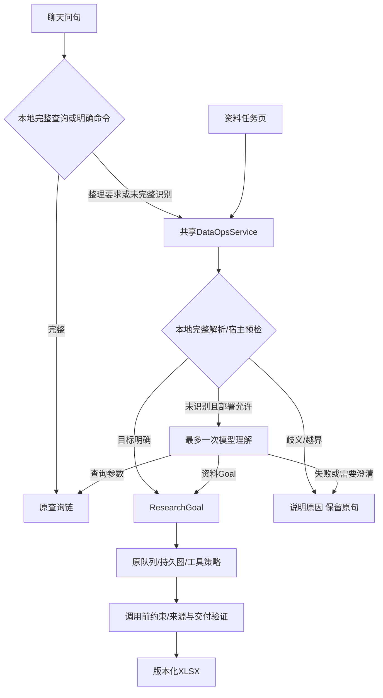

# 统一理解入口与业务Harness验收（2026-10-31）

本轮实现聊天/工作台的本地优先、一次模型兜底，并收紧目标与工具参数。保留已有Python、LangChain、LangGraph与SQLite路线；没有整体替换Deep Agents或宣称接入了其全部Harness。

## 实际调用链



一次理解由模型选择`propose_research_goal`或`submit_query_intent`；查询携带内部已验证路由回到原图，不再调用一次意图模型。明确表格/字段要求不能偷换成只查一个属性；可识别的字段遗漏、否定列和父对象变更仍被拒绝。工作台只开放Goal工具，聊天可以分流查询。它是有界输入，不保证任意请求都可执行或未知语义均可被程序证明覆盖。

`--research-goal-model`部署开关控制自动兜底；7912启用，7896/7914关闭。任务页默认允许且可取消；API省略/null沿用部署，false强制本地，true允许兜底。完整规则匹配和明确宿主边界不花模型请求。这里的一次预算只指理解，RAG生成/native执行仍独立。

## Harness具体约束

- 新ready目标必须有对象或筛选范围；命名目标的Schema限定目录候选、非空名称和new操作。父版限定append_fields、空names/filters/target_count，原对象由宿主绑定。
- 根据状态限制工具和参数。select_complete只允许合格ID，数量为目标与当前合格数的较小者；0合格允许空数组且须明确partial。audit_named与父版保留原行，不能因新增字段缺失而删行。
- 模型前给出动态Schema，工具前再次检查同一业务约束；图内交付再检查合格集合。既检查JSON类型，也检查当前状态允许的动作。
- 不把提案错误都归因于用户。失败说明模型提案未通过校验，并保留原句；拒绝提案的已知usage也保留。相同编号复用回执，未知派发不自动重发；新API客户端在错误响应上仍保存Cookie，防止换owner绕过原回执。
- 聊天顶层`model_calls`和嵌套的`assistant.understanding_requests_this_submission`只计本次新增理解请求，重放为0；原任务累计值由llm_calls与counts_scope标明，拒绝提案重放同样不再计新请求。
- 交付以宿主构建和逐格回读为准，partial检查点本身不算完成。未引入自动纠正重试、任意文件系统/SQL执行或隐藏推理日志。

复用的是LangChain原生`bind_tools`、Pydantic与LangGraph持久图；动态约束是本项目的业务策略，未冒称现成SDK能自动理解药材身份、饮片范围或筛选语义。

## 验证

28模块166项受影响离线检查通过、0联网尝试，覆盖两类入口、字段/文件遗漏、显式关闭模型、幂等、未知派发、Cookie、空表/部分合格/命名核对/父版保留和旧查询链。检查不是完整全仓回归；[结果](offline.json)。首轮三项API检查因“true从强制调用改为允许兜底”而失败，已将模型调用用例改为未识别问法，并另加规范问句零调用断言，原日志保留。

真实模型只做三项**合成资料烟测**，不是旧真实资料题重测或独立用户准确率：

| 项目 | 结果 | 实际请求 |
|---|---|---:|
| U01：普通问句一次分流 | 模型选择能力说明，返回原查询链；重复提交新增0调用 | 1 |
| U02：自然表达整理 | 模型生成两对象/功效与贮藏Goal，fixed交付2行；逐格回读与重放通过 | 1 |
| U03：零合格候选 | 原生模型list→inspect→deliver，提交空数组，生成0行partial表，57单元格回读通过 | 3 |

**共5次HTTP200、20,526 token、0重试**，冻结上限7未继续使用。U01/U02共15,071 token，说明通用理解携带较大静态工具定义；未证明成本下降。U03为合成案例，不能用它覆盖旧N03真实资料失败或宣称修复后真实题已通过。[实测回执摘要](model-smoke.json)、[协议](protocol.json)。没有发送真实药典、ETCM、PDF、会话历史或密钥正文；本轮关闭Langfuse导出，不声称轨迹评分回读。

实测脚本复用既有Recorder与业务执行器，先冻结再执行一次：

```bash
.venv/bin/python -m scripts.check_unified_harness_live --out var/unified_future_smoke
# 执行会消费目录与最多7次请求；已完成的live_synthetic_v1不可重跑
.venv/bin/python -m scripts.check_unified_harness_live --execute --out var/unified_future_smoke
```

本地完整回执在`var/unified_harness_v1/live_synthetic_v1`。保留实测时镜像`unified-harness-v1-live`及中间展示版`unified-harness-v1-ui`；最终版本增加聊天页说明与本次/累计请求计数，模型派发、Goal/工具约束及交付策略文件保持一致，计数分支另经模拟SDK回归。各构建清单与差异检查分别保存，不混称同一hash，也不将最终计数改动宣称为新增真实模型重测。

## 部署与边界

7896/7912按原状态目录与参数更新；7914升级为本地`tcm-research-chat:unified-harness-v1`，保留原状态及Cookie，没有推送远程。首次更新核验82份既有产物；页面排练后最终计数版更新核验87份，全部hash不变。回滚容器`tcm-research-r4-before-unified-harness-v1`及计数版前的`tcm-research-r4-before-unified-counts-v1`已停止保留；回滚时先停止新实例，不并行写同一目录。已发布文件可读，旧在途检查点仍受代码/驱动版本绑定限制。三个端口源码均与磁盘一致，最终页面无脚本异常或公网请求，本地能力问句与重复提交均新增0模型调用。见[部署摘要](runtime-summary.json)和[实测/最终源码差异](source-comparison.json)。

源码、构建、部署与页面记录在`var/unified_harness_v1/`。页面继续验证本地资料命名核对、增量、筛选、缺项与下载；浏览器排练显式关闭模型，没有新增真实资料外发。

下一项优先做独立问句验收与静态Schema按需缩小，记录真实请求与交付收益。多轮仍为实验，原R4 0/2、新组合2/2、新问句首测G7/8/A端到端0/2均原样保留；本轮安全约束和合成通过不等于整体模型收益、全库实体对应或语义完整性已经证明。
