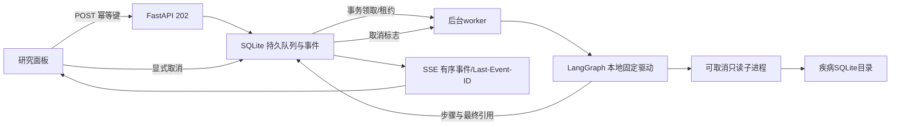

# 后台研究执行闭环：本轮交付

日期：2026-10-24。完成范围：后台本地疾病研究提交、持久队列、幂等请求、worker领取/租约、显式取消、SSE进度与重连、历史回看/删除、崩溃与排队恢复、页面接入。整个流程不调用外部模型。

## 使用

当前已更新的预览：http://127.0.0.1:7879/ 。展开“本地研究 · 疾病靶点”，输入 `Dermatosis Papulosa Nigra`，点击查询。后台读取283个靶点标识，页面展示首20条原始行与出处。刷新/关闭页面不会取消；重新打开面板会从历史发现未完成任务并重新订阅。点击取消才停止任务，结果可从历史回看或删除。

```bash
/tmp/tcm-ci-mail-env/bin/python -m scripts.preview_local_tasks \
  --port 7879 --state var/research_run_chat_v1/state \
  --diseases var/disease_catalog_v1/build/diseases.sqlite3
```

已有服务占用端口时直接访问，不重复启动。其他环境使用已安装 `requirements-research-chat.txt` 的Python；上述解释器路径仅对应当前机器。

## 实际调用链



模型循环基础设施已存在并经过两题合成真实模型验证，但本轮页面后台worker仍用本地固定驱动。这张图不将其称为已部署自主模型研究。

## API与存储契约

- `POST /api/research/jobs`：`disease`与8–100字符`request_key`；立即202返回run_id。相同所有者/键/问题返回同一任务，键复用到不同问题返回409。幂等有效期为记录保留期间；删除记录同时移除幂等记录。
- `GET /api/research/jobs`：当前会话最近20条摘要。
- `GET /api/research/jobs/{id}`：完整持久快照、当前状态及结果。
- `GET /api/research/jobs/{id}/events`：SSE，序号对应持久revision；支持`Last-Event-ID`或`after`，只返回之后事件，终态发送done；最新游标重连仍发送done。
- `POST /api/research/jobs/{id}/cancel`：排队任务直接取消，运行任务写入数据库取消标志，由执行器清理子进程。已终止任务返回现状；已提交取消优先于稍后的完成提交。
- `DELETE /api/research/jobs/{id}`：只删除终态任务及其事件；运行/排队返回409。

旧 `/api/research/runs` 日志与同步入口保持兼容，页面合并展示新任务/旧日志；新建任务统一走新队列。旧同步API仍保留原请求绑定生命周期，不适用于“断连继续”语义。

新库默认与会话库同目录 `research_jobs.sqlite3`，可用服务端 `RESEARCH_JOB_DB` 指定。使用独立schema，无需迁移旧会话/运行库；拒绝混用无关数据库和符号链接。文件0600，队列保留问题、资料快照与事件，属于需保护的本地资料。Cookie仅用于签名验证，库中使用其SHA256作为所有者键；跨所有者读、订阅、取消、删除均不可访问。写操作同源检查，读取/事件no-store。

## 并发、崩溃及取消语义

领取采用 `BEGIN IMMEDIATE`；同一共享SQLite任务只被一个worker领取。新队列每会话最多1条活动任务，全库最多20条活动任务、最多4条running；这些限制不包含兼容保留的旧同步入口。适用于同机共享本地SQLite文件，不是多主机分布式队列。

worker每次写入检查身份、revision和30秒租约；心跳续租并检查取消。运行最长125秒（内部执行器另有更小预算）。失去租约/存储时停止执行，不允许无日志继续。进程被强杀后，下一worker在租约过期时把原running标记interrupted，并拒绝旧worker补写；排队任务继续领取。优雅退出停止worker并保留中断状态。

SSE仅订阅持久事件，连接关闭不会取消worker。断线重连按序号回放，浏览器重复事件去重。事件只包含状态、阶段、次数和最近工具动作，完整资料通过所有者校验的结果API读取；不输出隐藏推理。

不自动重跑不确定的running任务。用户可重新提交新任务；这属于重新执行，不是中间节点续跑。queued任务在开始执行时读取当时服务配置的数据目录，运行中仍做原有快照变化校验。没有PostgreSQL、LangGraph持久checkpointer、exactly-once保证、跨设备账号或多主机租约；历史超过20条分页/自动清理也未实现。

## 验收

- 当前工作树完整离线回归：108模块946项，全部通过，跳过0、网络尝试0。
- 单元/ASGI：幂等与冲突、双进程唯一领取、租约失效隔离、取消竞争、队列重开、作用域隔离、SSE序号重放、旧入口兼容。
- 独立HTTP服务：真实关闭SSE连接后任务完成；显式取消；实际强杀服务进程，等待31秒租约到期，重启后旧任务interrupted，离线期间排队任务完成。使用固定合成runner，外部调用0。
- 浏览器：真实本地目录202提交后关页，再开页面可恢复283个靶点/20条原始行；2次SSE连接；其他会话事件404；删除成功；页面错误0。

报告：`audits/research_jobs_milestone/summary.json`、`full_regression.json`、`source_manifest.json`。

复现故障验收（临时目录及随机本机端口，不操作生产服务）：

```bash
/tmp/tcm-ci-mail-env/bin/python -m scripts.check_research_jobs_http \
  --out var/research_jobs_milestone/http_acceptance.json
/tmp/tcm-ci-mail-env/bin/python -m scripts.run_offline_ci \
  --out var/research_jobs_milestone/full_regression
```

## 部署与回滚

7879预览已加载新代码并复用原状态目录。未构建/发布Docker镜像，未Git提交/push。现有research镜像构建规则会复制新tcm模块，但需重新构建、启用研究任务并挂载疾病库才可使用；本次未验证新镜像。

回滚旧代码前先正常停止服务，独立任务库留存备份；旧代码不会读取该库，原会话/同步日志未迁移。回滚后新后台记录不会显示，但文件仍在。不要在任务运行中删除队列文件。旧UI恢复后也恢复旧请求断连即取消语义。
