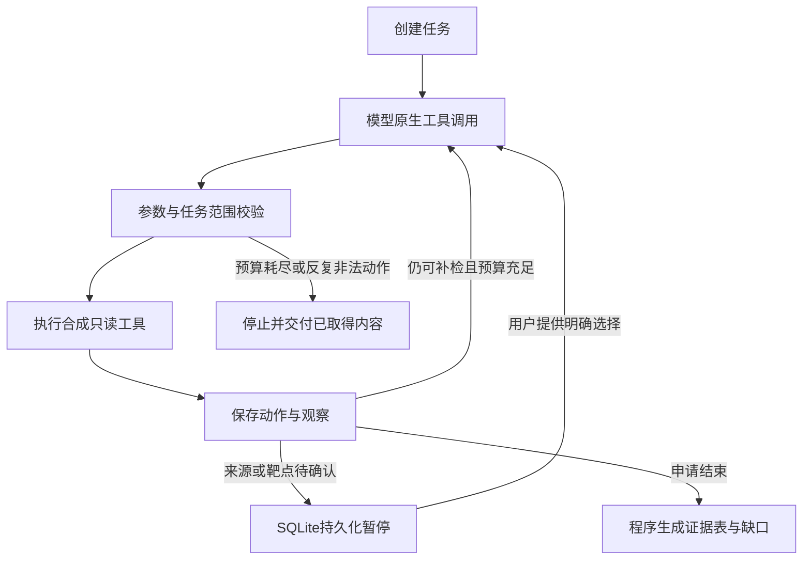

# 有限工具循环：合成关系证据核查任务

后续更新（2026-10-21）：已新增[独立任务页面](RESEARCH_TASK_WEB.md)并部署到本地7876。页面采用合成资料规则驱动；下文保留CLI原生模型验证的范围及历史结果。

2026-10-21。AP-01新增任务原型，回应“单轮查询业务过浅”的问题。本轮实现一个可恢复的多步骤任务，接通真实模型的原生tool calling，不增加新的Agent角色或依赖。

**当前交付为独立CLI，只有合成工具。** 7876页面/镜像仍运行上一版关系查询修复，未自动启用此任务。没有发送真实药典、ETCM、真实文献或既有用户会话，没有把本轮烟测当成真实科研任务验收。

## 任务与完成条件

固定任务：比较虚构“示例甲草”和“示例乙草”的来源共同靶点，由用户确认来源、选择一至两个靶点，检索各靶点的虚构研究记录，核对对象/撤稿及来源，输出证据表与缺口。

模型可以决定检索与核查的下一步，服务器控制权限和状态：



仅当来源确认、共同关系取得、靶点由用户确认、返回记录全部核查，并且每个选定靶点至少有一条可用药材本体占位记录时，报告标为complete。成分、撤稿或其他对象不能补齐药材本体证据；否则保留partial/缺口。complete只指这一合成任务契约满足，不代表实际疗效成立。

## 原生工具与执行约束

| 工具 | 能做什么 | 控制点 |
|---|---|---|
| resolve_sources | 读取两味虚构药材的候选来源 | 药名必须与任务相同；用户选择，模型不能代选 |
| common_targets | 查询用户确认来源的共同靶点 | 来源ID必须与用户选择一致；暂停等待用户选靶点 |
| search_literature | 查指定虚构靶点的initial/expanded资料 | 仅允许用户选定靶点；参数有限，不接受任意URL/SQL |
| inspect_study | 查看本任务检索返回的占位记录 | 不能臆造记录ID；区分药材、成分、对象不符、撤稿 |
| finish_task | 请求服务器生成最终证据表 | 完整度由服务器依据已取得来源判断，不信任模型自称完成 |

使用安装版本的`ChatOpenAI.bind_tools`、`AIMessage.tool_calls`与`ToolMessage`，没有将JSON计划伪装成原生工具调用。默认请求单个动作；对一次返回两个独立study核查调用的情况，校验记录都已返回且不重复，再顺序执行，按同一模型回合恢复匹配的两条ToolMessage。前置步骤变化类工具不能批量调用。

调用次数、非法/重复参数和超范围ID由程序控制。默认最多12个模型尝试额度、12个工具尝试、120秒累计活跃耗时；人工等待不计入活跃耗时。真实模型每次15秒超时、重试0、最多600输出token。消息正文上限24000字符，工具参数每动作另限2000字符，不声称这是精确总token预算或可抢占任意Python工具的硬超时。当前合成工具不联网。

## 持久化与恢复

独立SQLite任务库，不改聊天会话Schema。保存任务、revision、待选项、用户确认ID、成功动作/观察、预算和报告。事务＋乐观revision拒绝旧版本选择/覆盖；误指向其他业务库拒绝初始化。任务文件600，私有输出目录700。

在模型调用和工具执行前先持久化已占用额度。进程中断时不自动重复外部调用；需明确恢复，旧额度保留。只读未完成步骤可能重新规划，不保证每个中间节点精确续跑或恰好执行一次。API失败与协议失败也可显式恢复同一任务，记录旧错误，不重置已消耗预算。

保存的是结构化工具动作与观察，不存模型自由文本/完整CoT。任务没有账户权限、自动TTL或多用户服务入口；本机可显式删除任务，当前不作生产服务承诺。

## 本地使用

先使用项目已有Python环境和依赖。下列默认模式完全不调用模型API，scripted是确定性测试驱动，不代表LLM推理效果：

```bash
python -m scripts.run_research_task demo \
  --database var/research_tasks_demo/tasks.sqlite3
```

手动体验两次暂停：

```bash
python -m scripts.run_research_task create \
  --database var/research_tasks_demo/tasks.sqlite3

# 用上一步输出的id/revision替换TASK_ID和REVISION
python -m scripts.run_research_task resume --task TASK_ID --revision REVISION \
  --database var/research_tasks_demo/tasks.sqlite3 \
  --selection '{"示例甲草":"SYN-A1","示例乙草":"SYN-B1"}'

# 再使用新revision选择返回的靶点
python -m scripts.run_research_task resume --task TASK_ID --revision REVISION \
  --database var/research_tasks_demo/tasks.sqlite3 --selection '["SYN-T1"]'

python -m scripts.run_research_task export --task TASK_ID \
  --database var/research_tasks_demo/tasks.sqlite3 --out var/research_tasks_demo/report.md
```

`show`可回看任务，`delete --task TASK_ID --revision REVISION`删除。恢复中断用`--retry-interrupted`；模型/协议失败后恢复用`--retry-failed-model`，均需当前revision，不改变原预算。

原生模型需要显式选择；下述命令会实际发送纯合成资料到当前配置的HTTPS api.deepseek.com，关闭外部链路追踪，输出文件存在时在创建模型前拒绝：

```bash
python -m scripts.run_research_task demo --policy native --live-synthetic \
  --database var/research_tasks_native/tasks.sqlite3 \
  --out var/research_tasks_native/result_01.json
```

`demo`中的来源/靶点选择是预先设定的模拟用户动作，不可描述成真实用户测试或模型自主完成消歧。手动native恢复需要继续指定`--policy native --live-synthetic`。所有输入工具只有虚构资料，无真实来源适配入口，不读取整个PDF或原ETCM。

## 已完成的验证

- 新增18项离线测试：原生消息协议、两次暂停和数据库重开、实体/记录越权、额外参数、重复动作、提前结束、预算、模型中断恢复、revision冲突、错库拒绝、合成数据绑定、输出文件防覆盖、批量核查消息及显式失败恢复等。
- **最终77模块673项完整离线回归通过**，跳过0、网络尝试0；原评测输入指纹检查通过。
- 七组合成CLI故障情形完成：空结果补检可完成；只有成分、撤稿、对象不符、工具不可用及无共同关系保留partial。固定与自适应的比较由脚本驱动，只是控制流演示，不是LLM/RAG收益实验。
- 三个独立CLI进程完成创建→来源选择恢复→两个靶点选择恢复；最终11个控制步骤，报告可导出，证明待选状态不依赖进程内变量。
- 一次真实模型合成任务已通过原生工具接口跑通，累计保留7个模型尝试额度，成功执行7个工具动作。首次在第5额度发生模型/协议ValueError，原结果保留；补充独立双记录核查兼容后，同任务显式恢复，用额外2额度完成，总预算未重置。原始失败回复未留存，因此不能将当时根因完全断言为某一种具体返回格式。
- 真实模型流程实际完成：来源查询→共同靶点→initial空结果→expanded补检→分别核查两条记录→结束；报告区分herb_source_record与ingredient_only。来源/靶点选择由测试脚本模拟，没有把成分记录作为药材本体证据。

6条成功工具决策有provider token用量；失败回复用量未保留，未冻结provider返回的模型标识，单次费用为null，不编造完整成本或稳定延迟。配置模型名为运行后读取，局限在审计中明确记录。

[脱敏验收摘要](../audits/research_task_v1/summary.json)。私有源码快照、首次失败、恢复结果、任务库及报告在`var/research_task_v1/`，未进入Git。CLI阶段完成时未提交Git、未更新Docker、未远程上传；后续页面本地Docker交付见上方链接。

## 下一步

独立任务入口已补齐待选项、工具动作、预算及证据表，当前仅合成资料规则驱动。下一步定义实际只读ETCM/PubMed适配与对象核验契约，在本地验证资料一致性。真实资料进入外部模型仍需遵守授权范围，不能因合成烟测成功自动放开。

业务验收还需同任务比较确定性工具、一次规划与有限循环，检查未见问题上的完成数、对象错误、引用支持及调用代价。本轮只有合成流程与原生协议证据，尚未证明真实科研收益或自主文献理解。
