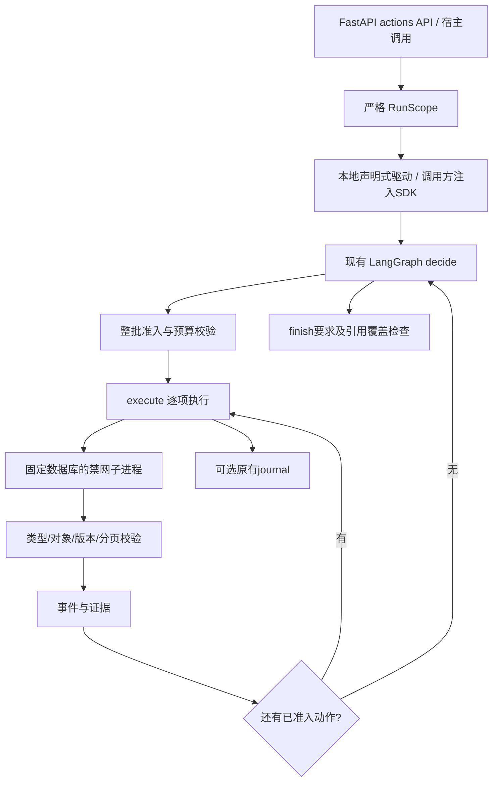

# A方案：正式工具循环的业务接入

> 阶段记录。2026-10-29核对：下文后续项1已由[多步骤聊天接入](CANDIDATE_A_CHAT_INTEGRATION.md)完成受限范围的实现；后续项2现已由[正式外置接入](RESEARCH_EVIDENCE_OFFLOAD.md)完成；其余任务按[统一大纲](TCM_PROJECT_ROADMAP.md)排序。下文测试数与“本轮未修改大纲”等表述保留2026-10-28阶段含义。

2026-10-28。实施选择为现有LangGraph 1.x＋单Agent受控工具循环；B/C保留实验，不新增第二套生产循环。本轮将批次、依赖和完成校验放入现有`tcm/research_run.py`，不是将候选实验脚本改名上线。

## 已交付的范围

- 同一个循环支持现有五个结构化工具：药材靶点画像、药材靶点相似度、疾病来源查找、疾病靶点资料、疾病关联药材排序。
- 宿主声明`RunScope`；固定对象使用来源ID，派生疾病动作使用`source_from`引用查找要求。只对唯一、完整、名称完全一致的exact命中放行后续分析；零结果、前缀命中、多来源不静默选择。
- 一次回复最多四个独立动作。整批校验工具名、参数、ID、对象、重复和剩余工具预算，通过后串行执行。搜索及其尚未读取的依赖、同对象连续页、finish混入工作批次都不能通过。
- `parallel_tool_calls=false`继续发送；接收端同时正确处理提供方返回的合法批次，逐个匹配原始`tool_call_id`，不将一批动作记成多次模型请求。
- `all_pages=true`要求从第一页读取至`has_next=false`，并引用完整链条。校验页码、来源、版本、目标集合、原始行分页数量和重复位置；第一页不能冒充全部。候选排序只承诺声明的top_k，不声称列出全体候选或预测疗效。
- 批次逐项写入原有journal。保存后的前项不重复；当前项调用结果不确定时停止，不继续自动发送剩余动作。依赖由已保存的事件和证据重建，不依赖进程内变量。
- 本地传输扩展为`LocalAnalysisTools`，固定宿主配置的数据库、执行前后文件版本，并在不继承密钥的禁网子进程内查询。保留旧`LocalDiseaseTools`兼容名称。
- 增加`POST /api/research/runs/actions`，复用会话鉴权、同源校验、并发限制、取消、历史及来源变更409处理。请求不能指定数据库路径或任意工具。

## 实际调用链



**当前HTTP actions入口固定使用本地声明式驱动，不调用聊天模型。** 它验证共享运行时和业务工具，不能称为自由问句自主规划。`run()`仍支持调用方注入聊天SDK，合成HTTP响应已验证真实SDK的批次往返；本轮没有启用真实资料外发。

既有单药/两药报告继续使用原来的确定性业务子图、后台队列和checkpoint。本轮没有将其接成模型可自主委派的工具，也没有引入Deep Agents、主管Agent或新的生产依赖。

## API示例

需启用现有`ENABLE_RESEARCH_TASKS`、配置`ETCM_DISEASE_DB`，并通过聊天页获取有效会话Cookie。排序和药材工具另需`TCM_DB`与`ETCM_ENRICHMENT_DB`。来源文件必须是当前部署的已构建索引。

下面是请求结构；将`Synthetic disease`替换为本地来源目录中的疾病原名，不猜译名。此例请求全部原始行以及前五个候选，数据缺失仍会如实返回。

```json
{
  "scope": {
    "requirements": [
      {
        "id": "discovery",
        "call": {"tool": "search_disease_sources", "arguments": {"name": "Synthetic disease"}}
      },
      {
        "id": "original-rows",
        "source_from": "discovery",
        "all_pages": true,
        "call": {"tool": "disease_gene_profile", "arguments": {}}
      },
      {
        "id": "candidates",
        "source_from": "discovery",
        "call": {"tool": "rank_herbs_for_gene_set", "arguments": {"top_k": 5}}
      }
    ],
    "unhandled_requirements": []
  }
}
```

`source_from`动作的arguments必须省略name，运行时仅允许使用观察得到的唯一来源ID。药材工具要求显式`etcm2-local:…`来源ID。没有新增面向用户的清单确认步骤；这个契约是后端执行边界。

## 验收与复现

```bash
.venv/bin/python -m unittest tests.test_research_run_business -q
.venv/bin/python -m scripts.check_candidate_a_business --out var/my_candidate_a_check
```

正式循环＋实际工具子进程在合成数据库上完成五种工具、六次底层查询、四个固定驱动步骤；核对24条疾病原始记录和14条排序见证，三份数据库字节未改变。四个驱动步骤不是四次真实模型调用，不据此报告延迟或成本改善。

新增回归覆盖实际SDK MockTransport返回批次、整批拒绝、依赖越权、来源歧义、全页要求、漏引发现证据、版本/集合变化、虚假的最后一页、批次中间保存与未知调用恢复，以及正式API的历史与会话隔离。见[本地业务验收](../audits/candidate_a_business_v1/verified/summary.json)。最终完整离线回归：137模块、1167项测试通过，0跳过、0次联网尝试，见[最终回归](../audits/candidate_a_business_v1/ci_final.json)。初次回归的疾病原名兼容性失败保留在[初次记录](../audits/candidate_a_business_v1/ci_initial.json)，修复后从头重跑，未修改失败汇总伪装通过。

## 保留的边界与后续顺序

1. 将自由问句编译成多项业务要求，再接入现有聊天入口；需要能够识别未支持的要求，避免只完成其中一项却声称全部完成。
2. 将实验中的大结果外置/引用取回整合到同一证据存储；当前单条结果仍受48KB限制，过大返回错误而非截断后宣称完成。
3. 将既有文本/结构化报告子图以受控业务动作复用，并统一结果展示。现阶段五个结构化工具可用，不等于药典检索和两药报告已进入自主循环。
4. actions API当前为请求绑定执行，保存审计历史；新动作的网页恢复/后台队列接入尚未完成。`run_durable`执行层已验证批次与依赖恢复，不能将它等同HTTP生命周期已交付。
5. 补新的独立业务任务验收与必要的受控模型测试。旧A/B/C失败记录保持不变，本轮未新增外部调用，也未获得新的真实资料外发授权。

## 兼容与回滚

旧profile API、无scope的两工具合成演示和既有报告入口保留。新工具必须使用显式scope；默认没有把全部工具开放给旧调用方。错误结果不计完成，未处理要求始终阻止complete。

没有修改来源数据库Schema、没有新增依赖。回滚时移除新actions路由并恢复本轮运行时/范围/本地传输代码即可停用；先排空请求。journal绑定包含代码、Schema、scope与框架版本，新旧绑定不同会拒绝继续；保留旧文件、使用对应旧代码恢复，不修改数据库内容来绕过检查。API审计历史不等于可执行checkpoint，不应手动改写历史状态伪装恢复。

本轮没有构建Docker镜像、切换现有预览进程、提交或push，也没有修改原大纲。
