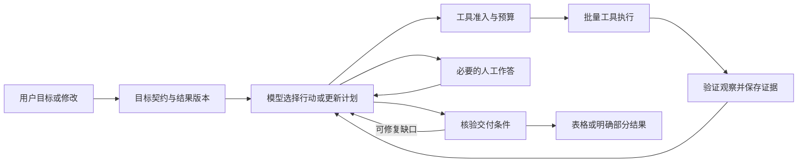

# TCM DataOps Agent：业务、执行架构与验收方案

更新：2026-10-30。D1固定流程、批量工作区与表格交付已实现，见[D1交付](DATAOPS_D1_DELIVERY.md)；D2持久观察循环与增量修订已做本地工程验收，见[D2交付](DATAOPS_D2_DELIVERY.md)；D3本地30题/50条/检索对照已交付，真实模型V2为8次HTTP200、F/P各3/3、A为0/3，动态A诊断与容器验收待完成，见[D3记录](DATAOPS_D3_EVALUATION.md)。有界本地问句入口及字段续改已本地验收，未识别要求不入队；通用Goal理解与LLM兜底仍未实现，见[入口记录](../audits/dataops_question_v1/README.md)。明确的表格任务与续改也已接入聊天首页，复用同一DataOpsService/队列/结果组件，见[聊天接入](../audits/dataops_chat_v1/README.md)。排期与完成状态仅由[统一大纲](TCM_PROJECT_ROADMAP.md)维护；本文定义需求、技术决策和验收契约，不把计划写成已有功能。

## 1. 定位与范围

产品定位：**用户用自然语言提出数据整理与核对任务，Agent结合结构化目录和文档，根据执行观察调整行动，在持久工作区交付带来源的表格，并支持继续修改。**

目标用户是整理资料的内容/数据运营人员；用ETCM和药典提供真实业务难点，不要求用户判断分子机制或疗效。可迁移的是“数据库＋文档＋交付物”的处理方式，不宣称已经支持其他行业或企业级数据治理。

| 主业务 | 用户需求示例 | 交付与意义 |
|---|---|---|
| 查询与统计 | “哪些记录缺少药用部位？按目录已有分类统计。” | 有口径的记录集合与统计；简单请求走直接工具 |
| 批量资料核对（主演示） | “核对这20条药材，补充药典功能主治和注意，标记部位差异、缺失和歧义，生成表格并保留出处。” | 结果表、问题表、来源表；替代逐条查阅和汇总 |
| 连续修订 | “只重查有差异的记录，增加贮藏字段，生成第二版并说明变化。” | 可追溯的新版本与差异表；复用有效结果，避免全量重查 |

首版支持已有目录选择、明确药材名单和前序结果集；不增加任意文件上传、任意数据库连接、在线爬虫或复杂BI。以20条贯通，50条作为批量验收上限。没有匹配或字段缺失也必须保留记录，不能静默丢行。

不纳入近期范围：方剂/处方推荐、靶点预测、通路分析、自动修改原始数据、多Agent主管、自由代码执行、全库实体归一化、自动长期经验学习。现有分析功能可继续使用但不扩建；文献检索退役，数据中的原始参考出处保留。

## 2. 两个参考项目的核验与取舍

本轮只读获取目录与17份源码/文档，没有安装或运行上游代码。固定版本与文件SHA见[源码清单](../audits/dataops_plan_review_v1/upstream_sources.json)。本节是源码审查，不是运行兼容性验收。

### 2.1 从零组装教程

固定仓库版本：`langchain-ai/docs@c08c01a65acbf06aab96efc02ec954aab78791e9`。

[教程正文](https://github.com/langchain-ai/docs/blob/c08c01a65acbf06aab96efc02ec954aab78791e9/src/oss/langchain/deep-agent-from-scratch.mdx)展示从`create_agent`按需组装能力，例子包含CSV、沙箱执行与文件、摘要、Skills和委派。适合学习能力边界；不构成本项目交付模板。该教程的LangSmith沙箱需要对应账号，不能推成所有Agent都需要LangSmith。

| 具体路径（同一docs仓库） | 可借鉴点 | 本项目选择 |
|---|---|---|
| `src/snippets/code-samples/deep-agent-from-scratch-minimal-py.mdx` | 模型与工具的基础循环 | 理解基础；保留本地A路线和DeepSeek接口 |
| `src/snippets/code-samples/deep-agent-from-scratch-sandbox-py.mdx` | 文件/执行环境有明确边界 | 首版采用受限数据与产物工具，不引入云沙箱 |
| `src/snippets/code-samples/deep-agent-from-scratch-summarization-py.mdx` | 摘要与完整资料分离 | 复用现有证据外置；先确定性任务摘要，不新增一次LLM摘要调用 |
| `src/snippets/code-samples/deep-agent-from-scratch-skills-py.mdx` | 按需加载任务指导 | 后置可选；权限和完成条件仍由代码执行 |

### 2.2 LangChain Academy课程

固定版本：[`langchain-ai/lca-deepagents@c39d80a2c81bfc4879cbbd3a552c9b37b4f81937`](https://github.com/langchain-ai/lca-deepagents/tree/c39d80a2c81bfc4879cbbd3a552c9b37b4f81937/python)。它是课程，不是成熟业务系统。`python/pyproject.toml`固定`deepagents==0.7.0`，其他不少依赖是范围约束；不复制整份依赖或追踪配置。

| 已读源码路径 | 实际观察 | 如何使用 |
|---|---|---|
| `python/m1/m1.7_messages_threads_checkpointers.py` | 不同thread示例，使用`MemorySaver` | 借鉴线程隔离；它不提供跨进程持久化 |
| `python/m1/m1.8_hitl.py`、`m1.8_hitl_respond.py` | 中断、用户选择、`Command(resume=...)` | 借鉴消歧交互；新业务使用持久存储与归属校验，不复制模拟邮件任务 |
| `python/m2/m2.2_agent.py` | 区分状态后端和只读参考文件 | 对应原始来源只读、产物可写 |
| `python/m2/m2.4_eval_agent.py` | QuickJS计算斐波那契数 | 文件名的eval是执行表达式，不是任务效果评测，不能作为本项目评测实现 |
| `python/m3/m3.1_summarization.py` | 调小模型上下文声明以触发摘要 | 借鉴可观测实验；不复制700 token演示值或模型窗口假设 |
| `python/m3/m3.2_scratch_agent_skills.py` | 文件后端加载Skills | 借鉴按需规范，后置，不建立技能平台 |
| `python/m5/sales_assistant/agent.py` | 组合MCP、业务工具、Skills及委派 | 借鉴模块分工，不复制整套销售助手 |
| `python/m5/sales_assistant/tools/sql.py` | 只读连接和SQL文本过滤；读取使用`fetchall()`，另有写入工具 | 不照搬任意SQL入口；使用结构化参数编译查询和明确限额 |

源码链接可由上面的固定仓库地址及路径定位；逐文件直链在源码清单。课程的线程、HITL、上下文实例适合学习；生产上的身份、预算、产物事务和评测仍由本项目实现。

### 2.3 选型结论

继续**A：单Agent＋LangGraph受控执行**。新业务使用明确的StateGraph，接通目标、观察、校验与人工输入；不重新进行A/B/C框架竞赛。`create_agent`可减少常规循环代码，但现有预算/来源/恢复机制已有定制，直接替换会扩大迁移面。Deep Agents SDK适合需要内置文件、执行和委派的场景，当前不足以抵消重复存储与迁移成本。此决定可被未来明确需求推翻，不是A质量已经胜出的结论。

Harness在这里是业务执行支撑能力的集合，不另造一个通用框架，不以新类名或组件数量作为成果。

## 3. 可验收需求

| ID | 需求 | 必须满足的行为 |
|---|---|---|
| R01 | 识别目标 | 保存原问、对象/筛选、输出字段、核对项、交付形式；未覆盖要求必须显式列出 |
| R02 | 查询与统计 | 白名单字段与操作符；计数、缺失、分组由程序计算；排序稳定且有ID作为并列顺序 |
| R03 | 跨源补充 | 保留ETCM原值和药典原文；译文、归一值、匹配依据分开存储 |
| R04 | 差异核对 | 区分一致、字面差异、歧义、信息不足；字段一致不自动升级为身份确认 |
| R05 | 动态执行 | 根据观察决定补查、变更检索、分批处理、澄清或停止；记录简短行动目的与计划变更 |
| R06 | 工作区 | 保存目标版本、记录集合、证据引用、字段状态、产物版本；关页后可回看 |
| R07 | 人工消歧 | 只在影响结果且无法自行区分时询问；支持选择、跳过并标未知、取消；不普遍要求核对任务清单 |
| R08 | 交付 | XLSX至少包含结果、问题、来源和运行说明；v2增加差异表，均可下载并重新读取验证 |
| R09 | 增量修订 | 只新增字段时不重查未变字段；对象、映射或来源版本改变时使相关结果失效 |
| R10 | 可靠执行 | 预算、取消、等待、幂等、恢复、版本绑定与owner隔离；拒绝静默重发不确定模型请求 |
| R11 | 可观测 | 记录模型/工具事件、观察摘要、校验结果、用量与耗时；不保存隐式长思维链 |
| R12 | 结果可读 | 默认显示完成数量、问题分类、表格预览和下载；哈希、完整出处与技术轨迹按需展开 |

任务完整性与数据完整性分开：若用户要求“列出缺失”，正确标记缺失可完成任务；若要求“所有字段必须补齐”，仍有未知只能返回部分完成。必须在验收契约中提前规定，不能执行后放宽标准。

“增加贮藏”默认应用到当前结果集；“只给差异记录增加贮藏”只应用到指定子集。原问存在多种会改变交付物的解释时一次简短澄清，不擅自扩大修改范围。

## 4. 数据与关联策略

使用既有药材目录、关系侧库中的名称候选/身份比较，以及药典字段索引。首个固定20条数据集包含可核对记录、缺失、歧义和差异；逐条建立参考映射。50条本地规模验收已扩展并通过；没有为达到数量把候选视为已确认。

参考类型至少包括：`reviewed_mapping`（有实际核验记录）、`fields_consistent_not_verified`、`ambiguous`、`unmatched`、`source_unavailable`。已有`tcm/etcm_identity.py`仅比较字面基原/部位；它不等于分类学身份审定。药用部位及炮制形式不一致时不能靠相似名称强合并。

只抽取本业务所需字段，不处理全量成分库、不重做OCR、不建设全库知识图谱。关联采用来源ID及证据边；Qdrant只帮助文本召回，不承担主键或身份确认。

检索顺序：已有明确映射/字段定位 → 名称或词面检索 → 必要时BM25＋本地BGE/Qdrant候选与可选重排 → 证据片段核对。记录每个分支的召回结果；不默认认为向量或重排必有收益。

新结果绑定`dataset_revision / index_revision / mapping_revision / tool_version`。缓存键包括规范化参数与以上版本。不能拿旧版“已核对”覆盖新版来源；全库原子索引发布不作为首版前置任务。

## 5. 工具与状态设计

### 5.1 工具粒度

D2已在`dataops/model.py`注册此工具集，`dataops/graph.py`执行；输入/输出是首版适配，详见D2交付。下表保留设计职责，不代表已实现通用数据平台。模型挑业务动作，程序做批量循环；首版每批最多10条、总计最多50条。工具发现只展示本任务可用能力，联网/写源数据工具不在注册表。

| 工具 | 主要输入 | 返回/职责 |
|---|---|---|
| `query_records` | 类型化筛选、字段、分组、稳定排序、受限页大小 | 结果集句柄、总数、统计和缺失；服务器编译参数化SQL |
| `inspect_sources` | 来源/结果集句柄、待核对字段 | 候选、基原/部位/炮制等区分信息、证据位置 |
| `lookup_document_fields` | 候选ID、字段、检索策略 | 批量字段、匹配位置、来源与失败状态 |
| `compare_fields` | 记录/字段结果句柄、核对规则 | 可复现的差异/一致/未知，不下科学正确性结论 |
| `read_evidence` | 已授权证据ID、范围 | 必要片段，复用受限回读 |
| `build_artifact` | 已提交结果集版本、输出规格 | 生成XLSX和manifest；模型不直接写任意单元格或路径 |
| `verify_delivery` | 目标版本、结果集、产物ID | 列/行/来源覆盖、值与缺失状态、文件可读性等问题清单 |
| `ask_user` / `finish_task` | 已知歧义与候选 / 待结束状态 | 前者进入持久等待；后者必须经宿主验证 |

已有药典/属性工具和来源访问是适配器基础；需要支持批量句柄及新的结果Schema，不能假称改个工具名即可复用。`research_evidence_store.py`绑定旧业务Schema，需提取或注入校验器后复用存储机制，不能直接塞入任意新payload。

工具返回统一包含`status, summary, coverage, missing, ambiguities, conflicts, evidence_refs, result_ref, next_cursor`。必要的内部批量读取也计入预算；工具数和底层读取数分开显示。错误区分可重试读取超时、不可重试参数/版本错误、等待用户、数据缺失。

### 5.2 目标与计划

`GoalSpec`保存不可由模型自行删除的交付要求；`Plan`保存当前实现路径。计划条目包含稳定ID、目的、依赖、预期证据、状态；增加、跳过或重排须保留变更记录。模型勾选TODO不构成完成证明。

计划是任务级而非每条药材级。50条补字段不产生50次规划；只把影响策略的异常汇总送给模型。检索无结果、候选过多、字段不全、用户改变条件可以触发重规划；机械分页与文件格式修复由程序完成。

`Policy`约束工具、允许读取的字段、数据范围、预算与外发范围，和目标分离。为消歧读取基原/部位属于有依据的辅助动作，即使不在最终表头，也可在Policy允许范围内执行；不能继续要求每次精确调用都预先出现在用户原句中。

### 5.3 最小业务对象

| 对象 | 关键字段与规则 |
|---|---|
| Workspace | owner、workspace_id、revision、当前目标；复用现有owner隔离，不宣称跨账户身份系统 |
| TaskRevision | parent_revision、GoalSpec、数据/代码/提示版本、结果集ID、字段范围；不可变历史 |
| RowFieldResult | source_id、field、原值/规范值、状态、证据ID、映射版本、检查规则版本 |
| Plan/RunState | 计划、进度摘要、待解决问题、预算、有限消息；完整资料留在证据存储 |
| Artifact | artifact_id、revision、父版本、行/列规格、内容hash、manifest、验证状态 |
| PendingDecision | question_id、任务revision、候选ID、证据、可选操作；返回时检查归属和是否过期 |

优先本地SQLite＋不可变产物目录，不另建虚拟文件系统。字段状态通过主键`(source_id, field, mapping_revision, data_revision)`追踪依赖。改映射使相关字段失效，新增列仅查新增列；来源整体变化则不承诺仍能复用原值。

## 6. 运行架构和技术选择

### 6.1 明确复用与新增边界

保留Python、FastAPI、LangGraph、DeepSeek兼容接口、SQLite和Qdrant。`StateGraph`实现新DataOps任务模式，现有聊天/报告路径保持兼容；不把新状态硬塞进旧`RunScope`。

| 能力 | 决定 | 原因/边界 |
|---|---|---|
| 模型决策 | 单模型原生Tool Calling；严格参数，受限批次 | 模型做决策，计算和产物由工具做；不新增主管Agent |
| 查询 | Pydantic查询规格＋参数化SQL | 组合字段/条件足够首版；不让模型任意执行SQL |
| 检索 | 复用字段检索、BM25/BGE/Qdrant与可选重排 | 按任务分支使用；效果须独立比较 |
| 任务持久化 | 新DataOps图用原生持久Checkpointer；首版单机SQLite | 对接`interrupt/resume`，减少另写恢复协议；已有A journal仅管理旧路径 |
| 调度与UI事件 | 复用既有队列/worker/SSE/取消 | 队列负责任务归属/租约，Checkpointer负责图位置，不重复排队 |
| 业务结果与文件 | SQLite存元数据，openpyxl生成XLSX，产物目录存文件 | 模型输出和表格构建分离，可做逐格验证 |
| MCP | 复用两个只读工具；DataOps默认直接调用同一适配器 | 保留协议契约测试；不把逐条MCP进程启动当批量实现 |
| Skills | 首版使用版本化任务指导；按需加载列为D3后可选 | 先测提示长度/可维护性需求，权限不在Skill中实现 |
| 可观测 | 本地统一run/tool/model事件与JSON导出 | Langfuse/LangSmith后置；不为追踪自动外发资料 |

本地实测：LangGraph 1.2.18、LangChain 1.4.7、Core 1.7.0、OpenAI适配1.7.3、checkpoint 4.3.1、Postgres适配3.2.0、Qdrant客户端1.20.0。D1已在主`.venv`安装并锁定openpyxl 3.1.5及et-xmlfile 2.0.0；Deep Agents未安装；D2已安装`langgraph-checkpoint-sqlite==3.1.2`、aiosqlite 0.22.1、sqlite-vec 0.1.9。

实施时新增最小依赖集合，兼容性通过后精确锁定SQLite checkpointer版本，不猜版本、不升级整个环境。SQLite checkpointer的本地持久化、中断及跨进程恢复已验证；HTTP目前只开放合成模型驱动。若原生持久化接入无法保持既有派发/预算边界，应暂停该迁移并记录ADR，不同时上线两套恢复控制者。

### 6.2 恢复与人工输入

新模式的图状态只由Checkpointer恢复；业务库记录结果与产物，队列记录调度投影；不把同一新图同时交给旧RunJournal恢复。旧单药/两药报告PostgreSQL checkpoint及旧A journal仍保留，不迁移历史运行。

`thread_id`由服务端绑定owner/workspace/任务版本生成；等待人工时释放worker，不持有长事务。新增`waiting_input`语义，不能直接沿用旧队列把`needs_input`当终态的逻辑。resume校验候选、问题ID、任务revision和归属；重复作答幂等，旧问题不可恢复新任务。未答记录可暂列未知，只有影响全局范围时暂停整项任务。

中断节点恢复可能从节点开头重跑，因此模型调用和写产物不能放在等待输入节点前半段。参考[官方中断语义](https://docs.langchain.com/oss/python/langgraph/interrupts)与[持久化说明](https://docs.langchain.com/oss/python/langgraph/persistence)。课程`MemorySaver`不能用于跨进程恢复。

模型派发前记录请求状态、预算预留及操作ID，响应落地后再推进状态；崩溃后状态未知时停止并显式提示，不假设Checkpointer能保证外部调用恰好一次。只读工具可按契约重试；artifact写入以结果版本/输出规格作为幂等键，临时写→重新读取验证→原子发布→保存manifest。文件已发布但元数据未提交时按hash核对后补提交，不重复生成两个版本。

### 6.3 上下文与预算

复用现有16KB外置思路，完整结果留在本地；模型主要看到目标、计划、记录数、字段覆盖、异常类别、必要证据和最近工具交互。摘要由程序从状态生成，不能由摘要覆盖原始证据或丢掉尚未满足的目标。需要某记录时按句柄回读，不将全部50条资料循环重发。

拟定首版默认限额（实现时单独配置，不改变旧Limits）：每任务最多8次模型请求、24次顶层工具动作、200次底层来源读取、每批10条；单次模型输出最多1,200 token。模型上下文上限按已配置提供方与本地保守计量的较小值控制，记录估计方式；不得拿教程中的模型窗口作为DeepSeek窗口。活跃执行最多5分钟，人工等待不计入活跃时间，等待保留期单独配置。

只读暂时错误最多额外重试1次，计入同一预算；模型SDK默认不自动重试；单动作格式纠正默认0次，显式启用时每目标最多1次且计入原模型预算，仅处理已收到的无效响应，未知派发不重发；同参数且同版本重复结果命中缓存，不算新进展。连续2次相同未解决缺口且没有新证据时停止该支路，仍可交付部分结果。完整数据取回和用户指定条数必须由程序核验，不能靠模型“觉得够了”。这些是开发初始上限，D3报告实际值，不暗示已获得对应外发授权。

### 6.4 产物与修改

XLSX默认四张表：`结果`、`问题`、`来源`、`运行说明`；v2增加`版本差异`。每行有稳定来源ID，每个补充字段有状态和引用。差异按记录ID＋字段比较，不按Excel行号；排序变更不冒充内容变化。

表格先保留源值；规范化另列，不自动把一方覆盖另一方。日期、单位、否定和数值条件未经确定性规则处理时保留原文。字符串按文本写入，避免源值被解释成公式；路径由服务端生成，下载检查owner及manifest。验证器检查实际单元格和来源引用，不只检查文件能打开。

普通修改生成子版本，历史文件不覆盖。修改目标使用revision防并发覆盖；修改途中取消，新版不发布，旧版仍可下载。只读源资料不进入清洗回写流程。

## 7. 实施模块清单

已新增`tcm/dataops/`包隔离新业务。下表是职责规划，实际D1/D2实现合并了部分职责：`baseline.py`负责行/证据校验，`graph.py`负责工具、覆盖与恢复，`jobs.py`适配原队列；不因文件名不同再建重复模块。优先复用函数与底层服务，不复制旧模块后改名字。

| 层 | 保留/改造位置 | 拟新增位置与职责 |
|---|---|---|
| 目标和工具 | `research_business_tools.py`、`task_tools.py`中的契约模式 | `dataops/contracts.py`、`tools.py`：Goal、Policy、Plan、统一观察及批量工具 |
| 查询和关联 | 既有药材查询实现、`relation_queries.py`、`etcm_identity.py` | `dataops/data_access.py`：筛选/分组、结果句柄、限定身份规则 |
| 检索 | `mineru_retrieval.py`、既有报告字段读取 | `dataops/source_audit.py`：批量字段/差异/来源状态 |
| 上下文和验证 | `research_context.py`、`research_observation.py`、证据存储/回读 | `dataops/verification.py`：目标覆盖和字段级检查；存储校验器按Schema注入 |
| 图与持久状态 | `research_jobs.py`、`research_job_api.py`、`report_checkpoint.py`作为参考 | `dataops/graph.py`、`workspace.py`：原生持久图、目标版本、暂停与增量状态 |
| 产物 | 复用已有报告下载/来源访问的隔离原则 | `dataops/artifacts.py`：构建、验证、幂等发布与diff |
| 接口和前端 | `app.py`、聊天分派、既有SSE和任务页面 | `dataops/api.py`及工作区页面：预览、来源、下载、人工选择、v1/v2 |
| 评测 | 旧CI、故障注入、固定数据测试保留 | 新DataOps协议、评测器与合成fixture；同一工具层的三种执行策略 |

文献退役纳入D1：审查`agent_pubmed.py`、`pubmed.py`、`task_literature.py`、文献台账与研究对象模块的反向依赖，移除专属路由/菜单/配置和网络执行；共享对象能力保留。历史台账只读或可导出，源数据中的古籍/DOI/PMID等引用不删。撤下功能后才改用户说明，不能在本轮文档调整中宣称已删除。

## 8. 评测协议：小规模但能解释结果

### 8.1 数据与题集

目标30个任务：查询统计6、批量补充/核对10、连续修订8、必要澄清/恢复4、范围外2。按任务组合和异常模板分为开发18、前瞻保留12。题目已在`eval/dataops_tasks_v1.json`冻结，参考在执行前建立；30题三策略离线检查已完成，12题首测后转回归。不是自由问句或真实LLM准确率，详见D3记录。

初始20条业务数据逐字段建立参考，优先检查原始JSON和药典原页/片段。记录来源版本、映射依据、实际审核者/方式；机器来源对照未人工复核的条目标记pending，不能用模型自评补成verified。允许已见药材，必须说明这是任务组合测试，不是未见实体泛化。

没有独立出题人时，称“作者设计的前瞻保留集”。保留题跑后即转回归；修复不能覆盖首轮结果。无需等待招募专家或收集40条用户原问才开始交付。

每题协议至少有：`case_id, split, origin, turns, fixture_revision, expected_record_ids, required_fields, allowed_mapping_states, evidence_refs, expected_artifact_columns, expected_diff, completion_policy, forbidden_actions, budgets`。输入为空、来源不可用、资料确实缺失分别标注，不能用一个“empty”覆盖。

### 8.2 对照实验

| 组 | 行为 | 公平性要求 |
|---|---|---|
| F 固定流程 | 固定处理阶段＋正常分页/错误/歧义分支 | 不能故意去掉异常处理制造弱基线 |
| P 一次计划 | 模型确定计划后程序执行 | 共享机械校验与重试；工具观察不触发模型重规划 |
| A 动态Agent | 模型阅读观察并选择下一步 | 同一数据、工具、外发限制、底层预算、验证器 |

这三组是执行策略，不是重开旧A/B/C框架选择。简单查询默认可走F，复杂组合再走A；不要求Agent在每类任务上都优于程序。

先做6个任务的成对观察干预：唯一匹配/多个候选、字段存在/缺失、来源可用/不可用等。评分允许多种合理工具序列，不能把多调用一个工具当成功。固定流程也能随观察分支；干预测试只验证敏感性，真实收益由完成率、成本和未参与调试的任务组合共同判断。

另对现有检索做小型同候选池对照：词面、混合检索、混合＋重排；不另造大检索题库。精确字段优先查表，减少把RAG引入不需要它的任务。

### 8.3 指标与拟定验收门槛

以下是验收目标，**不是已取得成绩**。先冻结再运行，不能结果不好后偷偷改阈值。

| 维度 | 口径与门槛 |
|---|---|
| 工程验收 | 合成场景的行/列/来源/幂等/恢复断言全部通过；网络尝试和跳过单列 |
| 主演示 | 三段真实资料流程可复现：首次交付、人工消歧、增量生成v2；每段同时展示未解决项 |
| 任务达成 | 按题预定completion_policy评分；分别报告完成、正确部分交付、等待、失败、not_run。覆盖率=已运行/计划，达成率=达成/已运行；超时/失败计入已运行分母 |
| 结果质量 | 精确字段值/集合/统计按oracle检查；引用定位与引用是否支持字段分开。严重错对象、虚构字段/来源、越权、覆盖源数据为0容忍 |
| 前瞻保留集 | 计划目标至少10/12题满足各自验收契约；未运行不能算过。不是泛化准确率声明，不达标就披露缺口 |
| 增量执行 | 仅加列时旧列引用和值不变，旧列来源读取为0；身份/来源变化时相关字段必须失效；用户缩小子集按精确集合验收 |
| 动态收益 | 公布逐题F/P/A差异和调用成本；不预填提升比例。若无收益，调整默认路由而非堆Agent |
| 检索 | 有候选相关性标签时报告Hit@k/MRR；仅在限定范围有完整相关性分母时报告Recall |
| 上下文 | 模型实际收到字节/估计token、外置次数、回读次数；关键目标和未解决项保留，不只报告压缩率 |
| 性能和费用 | 记录工具/底层读取次数、请求次数、provider usage、活跃耗时与人工等待。30题可给中位数/范围；不作为稳定生产p95。价格未知时成本null，不能填0 |

冻结代码/提示/数据/模型/依赖与运行参数，同题同权限；记录温度/seed是否提供方支持。首轮各执行策略一次，若另获预算才按事前协议重复，不能挑最好一次。模型调用失败与预算耗尽也保留。

### 8.4 必须覆盖的故障边界

缺字段；多个来源；字面差异；首批只返回部分记录；页重复；索引版本变更；工具暂时超时；模型重复无进展；外置证据丢失；旧revision提交；跨owner读取；等待人工后重启；模型已派发但未记响应；文件已发布但manifest未提交；导出期间取消；文献旧入口不再联网。

测试按层执行：纯函数/工具契约 → 合成模型替身完整链路 → 本地真实来源/浏览器 → 受控真实模型。替身通过只证明程序控制流，不证明模型会正确决策。最初D0文档调整未重跑1231项旧测试；后续D1/D2实施已运行全套回归，具体成绩见各自交付与验收记录。

## 9. 交付顺序与退出条件

三个完整里程碑，不把每个适配器单独交付。状态以统一大纲为准。

| 里程碑 | 一次性交付 | 阶段退出条件 |
|---|---|---|
| D1 数据工作区与可验收交付 | 20条参考范围、目标/字段契约、批量工具、差异规则、结果集/产物版本、表格预览下载、固定流程F、文献退役 | 从明确输入到v1表格和问题清单全链路可用；源不变、缺失诚实、行列来源可核验；首批开发案例和参考已保存 |
| D2 动态执行与持续修订 | 原生Tool Calling、动态计划、观察验证、持久Checkpointer、人工消歧、预算和上下文、v2增量、SSE/取消/恢复 | 同题观察变化产生合理行动；人工输入跨重启继续；加列只补相关字段；模型未知派发与重复产物得到正确处理 |
| D3 对照验收与求职交付 | 30题冻结协议与实际报告、F/P/A对照、50条规模演示、检索小对照、容器验收、3–5分钟演示与失败案例 | 报告真实完成/未运行状态；无虚构提升；镜像和代码/数据版本对应；使用者能按说明复现 |

D1就能展示实际产物；D2才可宣称观察驱动Agent业务闭环；D3证明或否定其收益。Skills、云追踪、PostgreSQL新模式、多用户登录、沙箱和新增外部MCP不阻塞首版。

本轮对外读取仅限公开教程源码。此前问句意图识别授权不覆盖真实资料多轮模型循环、云追踪或沙箱上传。可以先完成本地全部实现和合成替身验收；真实模型测试准备好固定题目、实际字段和总预算后单独申请。未获授权部分标not_run，不以等待授权阻断其他工作。

## 10. 文档治理与回滚

- [统一大纲](TCM_PROJECT_ROADMAP.md)：唯一排期/状态；旧P0独立题目标不再作为近期阻塞。
- 本文：唯一现行DataOps需求与技术/评测设计；修改版本要记录变更原因。
- [架构决策](ARCHITECTURE_DECISION_REVIEW.md)：保留A选择证据，补充新任务模式的恢复决策。
- [旧观察驱动研究方案](OBSERVATION_DRIVEN_RESEARCH_REQUIREMENTS.md)：仅保留方剂研究候选与数据审计，不再是实施主线。
- 旧分析/证据/评测计划顶部标历史，原始实验和失败不删除、不改分。旧使用说明继续描述可运行能力，D1/D2上线后再更新新操作。

新业务功能开关默认关闭；数据/产物独立目录，旧流程可用；关闭新入口即可回退，不重写旧checkpoint或源数据。依赖和新存储分开迁移，回滚保留产物及运行记录。文献代码退役可由Git还原，台账不删。最初方案审查只改文档；后续D1/D2已实现独立工作区、固定交付、持久观察循环与增量版本，详见各自交付记录。尚无Git提交或新镜像发布，不重写旧checkpoint或源数据。
