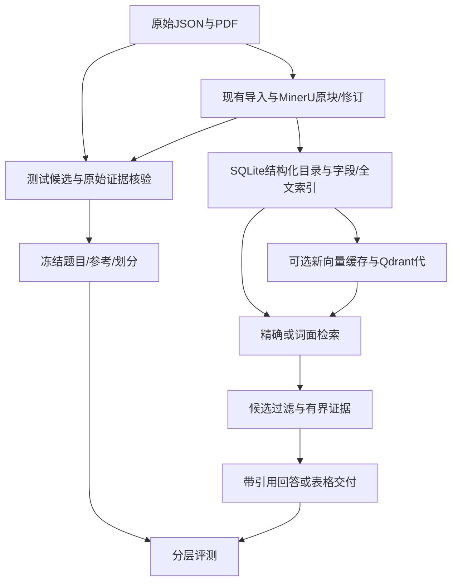

# 版本化数据、检索评测与 RAG 实施方案

更新：2026-10-31。**R1/R2已交付，R3受限摘录RAG及小样本真实调用已验收；R4工程整合与本地镜像已交付，原A0/2保留，执行上下文V2已做离线修复，有界Goal问句已接通，新8题理解仍有两项失败；组合新两题G/A均完成交付，尚无多轮增益，下一项收敛求职演示与复现。** [R2首测9/10](RAG_RETRIEVAL_COMPARISON.md)保留，字段缺陷已修；[R3结果](RAG_CITED_ANSWER.md)记录4次真实调用及未证明整体收益的负结果，自由归纳语义支持尚未验收。本文定义数据、检索、回答及Agent整合契约；排期与真实状态以[统一大纲](TCM_PROJECT_ROADMAP.md)为准。[DataOps子方案](DATAOPS_WORKBENCH_PLAN.md)继续管理工作区、队列、表格及增量修订。

## 1. 调整原因与业务目标

项目用于大模型应用岗位求职，需要能解释真实数据如何处理、如何选检索方案、模型依据什么回答、失败如何处理及如何测量，而不是只展示关键词路由或不断重测固定工具循环。

当前DataOps精确字段读取已经可用；V4动态A三题2/3、G V1规则/模型各8/12，不能证明模型更好。G V1提示了出处/来源与默认列语义缺口，但继续逐轮调同一组Goal不是近期主线。新顺序为**版本化数据与评测基线 → 检索对照 → 带引用RAG → Agent任务整合与部署**。

保留三个容易理解的业务场景：

| 场景 | 示例需求 | 处理与可验收结果 |
|---|---|---|
| 明确资料查询/核对 | 整理白术、黄芪的功效与贮藏，保留出处并导出表格 | 复用字段直接查询、来源核对和XLSX，不强行向量搜索或模型改写原值 |
| 按含义查证资料 | 找几条与受潮、虫害相关的药典贮藏说明，说明共同点并给出处 | R2已交付跨条目候选CLI；R3已接可选受限引用回答，Top-k不代表全部药材 |
| 数据库与文档协作 | 先选ETCM药用部位含Root的限定记录，再补对应药典保存说明；有问题则补查或保留未知，生成v2 | 数据库筛选＋限定对象文档检索＋证据/差异交付；对象对应未核验时保留候选状态，不凭语义相似确认身份 |

通用意义是结构化数据库与文档协作、可追溯回答和持续交付。近期不扩展处方/疗效推荐、靶点预测、全库知识图谱、联网文献或多Agent平台。

## 2. 现状与缺口

| 层 | 当前实现 | 新阶段需要补齐 |
|---|---|---|
| ETCM | JSON导入SQLite；R1已登记2076份原JSON及侧库指纹 | R2已执行并验证4条排除；身份不因名称相似得到批准 |
| 药典 | MinerU原块→字段/修订视图→SQLite精确字段与FTS5；R1新建索引同hash | 发布/锚点/candidate及R2新版本检索对照已交付 |
| 当前索引 | v3为616条目、8665字段片段 | 不是新构建成绩；R1复用、校验，不重做全本OCR |
| 向量 | R2新建8665条/512维BGE缓存与Qdrant代，249条实际token截断 | 旧8654条缓存仍不兼容；新代未切网页/镜像，截断影响待更强语义参考验证 |
| 检索 | R2另建受限跨条目CLI，精确/BM25/dense/RRF已同版本对照 | 历史报告保留单对象限制；新检索未接网页Agent，P17状态缺陷已在R3修复，旧首测不变 |
| 回答 | R3另建不依赖文献的有界摘录RAG、网页/API、校验及回退 | 4/4受限生成通过，未证明整体收益；自由归纳语义支持与自主任务仍待验收 |
| 工作区 | 队列/SSE、持久等待、字段复用、XLSX、v1/v2已有本地验收 | 将新检索与证据结果按版本接入；不重建一套任务系统 |
| 评测 | R1冻结30题原始参考，R2已完成检索首测并保存全部轮次 | 保留题已暴露；生成未验收，不是独立用户或人工批准集 |

RAG指外部证据检索后参与模型生成，不要求每次检索都使用向量。SQL/字段查询、BM25、向量是不同证据获取方式；模型只理解问句的G实验不是RAG效果评测。

## 3. 目标数据流与版本

数据构建与评测候选同批次产生，但冻结参考不从被测索引/检索结果反推。发布清单建议使用一个`release_id`关联原始源hash、ETCM/映射侧库hash、修订视图/字段索引hash、embedding模型指纹/维度/分词与截断配方、向量/Qdrant代、benchmark协议及代码版本。字段、向量、索引的数量应解释清楚，不将无正文资产等差异直接视作丢数据。

原始值和原始块只读。新输出使用新目录，构建完成并校验后再切换配置；未完成或hash不符不可发布。更换embedding模型、维度、切分或索引版本必须生成新代，不能混用旧向量或原地覆盖。

保持现有字段/作用域切分作为基线。R1记录长字段和嵌入截断风险；R2只有在实际截断或召回失败支持时，才比较保留父字段/原块锚点的子片段，不预先重切整库或同时调所有参数。

## 4. 随数据构建benchmark，但不自动制造标准答案

构建阶段输出的是`candidate`：可自动从JSON字段或原始PDF块生成问题模板、预期对象/字段、证据位置、缺失/歧义提示。模型可帮助改写问法，但改写质量、答案支持及独立性不能因此自动成立。

冻结参考至少记录：`case_id、origin、split、question、source_revision、expected_entities、expected_fields、relevant_anchors、expected_status、required_facts、forbidden_claims、review_method、review_status`。有任务/续改要求时再添加`expected_goal、parent_revision、expected_columns、expected_diff`。涉及召回率时另设`relevance_complete`并说明完整相关集合的标注范围。

证据锚点使用源文件hash、JSON指针，或PDF来源/物理页/原块ID/字符偏移；保留炮制作用域。`chunk_id`作为每个索引版本映射到锚点的结果，不让字段序号变化静默改写答案。遇到多个有效片段时允许参考列出可接受证据集合。

首批已在R1冻结[30题](../eval/rag_v1/README.md)：20道可定位证据、5道缺独立字段、5道对象/炮制形式待澄清；开发20、保留10，来源实体组无交叉。覆盖自然改写、限定跨条目语义查询、两道ETCM/药典并列及已知边界回归；缺字段仅指原始OCR范围，不推断现实知识。AI原页/JSON核对、待人工签核；R2已检索首测；R3另测已暴露开发题的受限摘录，不声称这30题已完成新的生成首测。作者接触过参考，不声称全项目从未见过实体或独立盲测。全库索引可含保留题文档，但问句/标签/答案不得参与调优或进入检索正文，不按成绩重新挑题。

无需全库人工逐条审核。只核验这批参考的原始证据，优先复用已查原页的边界样本并明确其开发身份；新增保留题在调试前封存。AI核对保留`pending_human_signoff`，不标成人工批准或独立专家集。候选、已核验开发参考、未运行保留题、已运行回归分别管理；一次执行后不能继续称同一题未见。

索引更新时对参考做影响检查和锚点映射；源内容变化则标待复核，不自动采用新索引文本当新答案。旧参考、旧错误和首轮成绩保持不变。

## 5. 四个完整交付阶段

| 阶段 | 一次性交付 | 退出条件 |
|---|---|---|
| R1 数据与benchmark基线（已交付研究基线） | 当前源/索引/侧库清单；构建/回读入口；原始锚点；8665候选与30题参考；完整性报告 | 34项离线及真实发布回读通过；参考原始可追溯、待人工签核；4条名称问题及旧向量不兼容已登记，不等于检索/回答准确 |
| **R2 检索对照与新向量代（研究对照已交付）** | 新BGE/Qdrant代、受限跨条目CLI、四方法对照、冻结协议及逐题失败报告已落地 | 开发20/20、保留首测9/10；无错对象/范围/注释泄漏，P17是首测状态错误，R3已修复但不改9/10。R2当时58项离线通过。向量无增益，保留精确/BM25、不加重排；不是全部业务通过 |
| R3 带引用RAG（受限摘录已交付） | 标签修复、原文/可选引用页、一次生成、来源/完整句校验、持久防重和失败回退、观测 | 4/4受限生成与4/4零调用控制，99项离线通过；原文已有必要信息、生成更长，整体收益未证，自由语义支持未验收 |
| **R4 Agent整合、容器与求职交付（有界组合已验收，多轮收益未证）** | 真实任务中观察驱动补查/限定改写/澄清；接回ETCM筛选、XLSX及增量v2；新协议F/P/A对照；固定版本业务镜像与3–5分钟演示 | 普通查询保持快捷路径；任务、证据、文件、版本与预算闭环；故障恢复和原状态兼容；同工具/标准下证明或否定动态收益；未证明多轮收益不默认开放native；镜像与实际源码/数据版本可对应 |

每阶段完成代码、必要接口、失败路径、报告和文档，不把每个适配器拆成一轮“下一步”。R1/R2先用本地工具与来源完成，无需先开真实模型。R3/R4执行前冻结具体题目、片段范围和调用上限，沿用当前用户授权，不重复要求此前已允许的任务相关外发。

## 6. 比较方法与验收口径

| 层 | 测量项 | 不能混淆 |
|---|---|---|
| 数据质量 | 字段边界、对象/作用域、原文守恒、来源锚点和版本一致 | 原页/块核验与索引自检分开；不能用同一错误上游自证正确 |
| 检索 | Hit@5/10、MRR@10、限定对象/作用域违例、无证据处理、耗时 | 相关集合完整且范围明确时才报告Recall@k；固定候选池重排不能当全库召回率 |
| 回答 | 必要事实覆盖、证据支持、引用定位、无支持陈述、正确报告不足 | schema合法、引用存在、摘录属于原文、陈述被原文支持分别评分；LLM裁判仅辅助并记录配置，不单独当真值 |
| Agent | 完整任务/部分交付/澄清/失败、需求遗漏、有效补查、表格/v2与缓存复用 | 不以多调用工具、轨迹变化或主观“会思考”证明收益 |
| 开销 | 实际HTTP派发/响应/未知数、token、工具与底层读取、活跃/等待耗时 | driver步骤不是模型请求；费用未知为null，小样本不宣称稳定生产p95 |

精确查询始终有正常缺失、候选与分页处理。检索对照先固定同一片段配方和对象限制，分别测试BM25、dense、RRF混合；只有候选排序确有缺口才增加重排。若改变切分，独立标为另一索引实验，不能同时改模型/数据后把提升全归因于向量。全文统计、用户要求“全部”或精确记录集合由程序扫描/SQL保证，不用Top-k语义搜索冒充穷尽。

R2检索限制只从原问和各方案共享的解析契约形成，不能读取`expected_entities`或`relevant_anchors`给某方案设置标准答案候选池。若专门固定对象/字段池测排序，另列为排序诊断，不混入跨库召回成绩；标准答案仅供评分器使用。

性能目标先在开发题定下具体预算并冻结，再跑保留题；不预填模型或向量必须提升的比例。采用更复杂分支至少应改善明确的错误类别且不放宽来源/范围约束，否则保留简单基线并记录负结果。每轮只运行事前规定的策略/重复次数，失败不自动重试刷分。

## 7. Agent、工具与模型的职责

保留Python、FastAPI、LangGraph、DeepSeek兼容接口、SQLite和Qdrant，不新增框架迁移。按明确对象/字段直接查表；按含义查资料才使用检索；只有需要归纳/解释时生成。模型通过受限工具获取证据，不假设会自动发现向量库。

工具层计划复用现有结构化查询、字段读取、证据回读和产物能力；补跨条目`search_documents`与锚点读取适配，输入限定对象/字段/作用域、k和字数，无任意路径、SQL或写源权限。现有`cross_source_report.text_search`有单药限制，不能直接标为已支持全库语义检索。最终注册名与模块以实现审查为准，不为清单中的每个动作新建一层封装。

新观察循环只在候选不足、条件冲突、证据缺失或对象歧义时考虑调整查询/补查/询问；限制改写次数并记录新增证据。分页、构建、验证与发布等机械步骤由宿主完成，不要求模型反复选择交付尾部动作。该职责调整需另立共享F/P/A协议，不倒改V4的原预算或2/3成绩。检索到的文字作为数据，文内指令不能改变工具权限。

R3最小生成不启用开放循环；R4的G2字段语义及有界名称候选随真实任务接入，明确“出处引用”与“药典来源/基原”不同，默认列/指定列和父版本范围由宿主落实。不把G2同题调提示作为R1–R3前置任务，也不先做自动字段归属修订工具。

## 8. 复用文件、拟新增位置与回滚

| 工作 | 现有位置 | 计划变更 |
|---|---|---|
| 数据发布 | 既有导入/修订/字段索引脚本 | R1已增`build_data_release.py`和`data_release.py`登记、重建词法索引与回查，不重复OCR或切换服务 |
| benchmark | `eval/`、原块边界参考、旧任务评分器 | R1已增`build_rag_benchmark.py`、`rag_benchmark.py`及`eval/rag_v1/`种子/冻结参考，不修改旧题分数 |
| 向量与检索 | `tcm/local_dense.py`、`qdrant_dense.py`、`mineru_retrieval.py`、`cross_source_report.py`，已有build/check脚本 | 参数化当前版本，新增跨条目受限入口与统一对照报告；历史固定v2实验仍可复现 |
| RAG回答 | `tcm/evidence_assistant.py`、引用/证据外置及`tracing.py` | 去除新主线对文献的依赖，复用生成/校验模式；拟增统一`eval_rag_pipeline.py`，不直接打开旧入口冒充验收 |
| 任务交付 | `tcm/dataops/`、现有队列/worker/SSE、聊天/工作台 | 新检索/回答结果接入已有版本、owner和产物验证；按R4处理Goal语义与真实驱动 |

R1文件与命令已存在，见[使用说明](DATA_RELEASE_BENCHMARK.md)；R2已增`eval_rag_retrieval.py`、`check_rag_search.py`及`ReleaseSearch.search`；R3已增`eval_rag_pipeline.py`及独立网页/API，R4限定候选任务已接入六工具及宿主交付，真实A尚未稳定完成；有界问句与显式单次模型理解已接通，开放语义稳定性仍待验收。实际发布为`var/data_releases/r1_20261030`，登记原资料并新建词法索引，不复制全部原资料或自动切换服务；评测按独立run_id保存。R1未构建向量、未调用模型，4条名称不符已由R2访问层执行排除；已登记文件和参考变化即拒绝复用。本地回执/快照是执行事实，Langfuse负责观察，导出失败不重发请求。

切换前校验索引、向量、模型与引用版本；新索引/向量指向同一release，旧版本保留。回滚恢复整套兼容配置，不只改向量路径；旧会话/产物不重写，旧checkpoint按版本保护处理。新RAG和真实Agent入口显式开启，既有精确查询与固定表格可用。R1只新建独立词法索引与发布文件，未修改原始数据库或运行新模型，业务镜像仍待R4。

R4实际交付与新负结果见[候选核对说明](RESEARCH_SELECTION_AGENT.md)、[验收](../audits/data_rag_r4/README.md)：F两题按契约通过，A0/2；P两次未交付且一次为基础设施故障。模型没有选择检索/回读，不据此声称自主RAG收益。14模块118项及本地最终镜像/网页通过，当前同时支持有界问句与明确字段表单。上下文反馈和工具可用性已在Harness V2离线修复，原A0/2保留；新8题理解规则4/8、模型方案6/8，含3题宿主零调用控制，一次多余澄清和一次擅加属性仍失败，事后守卫仅做离线回放；后续验证理解与执行安全组合，不把字段完整性程序题当成必须LLM的证据。
