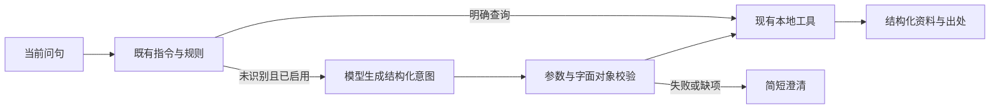

# 自然问法与模型意图兜底

> 历史阶段记录（2026-10-29标记）：2026-10-22属性意图阶段记录。靶点相似度、疾病查询、MCP及受限多步骤提案后来已有实现；7877和单项意图范围不是最新预览的全部能力。 当前进度与后续任务统一见[大纲](TCM_PROJECT_ROADMAP.md)。

2026-10-22。当前7877预览可直接问“我需要查看白术的相关属性”“帮我看看黄芪的基本信息”，读取ETCM来源属性，不要求输入指令。唯一中文候选直接使用并保留来源说明；多来源再选择，未知药名和炮制品不替换为母药。“它的基本信息呢”等追问沿用已选ETCM来源。

后续增量：已补`dataset_info`动作和本地资料介绍，支持“分别介绍两个数据”“我想问的是介绍两个数据库”，无需药材名；模型改述也可选择该动作。最新815项离线及页面结果见[本轮验收](../audits/dataset_info_v1/summary.json)，靶点相似度和疾病筛选仍属[后续计划](RESEARCH_ANALYTICS_PLAN.md)。下文809项为前一轮属性意图的验收记录。

此前失败来自两处：属性概况没有对应的自然意图；工具模式在规则未匹配时直接返回403，而默认预览关闭了模型。旧模型规划覆盖药典合成试验，未接ETCM属性工具。本次补齐属性意图，同时将一次模型识别接入已有LangGraph入口。



模型只选择目标、原句中的完整对象、规范字段及查询方向，不生成医学答案。支持单药属性/字段、药典字段及2至3药字段比较、现有关联方向、概览和功能介绍；多种独立目标、缺少对象或不支持任务返回澄清。当前是一个有界查询意图，不是任意复杂研究的自主多步执行器。

程序校验工具及字段白名单、对象原文位置、炮制/提取物范围、数量预算和额外参数。模型不能提供SQL、来源文件路径或选择具体来源；来源解析、版本与哈希检查继续由原工具完成。未知对象保留未知，模型误判仍可能发生，这些检查不证明自由问句语义已完整理解。

每个未识别问句最多1次模型请求、10秒超时、SDK重试0；模型超时、输出非法或调用不合约时返回澄清，不转入通用聊天模型。旧指令、已识别规则、界外命令和超长输入不进入该兜底。API的`routing.intent_model_calls`与顶层`model_calls`记录实际尝试；工具本身的零模型调用字段不代表整个请求的调用总数。

## 启用范围

默认启动命令继续关闭模型：

```bash
python -m scripts.preview_local_tasks --port 7877
```

2026-10-22用户明确授权“允许，仅外发当前问句做意图识别”。当前7877已启用下面的选项；只有规则未识别的当前问句会发送给已配置的DeepSeek模型。该授权不包含ETCM/药典片段、数据库或会话历史，也不扩展为使用真实资料生成答案。

当前启用方式，复用同一状态目录：

```bash
python -m scripts.preview_local_tasks --port 7877 --with-intent-model
```

独立的`INTENT_MODEL/API_KEY/BASE_URL`配置优先，否则读取已有聊天配置。普通聊天、证据生成、嵌入和联网工具继续关闭；只为未识别问句启用意图模型。调用模型的内容是当前问句和静态能力Schema，没有检索正文、候选名称目录、历史消息或密钥正文。页面显示该外发范围。停服务后不加此选项重启，即恢复全本地识别；不删除原状态库。

## 实现与验证

`attribute_intent.py`解析完整属性请求；`assistant_router.py`保留功能、概念、显式来源与原字段优先级。`intent_planner.py`定义严格`QueryIntent`及一次原生工具调用适配，`agents/agent_decision.py`仅在规则无结果时接入，随后复用原工具节点；`app.py`放行已启用的意图入口并记录调用次数。`config.py`增加可选模型配置前缀，原调用默认仍用CHAT配置。

新增11项夹具测试覆盖实际图/API、一次调用、仅问句输入、失败停止、对象凭空补全、炮制/提取物缩小、多候选、历史不外发、指令及旧路由。DeepSeek的3条合成题均得到有效类型化意图，累计3次调用；该组只验证协议/规划，未执行资料查询。另在模型开启的7877实际浏览器中验证：

| 问句 | 识别路径 | 模型调用 | 本地结果 |
| --- | --- | --- | --- |
| 我需要查看白术的相关属性 | 规则 | 0 | 白术13项来源字段 |
| 能给我一张白术的资料卡吗 | 模型意图 | 1 | 白术13项来源字段 |
| 帮我把白术的档案调出来 | 模型意图 | 1 | 白术13项来源字段 |

后两题只发送当前问句和静态能力Schema，未把检索结果交给模型；第3题之前已有本地功能介绍轮次，模型输入仍仅为当前问句。输入隔离由代码及夹具断言验证，未进行独立网络抓包。三题的13项返回值均与本地已导入SQLite记录一致，未重新审核原始JSON全集。模型关闭时另有15个浏览器场景通过，覆盖原句、改述、连续追问、来源字段、未知/炮制对象、个人用药边界及原功能；并非15个完整科研任务。

完整离线回归89模块809项通过，跳过、失败及网络尝试均为0；各组结果见[验收摘要](../audits/intent_router_v1/summary.json)。上述题目为开发验证，不是独立用户保留集，不能报告为一般意图准确率或完整科研任务成功率。仅规则返回“未识别”时才启用模型；已有规则选中但后续资料查询失败，不会再次交给模型。

初轮全量发现属性规则抢先捕获功能概览问法，已调整优先级并补回归；原失败保留。未修改数据库Schema、原始JSON、检索索引、旧任务或导出格式。回滚需一起恢复入口、特性开关、模型适配及属性解析；关闭模型开关即可先停外发路径。本轮未提交Git、push或更新Docker。
