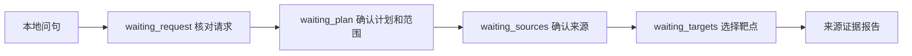

# ETCM问句、请求清单与本地执行

2026-10-21：真实ETCM只读任务已接入“原问句→用户核对清单→确认两味药的计划→确认来源→核对选定靶点→报告”。沿用已有SQLite任务库和三个只读工具，不增加框架、不向模型发送输入或资料。此增量不是模型规划或自动完整语义识别。

当前源码预览：**http://127.0.0.1:7877/research-tasks**。Docker镜像尚未更新；已有双药直接输入入口和合成任务仍可使用。

## 使用

1. 在“用问句创建ETCM本地任务”输入“白术和黄芪有哪些共同靶点？请保留双方的原始记录。”，点击“核对ETCM请求清单”。
2. 对照原句修订对象和要求。药材每行一项，2至8项、每项最多100字；其他要求最多6项、每项120字。草稿只按本地目录中文候选、拼音/名称键和来源ID做字面匹配；可能漏未知药名、匹配嵌套名称或误读否定，不解析代词。人工可补充未知名字，之后仍须实际解析来源。
3. 勾选已核对完整清单，再确认执行计划。当前一次只执行两味药的共同靶点及双方来源记录；计划中的两个对象必须来自已确认清单。不支持的要求不会偷偷改成其他任务。
4. 若有第三味药、文献核查、药用部位表或其他未执行要求，明确同意“仅执行当前选定范围”后才能继续；原清单保持不变。然后分别确认两份来源，中文候选不能视为药材身份已经核验。
5. 查看共同UniProt标识，每页20项，选择本页1至2项核对双方原始记录。下载报告可见原问句、草稿、用户修订、计划、来源版本/哈希和JSON位置。

示例：输入“白术、黄芪和未知第三草有哪些共同靶点？还要文献、药用部位表和价格比较。”，必须在对象清单中手动补齐未知第三草，在其他要求中补齐价格比较。即使双药部分完成，整份清单仍是部分完成；读取来源PMID线索也不等于完成文献核查。

## 状态与数据边界



有效空交集不需要选择靶点，可直接交付本地查询结果；来源无法解析则partial，查询总数为null并显示尚未执行，不能当成0个。资料缺失返回503，快照变化返回409；两者均不降级为模型或联网补答。

`request_inventory_user_confirmed=true`表示用户声明清单已核对，`raw_question_completeness_automatically_verified=false`始终保留。`confirmed_scope_complete`描述选定执行范围，`original_request_complete`在此入口描述用户确认后的清单；后者不证明系统自动理解了原句全部语义。`completion`与`local_steps_complete`沿用v2本地查询契约，即使本地部分完成，整体报告和任务也可能仍partial。

原文、草稿、修订、范围确认、来源选择和状态版本保存在现有SQLite任务库。创建时绑定数据版本及目录SHA/WAL；请求核对、计划确认和工具查询检查同一快照。进程重启后用同一任务库、Cookie签名配置与浏览器恢复；没有账号、跨设备同步或任务备份，清除Cookie后不能找回。GET/下载不会重算历史报告。

## 接口与改动落点

创建：`POST /api/research/tasks`：

```json
{"mode":"etcm_question","question":"白术和黄芪有哪些共同靶点？"}
```

核对：`POST /api/research/tasks/{id}/request`：

```json
{"revision":0,"request_scope":{"data_mode":"etcm_local","entities":["白术","黄芪"],"deliverables":["source_relations"],"other_requirements":[]},"confirm_complete":true}
```

revision应取当前响应值；计划确认沿用`/choose`，包含intent、herb_one、herb_two及独立的`accept_reduced_scope`布尔值。真实清单须显式指定etcm_local，不能提交到合成任务。合成旧请求省略data_mode时仍按synthetic_only处理；合成模型规划的字面量约束没有放开。

| 文件 | 职责 |
|---|---|
| `tcm/research_task_local.py` | 只读名称目录建议、快照、真实任务状态与报告覆盖 |
| `tcm/task_request.py` | 清单修订、完整性声明与计划提案 |
| `tcm/task_plan.py` | 独立LocalTaskPlan；真实模式只允许source_relations |
| `tcm/request_coverage.py` | 独立LocalRequestScope、未覆盖项和范围确认绑定 |
| `tcm/research_task_api.py` | 新模式、类型分派、所有者和revision检查 |
| `tcm/research_tasks.html` / `.js` | 真实问句、可编辑清单及完成范围展示 |

## 验收与限制

新增11项夹具集成测试，完整87模块782项离线回归通过，跳过/网络尝试0。真实浏览器20项检查通过，含实际进程重启、完整/部分请求、范围门禁、未知名称、来源确认、分页、导出、跨浏览器隔离、旧合成入口和移动端布局。中文字体渲染未作完整视觉验收，检查以DOM/布局和JS行为为准。

测试脚本选取的已知白术/黄芪候选来源返回151个来源声明共同标识；选定一个靶点的双方2条见证核对原JSON指针和来源文件SHA。该计数不代表所有同名药材，也不是独立用户评测、实体身份人工审核、全文数据验收或临床证据。外部模型调用0；PMID扩展继续冻结。

脱敏记录：[验收摘要](../audits/local_task_request_v1/summary.json)。完整日志及私有输入/报告仅在本机`var/local_task_request_v1/`，不进入Git或镜像。本轮未提交Git、push或发布Docker。

## 回滚与下一项

无数据库Schema迁移，不重写旧任务或旧v1/v2报告。回滚应一起恢复清单/计划/覆盖、真实引擎、API和页面，并备份、隔离新建的含request_draft的真实任务；旧引擎不理解这些阶段和清单，不能强改running或重新生成报告。已有历史任务不需要迁移。

下一项回到端到端业务演示与未见任务验收：记录用户是否能选对来源、读懂未完成项并完成有用的资料核查。保持本地只读默认，不因本次流程通过扩大模型外发或新增文献平台。
