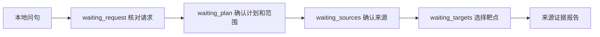

# ETCM问句、请求清单与本地执行

**当前默认已简化：** 聊天中的明确双药共同靶点查询直接执行，不需要核对清单或确认计划；本文清单流程用于显式研究任务或复杂要求。详见[直接查询](#明确双药查询直接执行2026-10-22)。

2026-10-21：真实ETCM只读任务已接入“原问句→用户核对清单→确认两味药的计划→确认来源→核对选定靶点→报告”。沿用已有SQLite任务库和三个只读工具，不增加框架、不向模型发送输入或资料。此增量不是模型规划或自动完整语义识别。

当前源码预览：**http://127.0.0.1:7877/research-tasks**。Docker镜像尚未更新；已有双药直接输入入口和合成任务仍可使用。

## 使用

1. 在“用问句创建ETCM本地任务”输入“白术和黄芪有哪些共同靶点？请保留双方的原始记录。”，点击“核对ETCM请求清单”。
2. 对照原句修订对象和要求。药材每行一项，2至8项、每项最多100字；其他要求最多6项、每项120字。草稿只按本地目录中文候选、拼音/名称键和来源ID做字面匹配；可能漏未知药名、匹配嵌套名称或误读否定，不解析代词。人工可补充未知名字，之后仍须实际解析来源。
3. 勾选已核对完整清单，再确认执行计划。当前一次只执行两味药的共同靶点及双方来源记录；计划中的两个对象必须来自已确认清单。不支持的要求不会偷偷改成其他任务。
4. 若有第三味药、文献核查、药用部位表或其他未执行要求，明确同意“仅执行当前选定范围”后才能继续；原清单保持不变。然后分别确认两份来源，中文候选不能视为药材身份已经核验。
5. 查看共同UniProt标识，每页20项，选择本页1至2项核对双方原始记录。下载报告可见原问句、草稿、用户修订、计划、来源版本/哈希和JSON位置。

示例：输入“白术、黄芪和未知第三草有哪些共同靶点？还要文献、药用部位表和价格比较。”，必须在对象清单中手动补齐未知第三草，在其他要求中补齐价格比较。即使双药部分完成，整份清单仍是部分完成；读取来源PMID线索也不等于完成文献核查。

## 状态与数据边界



有效空交集不需要选择靶点，可直接交付本地查询结果；来源无法解析则partial，查询总数为null并显示尚未执行，不能当成0个。资料缺失返回503，快照变化返回409；两者均不降级为模型或联网补答。

`request_inventory_user_confirmed=true`表示用户声明清单已核对，`raw_question_completeness_automatically_verified=false`始终保留。`confirmed_scope_complete`描述选定执行范围，`original_request_complete`在此入口描述用户确认后的清单；后者不证明系统自动理解了原句全部语义。`completion`与`local_steps_complete`沿用v2本地查询契约，即使本地部分完成，整体报告和任务也可能仍partial。

原文、草稿、修订、范围确认、来源选择和状态版本保存在现有SQLite任务库。创建时绑定数据版本及目录SHA/WAL；请求核对、计划确认和工具查询检查同一快照。进程重启后用同一任务库、Cookie签名配置与浏览器恢复；没有账号、跨设备同步或任务备份，清除Cookie后不能找回。GET/下载不会重算历史报告。

## 接口与改动落点

创建：`POST /api/research/tasks`：

```json
{"mode":"etcm_question","question":"白术和黄芪有哪些共同靶点？"}
```

核对：`POST /api/research/tasks/{id}/request`：

```json
{"revision":0,"request_scope":{"data_mode":"etcm_local","entities":["白术","黄芪"],"deliverables":["source_relations"],"other_requirements":[]},"confirm_complete":true}
```

revision应取当前响应值；计划确认沿用`/choose`，包含intent、herb_one、herb_two及独立的`accept_reduced_scope`布尔值。真实清单须显式指定etcm_local，不能提交到合成任务。合成旧请求省略data_mode时仍按synthetic_only处理；合成模型规划的字面量约束没有放开。

| 文件 | 职责 |
|---|---|
| `tcm/research_task_local.py` | 只读名称目录建议、快照、真实任务状态与报告覆盖 |
| `tcm/task_request.py` | 清单修订、完整性声明与计划提案 |
| `tcm/task_plan.py` | 独立LocalTaskPlan；真实模式只允许source_relations |
| `tcm/request_coverage.py` | 独立LocalRequestScope、未覆盖项和范围确认绑定 |
| `tcm/research_task_api.py` | 新模式、类型分派、所有者和revision检查 |
| `tcm/research_tasks.html` / `.js` | 真实问句、可编辑清单及完成范围展示 |

## 验收与限制

新增11项夹具集成测试，完整87模块782项离线回归通过，跳过/网络尝试0。真实浏览器20项检查通过，含实际进程重启、完整/部分请求、范围门禁、未知名称、来源确认、分页、导出、跨浏览器隔离、旧合成入口和移动端布局。中文字体渲染未作完整视觉验收，检查以DOM/布局和JS行为为准。

测试脚本选取的已知白术/黄芪候选来源返回151个来源声明共同标识；选定一个靶点的双方2条见证核对原JSON指针和来源文件SHA。该计数不代表所有同名药材，也不是独立用户评测、实体身份人工审核、全文数据验收或临床证据。外部模型调用0；PMID扩展继续冻结。

脱敏记录：[验收摘要](../audits/local_task_request_v1/summary.json)。完整日志及私有输入/报告仅在本机`var/local_task_request_v1/`，不进入Git或镜像。本轮未提交Git、push或发布Docker。

## 回滚与下一项

无数据库Schema迁移，不重写旧任务或旧v1/v2报告。回滚应一起恢复清单/计划/覆盖、真实引擎、API和页面，并备份、隔离新建的含request_draft的真实任务；旧引擎不理解这些阶段和清单，不能强改running或重新生成报告。已有历史任务不需要迁移。

下一项回到端到端业务演示与未见任务验收：记录用户是否能选对来源、读懂未完成项并完成有用的资料核查。保持本地只读默认，不因本次流程通过扩大模型外发或新增文献平台。

2026-10-22后续：已在固定提交`f2f8114`执行六条开发者设计任务并更新[五分钟演示](PROJECT_DEMO.md)，取得3完成、2部分、1待补结果；5份提交清单中4份需要模拟人工修订。属于脚本驱动的本地流程验收，没有真实用户理解观察或独立准确率结论。本人录屏和独立用户验收仍待完成，详见[本轮记录](../audits/task_business_demo_v1/summary.json)。

## 聊天入口衔接修复（2026-10-22）

用户在聊天页输入“我在整理当归与川芎，想核对共同靶点，并保留双方原始记录的位置”，实际收到403通用工具提示。已用原句复现。此前六场景验收只覆盖研究任务页，未覆盖从聊天输入这句话；不能用原任务页通过记录说明聊天入口也通过。

修复后，在聊天页输入原句，会返回“核对请求清单”按钮。点击后以`etcm_question`保存完整原句并进入对应任务，仍停在waiting_request；之后按原流程确认清单、计划、来源及靶点。聊天响应本身不创建任务、不查询来源或靶点，也不调用模型；点击按钮才执行现有创建API，创建API仍检查浏览器所有者及本站来源。

新路由仅衔接直接关系语法未能解析的共同靶点/来源关系/共同标识问句，复用现有任务字面提示，不按已知药名或背景前缀截句。其他要求保留在原文中供用户核对，不能保证自动提取完整。原直接查询、显式指令及个人用药边界优先级保留。任务关闭时明确提示未启用；超过400字符不会截断后提交。此分支即使请求显式AI模式也保持本地清单核对，不扩大真实资料外发。

跳转URL只含`/research-tasks#任务ID`，不放问句。任务页按ID读取，刷新不创建或推进任务，换任务同步ID、删除后清除ID；格式错误或其他浏览器的任务不展示。GET仍执行所有者检查。下述逐题修复后，尚未创建任务的核对按钮可随聊天刷新或进程重启恢复；已经创建的任务从列表或原任务链接恢复。

本轮新增8项主图/API测试，完整88模块790项离线通过，跳过/网络尝试0。15项实际浏览器检查从聊天起步，验证原句交接、零自动创建、清单与来源确认、刷新、导出、额外要求保留及链接隔离。所选当归/川芎来源172个共同声明标识，选定靶点双方2条见证与原JSON位置和文件SHA核对；这是已知失败回归，不是独立语言理解或医学效果评分。外部静态资源在浏览器验收中阻止，检查基于DOM/行为，不声称完成中文字体视觉验收。见[脱敏验收](../audits/chat_task_handoff_v1/summary.json)。

7877源码预览已重启加载修复，原状态库保留；未提交Git、未push或更新Docker。其他自行启动的实例需要停止后用原命令重启，刷新浏览器加载新页面。回滚本轮应一起恢复`assistant_router.py`、`assistant_info.py`、`app.py`、聊天模板及任务页JS；新建任务仍使用原Schema，不需要数据库迁移。

## 逐题模拟后的补修（2026-10-22）

按“先逐题跑通，再做全部测试”执行16个浏览器场景。首轮有两项阻塞：聊天刷新丢失核对按钮；明确询问“UniProt标识交集”未进入清单入口。修复后重新执行同一组16场景，再运行完整离线回归；不覆盖首轮失败记录。逐题问题、结果及模拟人工操作见[演示验收表](PROJECT_DEMO.md#逐题模拟与随后全量回归2026-10-22)。

待核对状态只在现有SQLite会话上下文中增加可选的短问句标记，沿用所有者、过期和删除规则，无Schema迁移。刷新或重启后，`GET /conversation`生成本地核对操作，不创建任务、不执行工具；新成功聊天或清空会话会移除旧操作。新请求清空旧资料焦点，防止将上一题的来源展示为待核对请求的证据。已经创建的任务仍独立保存；恢复按钮后再次点击可能新建同题任务，不提供跨刷新幂等保证，已有任务应从列表打开。

本地字面规则新增“明确UniProt命名空间＋交集”的来源关系提示，同时用于聊天路由和清单草稿；通用文献交集不会因此进入ETCM任务。仍不能自动理解全部否定、未知名称、代词和额外要求，清单须人工核对。真实ETCM入口不使用模型推理或自动选择来源。

本次新增4项回归，聊天衔接模块共12项；完整88模块794项离线通过，跳过/网络尝试0。16个浏览器场景检查通过，其中11个完成当前本地范围，另外5个为未支持要求、缺来源、缺字段、联网工具关闭、个人用药边界，各1个，不能算完整任务成功。实际下载11份文件，20条选定来源见证核对原JSON位置及SHA；不是全部关系记录验收或独立用户准确率。另用独立端口和状态库执行18项检查，含真实进程重启恢复核对操作、继续完成资料任务和浏览器隔离。外部模型调用0，7877预览已加载应用修复；Git/Docker未更新。脱敏记录见[本次摘要](../audits/user_flow_v1/summary.json)。

回滚补修时须同时恢复`task_request.py`、`research_task_local.py`、`assistant_router.py`、`agent_research.py`、`agents/agent_decision.py`、`app.py`和聊天模板。可选会话标记可由旧版本忽略，不批量改写历史聊天或任务；回滚后不再恢复新核对按钮，已创建任务仍由原任务页读取。

## 明确双药查询直接执行（2026-10-22）

此前把请求完整性核对做成普通资料查询的必经步骤，导致用户已经说清对象和任务，仍需反复确认。本次实际修改路由后的关系解析与执行，支持“我在整理当归与川芎，想核对共同靶点”及附双方原始记录的完整问句；也覆盖其他药材对、有限背景表达和原直接问法，不硬编码药名或截掉未支持要求。

流程为：聊天原句→现有LangGraph本地工具分支→解析两味药→解析ETCM来源→直接查询/展示共同标识及双方原行。中文名只有一个有效候选且未截断时，自动使用这份来源，在结果中明确标注尚未核验名称对应关系；多个候选只要求选择来源，未知名称不当成空交集。该自动策略仅用于自然语言双药共同靶点，不改变单药查询、显式`/relations`命令或研究任务引擎的来源确认。来源版本/SHA、只读库与重复来源检查保留，没有新增模型调用或数据库迁移。

不创建研究任务、不跳转任务页、不要求先挑选靶点。每页20项，逐项可展开双方原始行和JSON位置，上方显示来源文件及哈希。可沿用“出处呢”、翻页、刷新和收藏；收藏证据导出只含所保存的一页。AI整理开关不把这类确定性共同靶点查询发给模型。新的成功查询会清除旧的待核对操作，但旧聊天文字不追溯改写；刷新后重新发送原句。

三味药、文献/价格等复合交付不截成双药任务，仍保留原句走原清单流程；本轮没有解决开放意图理解或所有复杂请求的交互简化。中文唯一候选代表目录匹配，不能说已验证药材身份、机制或药效。

本次新增4项回归；相关6模块61项先通过，再在真实7877聊天页运行9个场景：5个直接查询完成，1个缺失来源澄清、2个复杂要求保留、1个个人用药边界，均符合预期，不能算9项完整业务成功。实际核对12条选定来源见证与原JSON/SHA，完成第二页/追问/刷新、桌面/手机布局及一次双来源证据笔记下载；浏览器外部静态资源阻止，外部模型调用0。之后完整88模块798项离线回归通过，跳过/网络尝试0，见[脱敏记录](../audits/direct_common_query_v1/summary.json)。

7877预览已用原启动命令重启，原状态库保留；本次没有提交Git、push或更新Docker。回滚应同时恢复`tcm/relation_queries.py`、`app.py`与聊天模板；历史聊天、任务、收藏无需迁移，查询仍可用显式来源ID执行，自动来源选择会恢复为原人工确认策略。

## 回答展示精简（2026-10-22）

用户反馈默认答案包含大量重复说明。已检查共同靶点、成分、药材靶点、候选路径、疾病富集、靶点反查、药材属性、药典、比较、概览、功能介绍及文献展示：正常回答保留简短结果，关联列表改为表格；每项的原始行、JSON位置、文件哈希和范围说明折叠，数据和查询条件不删改。适用于即时回答、刷新后的当前结果和收藏预览。

药典正文只显示当前文本一次，OCR原文有差异时保留在“出处与校订信息”中；原页查看与证据下载保留。药材属性不再默认显示状态码、长来源ID及每个字段的技术详情；单独请求的缺失字段仍显示。比较表中成功单元只列原文，缺失或重复字段继续明确标记。文献卡保留题名、期刊、链接与实际撤稿/更正提示，检索元数据和常规说明折叠；当前部署仍关闭文献联网，本次只用本地合成文献测试展示。

后端正常结果的`message`改为简短摘要，补充说明保留在`notes`及原有结构化证据中。会话只存摘要和来源焦点，不将正文加入记忆；刷新时避免把最后一条摘要与恢复的资料卡重复展示。旧聊天文字不批量改写，无数据库迁移。缺来源、缺字段、空结果、禁用和失败仍保留可见提示，不以精简为由标成完成。

17类浏览器检查覆盖表格行数、默认隐藏技术字段、展开出处、原PDF页面、分页/追问/刷新、收藏预览、4份实际导出和本地合成文献的撤稿提示；共同标识抽查2条原始见证，药典命中另与索引核对。前两次浏览器检查误将不同历史回合的摘要、固定欢迎消息计为重复，原记录保留并修正检查口径；没有据此修改业务结果。桌面和手机截图使用本机中文字体并临时解除聊天区域截取限制，仅用于检查结果内容，外部静态资源阻止。首轮全量有4处断言失败：3处依赖旧文案/说明位置，另1处促使恢复空疾病记录的可见限定；原记录保留。最终相同17类浏览器及完整88模块798项离线回归通过，跳过/网络尝试0，无新增测试用例或外部模型调用；17项含部分/缺失/边界及合成展示，不是17个完整业务成功。详细结果见[本次摘要](../audits/readable_answers_v1/summary.json)。

7877源码预览已更新，原聊天/任务/收藏库保留；Git及Docker未发布。回滚应一起恢复聊天模板、`mineru_evidence.js`及各工具的摘要/说明生成代码；查询索引、原始JSON、任务Schema与导出格式无需迁移。
