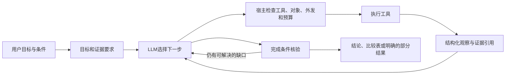

# 中医药研究 Agent：需求、数据基础与观察驱动方案

> **已退出当前主线（2026-10-29）**：本方案的方剂候选/机制研究业务不再实施为近期求职项目。现行需求、技术与评测统一见[DataOps工作台方案](DATAOPS_WORKBENCH_PLAN.md)，排期见[统一大纲](TCM_PROJECT_ROADMAP.md)。本文保留数据审计与候选设计供追溯；下文“P0”“下一大步”等均为当时建议，不代表当前任务。原始审计结果不变。

2026-10-29。状态：需求与可行性审查，**不是已上线能力或新的效果声明**。本次不改生产调用链、部署、原始数据或统一大纲。用户提出退出文献检索主线；本文列出退役范围，尚未删除模块。

## 1. 产品要解决什么问题

建议定位为：**面向中医药科研人员，依据本地数据库和药典，整理候选方药、核对组成与身份、追踪关联证据，并说明哪些机制假设值得继续验证。**

交付物应是可复核的候选比较表与证据包，帮助研究者决定下一步查什么、补什么数据或开展什么验证。不是给患者诊断、生成处方、调整剂量，也不是把数据库关联改称疗效预测。

目前最值得做的两项业务：

| 优先级 | 业务与示例需求 | 最终交付 | 为什么需要观察驱动 |
|---|---|---|---|
| P0 | 方剂研究准备：“围绕疾病D及已给出的症状描述，筛出值得进一步核对的已有方剂，比较组成、药典依据和资料缺口。” | 候选及入选理由、未满足条件、组成身份覆盖、药典字段出处；候选不足也给出明确结果 | 初次检索可能无结果、英文主症不同义、同名方不同组成、炮制品无法对齐；需要选择改写检索、读具体变体、补查或澄清 |
| P0 | 指定方剂证据审查：“这两个方剂谁更值得围绕D开展机制研究？分开已记录靶点与相似性推测，别只按靶点数量。” | 分层证据矩阵、共同/差异靶点、覆盖与偏倚诊断、可检验假设及限制 | 哪些成分值得展开取决于覆盖、证据等级和身份；发现数据不足或集合偏倚后，应缩小结论或换证据路径 |
| P1 | 对前述研究作条件变更：“排除含某药材的候选；改用另一版本方剂；仅保留明确来源的靶点，哪些结论改变？” | 增量比较和变化原因，复用仍有效的证据 | 条件改变使部分证据失效，需要定位受影响结论并重查，而非重跑所有步骤 |

以上示例中的D与方剂须由真实目录解析或用户选定；不是已经完成的案例。症状只作为用户给定的研究条件，不由模型自行推断证候或患者诊断。

计数、单药属性、明确ID查表、两集合交集继续直接执行。**复杂不等于必须用Agent：只有相较固定流程，动态处理证据缺口产生了可测收益，才能主张Agent的价值。**

## 2. 本地数据核验：有些未利用，有些确实缺失

本次只读检查原始文件清单、现有关系侧库的全部方剂相关行，并对成分做有界抽样。可复现结果见[机器审计](../audits/research_requirements_v1/data_readiness.json)，脚本见[审计程序](../audits/research_requirements_v1/audit_readiness.py)。

| 资源 | 核验结果 | 业务含义 |
|---|---|---|
| 药材JSON | 2,076份 | 已有属性、成分、方剂、靶点等关联；文件数不是唯一药材种数 |
| 成分JSON | 38,281份，约129 GiB | 不宜整份塞入向量库；按业务需要提取身份、关系与证据字段 |
| 靶点JSON | 260份 | 不等于全库只有260个靶点，其他关系表也含靶点；历史审计发现重复和身份错配 |
| 疾病JSON | 7,705份 | 既有疾病目录已建设；物种和关系证据等级仍有缺口 |
| 传统方剂关系 | 303,566条源行，来自654条药材来源，当前46,273个节点组 | **方剂不是没有数据，而是嵌在关联表中**；节点组不是已核验唯一方剂 |
| 中成药关系 | 70,007条源行，来自898条药材来源，当前8,927个节点组 | 可作为另一种方药对象；不直接与传统方剂按名字合并 |
| 药典 | 既有索引记录616条目、8,654字段块 | 提供来源、药用部位、炮制、功能主治、注意等规范文本；提取未全部人工审核 |

### 2.1 方剂可利用到什么程度

本次全量扫描现有侧库373,573条方剂/中成药关系行，确认：

- 传统方剂含拼音名、剂型、组成药材、主症描述、古籍出处。主症字段非空281,107行；非空不等于标准化、准确或有效。
- 中成药含名称、剂型、组成、适应描述、分类。两类关系行**均未包含独立剂量或证候字段**；不能推论其他原始数据也完全没有这些内容。
- 传统方剂797个节点组、中成药47个节点组在剔除链接模板后仍有不同内容。差异可能是版本、抓取或文本差异，未判定为错误，不能只保留第一行。
- 传统方剂组成有3,639种原始名称，仅684种能通过大小写/空格归一化与药材文件名形成候选。该匹配覆盖2,722,854/3,158,210次组成出现，重复很多；**这是名称候选统计，不是身份对齐率**。
- 中成药组成也包含炮制形式，不能去掉括号就合并。全量组方的剂量、比例和炮制信息不可由普通药材字段补全。

因此，可先做“已有方剂检索、组成核对、研究候选比较”；不具备凭现有行直接生成可靠处方的依据。

### 2.2 成分—靶点关系需要纠正旧判断

本次在不超过8 MiB的成分文件中，按文件大小顺序选12个等间隔样本，包含一个错误响应；不是随机代表性抽样，不能外推覆盖率。

- `4-hydroxy_benzoic_acid.json`同时含来源标签为`Confirmed Targets`的16行、`Potential Targets`的16行。
- `Cadaverine.json`含`Confirmed Targets`的8行。
- 潜在靶点表出现`Gene Symbol`、`Similar Score`、`Activity`和参考链接；确认靶点表也含活性与参考链接。
- 另读`Vasicinone.json`确认其潜在靶点、理化/药代/毒理字段结构；其结构展示字段是SVG链接，不能直接当作可计算SMILES。全量是否有其他结构标识尚未核验。

结论是**已有可研究的成分—靶点来源关系，但尚未完成全量提取、身份和证据语义核验**。不能再笼统称“没有直接关系”，也不能把来源的`Confirmed`标签称为本项目独立验证。

相似性表中的活性可能属于参考配体，不能自动归给当前成分；原行如`Ki:92`未显式带单位，不能自行补nM。ETCM论文说明了基于配体相似性的潜在靶点注释方法，这支持分开处理来源确认与预测两类证据。[ETCM v2.0原始论文](https://pmc.ncbi.nlm.nih.gov/articles/PMC10326295/)

### 2.3 哪些还不能直接实现

| 官网参考功能 | 本地起点 | 必要缺口或约束 | 建议 |
|---|---|---|---|
| 疾病相关基因收集 | 疾病—靶点目录 | 标识、物种、证据来源与抓取完整性 | 复用，补证据分级 |
| 方药关联网络 | 方剂组成、药材—成分/靶点 | 方剂变体、药材身份、边类型、覆盖 | P0，先做可追溯小范围网络 |
| 成分/方药靶标预测 | 已有确认/潜在靶点注释 | 结构、预测模型输入与版本、独立标签；组方暴露和剂量 | 先读取和解释已有注释，暂不训练新预测模型 |
| 基因集功能挖掘 | 可获得部分基因集合 | 物种、ID映射、背景集、通路版本和多重检验 | P1，有前置条件后接现成服务 |
| 疾病—方药关联 | 两侧来源集合 | 不能将交集当治疗有效性；缺独立验证标签 | 定位为研究证据比较 |
| 证候基因、疾病—证候、同病异证/异病同证 | 主症/适应描述有文本 | 未核验独立证候实体、证候—基因关系与可靠标注 | 暂缓；症状、证候、疾病不可互换 |

单个疾病样本有`Enrichment`段，但包含前端控件和配置；**段名存在不能证明可重用的计算结果完整，更不等于已拥有富集算法**。需另核输出表、输入、背景和版本。

ETCM原始论文描述的2023年资源规模和能力，不等于当前下载快照的覆盖；本次官网页面访问超时，未确认用户列举每个菜单的现行接口。网站工具还可能依赖外部知识库、预测程序与后台数据，不能只靠JSON目录重现。

## 3. ETCM与药典如何形成一条证据链

建议构建以下逻辑关系，先复用SQLite节点/边和既有检索，不先换图数据库：

```text
研究条件（疾病 / 用户给定症状 / 明确证候，分别保存）
       ↓ 来源文本检索与候选匹配
方剂来源版本 → 组成药材及炮制形式 → ETCM药材来源
                                  ├→ 成分 → 确认/潜在靶点 → 疾病关联
                                  └→ 身份核对 → 药典条目 → 功效/注意/炮制等字段
```

各箭头保存关系类型、来源位置、匹配依据、版本和状态。疾病—方剂的多跳路径若由集合运算得到，应标`derived`，不能变成来源已直接声明的关系。

药典要改变决策：某组成只能匹配普通药材而无法确定炮制品时，降低该候选的身份覆盖；注意字段与用户明确筛选条件冲突时，列为待排除或待核对；只有核对到对应药用部位/基原后，才把药典字段用于该组成。这样两份数据参与同一个判断，而非把两个答案拼起来。

建议派生模型：

| 对象 | 最少字段 |
|---|---|
| `SourceRecord` | 原始文件/页、JSON pointer或文本定位、文件版本/摘要、抓取状态 |
| `EntityCandidate` | 类型、来源名、候选标准ID、物种/部位/炮制、身份状态与依据 |
| `Assertion` | 主体、关系、客体、来源、来源证据标签、直接/派生/预测、缺失项 |
| `FormulaVariant` | 来源名称、古籍/来源、剂型、组成、剂量字段是否存在；保留不同版本 |
| `ConceptMention` | 症状/疾病/证候类型、原文跨度、否定与限定、译文、词表候选与匹配状态 |
| `ResearchEvidence` | 本次问题、观察结果、支持/冲突/未知、使用条件、原始证据引用 |

拼音、翻译、向量近邻都只生成身份候选。名称一致不抵消部位、基原、炮制或物种不一致。没有发现注意事项也不能输出“安全”。

## 4. 一个实际会调整行动的任务

示例：“围绕疾病D，比较候选方A、B的研究依据，核对药典，优先有明确成分靶点来源的解释。”下表为**设计场景，不是已完成运行**。

| 观察 | Agent下一步选择 | 为什么对本次任务有用 |
|---|---|---|
| 方A同名返回两个组成版本 | 读取来源/剂型；仍无法判别则询问用户，或明确分版本比较 | 避免用错组成；不先计算一个混合方的网络 |
| 方B有两个组成未能对齐药材 | 查询名称候选与药用部位/炮制；仍不明确则报告部分覆盖 | 缺失不等于没有靶点，不能声称完整组方分析 |
| 某成分只有潜在靶点 | 查来源证据类型，转查另一成分的确认靶点，或把该支路降为假设 | 让证据强度影响后续投入和措辞 |
| 靶点数量很高，但规模对照无优势 | 展示偏倚诊断，停止用数量选优；回到证据等级/差异成分与原始条件 | 不通过换一个分数制造阳性结论 |
| 药典只能匹配不同部位 | 标记冲突并排除该字段作为支持；必要时寻找另一来源版本 | 药典能够否定不成立的跨库连接 |
| 物种未明确 | 停止该支路的物种相关富集，先做标识核验或交付部分结果 | 避免默认投射到人类产生看似完整的图表 |
| 证据足以回答，仍有可用工具 | 直接完成，列出限制；不为展示工具继续调用 | 工具选择以问题收益而非调用数量为目标 |

Agent可以用LLM判断下一步值得查什么；名称精确查询、集合计算、统计与来源核验仍由确定性工具执行。仅记录“下一步目的、观察摘要、计划变化”，无需展示或存储长篇隐式思维链。

## 5. 工具层：复用什么，补什么

当前A主线有八个业务工具：疾病搜索/基因概况、药材集合排序、药材靶点概况/相似性、药典字段、药材属性、两药报告。另有受限证据回读与结束动作；当前MCP服务只暴露两个资料查询工具。见`research_business_tools.py`与`mcp_contract.py`。

| 能力 | 实施方式 | 前置条件与返回重点 |
|---|---|---|
| 数据/能力概览 | 从现有目录、版本与可用工具派生 | 返回覆盖、缺字段、来源状态，帮助Agent判断任务是否可做 |
| 搜索方剂、读取方剂变体 | **新增本地索引与工具**；复用`etcm_enrichment.py`关系行 | 支持组成/主症/来源约束，返回变体、总量、分页、匹配字段和原始出处 |
| 解析实体与读取关系 | 扩展现有关系与`etcm_identity.py` | 不确定时返回候选，不直接合并；支持方剂→药材→成分的有界遍历 |
| 成分靶点证据 | **新增有界解析器与工具** | 分开`target`/`similar_target`，保留物种、活性原文、单位缺失、引用与抓取状态 |
| 药典检索和字段核对 | 复用现有检索/报告；补身份约束及覆盖返回 | 功效、注意等按需读取；OCR缺失和身份冲突可见 |
| 集合比较与规模诊断 | 复用`target_similarity.py`、`target_size_null.py`等 | 集合来源与背景固定；结果不是疗效概率 |
| 通路富集、外部标识核验 | 优先现成服务/MCP，先小范围契约验证 | 明确物种、映射失败、背景/版本；远程失败不伪造本地结果 |
| 证据读取、候选比较表与导出 | 复用外置证据、运行记录；补研究结论结构 | 小摘要进上下文，原始证据保留可回读引用 |

不将完整业务全部包进一个`generate_report`工具，否则Agent依旧无法根据中间结果调整；也不把每个SQL动作拆成工具。以“能改变下一步决策的一次观察”为粒度，保留现有报告工具作为简单任务快捷路径。

工具定义除参数Schema，还应说明：适用问题、前置数据、可产生的证据、不能证明什么、成本、是否联网、是否写入。返回统一包含`status / items / coverage / missing / conflicts / provenance / next_cursor / artifact_ref`。`next_cursor`等是可选操作信息，不是未经检查就执行的指令。

### 现成MCP与LangGraph接入选择

LangGraph负责调度，MCP负责工具发现与调用协议；不存在一个接上就理解本项目方剂语义的“LangGraph医学工具包”。外部API的参数Schema可以复用，本地实体、证据与授权校验仍需实现。

| 候选 | 对本项目的用途 | 核验到的源码/资料 | 当前决定 |
|---|---|---|---|
| LangChain `MCPAdapter` | 将MCP工具自动转为模型可调用工具 | [官方文档](https://docs.langchain.com/oss/python/langchain/mcp)、[迁移说明](https://docs.langchain.com/oss/python/migrate/langchain-mcp-adapters) | 文档当前要求`langchain[mcp]>=1.4.0`且处于beta；本地LangChain 1.4.7但未安装该extra。先隔离验证，不盲目换现有stdio客户端 |
| BioContextAI Knowledgebase MCP | 候选外部标识、通路与网络查询 | [仓库](https://github.com/biocontext-ai/knowledgebase-mcp)；`src/biocontext_kb/core/`含`uniprot/`、`reactome/`、`stringdb/`、`opentargets/`、`ols/`；`src/biocontext_kb/openapi/config.yaml` | 社区实现；核验到模块目录/说明，尚未安装或端到端审计。先挑ID核验与Reactome两项，禁用其文献工具，不加载全部服务 |
| Reactome官方分析API | 通路功能分析 | [Analysis Service](https://reactome.org/dev/analysis/) | 可作为MCP适配不合适时的HTTP备选；返回映射/统计结果，不能替代物种和背景核对 |
| STRING官方API | 后续网络关系查询 | [官方API说明](https://string-db.org/help//api/) | 后置；关联网络不自动意味着直接结合或药效机制 |

这些是候选依赖，不是已验证可用集成。采用前固定版本/commit，测试Schema、超时、分页、速率限制、缺ID和返回来源；只给模型本任务允许的工具。MCP服务在本地启动，仍可能访问远程API；这与“所有资料留在本地”不是同一回事。现有外发授权不自动扩大到这些调用。

先用已有只读查询、集合运算和证据文件工具。首版没有必要让Agent任意执行SQL、Shell或Python，也没有必要自主安装新MCP服务。

## 6. 当前代码与目标架构的差距

当前主路径是：

```text
问句 → 规则/单次LLM提案 → 声明具体动作 → RunScope
     → 队列/worker → DeclaredActionsDriver → 本地工具 → 完成检查
```

`tcm/research_run_local.py`中的`DeclaredActionsDriver`依据`scope.pending()`返回下一批调用，并未让LLM阅读真实观察。`RunScope.permits()`主要允许预先声明的精确调用及分页/疾病来源依赖；完成条件是声明动作执行完成。`run_local_actions()`向循环传入固定执行说明，而不是用户完整研究目标。**有循环基础设施，尚不是生产观察驱动的研究Agent。**

最小改造应保留A、LangGraph、FastAPI、Qdrant、DeepSeek和现有持久执行机制，新增一种研究执行模式：



必须分开三个概念：

1. **目标契约**：回答对象、约束、需要支持哪些判断、交付哪些证据。不是预先填好所有工具名和参数。
2. **能力边界**：允许的工具、数据版本、可探索实体范围、网络目的地、写入权限、最大调用/费用。允许在边界内发现新候选，不因没有预先声明精确ID就堵死研究。
3. **观察状态**：候选集合、身份状态、证据覆盖、冲突、已尝试路径、下一项缺口。LLM依据这些决定继续、换路、澄清或停止。

实体扩展必须由工具返回的来源句柄派生；不能任意构造ID。完成检查关注结论是否有证据、必要条件是否覆盖、未解决部分是否明示，不由模型一句`complete`自证。拒绝重复无进展调用；连续失败/预算耗尽交付部分结果，只有可恢复的读取错误才有限重试。

跨回合保留用户明确的项目条件与选择、版本和证据引用；推测不自动写成长期事实。大结果继续外置，模型只接收任务状态摘要及需要的片段。进程恢复继续复用journal，模型请求派发状态未知时沿用停止/显式恢复规则，不能悄悄重发产生额外费用。

| 受影响模块 | 计划改动，不代表已完成 |
|---|---|
| `tcm/etcm_enrichment.py`、新方剂目录/成分证据模块 | 建派生索引、身份候选、字段与边证据类型；不改源JSON |
| `tcm/etcm_identity.py`、`tcm/relation_queries.py` | 方剂变体/组成解析，复用跨来源身份比较 |
| `tcm/research_business_tools.py`及解析契约 | 注册新工具、返回覆盖/冲突；旧八工具保持兼容 |
| `tcm/research_run_scope.py`或新增研究目标模块 | 新模式将目标完成条件与调用准入分离；不破坏旧精确计划 |
| `tcm/research_run.py`、`research_run_local.py` | 接入真实问题、动态工具允许集和观察摘要；保留确定性driver作为基线 |
| `tcm/research_plan_run.py`、`research_plan_jobs.py`、相关API | 接入新模式，复用队列/取消/恢复，按实际代码依赖细化 |
| `agents/agent_decision.py`、`tcm/intent_planner.py`、`assistant_router.py` | 快捷查询直达；研究问题进入目标模式，减少关键词命中对业务范围的限制 |
| `tcm/mcp_client.py`、`mcp_contract.py`及可选依赖 | 按需接入外部工具，不把全部注册表暴露给每次任务 |
| 聊天模板及研究运行前端 | 结论先展示，过程/来源可展开；只有真正歧义才要求澄清，不再普遍要求核对清单 |

## 7. 领域工程问题与效果边界

1. **关联不等于治疗证据**。既有128组疾病规模随机对照中，最大共同靶点数超过随机第95百分位为0/128；这是特定背景、样本和统计量的结果。它不证明所有关联无用，但明确不支持直接用交集数宣传预测准确率。见[原始分析](DISEASE_SIZE_NULL_EVALUATION.md)。
2. **数据源共用会制造循环论证**。从ETCM疾病/方药关系生成候选，再用同一关系证明候选正确，只能评数据读取一致性，不能评预测能力。预测任务须补独立来源或实验标签。
3. **组成集合不等于真实暴露**。剂量、煎煮、炮制、组织暴露、活性方向等缺失时，不能把全部成分靶点并集称为方剂真实作用，也不能推断药物协同或安全性。
4. **身份和类型优先于召回**。症状不是证候，证候不是现代疾病；药材名不是物种/部位/炮制身份；Gene Symbol还需物种，化学同名可能有异构体。语义检索只能发现候选。
5. **药典文本需要局部质量标记**。否定词、单位、上下限、炮制与注意字段OCR错一处即可改变解释。关键字段优先原页复核，低风险说明字段可采用抽查；不能把整库统一标成已审核。
6. **可重复分析需要版本**。原始数据只读，派生目录新建代次并在发布时切换；运行绑定版本，混用新旧来源时重新核验。本文不把尚未实现的索引原子发布标为已完成。
7. **外部返回也是不可信输入**。网页、JSON字符串、MCP工具说明中的指令不能改写宿主权限。知识文本只作数据；防止它要求额外联网或读取秘密。

## 8. 文献检索退出范围

按用户方向，后续主线不再以实时文献检索兜底。退役应作为一个完整变更处理：

- 去掉聊天建议、`/pubmed`入口、现代文献工作区与Agent路由；涉及`app.py`、`agents/agent_decision.py`、`tcm/assistant_router.py`、`intent_planner.py`、`templates/index.html`和工作区JS。
- 审核`agent_pubmed.py`、`pubmed.py`、`task_literature.py`、`literature_evidence.py`、`literature_store.py`、`research_objects.py/js`的反向依赖，再删除专属模块、配置与测试；共享存储/对象能力不能按文件名一刀切。
- 旧文献台账和会话结果保留只读回看或迁移导出；不删除用户历史和原始资料。
- **保留数据自身的古籍、DOI、PMID、BindingDB等来源引用**。删除联网检索功能，不等于删除成分靶点证据出处。
- 验收旧入口不会隐式联网、不出现失效标签、共享任务/记忆正常；应用依赖移除后做导入与路由回归。

删除此功能后，项目可以交付“本地来源范围内的研究证据整理”，不能宣称系统综述、最新临床有效性评估或全面安全性审查。

## 9. 如何证明Agent比固定流程有价值

先冻结任务成功条件，再准备同问句、不同观察的对照。例如同一方剂比较问题，工具返回完整、同名变体、身份冲突、缺成分、只有潜在靶点、空集、分页截断或超时。正确行为应随观察改变，而不是永远调用相同工具。

比较三组：现有确定性流程、一次LLM计划后固定执行、LLM观察后动态选择。三组使用同一数据快照、工具能力、预算和可见资料，不能给新方案更多数据后把提升归因于loop。

首轮建议12个基础任务，每个设置2种关键观察，共24个场景；另保留未参与调试的真实目录案例。合成用例仅验证控制流，真实案例验证业务与出处；AI可辅助出题，但不能独自证明疗效或替代证据审核。

| 验收维度 | 建议门槛/报告方式，尚未取得结果 |
|---|---|
| 观察适应性 | 24个受控场景中至少20个作出预定义可接受的策略；不要求唯一工具序列 |
| 结论与来源 | 身份冲突、缺单位和预测证据不能被升级；严重错误0；每个关键结论均有对应来源或明确未知 |
| 任务完成 | 完整、合理部分完成、需澄清、失败分别统计；不给安全停止自动算完整成功 |
| Agent增益 | 相比一次计划，适应场景的正确任务结局有改善；逐题公开变化。小样本不宣称统计显著 |
| 工具效率 | 无进展重复、无关工具占比、调用数、用量、耗时及超预算数；简单查询不强制用模型 |
| 检索与融合 | 方剂检索Hit@k；限定候选池有完整相关性标注才报告Recall；身份候选与已核对映射分开计分 |
| 统计重现 | 固定背景/版本、映射失败数、随机种子与校正方法；不能只展示漂亮网络图 |
| 工程闭环 | 取消、恢复、证据回读、状态归属和旧模式回退；新研究模式也有测试 |

若动态方案没有收益，就保留固定流程用于对应任务，调整业务或工具，不用增加Agent数量掩盖问题。未经业务验证的架构和模型对照结果不写成简历提升数字。

## 10. 下一大步及阶段门槛

建议先做“**方剂研究数据与证据链的完整纵向切片**”，而不是继续扩写关键词或先堆新MCP：

1. 从已有侧库提取方剂变体、组成、主症/适应描述、来源，建立可查目录；保留版本差异与缺失。
2. 按可追溯来源选一组约20个方剂变体，包含歧义/稀疏/炮制差异的困难样本；这只是纵向实现范围，不拿筛选后的样本宣传全库覆盖。
3. 接通方剂→药材→药典；对这些组成涉及的成分按需提取确认/潜在靶点，不先解析整个129 GiB成分库。
4. 交付可查询工具、覆盖报告、两份真实候选比较样例以及缺口清单；本地处理不需要把真实资料发给模型。
5. 随后接入目标契约与动态loop，用合成观察验证改路；真实模型对照另按明确资料范围和调用预算执行，既往授权不能复用。
6. 文献退役与该业务入口整合一并完成，再更新统一大纲、使用说明和演示。最后才扩展富集/外部MCP与可选网络分析。

首个阶段门槛：用户能找到方剂、看清版本与组成、逐项进入对应药典来源，并获得诚实的未匹配结果；没有这条数据链，先升级模型loop也只会更灵活地碰到空工具。

回滚：新派生索引独立目录；新模式配置开关默认关闭，保留旧driver；新记录带版本，不强行改写旧checkpoint。文献退役保留历史读取迁移，代码可由Git回退。本次尚未进行这些生产变更。

## 11. 本次核验范围与复现

本次输出需求文档、聚合/Schema审计和只读复现程序；没有调用外部聊天/嵌入模型，没有上传ETCM/药典片段，没有启动外部生物数据MCP。

```bash
# 从仓库根目录运行；读取既有侧库与有界成分样本，重写本审计输出
python audits/research_requirements_v1/audit_readiness.py
```

源目录及侧库路径固定在脚本中，换机器时需修改路径。侧库元数据指纹与成分样本SHA在输出内；该审计不重新核验整个169 GiB快照，也不是持续变动数据库的备份工具。源码核验覆盖当前路由、A执行driver/Scope、业务工具注册和MCP契约。生产测试数继续引用既有记录，本次未重新运行全套CI。
