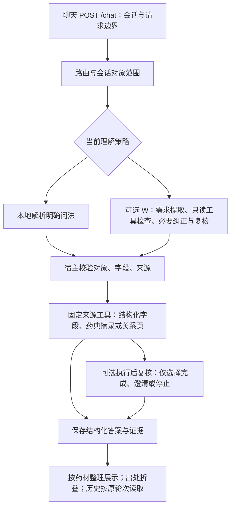

# 中草药资料问答：业务案例与三分钟演示

更新：2026-11-06。适用基线：应用实现 `12a38a9`，测试及交付记录 `3026826`。本页更新演示口径，未新增业务能力或模型成绩。[旧工作台演示](history/PROJECT_DEMO_BEFORE_QA_DEMO_20261106.md)保留，旧端口和表格实验不作为当前主线。

## 业务背景

面向需要核对中草药基础资料的学生和研究资料整理者。典型任务是先确定药材，再补问性味、归经、药典用量；不同字段可能来自不同来源，用户需要看到答案并能返回原文核对。这是拟定使用场景，尚无真实机构客户或用户访谈结论。

手工工作通常需要分别查结构化记录与药典条目，辨别名称、字段、缺项和出处。项目把这些步骤放进连续对话：用户无需每次重新输入药名；程序按字段选择默认来源，保留显式来源要求；答案集中展示，出处按需展开。没有测量节省时间或人工错误率，因此不宣称效率提升百分比。

交付物是**对象、字段、来源对应正确且可回查的资料答案**。不涉及个体用药建议。关系分页只交付当前页；固定模板表格目前是候选功能。

## 使用哪个入口

- 已部署的本地 Docker：<http://127.0.0.1:7934/>，交付记录中为模型关闭、fixed 执行，适合排练已有问法。
- Python 试用实例：<http://127.0.0.1:7896/>，交付记录中启用 W 理解与执行后反馈，提问可能产生模型费用；不把它当作免费演示入口。

端口和开关是 2026-11-06 的部署记录，使用前核对运行状态；两者状态目录独立，不能用一个实例的会话验证另一个实例的恢复。见[交付记录](../audits/qa_release_v1/README.md)。

`app.py` 是 FastAPI 应用入口；`scripts.preview_local_tasks` 是设置本地数据与功能开关、启动应用的辅助命令。另开实例时用空闲端口和新的状态目录，按[README](../README.md#本地运行)准备资料；不要为了排练覆盖现有服务或状态。私有数据库、索引与 PDF 不随 Git 或镜像分发。

## 三分钟演示

下列是已有走查问法，用于展示实现，不算新题评测。使用新浏览器会话，保持同一会话完成全程。

| 时间 | 操作 | 要让观众看到的结果 |
|---|---|---|
| 0:00–0:25 | 介绍上述资料核对场景 | 明确用户任务和资料来源，不展示未验收功能清单 |
| 0:25–0:45 | 输入“我想了解茯苓的信息” | 询问具体字段，同时保留茯苓这个对象 |
| 0:45–1:15 | 输入“给出性味和剂量” | 继承对象；性味来自 ETCM，用量来自药典；同药信息集中呈现 |
| 1:15–1:35 | 输入“归经呢” | 继续查茯苓的归经，不重复询问药名或默认来源 |
| 1:35–2:00 | 输入“查询泽泻的ETCM药用部位和药典功能与主治” | 新对象与两种来源对应正确，原答案仍保留 |
| 2:00–2:30 | 展开药典出处，打开原页，再刷新聊天页 | 原轮次字段答案可回看，历史出处可打开；在当前保留窗口内恢复 |
| 2:30–3:00 | 展示一份交付记录和一处限制 | 工程恢复已验证；新问法下模型理解仍需单独验收 |

若遇失败，保留问句、请求编号和页面结果，沿[诊断说明](REQUEST_DIAGNOSTICS.md)定位；不要临场换同义词直到成功，再称原题通过。演示不需要开启表格、向量检索或 native。

## 当前调用链

这是主线逻辑图，并非所有请求必经同一函数：`app.py::chat` 可直接路由普通查询；复杂字段和追问可经 `tcm/dataops/chat.py::execute`、`conversation_scope.py::prepare`、`DataOpsService.submit_research_question`，再由 `answer_delivery.py::deliver_saved_query` 执行并保存。普通资料查询不必经过历史表格的队列或 LangGraph 图。

W 的 `requirements_feedback.py::run_requirements_feedback` 每次理解最多 3 次模型请求；执行后 `result_feedback.py::review` 最多另加 1 次。它只看受限工具状态，不重查工具、不改写药学答案，不能替代宿主校验。未启用时这两个模型环节不参与。前端 `assets/web/answer_delivery.js` 确定性合并展示，未增加润色答案的模型调用。

## 证据与下一步

- [真实资料走查](../audits/qa_real_data_walkthrough_v1/README.md)保留最初发现的历史答案恢复缺口；[后续修复](../audits/chat_history_recovery_v1/README.md)记录恢复验证。
- [版本交付](../audits/qa_release_v1/README.md)记录 Docker、源码一致性与最终 217 模块 / 1891 项离线检查。这些不是 1891 道真实用户题。
- [面试证据](INTERVIEW_EVIDENCE.md)解释个人贡献与技术取舍；[小批量真实模型验收](../audits/qa_live_acceptance_v1/README.md)为 3/4 场景通过。追问缺口随后已[修复并离线验证](../audits/qa_followup_fix_v1/README.md)，7896 已加载，Docker 未更新，原模型首测不改分。

项目已有限定问答的实现与部署记录；新使用证据暴露的追问缺口须如实说明。若继续收尾，仅针对已定位的问题，不为演示加入新的基础设施。
