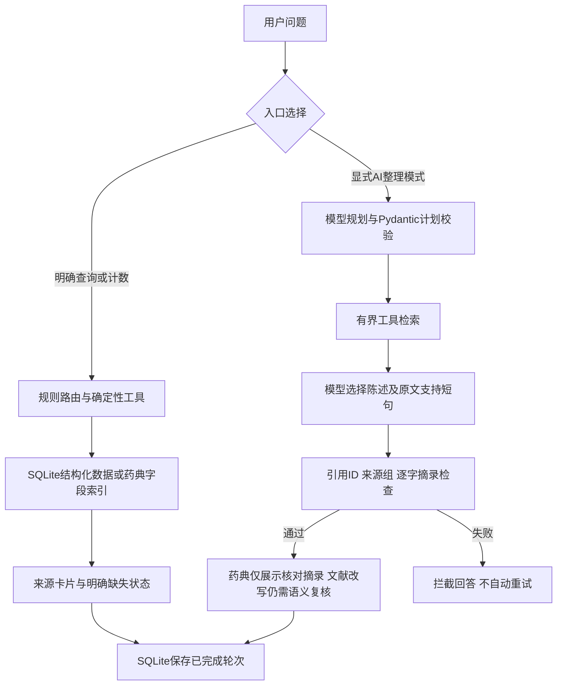

# 中草药研究助手：5分钟演示与项目讲解

当前本地交付：本功能已进入7876的`tcm-research-chat:c4de8bc`镜像，见[版本、启动及容器验收](releases/RESEARCH_LOCAL_C4DE8BC.md)。下方源码阶段记录保留其当时的验收边界；7875源码预览需按命令另行启动，不视为当前运行状态。

演示目标：让观看者看到一个真实问题如何被理解、检索和限制，而不是罗列框架。当前有真实开发题及原失败两题的重测记录，没有独立准确率结论。

## 打开当前源码预览

本机已启动 **http://127.0.0.1:7875/**，使用当前源码，独立于7873旧容器。当前已启用本地ETCM和药典只读工具，AI整理仍使用合成资料。重新启动时，在项目根目录使用已安装`requirements-research-chat.txt`依赖的Python环境运行：

```bash
python -m scripts.preview_evidence --port 7875 --with-local-research --with-local-herbs --etcm-enrichment var/etcm_enrichment_v1/data/enrichment.sqlite3 --etcm-source /home/zry/workspace/HDCTI/dataset/ETCM2.0 --etcm-targets var/etcm_target_links_v1/targets-paths.sqlite3
```

本机已验证的Python为`/tmp/tcm-ci-mail-env/bin/python`；它是临时环境，不保证换机或清理/tmp后仍存在。新环境先安装依赖，再配置`.env`中的聊天模型。启动服务本身不发起模型调用；每次勾选“AI整理回答”并发送问题时，会调用已配置的真实模型，传入的是当前合成问题与虚构片段。该入口不需要Tavily或嵌入模型服务。

启动器固定AI为合成模式，默认关闭真实工具；`--with-local-research`只启用确定性的药典查询和原页预览，使用项目的`var/mineru_retrieval_v2`及`data/`下两份已提供的药典PDF，按原服务校验快照。

`--with-local-herbs`启用`var/tcm/herbs.sqlite3`，固定默认版本`local-2026-10-10`；也可用`--herb-db`和`--herb-version`显式选择数据库及版本。启动前只读校验Schema、所选版本和有效记录，缺库/缺版本/无有效记录时拒绝启动，不创建空数据库假装成功。`GET /ready/herbs`可单独检查ETCM就绪，`GET /ready/research`检查药典；`/health`只证明进程可用。当前两类数据均就绪，概览显示2076条ETCM来源记录及616个药典候选，数量不相加。

PubMed、网页搜索、语音和图像仍关闭，普通公开来源清单为空。两个本地数据选项都不改变AI的合成模式；省略对应选项会关闭该真实资料工具。

会话保存在`var/evidence_assistant_v1/preview/memory.sqlite3`，Cookie名为`tcm_synthetic_preview`；关闭服务不会删除记录。前台启动后用Ctrl+C停止，重启同一命令即可恢复。可用`--state`选择另一个预览目录；浏览器Cookie仍共用该预览名称，不把多个预览当成账户隔离。

当前预览已开启自动意图识别。“示例草的使用风险？”和“示例草今天卖多少钱？”可以直接发送，无需勾选。明确字段查询、指令和会话内可识别追问仍优先走规则；规则已选中但资料工具关闭或无证据时，不自动转模型补答。查询真实白术时不勾选AI即可走本地药典；测试虚构示例草的“功效”时应勾选AI整理，强制选择虚构资料工作流。未匹配的真实药材问法目前也只会进入合成AI工具，不能因此宣称真实药典语义问答已全面开放。

可依次尝试：

| 输入 | 观察内容 |
|---|---|
| 数据概览 | 两库就绪状态、各自的来源数量与ETCM原始分类；不是去重后的药材总数 |
| BaiZhu的药用部位 | 不勾选AI，查询ETCM来源字段，并可展开JSON Pointer、原值与文件SHA |
| 它的药性呢，然后出处呢 | 紧接ETCM查询，沿用同一来源记录；缺失字段显示未提供 |
| 在ETCM查询HuangQi的归经 | 显式选择ETCM；词表中文与原值并列，不自动合并实体 |
| /herb 白术 | 查看中文名称候选及“根/根茎”跨库冲突后选择来源；展开成分分页及其他药材来源 |
| /herb 黄芪，或 /herb 甘草（分别发送） | 查看基原文字与部位一致提示，仍为未人工确认；展开双方原文及药典页码 |
| 白术有哪些成分 | 先选择ETCM来源，返回307条来源成分行；展开成分详情核对名称、分子式、分子量，再查看来源CAS/PubChem及JSON出处；没有直接靶点时明确提示 |
| 白术和黄芪有哪些共同靶点 | 选择双方来源，查看151个相同来源声明UniProt标识、双方原始行和分页；不是药效结论 |
| CYP24A1有哪些成分 | 返回Q07973来源直接收录的11条成分行，展开靶点原文件SHA及抓取状态 |
| P04278有哪些成分 | 查询2639条来源成分行；翻页固定UniProt，未证明结合或作用机制 |
| 靶点CYP19A1有哪些成分 | 名称变体暂未纳入，显示当前未覆盖，不解释为没有关系 |
| 白术的成分关联哪些靶点 | 选择来源；307条成分行中71条与靶点文件三字段对应，展示213条候选路径、47个UniProt和双方原始行 |
| HuangQi的成分对应哪些靶点 | 展示197条候选路径、60个UniProt；缺失/未匹配与目录覆盖独立显示，不能解释为药效机制 |
| 查白术成分、选择来源后追问“这些成分对应哪些靶点” | 沿用同会话来源；刷新和重启后仍可按来源重读，不把全部原文存入记忆 |
| 帮我把白术的成分和相关靶点串起来 | 有限关系改述识别，仍需核对中文候选并选择来源 |
| /research 白术的功效，或白术的功效 | 不勾选AI，显示本地真实药典的候选字段与出处；模型调用0，未人工审核 |
| 比较白术和黄芪的功效与用量 | 不勾选AI，按字段并列表格，分别展开两味药的来源与原页 |
| 请整理虚构示例草的功效并附来源。 | 原文摘录、`L1`、合成来源卡片；不能将测试属性理解成真实功效 |
| 示例草的使用风险有哪些？ | 规划应选注意字段；输出仍是虚构注意资料，不提供医学建议 |
| 示例草今天卖多少钱？ | 超范围提示，不进入资料检索 |
| 它有什么用？ | 当前AI整理不发送历史，缺少当前药名应要求澄清 |

页面会显示“自动意图识别已开启”，接口普通请求`{"query":"示例草的使用风险？"}`也可触发；响应`routing.reason=unmatched_rule_model_fallback`可用于确认实际路径。自动路由开关为`ENABLE_EVIDENCE_AUTO_ROUTING=1`，普通部署默认关闭，且必须同时启用自然语言路由、AI整理并处于synthetic模式。切到local_sources会停用自动兜底，不扩大此前两次有限真实来源测试的授权。

确定性ETCM、药典和概览请求不调用模型；合成AI资料整理最多2次模型调用，模型判定超范围/澄清通常1次。模型失败仍可能出现，调用上限不代表成功承诺。历史回放展示旧版真实模型实验；当前页面的本地工具、合成AI路径和历史记录要分别说明。

2026-10-19现场验收：页面/模式提示、健康状态、真实药典关闭、合成整理、超范围停止、同会话记录和异会话隔离7项HTTP检查通过；另重启预览进程后恢复4条消息，新增模型调用0。两条聊天验收共3次模型调用，真实来源片段0。另2项启动配置与误用来源拒绝测试通过；此前51模块466项全量离线成绩属于前一轮，不将本轮2项直接拼成新的全量成绩。本轮记录在`var/evidence_assistant_v1/preview_acceptance/`，Cookie仅本地保存，不提交。

后续启用本地只读药典后的验收单独记录在`var/evidence_assistant_v1/local_research_preview/`：原指令、无指令问法及概览3项HTTP通过，原问题来源卡片等4项浏览器检查通过；启动配置及AI合成边界3项测试通过。没有调用外部模型或外发来源片段。旧纯合成状态下的503浏览器回归需用不带`--with-local-research`的另一个预览实例运行，不能以当前partial结果替换原不可用场景。

ETCM基础接入时，54模块488项离线回归、8项实际浏览器检查通过，包括就绪、双库概览、自然拼音字段与JSON出处、追问、刷新及会话隔离、显式ETCM查询、中文未映射保护及数据库字节不变；模型调用0。记录在`var/evidence_assistant_v1/etcm_preview/`。此时概览为ok，不再沿用此前仅药典可用的partial记录。

后续中文对照及关联增量已完成：2076条双语记录、584583条来源关联、520条药材中文名候选。当前55模块498项离线及9项真实浏览器检查通过，基础库SHA不变、外部模型调用0。中文名称候选须选择来源，机器译文未审核且默认折叠，成分/靶点文件仅作文件名候选，没有自动合并或临床质量结论。使用方法及完整限制见[ETCM中文对照与来源关联](ETCM_LOCALIZATION_AND_LINKS.md)。省略启动命令中的`--etcm-enrichment`即可回到基础查询。

### 两味药材的本地原文对比

当前7875还支持“比较白术和黄芪的功效与用量”或“白术与黄芪的功效和注意有什么区别”。最多两味明确药名、两个已支持字段；也可用`/research 比较白术和黄芪的功效`。没有明确字段、药名不完整或超出预算时先要求澄清，不静默减少对象或字段。

比较先对完整原问执行药名和炮制品保护，再分别查询各药各字段；表格直接展示检索原文，各列有独立来源卡片。缺失、重复、未展开引用分别保留状态，整体标为partial，不解释成无作用或无禁忌。这里没有模型归纳、疗效排序或替代用药建议。

对比后不自动选择其中一味作为会话焦点，追问请明确“白术的用量”等。当前只持久化固定对比摘要，刷新后不自动恢复完整表格；可重新发送原问题恢复。原页按钮可按各字段展开；源码现已提供“导出对比证据 Markdown”，按药材/字段保留原文、缺失状态与出处，见[范围和验收](COMPARISON_EVIDENCE_EXPORT.md)。AI勾选仍会强制选择原合成流程，所以查询真实对比时保持未勾选。

本轮54模块483项离线回归全部通过；两条真实本地开发问题的表格原文一致性、缺失字段、追问和移动端等5项浏览器检查通过，模型调用0。它证明对比功能连接和来源展示，不是药典准确率或临床效果评测。

## 打开离线回放

当前工作区已生成`var/evidence_assistant_v1/demo/replay.html`，用浏览器直接打开即可。不需要Docker、API密钥、网络或模型服务；页面显示的是已保存运行结果，耗时和token属于记录中的运行，不是当前回放速度。

从已有本地记录重新生成时，选择一个尚不存在的输出文件：

```bash
python -m scripts.replay_evidence_demo --out var/evidence_assistant_v1/demo/replay-new.html
```

生成器仅用Python标准库读取4份已保存记录；不读`.env`，不启动服务器，不创建新模型调用。原始记录不在公开Git中，演示HTML也位于忽略的本地目录。新克隆若缺少`live_batch_01.json`、`source_quote_recheck_01.json`、`boundary_before_01.json`和`boundary_after_01.json`，会报缺少文件，不能生成真实回放；不会补造一份成功记录。完整路径和实验方法见[实验记录](LLM_APPLICATION_EXPERIMENTS.md)。

如需录屏，先打开此回放页，按照下表操作；明确说“这是历史实测回放”。7873容器尚未包含新的AI工作流，不能把该容器界面当作本轮新功能的现场演示。

## 5分钟讲解顺序

| 时间 | 操作 | 要讲清的事实 |
|---|---|---|
| 0:00–0:40 | 展示场景与下方架构图 | 面向中草药资料查阅；ETCM结构化记录与药典字段有不同来源。精确计数走规则；需要改写和选段时使用有界模型流程。 |
| 0:40–1:30 | 选择D01，展开规则入口和模型查询计划 | 原问“拿来干什么”没有被规则可靠转换为功效查询；模型改写后取到同一索引中的候选。收益来自任务理解，不是证明换了检索算法更准确。 |
| 1:30–2:30 | 对照D01首轮与修复后回答，展开来源 | 首轮引用ID真实存在，但模型自行把并列功效与主治配对。修复后要求支持短句，服务端只展示原文摘录，保留两份列表。说明牺牲了自由总结能力。 |
| 2:30–3:15 | 选择D05，查看partial及缺失查询 | 注意字段没有取到；如实保留部分完成，不把没有证据的注意事项补上。不能因为回答有引用就把任务记为完整成功。 |
| 3:15–3:50 | 选择B06，再快速切换D03/D04 | B06是合成撤稿故障：过滤记录后仍须把缺失状态传给模型。D03先澄清，D04无资料时停止；这两题没有在新版本重测。 |
| 3:50–4:30 | 展示调用次数、耗时和token | 首轮5题8次模型调用；原两题另获授权重测4次。摘录格式增加支持项，两个题输出token都增加；不编单次费用或延迟提升。 |
| 4:30–5:00 | 展示限制与下一项实验 | 现阶段是受约束的资料助手。五方案本地检索开发对照未显示足够dense收益，故保留名称字段默认；独立测试集、引用上下文审核及多人生产能力仍待完成。 |

## 当前架构及验证范围



已验证的真实批次只用药典工具，文献工具被禁用。文献适配器和合成故障测试不能包装成已完成真实跨来源综述。每题最多2次模型调用、2个本地查询；本地每查询最多3条命中、每条正文800字。模型不接收会话历史；最终展示的摘录会保存在本地会话。

## 从源码解释个人工作

| 部分 | 继承或本项目改造 | 讲解入口 |
|---|---|---|
| 多Agent医疗系统、LangGraph/LangChain、Qdrant等原能力 | 上游开源项目基础；不能把全部原有模块算作新领域成果 | README保留的原项目说明 |
| 结构化药材、药典候选、来源定位及确定性会话 | 中草药场景的已有改造；SQLite查询与名称字段检索为当前主要路径 | `tcm/herbs.py`、`tcm/mineru_retrieval.py`、`tcm/mineru_chat.py` |
| 有界模型任务、支持短句和摘录展示 | 本轮新增；复用现有工具，不另建一组Agent | `tcm/evidence_assistant.py` |
| 默认合成入口、显式AI模式、持久会话 | 在主聊天接入新流程；现有容器未发布该增量 | `agents/agent_decision.py`、`app.py`、`templates/index.html` |
| 开发评测、有限外发预算、原失败与修复对照 | 本轮新增；开发自查不冒充独立人工评测 | `scripts/eval_evidence_live.py`、`tests/test_evidence_support.py`、实验记录 |

项目表达保留“基于开源项目改造”。开发中使用了AI辅助，讲解时区分采用的建议、实际验证结果和本人能独立复现的内容。以下描述应在你能从源码解释并亲手跑通后使用。

## 可用于项目介绍的表述

> 基于开源医疗助手改造中草药科研资料助手，复用LangGraph编排，将SQLite结构化查询、药典字段检索和显式AI整理入口接入统一聊天。为模型设置查询、片段和调用预算，记录耗时与token，处理澄清、资料缺失和工具失败。执行5道真实开发题后发现引用ID有效仍会出现来源未明示的关联，增加原文支持绑定与药典摘录展示，并在原两道失败题的单次重测中未再展示该扩写；缺失字段仍明确保留部分完成。

面试时不把5题说成大规模黄金集，不把原题重测说成独立泛化效果；不声称准确率提升百分比、自动诊疗、生产高并发、dense/重排收益或长期语义记忆已验证。

## 自己应能回答的6个问题

1. 为什么计数不交给LLM？它有确定的数据库答案，模型调用增加不必要的成本和不确定性。
2. 为什么引用ID有效仍会出错？ID只证明来源存在，陈述可能把来源的并列事实变成未写明的关系。
3. 为什么增加supports还要限制展示？正确原文可以与错误改写一起出现；当前药典展示由服务器只保留核对摘录。
4. 摘录为什么也不能自动判为正确？选段可能不相关或丢失上下文；文献改写尤其还缺语义蕴含检查。
5. 修复代价是什么？自由总结能力收窄，支持项增加输出token，缺失字段仍缺失；两道单次耗时不能推出稳定P95。
6. 为什么现在不增加数据库或检索框架？SQLite满足当前查询和会话需求；已做五方案本地对照，规范题dense没有优于名称字段，改述题没有明显胜于BM25，且仍有范围拒答问题，所以保留默认。独立效果及hybrid/重排收益未验证，未实验的术语不算收益。

下一次有效投入是：本人按讲稿完成一次录屏或模拟面试，记录解释不清的具体点；随后按[业务验收约定](APPLICATION_EVALUATION_PROTOCOL.md)补未见题。已有五方案对照及8条真实模型合成规划烟测，不默认重复运行。回放生成与本说明不增加真实资料外发额度，也不要求发版。

2026-10-20自然用途问法增量：7875支持“金银花能派上什么用场”“连翘一般拿来干什么”“丹参有哪些应用记载”，显示药典未审核原文及来源；可继续“出处呢”或“用量呢”。使用前取消“AI整理”选择以演示确定性工具路径。未知完整名称不自动映射，炮制品仍需独立范围；这是有限问句识别，不是任意问题理解。六条已知失败修复的同题成绩见[评测记录](SCOPED_RECALL_EVALUATION.md#用途改述修复与同题回归2026-10-20)。

2026-10-20研究收藏：展开聊天上方“研究收藏（持久保存）”，在药典查询或ETCM来源选择/翻页后点击“收藏当前查询”，可添加个人笔记。清空聊天及实际重启后仍可预览；预览不会把收藏恢复成当前聊天焦点，笔记不进入模型。修改/删除冲突会提示刷新。仅同一浏览器匿名访问，清理Cookie失去入口；不是跨会话语义记忆。[使用与限制](RESEARCH_BOOKMARKS.md)。

2026-10-20收藏备份增量：研究收藏区点击“导出备份（含个人笔记）”，在另一个浏览器选择下载的JSON并“导入备份”，创建独立收藏副本；重复导入保留当前笔记。来源变化时预览停止，不自动切换数据。无备份仍不能找回丢失的匿名入口，未做账号恢复或自动同步。

2026-10-20：收藏卡片可点击“导出证据笔记”下载Markdown；勾选“包含已保存的个人笔记”才携带笔记，未保存的编辑不导出。演示白术关联第二页时，清单仅含该页20条，不能说是全部213条机制。药典显示原文、修订和物理页码。见[证据笔记说明](BOOKMARK_EVIDENCE_NOTES.md)。

## 疾病富集来源增量（2026-10-20）

新增科研来源查询：“白术有哪些疾病富集记录”。选择ETCM来源后查看疾病原名和“疾病表抓取状态”，再问“出处呢”或收藏导出。演示时明确：当前白术20行且状态skipped，不是全量疾病列表，不代表能治疗这些疾病。[说明](ETCM_DISEASE_ENRICHMENT.md)。
