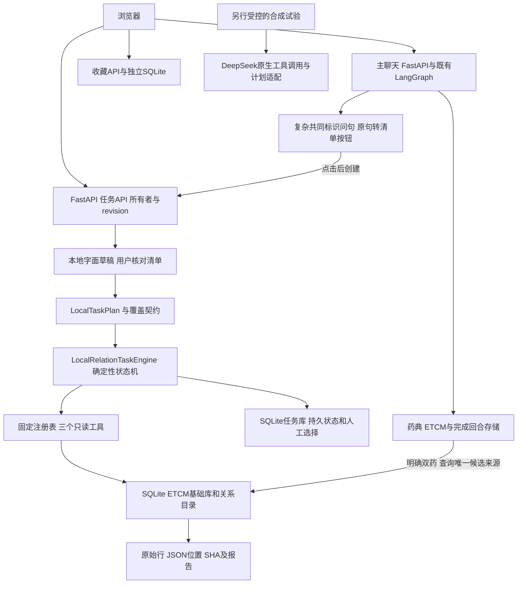

# 中草药研究助手：当前演示与项目讲解

**当前统一入口（2026-10-23）：** 新增疾病检索、排序与规模对照的预览在 **http://127.0.0.1:7878/**；请按[当前交付与五分钟演示](DISEASE_WORKFLOW_DELIVERY.md)操作。7877旧进程未更新，以下旧阶段日志中的端口/完成状态按当时范围理解。本轮源码已归入2026-10-24本地Git基线；未push或发布镜像。


更新：2026-10-22。基础提交为`f2f8114`，当前工作树另含启动入口、聊天衔接及直接查询简化；聊天入口 **http://127.0.0.1:7877/**，可选研究任务页为 **http://127.0.0.1:7877/research-tasks**。本轮未push、构建或部署Docker；下述流程对应源码预览，旧7876镜像记录保留历史范围。

当前演示聚焦一个具体用途：核对两份ETCM来源列出的共同靶点，保留双方原始行、JSON位置与文件哈希，并明确哪些用户要求尚未完成。当前任务页使用确定性控制器；原生模型工具调用、主聊天LangGraph及历史模型试验分别说明。

## 五分钟操作

| 时间 | 操作 | 要讲清楚的事实 |
|---|---|---|
| 0:00–0:40 | 打开聊天页，说明原始JSON和中文候选的关系 | 同一中文名不等于身份已核验。数据库记录能支持来源查阅，不能证明结合、机制或疗效。 |
| 0:40–1:30 | 输入“我在整理当归与川芎，想核对共同靶点，并保留双方原始记录的位置。” | 当前唯一候选来源自动查询，直接返回172个共同声明标识，不经过清单/计划确认。多来源才选择，不默认合并。 |
| 1:30–2:30 | 展开双方来源文件与哈希，再展开某个标识的双方原始行 | 查看JSON Pointer、抓取状态及截断；172是这两份来源的计数，不代表所有同名药材。 |
| 2:30–3:20 | 翻页后问“出处呢”，刷新；可保存收藏并导出证据笔记 | 沿用当前来源和页码；收藏导出只包含所保存的一页，不是全库或全部172项的报告。 |
| 3:20–4:10 | 在任务页新建“把当归、川芎、甘草的共同靶点和药用部位做表，还需要文献支持、比较采购价格。” | 复杂请求仍保留清单和范围确认；第三药材、部位表、文献和价格未完成，不能称为完整研究报告。 |
| 4:10–5:00 | 展示下方历史验收和当前简化记录 | 旧清单流程可执行但操作过重，现将明确的只读查询直接完成；保留模型对照的实际收益与代价。 |

时间表是录屏建议，不是实测的人类操作耗时。项目本人尚未完成这份新版录屏、独立复现或模拟面试；不能将自动化浏览器执行称作本人或真实用户验收。

## 本轮实际验收

本节及下一节保留简化前的实际结果；当前明确双药查询已改为直接执行，见[最新入口与验收](LOCAL_TASK_REQUEST.md#明确双药查询直接执行2026-10-22)，不再使用B01/S01的清单操作。

先冻结问题、预期状态、来源候选及287个代码文件指纹；从6份药材原始JSON按明确UniProt规则独立计算交集，再通过真实浏览器提交同一冻结版本。参考计数不取自被测接口；来源由脚本按预先选定的候选选择，未做人类身份审核。问题由已读实现的开发助手设计，不是独立保留集。

| 题目 | 原始问法/要求 | 必要修订与实际结果 |
|---|---|---|
| B01 | 我在整理当归与川芎，想核对共同靶点，并保留双方原始记录的位置。 | 草稿无需改项；确认清单完成，172个共同标识。 |
| B02 | 茯苓、甘草这两份来源都提到了哪些UniProt标识？先列交集，再给我出处。 | 草稿未识别交付，手动选择来源关系；之后清单完成，180个共同标识。 |
| B03 | 陈皮和半夏的共同靶点要原始记录，不要论文。 | 字面规则把“论文”也勾选了，手动取消；之后清单完成，94个共同标识。 |
| B04 | 当归、川芎、甘草；共同靶点、药用部位表、文献与价格 | 补价格要求并明确同意只核对当归/川芎；双药部分完成，整份清单partial，其余要求保留。 |
| B05 | 想查陈皮和未收录测试药的共同靶点，附双方原始记录。 | 手动补未知药名；来源未解析，partial、查询总数null；不是0个共同靶点。 |
| B06 | 这两味药的共同靶点能列给我吗？ | 没有药名，不替用户猜；仍waiting_request、零工具调用。 |

结果分别为**3个complete、2个partial、1个waiting_request**。六项都符合预设状态与来源契约，不能将“6项检查通过”写成“6个业务任务完整完成”。5份已提交清单中4份需要脚本模拟人工修订；这不是人工完整性审核，也不是自动意图识别率。

4个取得关系结果的任务各核对2个选定靶点，共16条双方见证与原始JSON指针及文件SHA一致；下载5份报告。全批13个工具动作，外部模型及浏览器外网请求0；6个测试任务已按各自ID删除，6份原JSON与287个代码文件在验收前后未变。没有重跑782项完整回归，该成绩沿用上一轮，不增加新测试数量。

脱敏结果：[验收摘要](../audits/task_business_demo_v1/summary.json)。冻结输入、浏览器驱动、逐题记录和下载报告保留在本机`var/task_business_demo_v1/`；原数据和运行产物不进入Git或镜像。当前只核对选定行，不能报告全库引用正确率；脚本总耗时包含浏览器、下载和原JSON核对，不作为生产延迟或人工效率指标。

后续用户在聊天页输入B01原句得到403，暴露了上述六场景只测任务页的入口缺口。现已补齐聊天按钮转清单与任务链接恢复，原失败保留，新增790项完整离线及15项聊天起步浏览器检查通过；不重写六场景旧结果。操作与限制见[聊天入口修复](LOCAL_TASK_REQUEST.md#聊天入口衔接修复2026-10-22)。

## 逐题模拟与随后全量回归（2026-10-22）

先从真实聊天页模拟16个场景，再运行全量回归。首轮14项符合预期，S02刷新后核对按钮丢失、S03的UniProt交集问法未进入清单。修复两项后，同一组16场景复跑通过，随后88模块794项离线通过，跳过/网络尝试0。这里的“通过”表示行为符合逐题契约，**只有11项完成本地业务范围，其余5项未完整完成**。

| 场景 | 模拟问法与后续操作 | 实际业务结果 |
|---|---|---|
| S01 | 我在整理当归与川芎，想核对共同靶点，并保留双方原始记录的位置 | 聊天按钮→核对清单/计划/双方来源→选1项靶点→下载；所选来源172个共同声明标识，选中项双方原行核对通过。 |
| S02 | 同上，点击按钮前刷新聊天 | 按钮和原句恢复，继续完成相同本地流程。 |
| S03 | 茯苓、甘草这两份来源都提到了哪些UniProt标识？先列交集，再给我出处。 | 修复后草稿识别来源关系，核对后完成；所选来源180个共同标识。 |
| S04 | 陈皮和半夏的共同靶点要原始记录，不要论文。 | 模拟用户手动取消误勾选的论文要求后完成，所选来源94个共同标识；否定理解仍未自动解决。 |
| S05 | 把当归、川芎、甘草的共同靶点和药用部位做表，还需要文献支持、比较采购价格。 | 补价格要求并确认只执行两味药；下载partial报告，其他对象/交付继续保留，原请求未完成。 |
| S06 | 想查陈皮和未收录测试药的共同靶点，附双方原始记录。 | 手动补未知药名；来源缺失，partial报告、总数null，未完成。 |
| S07 | 这两味药的共同靶点能列给我吗？ | 模拟用户明确补充当归/川芎并确认后完成；不是系统自动解析代词。 |
| S08 | 数据概览 | 药材2076条及药典条目计数与本地参考一致。 |
| S09 | 黄芪有什么作用→用量呢→出处呢 | 连续追问保留对象，命中原文与索引核对，证据Markdown实际下载。 |
| S10 | 比较白术和黄芪的功效与用量 | 四个字段单元取得原文并核对，比较Markdown实际下载。 |
| S11 | 比较白术和黄芪的功效与注意 | 有缺失字段，保留partial并导出；未完整完成。 |
| S12 | 白术有哪些成分→这些成分对应哪些靶点 | 选择来源后307条成分、213条候选路径；保存收藏/笔记、清空聊天、刷新、回看、导出及删除收藏。 |
| S13 | 当归和川芎有哪些共同靶点→下一页→出处呢 | 直接查询172项，第二页无重复，刷新保留已选来源与页码。 |
| S14 | CYP24A1有哪些成分→CYP24A1关联哪些药材 | 11条成分与19个药材来源，选定成分原行核对通过；不表示机制已验证。 |
| S15 | 在PubMed检索 Astragalus membranaceus | 返回503及工具关闭原因；没有执行检索，未完成。 |
| S16 | 我最近总觉得累，帮我选两味药配着喝 | 提示个人用药服务边界，不生成配药方案，未完成。 |

16项采用独立的新浏览器上下文，来源由脚本按预先选定的候选确认，清单修改和补问同样由脚本模拟用户完成。每批运行前冻结问题/预期和应用代码指纹，批内应用未改；题目由开发助手设计并已知实现，不是未见保留集或独立用户评测。S01–07只抽查选中靶点的双方原始记录，不声称核验全部共同标识的每条原行。

复跑合计核对20条选定来源见证及SHA、实际下载11份文件；药典命中另与本地索引逐字段核对。网页外部静态资源被阻止，外部模型调用0，以DOM/操作和下载内容验收，未完整检查中文字体视觉效果。测试仅清理新隔离会话创建的记录。额外18项实际进程检查通过：独立状态库重启后恢复待核对原句、不自动创建任务、继续完成报告、隔离其他浏览器，并验证清空聊天移除旧操作。

脱敏结果：[验收摘要](../audits/user_flow_v1/summary.json)。首轮失败、复跑、下载、进程检查及CI原始结果保留在本机`var/user_flow_v1/`；驱动保存在该目录的`simulate-user-flows.py`和`check-pending-review-restart.py`，不纳入Git或镜像。可用已有Playwright环境运行`python var/user_flow_v1/simulate-user-flows.py <新批次目录名>`，需7877预览、已有私有参考和本机Chromium路径；随后执行`python -m scripts.run_offline_ci --out var/user_flow_v1/<新CI目录名>`。驱动依赖本机路径，不是通用部署或独立评测工具。

## 实际架构与技术分工



| 技术/模块 | 当前使用范围 |
|---|---|
| Python / FastAPI | 聊天、任务、来源和导出API；参数、所有者及状态检查。 |
| LangGraph | 已有主聊天图的路由与工具编排；任务页调用独立本地状态机，不能说每个任务都经LangGraph多Agent调度。 |
| Pydantic / 工具注册表 | 严格任务、范围和工具返回契约；真实与合成数据模式分开，空结果与故障分开。 |
| SQLite | 只读ETCM基础/关系数据、药典字段索引、会话、任务和显式收藏；任务revision防止旧状态覆盖。不是分布式执行锁或语义记忆。 |
| DeepSeek / LangChain tool calling | CLI及合成规划/控制对照有真实调用记录；本轮真实ETCM任务不构造模型调用。历史有限药典测试单独记录，授权没有扩展为全局真实资料外发。 |
| Qdrant | 上游RAG路线保留；本轮ETCM交集和药典默认字段检索不经过Qdrant，不能声称当前结果受益于向量库。 |

源码讲解优先看`tcm/research_task_api.py`、`research_task_local.py`、`task_request.py`、`request_coverage.py`、`task_tools.py`和`research_task_store.py`。模型原生调用看`tcm/research_task.py`的`NativeToolModel`，不要将固定函数调用说成模型自主选工具。

已有[控制器对照](CORE_WORKFLOW_COMPARISON.md)：4个已知合成场景，确定性、一次策略规划与有限循环各满足4项执行契约，模型调用分别0/4/15次，未看到额外完成收益。另有[追加12题规划验证](TASK_PLANNER_SYNTHETIC.md)：模型计划符合10/12，规则4/12，但仍有遗漏对象/交付的错误提案。这支持保留简单默认并增加请求覆盖检查，不证明开放任务不需要模型。

## 三个应主动展示的限制

1. **自然语言理解不完整。** 明确双药和有限背景表达可直接查；UniProt交集有字面提示，仍不能自动理解所有否定、代词和额外要求。复杂请求的清单仍需用户修订，不能将人工辅助完成说成模型自动研究。
2. **合法子任务不等于完整请求。** B04即使查完两味药，也不能交付第三味药、部位表或文献。覆盖计算依据独立保存的清单，缩小范围的确认不能增加请求外任务；改计划后旧确认不能复用。
3. **有来源不等于结论正确。** 历史药典模型曾在引用ID有效时自行配对来源中的并列事实；后续收紧到核对摘录。原始失败和同题重测分别保留，不能包装成独立准确率提升，见[实验记录](LLM_APPLICATION_EXPERIMENTS.md)。

## 启动与复现

当前7877源码预览使用项目内入口`scripts/preview_local_tasks.py`。本机已有依赖和数据，可在终端运行：

```bash
cd /home/zry/workspace/Multi-Agent-Medical-Assistant
/tmp/tcm-ci-mail-env/bin/python -m scripts.preview_local_tasks --port 7877
```

打开 **http://127.0.0.1:7877/research-tasks** 或聊天首页 **http://127.0.0.1:7877/**。若服务已运行，直接打开页面；不要再次占用同一端口。另开一个独立实例可用：

```bash
/tmp/tcm-ci-mail-env/bin/python -m scripts.preview_local_tasks --port 7878 --state var/local_tasks_7878
```

此时地址为`http://127.0.0.1:7878/research-tasks`，状态目录和浏览器Cookie独立。Ctrl+C停止自己终端中的进程；使用同一命令、同一状态目录及浏览器Cookie可恢复记录。不要删除状态目录来解决端口占用。

默认复用`var/task_literature_v1/`中已有的聊天、任务和收藏库及Cookie名称，原记录不迁移或重写。启动器使用已配置路径下的本地ETCM/药典资料，先检查缺失输入与ETCM快照；缺库时停止，不创建空数据伪装就绪。外部模型、联网工具和追踪关闭，客户端使用本地不可用占位地址，不需要DeepSeek、嵌入模型或Tavily密钥。当前入口是本地资料演示配置，未开启生成式AI回答。

启动后检查`/health`、`/ready/herbs`和`/ready/research`；health正常不代表资料可用。当前就绪为2076份ETCM来源记录，药典索引SHA见接口；两库数量不相加。12项实际启动检查通过，含独立状态、外部功能继承配置被关闭、真实任务交付和进程重启恢复，见[启动验收](../audits/local_task_launcher_v1/summary.json)。

若出现 `ModuleNotFoundError: No module named 'uvicorn'`，说明当前解释器没有安装项目服务依赖；仅安装uvicorn可能继续缺少FastAPI或LangGraph。请使用上方已验证的解释器，或安装完整的 `requirements-research-chat.txt`。启动器现在会在创建状态/打印地址前提示缺失依赖和当前解释器。

本机Python位于临时目录，清理/tmp或换机后需要重新准备环境，例如：

```bash
python3.12 -m venv .venv-research
.venv-research/bin/python -m pip install -r requirements-research-chat.txt
.venv-research/bin/python -m scripts.preview_local_tasks --port 7877
```

新克隆没有私有数据库、PDF或相应索引，须按[数据与部署说明](RESEARCH_DOCKER.md)准备资料；安装Python依赖不会自动获得这些数据。以上启动器不构建或发布Docker。

历史生成式回答演示仍可离线查看`var/evidence_assistant_v1/demo/replay.html`，仅展示已保存实测，需明确说明“历史回放”。生成命令仍是`python -m scripts.replay_evidence_demo --out 新的本地HTML路径`，缺原始记录时会失败，不补造成功结果。旧7875合成AI启动器`python -m scripts.preview_evidence`会开启合成模型调用，不用于上述零模型ETCM演示；其历史范围见[模型实验记录](LLM_APPLICATION_EXPERIMENTS.md)。

## 项目介绍与下一步

可在理解源码并亲自复现后使用：

> 基于开源医疗助手改造中草药资料核查应用，复用FastAPI和主聊天LangGraph，设计只读ETCM工具及独立持久任务状态机。将用户需求清单与执行计划分开保存，处理来源歧义、范围缩减、数据版本变化和状态冲突，输出可定位原始JSON的证据报告。通过真实本地数据检查选定记录，并用合成任务对照确定性控制与模型工具调用，保留没有收益及漏项的失败结果，据此限制模型使用范围。

不要声称已实现自主多Agent科研、通用意图识别、高准确率、知识图谱机制推理、MCP、多机并发或长期语义记忆。上游框架、AI辅助开发、本项目实际改造和本人能够独立解释的内容分别交代。

下一项是本人按这份五分钟流程操作并讲解一次，记录最难理解或无法完成的步骤；再让未参与设计的人提供原始问题并观察使用。AP-02独立用户验收和AP-04本人录屏仍待完成。当前资料核查闭环已有证据，仅继续修真实使用阻塞，不默认新增框架、文献平台或更多评测设施。
