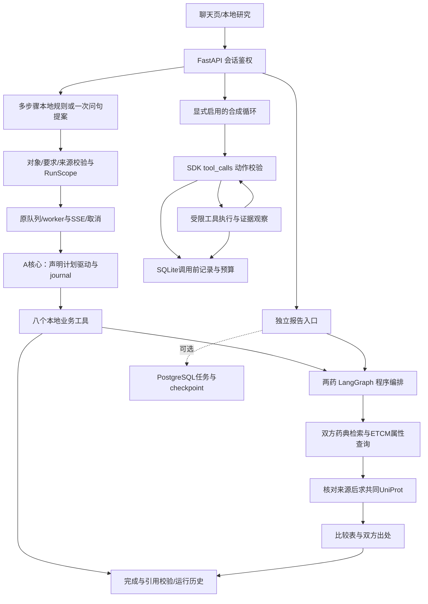

# 中草药研究助手：求职演示

更新：2026-10-29。LangGraph基线已升级至1.2.18，见[升级记录](LANGGRAPH_V1_UPGRADE.md)。当前聊天入口与限制见[多步骤聊天](CANDIDATE_A_CHAT_INTEGRATION.md)，最终任务顺序见[统一大纲](TCM_PROJECT_ROADMAP.md)。历史结果保留在audits中；以下启动命令不代表该端口必然已有服务。

## 项目一句话

在开源医疗助手基础上，构建面向中草药资料核验的研究助手：把药典文本和ETCM结构化记录做成可追溯的查询与比较报告，并对只读研究流程和工具循环分别实现有边界的持久化恢复。

目标用户是整理文献/资料的研究者。典型任务是“比较当归与川芎的药典属性，核对两份ETCM来源共同列出的靶点，保留原始出处”。当前结果是资料整理，不是新靶点预测、疾病治疗推荐或临床结论。

## 先分清执行场景

| 场景 | 数据 | 模型 | 主要证明什么 |
|---|---|---|---|
| 多步骤聊天 | 本地ETCM/疾病来源目录和药典索引 | 默认规则解析、声明计划本地执行；可选一次问句模型提案 | 多项要求、来源依赖、批次、完成/引用校验、后台进度与受控恢复；不是工具观察驱动的自主模型循环 |
| 双药报告 | 本地真实药典索引与ETCM记录 | 确定性检索/编排，演示不调用LLM | 数据来源、字段对齐、部分结果、双方见证 |
| 工具循环页面 | 固定虚构疾病与工具返回 | `OfflineModel`合成SDK替身 | 原生tool_calls契约、状态/预算、暂停恢复和owner隔离 |
| 中断与恢复脚本 | 合成工具数据 | 合成SDK或固定只读分支 | SIGKILL边界、pending处理、已保存步骤复用 |

项目另有DeepSeek接口适配和历史真实调用，但不是以上场景的默认执行者。不能把演示通过说成真实模型端到端成功率。

## 启动

当前建议预览入口：http://127.0.0.1:7896/ 。如需重新启动，先确认该端口没有正在运行的服务；不要启动两个不同配置的worker共用同一个队列。

```bash
.venv/bin/python -m scripts.preview_local_tasks \
  --port 7896 --state var/candidate_a_chat_preview \
  --diseases var/disease_catalog_v1/build/diseases.sqlite3 \
  --synthetic-loop
```

`.venv`是项目内已安装新版依赖的环境。其他机器创建Python 3.11或更高版本的虚拟环境，按`requirements-research-chat.txt`安装依赖。新版预览使用独立状态目录，旧会话和checkpoint未自动迁移。真实资料场景还需要既有ETCM数据库、药典索引及源文件；无数据时不能凭这条命令复现172这个计数。

这个启动命令不主动配置PostgreSQL、Qdrant、MCP或语义记忆。不要展示一串技术名词却默认它们都参与了请求；相关可选部署见各自里程碑。保持外部模型关闭即可完成此演示。

当前7896预览默认关闭模型；合成循环面板需要按上面的`--synthetic-loop`配置启动，不能只根据端口判断已启用。

可先在聊天中输入“当归的靶点画像，川芎的靶点画像”，展示计划、两次本地查询与折叠出处。也可问“当归的靶点画像，查找与川芎靶点最相似的药材，前5个”，展示超过16KB返回的摘要、按需读取及完整下载；见[正式外置接入](RESEARCH_EVIDENCE_OFFLOAD.md)。

## 八分钟演示脚本

| 时间 | 操作与预期 | 讲解重点 |
|---|---|---|
| 0:00–0:50 | 说明用户任务、两类来源和数据限制 | 2076等原始记录数不是去重药材种数；文本提取未等同人工校勘 |
| 0:50–2:50 | 展开“本地研究”，选“两味药联合比较”，输入当归、川芎和“功能与主治”；生成报告 | 两药分别查药典与ETCM属性，来源可用才查共同靶点；并行的是程序子任务 |
| 2:50–3:50 | 展开一项共同UniProt的双方原始记录，下载JSON，再刷新回看 | 历史当归/川芎快照为172个共同标识，实际以所选来源为准；默认首页20项，明确要求全部时受控分页（最多10页/200项），预算不足保留partial |
| 3:50–5:10 | 展开“合成 Agent 循环演示”，选“演示暂停与恢复”，刷新，再点继续 | 120秒内操作；第一个工具观察已保存，续跑累计4次合成模型、3次工具，预算没有重置 |
| 5:10–6:30 | 打开本轮强杀验收摘要 | ready状态可继续；pending模型/工具结果不确定时停止，不宣称自动重试能实现exactly-once |
| 6:30–7:20 | 展示备份恢复测试与跨会话404 | cookie签名、owner和revision一起保留才有恢复价值；不是只复制一份聊天文本 |
| 7:20–8:00 | 讲一个失败实验和当前限制 | 语义记忆混合排名未证明更好；真实意图8题只过3题，不能用修复回放冒充新模型成绩 |

时间是讲解安排，不是实测延迟。若资料、指纹、到期时间或端口不符，展示错误与已有审计记录，不临时修改测试标签或开启外部模型掩盖问题。

若重点展示最新聊天入口，可发送“比较当归与川芎的药典功效和用量，核对全部共同靶点，保留双方原始记录的位置”，展示字段对照、共同靶点总数、折叠出处、完整证据及刷新回看；本次所选来源实际13次内部读取、172项共同标识。见[报告工具统一](RESEARCH_REPORT_TOOLS.md)。该聊天计划复用A核心，由`DeclaredActionsDriver`执行；新聊天已接入原队列和A journal，可演示关页、取消及“恢复已保存步骤”，见[生命周期](RESEARCH_PLAN_LIFECYCLE.md)。不要将一次意图提案讲成多轮模型自主决策，也不要承诺pending工具会自动重发。

## 一条命令排练

```bash
# 仅合成契约和真实进程强杀，不需要浏览器或外部模型。
python -m scripts.rehearse_recruitment_demo --out var/rehearsal_new

# 本机排练脚本：先以 --synthetic-loop 启动上述预览，输出目录须不存在。
.venv/bin/python -m scripts.rehearse_recruitment_demo \
  --out var/rehearsal_with_browser_new --url http://127.0.0.1:7896/ \
  --browser-python /tmp/tcm-api-check-20261012/bin/python \
  --browser /tmp/tcm-playwright-20261012/chromium-1243/chrome-linux64/chrome
```

工具串联现有18项代表性契约测试、3种循环SIGKILL边界、真实双药页面与合成循环页面；输出每阶段日志、源码摘要和总结果。它不启动预览、不验证已有服务实际加载的代码版本、不重做PostgreSQL全库恢复，不是全仓回归或独立用户评测。会在隔离浏览器会话中创建少量测试记录，真实双药报告保留为历史；不上传原始资料。

该脚本也不覆盖最新多步骤聊天全部场景；其专门浏览器与本地资料验收见[聊天审计](../audits/candidate_a_chat_v1/README.md)。`/tmp/`浏览器路径仅适用于原验收机器，其他机器须换成本机环境。

本轮结果见`audits/recruitment_rehearsal_v1/`。历史39/43/50等增量测试集合存在重叠，不能相加为总测试数。

## 当前调用链



更多技术分工、失败分析与可用简历表述见[面试证据与追问](INTERVIEW_EVIDENCE.md)。

## 演示前本人应完成

- 独立按命令运行一次，并录制上述流程；现有自动化浏览器验收不能替代本人讲解。
- 能指出模型调用发生在哪一层、哪些结果来自固定工具、哪些分支默认关闭。
- 能从一条结果定位到来源与检查脚本；能解释失败分支，而非只背框架名。
- 准备两三个自行提出的新问题，先冻结期望再测试。当前开发题不支持泛化准确率或生产用户收益结论。
