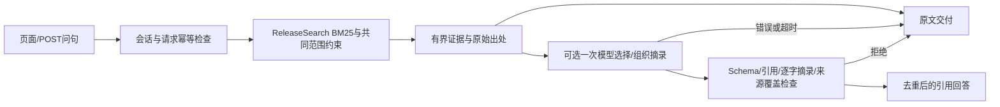

# R3：有界证据与引用资料回答

更新：2026-10-31。**已交付受限摘录RAG、网页/API、失败回退和小样本真实调用验收；没有证明模型提高业务准确率。** 默认仍是原文查询，生成由用户明确点击。自由医学解释的语义支持和自主Agent循环尚未验收。

## 使用

- 当前真实配置入口：[7912引用资料页](http://127.0.0.1:7912/rag)。聊天侧栏也有入口。“查看原文”不调用模型；“整理引用回答”最多调用模型一次。
- [7896引用资料页](http://127.0.0.1:7896/rag)只开放原文，生成按钮关闭。原有聊天/ETCM/DataOps模式不因RAG开关改变；7912的DataOps仍是合成驱动。
- 结果直接显示摘录/对照；展开出处查看物理页、块位置、炮制作用域或JSON指针。原始资料未人工签核，不把共有词串或名称候选当身份/药效相同。

可试问：

1. `比较白术和黄芪的贮藏原文，指出共同用词，保留各自出处。`
2. `比较白芍与苍术的贮藏原文，找共同用词；没写的防护不要补充，保留各自出处。`
3. `并列ETCM BaiZhu的药用部位与药典白术来源段的原始用词，保留两边出处，不确认对象身份。`
4. `五味子的性味与归经在条目中怎样记载？`（适合直接查看原文）
5. `只查白术独立的【注意】字段`（资料缺失，生成前停止，不补造）

“我记录的是半夏，也可能是姜半夏或法半夏，炮制形式还没确定”会先要求明确条目，不选择母药代替。查询结果是当前检索候选，不承诺枚举所有药材。

复现7912：

```bash
.venv/bin/python -m scripts.preview_local_tasks --port 7912 \
  --state var/dataops_question_demo --dataops-synthetic \
  --with-langfuse --rag --rag-model
```

去掉`--rag-model`即可只查原文；去掉`--rag`则关闭新页面。`--rag-model`优先读取`RAG_MODEL/RAG_BASE_URL/RAG_API_KEY`，缺省读取`.env`的CHAT配置，普通聊天配置仍由原预览开关关闭。启动、打开页面和刷新不调用模型。Langfuse可选，去掉`--with-langfuse`不影响执行。

## 实际调用链与边界



`tcm/rag_pipeline.py`使用现有LangGraph构建检索、一次生成、校验的条件图，**不是自主ReAct循环**。R2的SQLite/FTS是当前默认检索；没有因为新增RAG就强制向量、重排或第二次模型规划。生成工具不访问文献，不加载会话历史。

证据最多6条、每条800字、合计4000字；截断、已知部分结果或来源超预算时保留原文，不让生成掩盖缺口。原始值和定位留在服务端结果，模型只见当前问句与有界证据。请求正文32KiB、输出1800 token、请求超时配置30秒，禁重试与格式纠正；未知派发按已尝试处理。超时是HTTP客户端配置，不宣称任意运行阶段均有30秒硬墙时限。

模型只可选`excerpt / shared_phrase / parallel_records`：

- 引用ID必须属于本次证据，摘录必须逐字出现；PDF摘录还需保留完整句的边界，JSON值需完整引用。
- 每条选入证据都必须被引用，不能默默遗漏一方；共有片段需在不同记录、相同资料类型与字段的摘录中同时出现。
- 程序渲染共有片段及原文并列，不显示模型自行编写的医疗结论。共有片段检查只能证明字面相同，不能证明用词自然、概念等价或医学语义正确。
- 语法/引用/摘录/覆盖失败或模型不可用时，返回已取得原文并保留失败状态；不把回退算作生成成功。模型超时后不会自动再次派发。

`/api/rag/answers`复用Cookie归属和Origin检查，输入只允许问句、是否整理、请求编号；不接受路径、SQL或工具权限。`rag_answers.sqlite3`先保留请求，再执行，同一编号回读同一结果；处理中/中断后状态未知返回409，不自动继续。每会话最多100条本地记录。当前是单机小工作流，不是队列化多用户服务；全局配额、归档和统一后台恢复随R4处理。

R2的字段别名错误已修复：普通问法将可接受标签组成OR要求；明确要求独立`【性味】`仍按原标签查询；出现两个可能范围则继续消歧。五味子暴露题回归正常，**R2保留首测9/10原记录未改写**。

## 实测与模型价值

[8道开发题](../eval/rag_generation_v1.json)复用已暴露的R1/R2原始参考，不宣称新的独立盲测。先冻结问句、资料、正文hash、代码、预算，再做同一证据下的原文/模型对照。实际4次DeepSeek HTTP200、0重试；输入2050、输出415、合计2465 token，费用未知记null。

| 类别 | 结果 | 可证明的内容 |
|---|---|---|
| 三道双记录共有片段、一道人为指定ETCM/药典并列 | 4/4通过受限输出契约 | 一次生成可选择并组织真实资料，引用和字面摘录可核验 |
| 黄芪原文、五味子别名回归、白术缺字段、半夏形式待定 | 4/4、模型请求0 | 直接交付、修复及生成前阻断有效 |
| 本地Langfuse | 8条轨迹、4个generation及父子关系回读通过 | 调用与本地记录对应，不代表答案业务正确 |
| 最终受影响离线检查 | 12模块99项，0跳过/联网 | 引用伪造、裁掉否定、类型越界、超时、冻结请求漂移、跨会话和存储故障等已测 |
| 两端口浏览器 | 入口、原文、出处、重放、缺失/歧义阻断通过 | 无JS异常、无浏览器站外请求；验收未新增模型调用 |

**真实负结果也保留：** 原文基线已包含要求的字面信息；模型没有提高这批题的事实覆盖，四题原始输出都更长。G01选择的共有片段为“干燥处，防”，虽属原文但表达不自然；G01/G03还重复摘录。没有与确定性共有词算法对照，不能据“3题输出共有词串”断言LLM不可替代。

运行结束后仅做确定性展示去重及API存储失败处理；用已保存的合格摘录回放，不新增模型请求，不覆盖原始4次回答或协议。原始/最终显示长度分别为G01 150→90、G02 70→80、G03 163→99、G04 144→144字；均仍长于原文基线59/51/63/135字。当前代价换来的是可选组织形式，**尚无整体收益证据，因此不默认使用模型**。

完整受限输出通过不等于自由归纳语义支持通过，`free_paraphrase_semantics_verified=false`。源码、原始协议、逐题指标、回放及观察回执见[验收目录](../audits/data_rag_r3/README.md)；原片段、响应及截图留在本地`var/rag_r3_v1/`。无头QA浏览器另读取已有Windows中文字体后复查，字体未复制进仓库。

## 下一大步R4

把已有资料检索、ETCM筛选、证据回读、XLSX/v2接入同一个有预算的任务执行入口，复用D2持久图/队列；让模型只在缺项、候选不够或范围冲突时决定补查/澄清，不接管机械构建/验证。引用整理仍可选，普通字段保持直接交付。

先固定真正需要跨工具和根据观察调整的少量任务，以及同工具/资料/完成条件的F/P/A对照；逐项记录有效补查、需求遗漏、交付、失败与代价。R3简单资料归并的通过率不能替代这个实验。再完成故障恢复、固定版本镜像与3–5分钟演示，不重开框架选型或新增文献网络功能。
