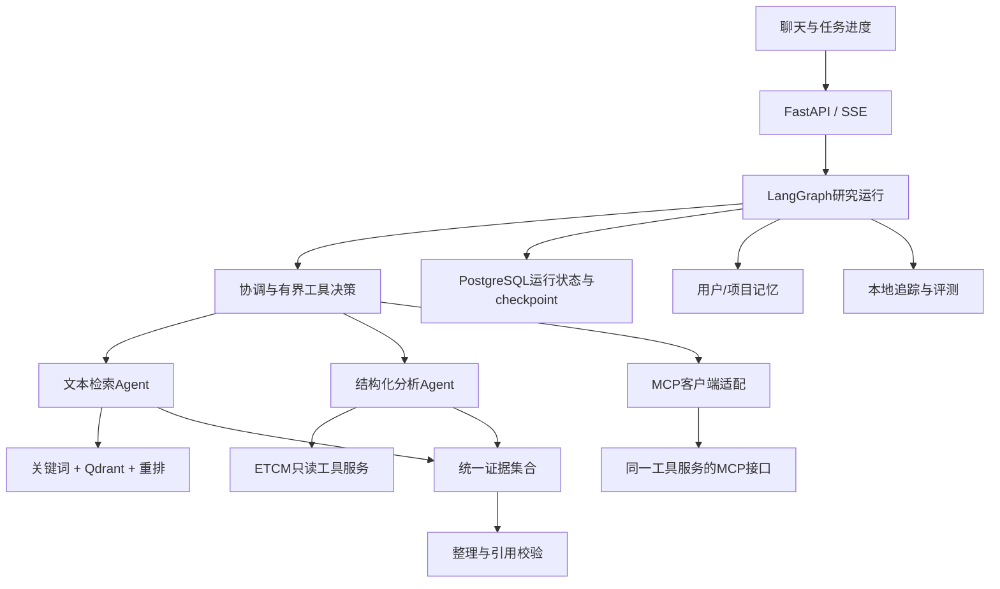

# 秋招技术升级主线：TCM Research Agent

> 2026-10-25增量：已实现[两味药联合比较报告](PAIR_RESEARCH_REPORT_MILESTONE.md)，含并行研究子图、来源绑定的共同靶点工具、双侧见证校验、后台报告及JSON导出。固定流程协作不等于自主LLM多Agent；其他未完成项保持原状态。

> 2026-10-24增量：已交付[跨来源资料报告](CROSS_SOURCE_REPORT_MILESTONE.md)，含LangGraph并行分支、本地RRF、后台报告与开发对照。融合未优于BM25，保持显式配置；Qdrant/学习式重排/自主模型协作仍未完成。下方早期“下一步”描述以此和实现状态页为准。

更新：2026-10-24。用户目标为大模型应用岗位的求职项目，主动增强技术深度、广度与可讲解性。本文取代早期“先停止功能开发，只做试用”的安排；此前冻结的Agent循环、混合检索、长期记忆、MCP和必要数据库工程按本计划解冻。现有原始数据外发约束继续生效。

## 1. 项目定位与贯穿需求

定位：支持多步骤研究资料整理、混合检索和可追溯报告的中草药研究Agent。保留Python、FastAPI、LangGraph、Qdrant、DeepSeek路线。既有来源目录及确定性运算作为基础工具，逐步新增可持久恢复的模型执行层。

贯穿任务示例：

> 比较白术与黄芪的药典记载、成分和来源共同靶点，整理成一张有出处的比较表。把资料缺失和身份对应不确定的地方列出来；保留这个任务，明天接着核对。

拆成三个可独立演示的用例：

1. 开放问法查资料：同义改述、多个字段、药典文本检索、证据引用。
2. 多步骤研究：模型选择工具、并行获取独立资料、识别缺项、有限补检、整合结果。
3. 跨会话继续研究：任务执行中断恢复、用户更正对象、记住明确偏好、根据资料新版本重新读取。

对象不确定时才澄清，常规只读步骤直接执行。进度可见且可取消。避免重新引入每个简单问题都核对清单的交互。疾病候选排序保留为研究工具，不承诺新靶点或疗效预测。

## 2. 当前基础与新增目标分开

现有：单次意图提取、固定工具注册、LangGraph路由、SQLite来源/会话/任务、药典检索及本地dense开发实验、出处校验、版本/并发冲突处理、历史Docker交付。`a0c6ed8`基线通过96模块877项离线回归。

升级目标包含生产聊天模型循环、Agent分工、混合检索、执行checkpoint、分层记忆和MCP。部分执行基础设施已完成；以[最新实现状态](PROJECT_IMPLEMENTATION_STATUS.md)逐项区分已完成与计划，不将整张架构图当现状。

当前疾病演示主要走结构化SQLite查询。旧仓库有Qdrant/RAG和多Agent组件，不代表这些新任务已使用它们。先写实际调用链，再改接入点。

## 3. 技术—需求—验收对应

| 编号/顺序 | 技术升级 | 业务用途 | 实现与验收产物 |
| --- | --- | --- | --- |
| J01 P0 | 原生Tool Calling + 有界ReAct式执行 + LangGraph状态机 | 一句话包含多个资料需求，工具结果改变下一步动作 | 计划/执行/观察/完成节点；严格Schema；步骤/时间/token预算；超时、空结果、非法参数和重复调用处理；与固定流程对照 |
| J02 P0 | Qdrant dense + 关键词检索 + RRF + 本地reranker | 没有精确字段词时也能找到合适药典片段 | 复用已有分块和原页锚点；按对象/版本过滤；字段、BM25、dense、hybrid、hybrid+rerank同题消融，记录质量和延迟 |
| J03 P0 | 有职责区分的多Agent子图 | 药典文本与ETCM结构化分析可独立进行，最终合并一致的证据 | 协调Agent、文本检索Agent、结构化分析Agent；独立子任务并行，统一证据格式；合成与校验作为节点，先不再增加角色；比较单Agent多工具与多Agent的结果/成本 |
| J04 P0 | LangGraph持久checkpoint + PostgreSQL + SQL迁移 + SSE | 任务中途关闭仍可恢复；多进程服务；用户看到进度并能取消 | 单独运行库保存run/step/checkpoint/idempotency记录；数据库事务、revision、租约及恢复策略；重启/崩溃/并发/迁移演练；旧SQLite会话保留兼容 |
| J05 P1 | 分层记忆：窗口/摘要 + 结构化长期偏好 + Qdrant语义检索 | 跨会话继续研究，记住用户明确研究方向和输出偏好 | 用户/项目命名空间、来源与时间、冲突更新、过期删除；区分偏好与资料事实；无记忆/窗口/语义记忆对照；验证跨用户隔离 |
| J06 P1 | MCP Server + 本应用MCP Client适配器 | 同一套ETCM工具供聊天和第二个本地客户端调用 | 从现有注册表导出协议适配；先stdio、后按需Streamable HTTP；能力发现、工具调用、错误、取消与结果一致性；真实客户端验证，不能只写包装类 |
| J07 横贯 | 可观测性 + 故障注入 + 端到端评测 | 能解释为什么选错工具、慢在哪、为什么补检、花多少钱 | run/step/tool trace，输入脱敏、token/耗时/失败码；可接本地OpenTelemetry导出；固定用例与故障回放；提交绑定的CI及演示 |
| J08 P1扩展 | 有来源边的图检索 + 文本检索联合回答 | 从药材出发查看成分/靶点路径，再补充相关文本 | 先复用SQLite关系表实现受限路径遍历；比较SQL检索与关系扩展；来源边和推测匹配边分开；有实测需求再增加Neo4j |

核心版本完成J01–J04和J07即可形成完整技术故事；第二轮完成J05/J06。J08是有条件扩展，避免同时启动所有组件。每项即使未提升质量，也要有真实接入、对照与选择理由；测试数量不是优化收益。

## 4. 架构与边界

本地调用与MCP调用是同一能力的两种入口，任务选择一种，不能重复执行以制造调用次数。ETCM事实仍由只读SQLite来源目录负责；PostgreSQL先只承担可变运行状态/记忆，避免一次迁移全部资料。

有界ReAct体现为根据工具观察选择下一动作，不要求输出模型隐藏思维链。用户看到简短计划、工具动作、结果和结束原因。Tool Calling是调用接口，LangGraph负责执行和状态，多Agent是职责分工，MCP是互操作协议；四者分开验收。

J04前先用兼容当前版本的持久化适配完成小规模恢复；PostgreSQL阶段验证跨进程语义。不要把“保存完成后的对话”当作“崩溃后从执行中间恢复”，也不能承诺外部调用恰好执行一次；不确定调用状态必须记录并有重试/幂等策略。

## 5. 每一阶段怎么做

### 第一阶段：J01，有界模型执行闭环

进度：已有[独立合成执行器及API](RESEARCH_RUN_V1.md)，新增[具体请求范围及真实本地工具适配](RESEARCH_RUN_SCOPE.md)，前一增量41项相关测试通过。现已接入[主聊天本地研究入口](RESEARCH_RUN_CHAT.md)，本轮48项相关测试和真实本地浏览器验收通过。新增[真实SDK离线协议验收](RESEARCH_RUN_SDK.md)：26项相关测试通过，实际SDK通过模拟HTTP完成工具调用循环。已完成[两题真实模型验收](RESEARCH_LIVE_SYNTHETIC.md)：8次请求、按现规则0/2通过；发现合成后端与公开工具描述的名称/ID契约不一致，以及明细缺失时完成语义不清。J01仍未验收通过，合成契约与完整/缺失资料分层验收已离线修正，23项测试通过，6次真实工具参数离线回放正确；原始失败记录保留；V2已另行授权真实重测，7次请求、2/2通过。仅证明两道有明确步骤提示的合成任务链路，不能视为业务准确率或自主规划完整验收。下一项补运行状态/步骤/最终引用的持久化设计与本地实现，为J04打底。

先拆出运行入口，不改写所有旧路由。明确单次查询继续走快路径，研究请求进入新图。复用`tcm/analysis_tools.py`、`tcm/task_tools.py`现有工具，定义兼容适配而非再复制业务逻辑。

建议落点（新文件名为设计，不是既有实现）：`tcm/research_run.py`、`tcm/research_run_state.py`、`tcm/research_tool_adapter.py`、`tests/test_research_run.py`；在`agents/agent_decision.py`和`app.py`增加受控入口。首版默认最多4次模型决策、8次工具执行和60秒运行预算，均配置化；这些是本地设计预算，不是新增外发授权。

首批12条合成开发任务覆盖：单工具、多工具、独立并行、顺序依赖、缺对象、空结果补检、工具超时、非法参数、重复调用、预算耗尽、用户取消、部分完成。记录“模型提案”和“实际执行”分别是否正确。先通过离线假模型/录制回放，再进行获授权的真实模型验收。

完成条件：API真实返回执行轨迹、证据和结束原因；至少一条任务因观察结果而切换下一工具；预算硬限制和越权拒绝通过；现有直接查询不退化。静态固定顺序调用不能标成自主规划完成。

上下文管理增量：已接入[本地输入大小预算与工具观察压缩](RESEARCH_CONTEXT_BUDGET.md)，30项相关测试通过；按序列化UTF-8字节测量，不冒充服务端token硬限制。完整证据保留，近期工具对与任务约束不删；已追加当前运行内 `read_run_evidence` 有界明细读取，39项相关测试通过；已追加逐次/累计输入估算预算及六轮离线大小对照（31项测试通过）；默认使用标注清楚的字节代理，没有本地词表时不联网下载。尚未实现跨运行读取、服务端精确token预算或真实长任务效果对照。

### 第二阶段：J02/J03，检索和分工

将药典文本检索独立成可调用工具；直接使用既有MinerU数据与来源锚点。嵌入与重排优先采用已有本地模型，避免批量资料外发。候选重排模型先核验本机资源、许可证和版本，锁定后再比较。

建议落点：复用`tcm/mineru_retrieval.py`及已有检索评测，新增检索适配与子图模块。先完成单Agent调用文本/结构化两类工具，再引入多Agent并行，防止无法区分新增检索与新增Agent各自的贡献。

### 第三阶段：J04/J07，执行恢复与工程深度

本轮完成[后台研究执行闭环](BACKGROUND_RESEARCH_MILESTONE.md)：独立SQLite队列、幂等提交、跨进程唯一领取/租约、取消、可重放SSE、浏览器关页与历史恢复、实际强杀后中断标记及排队恢复。全仓108模块946项通过。PostgreSQL及LangGraph中间节点checkpoint仍未完成；不自动重试不确定的调用。

先定义run/step状态、幂等键、任务所有者和取消语义，再接PostgreSQL/checkpointer。SSE断线只影响订阅，不应取消后台任务；重连用run ID和事件序号恢复。任务租约、过期回收与重试需要故障注入验证。

数据库迁移先备份、事务执行、失败回滚；旧SQLite路径保留开关。追踪默认本地保存脱敏元数据，不把药典文本和用户历史自动上传外部追踪平台。对串行与并行、单worker与多worker分别记录p50/p95及失败率，先定义硬件和负载再报告容量。

### 第四阶段：J05/J06，记忆与工具互操作

先将明确偏好保存为可查看/更正/删除的结构化记录，再引入语义召回；模型摘要不是原始事实，引用资料仍从源库读取。记忆过滤必须先按用户/项目权限约束，再做向量相似度检索。资料变化时不能继续引用旧记忆中的过期结论。

MCP先暴露3–5个已有只读工具，并由本项目客户端和另一个本地客户端分别调用。外部客户端/模型读取私有资料的权限另行明确，协议接入不等于资料自动获准外发。

## 6. 评测与秋招讲解材料

建立60–100题计划集，按需求拆分20题开发、40题保留起步。用户尚无真实题时可先使用作者/其他AI设计题，但要标出来源、去除近重复，并让人工核验答案与依据；保留集在调参前冻结，不因题目失败挪入开发集后继续称独立。

- 执行：完整任务完成率、工具选择/参数正确率、无效调用率、部分完成的准确报告、预算超限次数。
- 检索：有完整相关性标注再报告Recall@k；否则报告已知目标Hit@k，补充MRR/nDCG的标注前提。
- 生成：引用支持率、缺证据时的回答边界；人工抽核，模型评分只作辅助。
- 工程：p50/p95、token和按实际价格计算的成本、超时率、恢复成功率、幂等/隔离错误数。
- 消融：规则/单次规划/循环；单Agent/多Agent；稀疏/dense/hybrid/rerank；无记忆/窗口/长期检索；本地/MCP。

每模块保留一张调用链图、一个可复现命令、一份对照结果、一个故障案例。最终材料是3–5分钟演示、技术架构说明和3条项目经历，能解释数据、模型、工具、存储的责任及取舍。不要预填“准确率提升XX%”，结果未出前只写实验设计。

## 7. 版本、授权与实施顺序

当前`requirements-research-chat.txt`仍固定LangGraph 0.3.9等依赖。官方新文档不能直接当作该版本接口；J01先做兼容性探针，若确需升级，使用隔离环境、锁定依赖并保留旧基线，一次只升级有明确需要的组件。Qdrant、MCP与数据库驱动同样记录实际运行版本。

本文授权范围为重排技术路线；不自动安装或部署所有组件、不新增模型外发。此前仅当前问句的一次意图调用授权不能覆盖多轮模型决策或资料输入；旧的5题/2题有限测试不重复使用。无需外发的实现、合成测试和回放可先推进；真正需要外发时再按具体输入和调用预算确认。

建议拆成四个可独立展示的里程碑，不假定投递截止日期：J01 → J02/J03 → J04/J07 → J05/J06；每个完成即可更新简历材料和演示，J08后置。首次技术升级任务明确为J01，不再默认追加旧版相似度评测或只等待本人试用。

## 8. 本轮核对的官方依据

- [LangGraph持久化](https://docs.langchain.com/oss/python/langgraph/persistence)：区分线程checkpoint与跨线程store，作为J04/J05职责设计参考；接口以锁定版本实测为准。
- [Qdrant混合与多阶段检索](https://qdrant.tech/documentation/search/hybrid-queries/)：作为J02融合与重排实验的接口参考，不代表现有项目已接入或已有收益。
- [MCP架构](https://modelcontextprotocol.io/docs/learn/architecture)：作为J06客户端/服务端及传输设计参考；实现时核验SDK协议兼容，不沿用未经检查的旧教程。

未调查具体企业招聘JD，不将上述清单称为所有秋招岗位的统一要求。收到目标JD后再调整技能权重；当前优先围绕用户指定的大模型应用方向形成完整工程链路。

## 后续交付粒度

按用户要求，以[大里程碑清单](PROJECT_IMPLEMENTATION_STATUS.md)为后续执行单位：跨来源检索/协作报告 → PostgreSQL/checkpoint恢复 → 记忆/MCP。每个包一并完成业务接入、工程失败路径及验收，不再把单个小工具适配作为独立终点。
