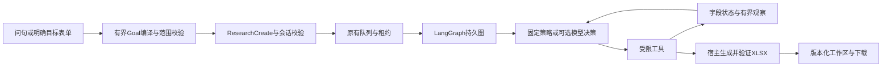

# R4 候选资料核对：运行、对照与当前边界

更新：2026-10-31。工程整合、真实资料网页及本地镜像已验收；**原A的0/2保留；新版在两项新限定任务交付通过，尚无多轮收益证据**。统一状态见[大纲](TCM_PROJECT_ROADMAP.md)，执行记录见[R4验收](../audits/data_rag_r4/README.md)。本轮已接通有界问句与表单两种输入；模型理解仅保留显式实验开关，不能当作任意自然语言任务理解已完成。

## 执行层修复：Harness V2（最初离线验收）

针对原A两题“已读完又列目录/重查”的回执，当前驱动升级为 `research_native_tool_calling_v2`：

- 每轮根据真实状态暴露工具及参数候选；目录已读就不再暴露列目录，已读字段不再进入可检查ID，已读证据不再进入回读ID。检索、回读、澄清和交付仍按状态供模型选择，不替模型选择药材或自动交付。
- 最近最多3组动作/结果以原生assistant tool-call与tool消息配对重建，最新目标、字段状态和观察放在最后一条snapshot；保留无进展反馈。历史仅保存状态与证据句柄，旧原文不反复进入上下文；超预算先移除旧工具对，目标和最新证据不被概括改写。
- 宿主再次检查工具前置条件，重复列目录、重复已核对字段、同一检索和已读证据在打开来源前拒绝。重复失败仍会停止，不靠无限重试或自动换工具把失败变成功。
- 人工选择后的动作历史、来源决定随checkpoint恢复；拒绝动作在执行记录中标为rejected。新执行协议/源码绑定阻止用新代码偷偷恢复旧运行；已发布文件和已完成任务继续可读。

[离线回放验收](../audits/research_harness_v2/README.md)：原8个动作中的4个有用动作仍被允许，4个重复动作会被拦截；15模块127项受影响回归通过。SDK模拟还检查作用域不符后换候选、工具消息配对、缺失新版交付和等待恢复。**这不是新模型成绩，A原始0/2不变；这一离线轮次没有验证新版模型；后续新组合实测见下节。** 随后已接通下述有界问句入口；原A成绩不变。

当前7912/7914的新资料任务采用fixed确定性执行。7912已启用聊天/工作台共用的一次模型兜底，页面可取消，规范问句不强制调用；7914不含模型配置。最新本地镜像为 `tcm-research-chat:external-clean-v1`，以构建清单hash为准；旧镜像保留，原状态目录、会话及文件继续使用，未推送远程。体验修复见[此前验收](../audits/qa_observability_v1/README.md)，新调用链与约束见[本轮验收](../audits/unified_harness_v1/README.md)。

## 统一理解与参数约束

明确且完整的本地查询直接执行；表格/续改要求或未完整识别的输入共用`DataOpsService.submit_research_question`。已启用时最多一次模型选择`propose_research_goal`或`submit_query_intent`，同次返回完整Goal或查询参数；查询以内部已验证路由回到原图，不再调用一次分类模型。工作台仅接受资料Goal，不接受模型偷换成普通查询。规则命中不代表覆盖全部要求；已识别的交付文件和字段不能被查询提案丢弃。

新目标Schema限制允许名称和new操作；父版限制append_fields、空names/filters和空target_count，由宿主绑定旧对象。执行Schema按当前状态限制可交付ID和数量：select_complete只选合格集合，0合格可交付空表；audit_named和父版保留原记录，新增缺失不能删行。调用前再次执行业务校验，Schema不被当作语义正确性证明。

使用现有LangChain原生tool calling/Pydantic和LangGraph持久图，统一策略与校验作为本项目的业务Harness；未整体迁移至Deep Agents或宣称已直接接入create_agent中间件。未知派发不重发，已知提案失败保留原句并提示表单；本轮仍为一次理解预算，未开启自动纠正重试。真实模型合成烟测三项通过，5请求、20,526 token，不能替代真实资料独立验收；更大的静态Schema有token开销，未证明成本下降。

## 最新新问句首测

[12题首测](../audits/research_acceptance_v1/README.md)区分8道作者业务与4道宿主控制：R业务1/8、G一次理解＋fixed业务7/8，控制均正确零调用；预选native两题端到端0/2，其中一题Goal漏药名未执行，另一题错误提交三条不合格记录被拒绝且无文件。实际13请求、26,135 token，没有重试或覆盖旧分数。常规执行继续fixed，单次理解显式选择；下一项先回放并收紧目标/交付参数，不能将该12题当独立用户准确率。

## 此前组合实测与执行选择

[新组合验收](../audits/research_combined_v1/README.md)在原8题之外冻结了两项业务和两项控制：从桔梗/牡丹皮/陈皮/薄荷挑两条注意及贮藏齐全记录（实际仅1条，正确交付partial），以及陈皮/桔梗旧表补贮藏和注意（保留两行及原功效，缺项不补造）。原0/2不重测、不覆盖。

| 新两项业务 | 完成交付 | 模型开销 |
|---|---:|---|
| 本地规则理解＋确定性执行R | 0/2，原句未识别而停止 | 0请求 |
| 一次模型理解＋确定性执行G | 2/2 | 共2请求、3,297 token |
| 同一份模型目标＋多轮Agent A | 2/2 | 额外10请求、27,471 token；归属总量12请求、30,768 token |

两项控制均由本地预检处理，模型与执行0；不能算作模型能力。G/A共用目标提案，实际整轮总请求12，不能将两方案的归属请求直接相加。A每题自主执行列候选→核对→两次回读证据→交付，共回读9段，没有选择搜索工具；原文回读未带来交付差异。没有重试、未启用Langfuse导出；原始SDK回执与逐题评分另存。题目及来源参考由作者建立，不能当作盲测、整体准确率或模型必要性证明。

**当前选择：常规字段整理用fixed确定性执行；需要理解自然表达时显式选一次模型；native多轮保留实验。** 两题证明新版受限tool calling能交付，尚不能证明比确定性执行更有用。新增遗漏明确字段、排除列、数量/任务模式和父版更换对象校验，错误提案不入队；这些是局部约束，不是任意语义正确性判定器。

23模块183项受影响回归通过。原synthetic模式及旧任务继续兼容，fixed同样复用队列/持久图/交付验证，来源仍未人工签核。准备未来对照只运行下述命令，不调用模型；不要重复执行已消耗的live_v1目录：

```bash
.venv/bin/python -m scripts.eval_research_combined --out var/combined_future_prepare
```

## 新增：问句到任务与一次模型理解

同一页面顶部可直接输入“整理白术和黄芪的功效、注意事项，保留出处并生成表格”，无需先核对请求清单。聊天中的明确资料表格要求共用此服务（需启用research-selection）。两种任务语义不同：

- **指定对象核对** `audit_named`：保留所有指定记录，缺失如实标记；当前白术/黄芪的注意字段缺失，仍能交付两行核对表。`complete`表示完成核对，不表示字段齐全或药效已核实。
- **从候选挑选齐全记录** `select_complete`：例如从白术、黄芪、川芎、甘草、大黄挑两条功效和注意齐全的，当前结果为甘草、大黄；不足返回partial。候选上限20与目标数量1–5分别校验。

结果上继续输入“增加贮藏，保留旧字段”，自动绑定当前已交付版本，仅新增列，保留原对象、旧字段和旧文件。存在实际歧义才提出具体问题；原句保留供修改，未知要求不被静默丢弃。默认附带ETCM药用部位作来源对照，不擅自增加拉丁名等属性；出处和页码是证据，不等于药典“来源/基原”字段。

新接口 `POST /api/dataops/research-questions` 与现有ResearchCreate/队列/持久图共用；只多了一次Goal编译。复用RAG的请求回执实现，模型调用前先落盘；同请求编号重放复用提案，未知派发不重发。单次问句理解和多轮任务执行分别有开关及统计。

**真实问句理解对照已运行，不代表执行Agent通过。** 8道作者开发题，规则4/8、模型方案6/8；其中3道由宿主检查直接澄清、未调用模型。实际调用的5题只有3题目标正确，另有一次不必要追问、一次擅增ETCM属性；5次HTTP200、7,754 token、0重试。只发送固定问句、名称候选、字段定义及父版本结构元数据，没有药典正文或用户历史，且没有执行这些模型提案。不能声称独立准确率或整体收益已证。

事后加入未请求/明确排除列的宿主拒绝、父对象已绑定标志及“存放环境≠生境”提示。原Q08错误回复离线回放被拒绝，**不改原6/8，不算新增模型通过**；改后提示未做真实复测。22模块174项受影响检查通过；7912/7914新问句流程及下载逐格回读通过，见[本轮验收](../audits/research_question_v1/README.md)。

上述是该轮当时的默认配置。当前7912采用统一的本地优先/一次兜底，页面默认允许并可取消；7914复选框禁用。其他部署加`--research-goal-model`才启用；它不自动打开native执行，也不重试已消耗的实验。原模型提案错误仍受宿主约束。

## 可以直接使用

打开 <http://127.0.0.1:7912/dataops/research>，或本地Docker实例 <http://127.0.0.1:7914/dataops/research>。两处任务执行均为**本地确定性策略**。7912问句可勾选一次模型理解，执行阶段不调用模型；其原有 `/rag` 生成按钮仍有独立开关。

1. 候选填“白术，黄芪，川芎，甘草，大黄”，数量2，勾选“功效”“注意”。系统逐批核对原始字段，当前来源中甘草、大黄满足条件，结果仍保留饮片作用域及身份待核验信息。
2. 下载五表XLSX：结果、问题、来源、运行说明、候选核对。缺失不由模型补写；可展开出处与差异。
3. 增加“贮藏”，点击“按当前勾选字段生成新版本”。v2保留原记录与旧字段，另增版本差异表；v1文件不改写。两个相互竞争的修改不能同时覆盖同一父版本，后提交者刷新后继续修改。
4. 用“白术，黄芪”核对功效和注意，当前均没有独立注意字段，返回 `partial` 和可下载的核对记录，符合条件数为0，不凑出两条成功记录。任务筛选为空与所有药材都不存在相关信息是不同结论。

工作区按会话隔离；刷新可恢复进度，关页不取消，运行中可取消。只有实际来源歧义才询问选择，唯一候选不要求额外确认。表单限定最多20条候选、目标1–5条、文档字段最多4项；这是限定候选内的核对，不是全库穷尽搜索或药材身份签核。

## 实际调用链



复用D2队列、SQLite Checkpointer、派发回执、人工等待、执行锁和租约保护，没有建立第二套调度系统。新 `ResearchEngine` 为独立任务类型，旧Goal与原Engine没有被改成新协议。

| 工具 | 数据与边界 |
|---|---|
| `list_candidates` | 按不可变Goal做参数化SQL筛选；仅列根候选范围 |
| `inspect_candidates` | 每次最多5条；读取ETCM属性、中文对应候选及药典字段状态；不确认身份 |
| `search_documents` | 在已核对对象及目标字段内先过滤再做BM25，最多6条；禁止扩大对象、把出处误当来源列，或把检索命中补成独立缺失字段 |
| `read_evidence` | 回读本任务证据ID，最多3条、每条800字；未知ID拒绝 |
| `ask_user` | 已有多个来源候选时等待选择/跳过/取消 |
| `deliver_result` | 校验数量、字段与父版本范围；宿主构建、逐格回读验证并结束，不让模型再调用机械构建、验证、结束三步 |

使用R1发布 `var/data_releases/r1_20261030` 中同版本616条目/8665片段索引和登记的ETCM库；四条隔离映射继续拒绝。原JSON/PDF/数据库只读，源版本不符拒绝复用。此任务默认精确字段读取和BM25；R2的BGE/Qdrant检索对照继续保留，没有在这些精确字段任务里强行使用向量检索。

默认每任务10次决策、24次工具动作、200次计数口径下的来源读取，决策上下文16,000字节、活动时间300秒；两次无进展停止。实际SQL/索引操作数不等于来源读取计数。原内部 `model_calls` 兼容字段仍是决策步数，新结果区分 `decision_steps` 和 `provider_requests`。未知派发不自动重发，换代码/数据/预算后不能假装恢复旧checkpoint。请求键幂等、文件hash、父版本约束仍由程序执行。

## 真实模型结果：不能证明A收益

固定题目：[S01/S02](../eval/dataops_research_v1.json)。F为批量字段完整性程序，P在读共同目录后仅生成一次工具脚本，A每步使用native tool calling观察再行动；相同来源、工具与完成条件，机械交付由宿主负责。两题属于作者开发题，已看过来源，不是独立盲测，也不是临床评估。

| 组合 | 实际结果 | 外部请求 |
|---|---|---:|
| S01 F：候选筛选 | 正确选择两条并交付 | 0 |
| S01 P | HTTP200后评测回执写入冲突，结果未知；属于基础设施失败，未重跑 | 1 |
| S01 A | 检查后重复列目录/检查，无进展停止，无文件 | 4 |
| S02 F：旧表补缺失注意 | 保留两条旧记录和功效，缺失如实标记，正确交付partial | 0 |
| S02 P | 返回非法JSON计划，执行前拒绝 | 1 |
| S02 A | 已读出缺失后重复列目录，无进展停止，无文件 | 4 |

合计10次HTTP200、19,951 token；F按事前契约2/2正确，A0/2交付，P两次均未交付且其中一次不能归因为模型。**没有证明LLM的必要性、动态补查收益或自主RAG成功**：真实A没有选择文档搜索/证据回读；其接入仅由本地工具流程检查覆盖。模型实际发送的是任务、工具定义、候选元数据和字段状态，没有执行原文回读。

首轮日志失败与续跑协议分别保存，不覆盖原记录，不重试S01-P；续跑由用户单独明确允许。最终格式修复（证据行稳定排序）在真实模型测试后完成，仅做本地/容器回归，不能称最终版本另获模型通过。

**当前决策：** 常规字段整理继续走确定性流程。真实驱动仅保留显式实验入口，未在运行网页默认开启。执行上下文/工具状态已做离线修复，原题未复测，新组合两题已交付；有界Goal入口及单次模型理解已接通，但新8题理解仍有两项失败，不能当作稳定自由任务理解。不能用这两道可编程字段题继续证明“必须Agent”，也不因A失败而扩充框架或不断重测旧题。

## 启动与复现

独立本地确定性预览（原有7912已运行时可直接访问，无需再启动）：

```bash
.venv/bin/python -m scripts.preview_local_tasks \
  --port 7913 --state var/r4_preview --research-selection fixed --rag
```

最新本地镜像 `tcm-research-chat:external-clean-v1`，**没有发布Docker Hub**。代码白名单构建，不包含资料、环境文件、权重或会话；原资料只读挂载，状态独立写入，按主机UID运行以读取原有0600资料注册文件，无需放宽源文件权限。主机7914映射容器8000。

```bash
.venv/bin/python -m scripts.build_research_image \
  --tag tcm-research-chat:external-clean-v1 --receipt var/r4_build_new.json
.venv/bin/python -m scripts.run_research_selection_container \
  --image tcm-research-chat:external-clean-v1 --name tcm-research-r4-new \
  --port 7915 --state var/r4_container_new
```

干净依赖安装、空状态启动、实际查询/表格交付和容器重建恢复已验证，复现命令见[干净环境说明](CLEAN_REPRODUCTION.md)。

镜像不是通用搬家包：R1注册文件含原始绝对路径；启动器按原路径只读挂载。换机器应重新构建/登记数据发布，不能偷偷改注册文件或只带镜像。现有compose旧预览不被这个入口替换。

评测先准备协议与源码快照，再单独执行；`--execute`会外发限定任务资料，不能重复使用已执行目录。历史目录已消耗，不应直接重跑：

```bash
.venv/bin/python -m scripts.eval_dataops_research --out var/r4_future_prepare
```

准备命令不调用模型。真实实验必须另行明确具体题目/目的地/预算；没有自动调用下一轮或无限重试。失败与原始回复只保存在本地私有运行目录，公共验收文档只记录必要统计。

## 三分钟演示与仍未完成项

当前演示与一条命令排练已更新，见[求职演示](PROJECT_DEMO.md)及[面试证据](INTERVIEW_EVIDENCE.md)。排练使用真实资料和fixed策略，模型成绩展示保存的独立回执，不临时重跑刷分。

先展示五候选两字段的筛选与带来源表格，再补贮藏生成v2、对照v1不变，最后展示两次真实A失败及Langfuse轨迹。可讲清楚版本化数据、精确读取与检索分工、受限tool calling、持久化/幂等/租约、有界上下文、可验证交付，以及为什么此处保留程序基线。

尚未完成：开放问句正确Goal的稳定验收（已接通但新8题仍有失败）；真实模型A稳定交付及相对F收益；真实A自主检索收益；跨库身份人工确认；全库相关性/Recall真值；自由语义医学归纳验证；公开远程镜像与跨机器迁移验收。上述项目不能因为本地网页/镜像通过而标为已实现。
