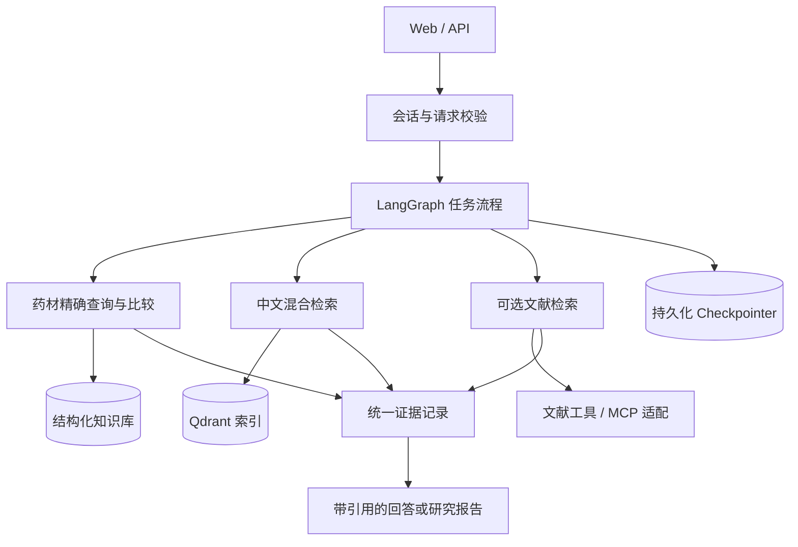

# TCM Research Agent：建设大纲与实施路线

## 当前状态核验（2026-10-24，优先于下方阶段记录）

核验范围：当前关联分析主线的实现、P2c–P2f及交付验收摘要、实现文件指纹、Git工作树、本地健康接口和大纲链接；核验后已补跑当前工作树全量离线回归；未核验Docker/远程部署，也未逐项重验历史M0–M5功能。

| 工作 | 当前状态 | 证据与限制 |
| --- | --- | --- |
| P0/P1 数据介绍、药材靶点画像/相似度 | 已有源码及阶段验收 | 结构化资料查询，不是新靶点预测 |
| P2a/P2b 疾病索引、靶点资料及候选排序 | 已有源码及本地验收 | 物种、关联等级及疾病针对性未验证 |
| P2c 疾病名称查找 | 已完成本地交付 | 859项为该阶段历史全量；中文疾病别名未核验 |
| P2d/P2e 基线和规模随机对照 | 已完成开发诊断 | 128组开发样本，无独立预测标签；评测实现指纹与保存记录一致 |
| P2f 候选规模解释 | 已完成本地交付 | 24项相关回归、6项浏览器检查；无新增模型调用 |
| 完整演示 | 已完成已知流程检查 | 10项浏览器检查、12条选定见证；不是独立用户验收 |
| Git与Docker交付 | 2026-10-24本地源码基线；未push/发布镜像 | 见[提交范围](releases/RESEARCH_LOCAL_20261024.md)；审计中的旧HEAD保留测试时含义 |
| 独立业务效果、P3新靶点预测 | 未完成 | 需任务定义、可靠独立证据和防泄漏评测 |

**验证口径（2026-10-24补验）：** 当前工作树完整离线96模块877项通过，跳过与网络尝试均为0；312个源码/依赖文件在记录指纹至运行结束期间未变。见[本次摘要](../audits/delivery_regression_20261024/summary.json)。867项仍保留为P2d历史成绩，P2e/P2f局部回归不累加。本次未重新做真实数据、浏览器或外部模型验收；既有交付记录绑定的4个实现文件与核验时SHA一致。大纲本地文件链接核对无缺失。

**部署口径：** 本次只读检查7877和7878的`/health`均返回200；这只证明服务存活，不代表所有数据就绪。最近完整演示在7878完成，7877未重新加载P2f；两者不能混用验收结论。当前7878按关闭模型的启动配置演示，早期7877启用意图模型的记录仅代表当时试验。Docker/远程状态本轮未重新核验。

**当前唯一执行顺序：** 先按[五分钟演示](DISEASE_WORKFLOW_DELIVERY.md)本人试用并记录具体阻塞；需要交付时明确Git或镜像范围，再完成对应发布前检查。独立用户问题和有效性标签仍待补充。MCP、自主多Agent循环、长期语义记忆和新预测算法不因本轮完成而视为已实现，也不自动列为下一项。

## 2026-10-23关联分析阶段记录

以下测试数、端口及“本轮”均保留对应阶段含义；当前状态以上方核验表为准。

**当前进度：药材靶点画像与集合相似度已接入聊天。** 已完成数据库介绍意图，并新增固定注册表中的 `herb_target_profile`、`herb_target_similarity` 两个工具；规则或一次模型意图提取选择工具，本地只读计算 Jaccard/共同靶点数，返回 Top-K、共享/独有标识与来源核对入口。已捕获真实模型重复填写对象导致的校验失败，修复仅兼容完全相同的重复字段；修复验证采用离线回放，未再次外发。详细验证状态见[交付与限制](TARGET_SIMILARITY.md)，不将单条改述测试计为总体识别率。

**最新完成：P2a疾病来源审计与版本化靶点索引。** 全量扫描7705份JSON，7593条来源入库，112条文件名差异隔离；保留2047010条靶点原行及563个不同UniProt，可通过CLI按原名或来源ID查询并核对原始JSON。92模块843项离线回归通过，13份原始文件3554行独立对照通过。全部入库来源缺少明确物种字段；1632条来源共享381组完全相同的靶点集合，不能宣称疾病特异性预测。见[数据结果、命令与限制](DISEASE_GENE_CATALOG.md)。

**最新完成：P2b疾病靶点聊天与候选药材来源排序。** 固定注册表新增两个工具，支持来源原名/ID查询、原行翻页、Jaccard/共同靶点数排序、完整与背景内覆盖、双方原行样本和持久参数回看。7877已加载疾病目录；物种未核验、相同集合不可区分及抓取状态保留。完整离线93模块851项及浏览器11组通过，真实Top5两种排序与独立计算及4份原文件对照一致；本轮外部模型调用0，模型路径为合成回归，尚未做扩展Schema的真实提供方验收。见[使用与边界](DISEASE_CANDIDATE_ANALYSIS.md)。

**最新完成：疾病名称查找入口。** 新增固定工具 `search_disease_sources`，支持目录浏览、多个英文关键词、20条分页、表格内搜索及直接进入来源靶点/排序。原分析名称不完整时先列候选，选择后保留原数量/排序；刷新恢复搜索参数，目录变更使旧焦点失效。`diabetes`、`diabetes mellitus`、`alzheimer`分别匹配51、24、9条来源，中文别名仍未核验，不自动翻译。完整离线94模块859项及浏览器11组通过，见[使用与验收](DISEASE_NAME_SEARCH.md)。

**最新完成：P2d候选排序基线诊断。** 固定抽取128组不同疾病靶点集合，Jaccard/共同靶点数与“仅按药材靶点总数排序”的Top10平均重合62.58%/82.03%；跨疾病平均重合58.54%/80.97%。16份排序与生产算法一致，完整离线95模块867项通过；未取得独立生物学标签。当前可作为来源集合候选检索，尚不能宣称疾病预测有效；见[评测方法与结果](DISEASE_RANKING_EVALUATION.md)。

**最新完成：P2e集合大小匹配随机对照。** 沿用128组开发样本，每组256次均匀不放回抽样，总计60588032次候选比较；实测最大共同靶点数超过随机最大值第95百分位为0/128，Jaccard Top10实测/规模期望比值中位数1.006。本轮未支持将交集数量解释为疾病针对性，亦未验证个别关联不存在；见[方法、结果与局限](DISEASE_SIZE_NULL_EVALUATION.md)。含新增9项在内共24项离线回归通过，无外部调用，默认排序未改。

**最新完成：P2f聊天候选结果解释。** 候选表新增默认折叠的规模对照，展示实测、期望和差值；严格校验分母和结果，不改变原排序。24项相关离线回归和6项浏览器检查通过；独立预览在7878，7877旧进程未更新。见[使用与限制](DISEASE_SIZE_CONTEXT.md)。

**最新完成：交付整理与端到端演示。** 7878完成10项实际浏览器流程检查、前两条候选12条原始见证及双方文件SHA核对；统一当前入口与历史说明，见[五分钟演示](DISEASE_WORKFLOW_DELIVERY.md)。本轮仅文档和流程验收，无模型调用，未提交或发布。

**下一项：本人试用及交付决策。** 按演示流程操作并记录具体阻塞，再按明确范围提交源码或验证镜像；独立用户任务和有效性标签仍待取得，不以继续增加算法/框架代替业务验证。

## 更早阶段记录（历史状态，不作为当前部署或待办）

以下“最新”“当前”“下一步”和模型配置指当时阶段，完成依据按各自链接追溯。

**历史增量：属性自然问法与模型意图兜底。** 原句“我需要查看白术的相关属性”已接ETCM属性，唯一候选直接读取，保留完整炮制名称及来源；同时接入“未识别问句→一次模型提取目标/对象/字段→严格校验→现有本地工具”，每题最多1次、不将检索结果发回模型。用户已明确授权仅当前问句做意图识别，7877已按该范围启用，资料和历史不外发。3条合成DeepSeek题协议验证通过；另在实际浏览器验证2条真实药名改述，各1次模型调用并返回本地白术13项字段，原句0次。模型关闭时15个浏览器场景通过，原功能/概念/指令与显式来源优先级保留。验证和限制见[意图路由](INTENT_ROUTING.md)；复杂独立多任务的自主执行、独立用户准确率未因此完成。

本轮完整离线89模块809项通过，跳过和网络尝试0；实际模型开启的3个浏览器场景通过（2次意图调用）。[脱敏验收记录](../audits/intent_router_v1/summary.json)保留初轮路由优先级失败及修复；未更改资料、数据库Schema或Docker，未提交/推送Git。

**最新完成：默认回答精简。** 共同靶点、成分、反查等改为结果表格，药典正文只显示一份；原始行、JSON位置、哈希和常规说明按需展开。比较、属性、概览、功能介绍与文献卡同步处理，缺失/失败及实际撤稿提示仍可见。17类实际浏览器/合成文献展示检查通过，未增加模型调用或改变检索数据；全量结果及回滚见[展示调整](LOCAL_TASK_REQUEST.md#回答展示精简2026-10-22)。7877源码预览已加载，Git/Docker未发布。

**当前交互已简化：明确双药共同靶点直接查。** 用户反馈原清单流程操作过重，本次已实际修改并重启7877：当归/川芎原句直接返回172个来源共同标识及双方原始位置，不再先核对清单/计划。中文唯一候选自动使用并展示来源，仍未核验身份；多来源才选择，缺失不造结果；额外对象/交付不丢弃，复杂任务页保留。相关61项回归后执行9个实际浏览器场景，5个直接查询完成、4个澄清/复杂要求/边界符合预期；12条选定见证及证据下载通过。随后全量结果见[最新验收](LOCAL_TASK_REQUEST.md#明确双药查询直接执行2026-10-22)。不引入框架或模型外发，未改旧任务/Schema，未更新Git或Docker；下方清单验收保留其历史实现范围。

**最新完成：先逐题模拟，再全量回归。** 16个真实浏览器场景首轮14项符合预期，修复刷新丢失核对按钮及UniProt交集未进入清单两处阻塞，同题复跑16项契约检查通过。其中11项完成当前本地范围，5项分别为额外要求、缺来源、缺字段、联网关闭和个人用药边界，不计为完整成功。20条选定原JSON见证核对及11份实际下载；清单修订/澄清仍由脚本模拟用户确认。随后88模块794项完整离线通过，跳过/网络尝试0；另18项实际进程检查通过，含待核对原句重启恢复和继续完成任务。外部模型调用0，7877源码预览已更新，Git/Docker未发布；[逐题问题与结果](PROJECT_DEMO.md#逐题模拟与随后全量回归2026-10-22)、[脱敏记录](../audits/user_flow_v1/summary.json)。本轮完成已知流程回归，AP-02独立用户验收仍待开展；下一项优先观察本人/未参与设计者的实际使用阻塞，不用更多同类开发题替代业务证据。

**最新修复：聊天→请求清单衔接。** 用户将B01原句输入聊天页得到403，已复现并保留失败；此前六场景只测任务页，不能证明聊天入口可用。现对直接关系语法未能解析的共同标识问句提供本地清单按钮，点击保留完整原句创建任务；不自动查询、猜药名或丢掉其他要求。任务ID链接支持刷新及所有者隔离，原直接查询/指令保留。新增8项测试，88模块790项完整离线和15项实际浏览器检查通过，外部模型调用0；7877已重启，原库保留，Git/Docker未发布。本轮属于已知失败回归，独立用户理解与完整语义提取仍未完成，见[范围与验收](LOCAL_TASK_REQUEST.md#聊天入口衔接修复2026-10-22)。

**演示启动补齐：** 已提供项目内`python -m scripts.preview_local_tasks --port 7877`，默认保留现有状态库，支持`--state`独立目录。关闭外部模型、联网和追踪，缺少资料停止启动；12项实际进程检查通过，含真实任务、独立浏览器和重启恢复。没有改变任务规划/检索规则或重跑旧全量回归；见[运行代码](PROJECT_DEMO.md#启动与复现)及[启动验收](../audits/local_task_launcher_v1/summary.json)。

**最新完成：AP-02/04固定版本业务演示验收。** 基于已提交`f2f8114`冻结6条开发者设计问法、预期、原JSON参考和287个代码文件指纹，再用实际浏览器执行；结果为3个complete、2个partial、1个waiting_request，六项状态/来源契约均符合预期，不算六项完整业务成功。所选当归/川芎、茯苓/甘草、陈皮/半夏来源分别172/180/94个共同标识，16条选定见证核对原JSON/SHA，5份报告实际下载，6份源文件和代码在验收前后不变。5份提交清单中4份仍须模拟人工修订，未解决自动完整语义提取；外部模型/浏览器外网请求0。本轮更新[五分钟演示、实际架构与求职表达](PROJECT_DEMO.md)，未改应用规则、未重跑旧782项全量回归、未增加框架或评测平台。独立用户验收、本人录屏与独立复现仍待完成；**下一项是本人照稿操作讲解并记录实际阻塞，然后采集未参与设计者的原始问题**，不继续以更多同类开发题代替用户证据。见[脱敏验收](../audits/task_business_demo_v1/summary.json)。

**AP-01真实ETCM问句与清单闭环。** 已将清单核对和覆盖契约接到既有真实只读工具：原问句→人工核对对象/要求→确认两味药计划→确认来源→选择靶点→原始记录报告。未知药名可补入清单，但无来源不当成空交集；第三药材、文献、部位表等未执行要求保留，需明确同意执行子范围，整体仍partial。输入和资料保持本地，非自动完整语义提取。87模块782项离线、20项实际浏览器检查通过，含真实进程重启；已知白术/黄芪所选来源151个共同标识，选定靶点双方2条见证与原JSON/文件SHA核对。不是独立业务或药效验收，累计源码已本地提交`f2f8114`，未push或更新Docker；见[实现与回滚](LOCAL_TASK_REQUEST.md)。后续按上方AP-02/04推进，不默认扩框架、模型外发或文献平台。下方各阶段“尚未接入真实ETCM”的陈述保留原阶段范围，以本段为当前状态。

最新追加验收：核心6文件在出题前冻结且运行后未变，新增12条作者设计合成问句；模型原计划符合10/12，规则4/12。模型分支为4完成、2预期partial、4需澄清、2错误提案，不能将10/12算完整任务成功率。三对象请求和额外交付被错误表达，默认入口仍不切换。记录与复现见[追加验收](TASK_PLANNER_SYNTHETIC.md#追加验收冻结代码后的12题2026-10-21)。84模块748项完整离线回归通过；真实用户与独立审核仍未取得。

请求覆盖契约已接入显式合成请求清单：独立保存对象/交付，未覆盖项需用户明确确认缩小范围；子范围完成仍保留原请求partial，计划改变不能复用旧确认。85模块759项完整离线、14项实际浏览器检查通过，含真实进程重启后恢复范围确认；上一轮A11/A12仅离线回放，不改原评分、不新增模型调用；见[实现与边界](REQUEST_COVERAGE.md)。这里是用户声明清单的覆盖核验，尚未解决自由问句完整需求提取。本地合成问句入口现已接入：waiting_request先核对完整清单，允许人工取消误识别、补充其他要求，确认后再生成计划；原文、草稿、修订及未完成项持久保存。86模块771项完整离线、17项实际浏览器检查通过，含真实进程重启恢复，外部模型调用0。没有网页模型外发，不宣称自动提取完整；见[操作与边界](REQUEST_COVERAGE.md#问句入口先核对请求清单再规划2026-10-21)。下一项优先适配真实ETCM只读任务闭环，资料保持本地，不堆失败题关键词或扩文献/框架。上一轮冻结验收记录保留，本增量另行验证。

架构审查后的第一项改造：新建ETCM本地任务使用v2完成契约，将查询完成与研究证据核验分开。双方记录核对或有效空交集可完成；来源未确定仍partial，文献未获取放在结论边界。旧任务及报告保持v1含义，不批量改写。81模块715项离线及16项实际浏览器检查通过，外部调用0；7877源码预览已更新，Docker/Git未发布。见[实现、验收与回滚](TASK_COMPLETION_SCOPE.md)。第二项已接入ETCM三个只读工具的严格参数、类型化ToolResult与固定注册表，保留原完成口径、来源确认和revision；82模块725项完整离线、受影响33项复测及17项实际浏览器检查通过；见[实现与限制](TASK_TOOL_REGISTRY.md)。第三项已接入仅合成资料的严格TaskPlan、waiting_plan持久澄清和按目标限制工具/完成条件，83模块735项完整离线、15项实际浏览器检查通过，含真实预览进程重启恢复，外部调用0；见[实现及回滚](TASK_PLAN_CLARIFICATION.md)。缺项时不调用工具，确认后仍须选择来源与靶点；真实ETCM计划、生产自由问句规划和聊天/合成工具统一迁移尚未实现。第四项已完成合成问句到严格计划的单次模型适配与强制提案审核：8条作者设计题，规则/模型原始目标及对象均8/8，模型8次调用约10.39秒，规则约0.001秒，未观察到收益，故不改默认、不开放任意网页问句外发。原始模型输出与约束后结果分开；84模块745项完整离线、最终专项10项复测与10项实际浏览器检查通过，见[验证与限制](TASK_PLANNER_SYNTHETIC.md)。真实ETCM问句规划和独立业务验收仍未完成，不解冻真实文献扩展或引入新框架。

参考文献扩展冻结。现有PMID线索与药典/ETCM出处保留为可选能力，不继续建设文献获取、全文、对象审核平台，不将其作为数据查询完成的前置条件。核心查询的依据是对应原始记录及数据版本，不要求每项回答附论文。

下一项只验证已有任务控制是否需要模型：相同来源/靶点确认、相同工具和报告，比较有空结果补检能力的确定性基线、一次有界策略规划、有限原生工具循环。先用4个已知合成场景检验控制流程和调用代价；不将合成执行成功算真实科研效果，也不为证明模型更好削弱基线。见[方法与结果](CORE_WORKFLOW_COMPARISON.md)。

首轮对照已完成：4个已知合成场景中，三组执行契约均4/4（各2个complete、2个预期partial）；确定性/一次策略规划/有限循环分别调用模型0/4/15次，四题总耗时0.231/6.318/14.304秒。循环在不可用场景额外补检一次，未带来完成收益。维持确定性默认，不将该样本解释为真实业务或独立效果；7项评测器及18项引擎回归通过。本轮不增加新功能，不改应用默认路由。

选择默认方案后，主线回到真实本地任务的未见用户表达和完整操作验收；不默认增加Agent、CoT展示、检索框架或更多评测平台。若固定流程已满足任务，继续用确定性工具；只有独立任务暴露固定流程无法处理的观察分支，才考虑解冻模型循环。本人5分钟演示和可解释的失败案例优先于继续扩展功能。


> 文档性质：面向大模型应用岗位的实施大纲。2026-10-19重新排优先级；旧M0–M5保留作为历史与备选清单，不再逐项顺序开发。
> 更新日期：2026-10-20。当前发布镜像为 `8n1eld/tcm-research-assistant:d0d3bc3`，源自干净提交d0d3bc3；cb16678远程回归与Docker构建、Hub摘要及拉取复验通过。下述源码增量尚未进入该镜像，数据质量与多用户生产准入仍未完成。
> 最新进度：自然语言入口、实时概览、三个功能页签已交付并发布Hub；本地415项回归、实际容器11组浏览器与3组部署恢复检查通过，7873运行同一内容。页签共用一个任务，不是多任务/多用户管理；术语解释、对象核验及临床质量仍待做。见[发布记录](releases/RESEARCH_D0D3BC3.md)。
> 对象核对增量：M4-04b1已在本地7873交付原文词线索和来源绑定用户标注，426项回归及容器8组浏览器/3组部署检查通过；尚未push/发布Hub，不批准对象一致或直接归因，见[说明](RESEARCH_OBJECT_REVIEW.md)。
> 定位：中草药知识检索与科研证据分析助手。先交付可靠的查询与证据能力，再按实际收益扩展 Agent 工作流。

当前业务逐项评估（2026-10-20）：[业务完整度与全部任务核对](BUSINESS_COMPLETENESS_REVIEW_20261020.md)。该报告按实际7876镜像/开关及现有证据区分已完成、部分完成、当前关闭和冻结项；以下各日期增量保留历史范围。

## 当前主线：大模型应用求职交付（2026-10-19重排）

**当前完成项（2026-10-20）：** 已修复关系改述“帮我把白术的成分和相关靶点串起来”和关系后追问“这些成分对应哪些靶点”。新增轻量关系来源焦点，随SQLite完成回合检查点持久化，保存ID/版本/SHA/查询种类/页码，不保存完整原文；刷新及实际重启后按当前只读资料恢复列表，会话清除、过期、数据变化及切换工具时失效。原12题首轮8完成＋2澄清＋2未支持原样保留；同题回归10完成＋2澄清，不算独立效果成绩。63模块552项离线、实际重启前后10项浏览器检查通过，网络/模型尝试0、原始基础库不变。7875已更新，Docker未更新；详见同一[实验记录](LLM_APPLICATION_EXPERIMENTS.md#关系改述与持久焦点修复2026-10-20)。

**最新功能（2026-10-20）：研究收藏。** 根据“先完善其他功能”转向ENG-06的显式留存，暂停问法扩展与继续扩题。药典和已选来源的ETCM关联查询支持手动收藏、笔记编辑、删除、同浏览器恢复；独立于聊天TTL，来源绑定失效时停止回看。并发编辑与聊天版本变化均拒绝旧版本保存。66模块578项离线与12项真实浏览器检查（含实际服务重启）通过；首次浏览器发现异步焦点时序、后端409正确拒绝，前端已修复并保留失败。7875已更新，Docker未更新，外部模型调用0。见[范围、使用与限制](RESEARCH_BOOKMARKS.md)。

**收藏备份增量（2026-10-20）：** 已增加全部收藏JSON导出、另一浏览器导入副本，保留原来源绑定，生成新ID，不转移Cookie/原身份。整批格式和完整性校验后事务导入；超额或坏文件不部分写入，重复查询保留已有笔记；旧来源在预览时重新核验，不自动改成新数据。详情见[备份与恢复](RESEARCH_BOOKMARKS.md#json备份与恢复增量2026-10-20)。

**证据笔记增量（2026-10-20）：** 收藏可导出Markdown来源清单，复用药典原文/修订/原页定位，ETCM保留收藏页和原始行见证；个人笔记默认排除、可勾选独立分列，不生成模型综述或机制结论。导出核对所有者、收藏revision和来源指纹，不改变聊天焦点。68模块594项离线与8项真实浏览器检查通过，7875已更新，Docker未更新，外部调用0。见[范围与验收](BOOKMARK_EVIDENCE_NOTES.md)。

**核心数据增量（2026-10-20）：疾病富集查询。** ENG-04已支持“白术有哪些疾病富集记录”，复用已有药材JSON的disease关联表；中文候选先选来源，保留原名、原始行、分类与抓取状态。零行仍显示skipped或状态未知，富集不当作适应证或治疗推荐。兼容已有分页/焦点/收藏/备份/证据笔记；69模块600项离线、8项真实浏览器检查通过。真实白术20行但源状态skipped，未宣称全量。7875已更新，Docker未变，模型/外部调用0。见[使用及范围](ETCM_DISEASE_ENRICHMENT.md)。

**本地候选更新（2026-10-20）：** 本轮累计源码已构建为`tcm-research-chat:working-20261020`，在7876独立候选容器完成验证，原7873等容器未替换。部署发现WAL主文件单挂载及原目录0700导致ETCM查询不可用，已新增在线备份生成独立只读运行快照，不改源权限。70模块603项离线及20项容器浏览器（含实际重启恢复）通过，无真实模型调用。已按用户范围完成本地提交`0d65be4`，从干净提交构建`local-20261020`并更新7876；71个运行文件及健康/就绪接口复核通过，没有push或发布Hub。见[本地候选记录](releases/RESEARCH_LOCAL_20261020.md)。

**最新工程增量（2026-10-20）：请求失败定位。** `POST /chat`新增服务器请求编号、到响应头耗时及固定分类JSON日志，覆盖路由、执行、校验与存储失败；页面保留具体错误卡并显示排查编号，不自动重发。未知异常不再回传异常正文，诊断不记录问题、来源、笔记、Cookie或密钥；新增8项测试；完整71模块611项离线回归及6项源码浏览器检查通过，跳过/网络尝试0，真实模型调用0。Docker仍为0d65be4，本增量纳入本轮本地Git提交，尚未构建Docker，见[使用及边界](CHAT_REQUEST_DIAGNOSTICS.md)。后续回到AP-02收集未见真实任务和AP-04本人演示，不继续扩张框架或诊断平台。

**最新功能（2026-10-20）：靶点反查药材来源。** 支持“CYP24A1关联哪些药材”，复用已核对靶点标识及药材直接UniProt来源边；歧义先选择，按来源记录去重计数，固定UniProt分页，最多3行见证。可进入明确药材来源、刷新、追问、收藏、备份和导出；不是药效排名或治疗推荐。新增6项测试，完整72模块617项离线与8项源码浏览器检查通过，实际Q07973的19条药材见证逐条核对原JSON；外部/模型调用0。本增量纳入本轮本地Git提交，Docker尚未更新。见[范围与使用](TARGET_HERB_LOOKUP.md)。

**最新功能（2026-10-20）：双药对比证据导出。** 在已有两味药/最多两个字段表格下下载Markdown；服务端按固定索引重查，分别保留原文/研究视图、缺失/重复/未展开引用及原页定位，不使用客户端正文，不写会话。来源过期拒绝，最多20个候选片段及3 MiB；不生成选药结论。新增6项测试；完整73模块623项离线及6项真实资料源码浏览器检查通过，跳过/网络尝试0，模型/外部调用0。上一轮请求诊断及靶点反查已本地提交`10bac32`，本增量验收后也保存为本地提交；Docker尚未更新。见[使用与限制](COMPARISON_EVIDENCE_EXPORT.md)。

**最新本地交付（2026-10-20）：** 干净提交`c4de8bc`已构建为同名本地镜像并更新7876，新增请求诊断、靶点反查及双药对比导出已在实际容器可用。保留原卷，74个运行文件指纹核对，26项跨版本/容器浏览器检查通过；复用已有623项源码回归，不重复计算新成绩。原7873等服务未替换，没有远程上传。见[本地版本及验收](releases/RESEARCH_LOCAL_C4DE8BC.md)。后续主线回到AP-02真实未见任务与AP-04本人演示；本轮已请求用户提供2–3个实际问题，尚不假称取得独立题集。

**模拟用户已知失败修复（2026-10-20）：** 保留另一个AI原12题0完整完成的首轮记录，不将后验题称独立测试。修复礼貌前缀导致药名被拒、资料范围误路由、无字段的药典名称入口及来源问句；多字段缺项标partial，保留唯一来源焦点，炮制/未知名边界不放开。新增6项测试，74模块629项离线及冻结输入检查通过；7876已装未提交工作树修复镜像，原卷/7873等服务不变，没有外发。原题1/2/3/9的原句回归已出现预期改善，partial和澄清仍不算完整完成。其余长复合问法、医疗边界与联网禁用提示仍待修。见[范围及兼容性](NEW_USER_WORDING_FIX.md)。

**通用403与复合意图修复（2026-10-20）：** 对已知候选选择、成分收录含义、个人配药、关联溯源、靶点双方向及文献＋下载问题增加有界针对性回应。双方向显式选择后才执行，明确药名不借用其他来源焦点，PubMed关闭不承诺输入词后联网；提示不代表资料任务完成。新增8项测试，75模块637项完整离线回归通过，冻结输入不变；7876已装未提交工作树镜像，原卷/其他容器不变。原题回归另存，不升级为独立效果分数。见[范围与交付](INTENT_GUIDANCE_FIX.md)。

**多药字段比较（2026-10-20）：** 已从双药两字段扩展为最多3味药、4个标准药典字段，支持已知“把黄芪、党参和人参放一起看看”原问；性味/归经共用原文字段，缺项逐单元保留partial，未知药名与炮制品不丢弃。导出格式版本2保持来源校验与3 MiB限制；比较后不猜跨轮代词对象。新增6项测试，最终75模块643项完整离线及8项实际容器页面检查通过，7876更新为未提交工作树镜像`multi-comparison-20261020`。未增加模型或外部检索，原数据/会话卷/其他实例保留，未上传远程；这是已知题修复，不是独立用户准确率。见[范围及验收](MULTI_HERB_COMPARISON.md)。

**AP-02固定版本业务筛查（2026-10-20）：** 新建24项作者设计题，先冻结同一7876镜像/源码/参考再运行，实际27次聊天及2项比较导出、测试会话全部清理。17项资料任务原机器评分8完成，离线契约复核10完成/5澄清/1未识别/1partial；7项边界单列。原评分、4处评分复核和运行前评测器失败均保留，没有改应用或重跑抬分。新增7项评分/驱动测试及原输入指纹检查通过。该批非独立作者、无真实观察题，模型对照未运行，AP-02独立验收仍未完成。主要阻塞是背景长句误判药名、查询附出处被提示提前拦截；下一轮只修其中一个。见[首轮与评分复核](BUSINESS_ACCEPTANCE_V1.md)。

**AP-02已知P20修复（2026-10-20）：** “查成分靶点＋附原始记录”现先完整解析明确查询，再走原来源选择及双方证据；记录溯源、未知来源、旧焦点和个人配药边界保留，不截断额外任务。新增5项测试，最终76模块655项完整离线及8项实际页面检查通过；原句选白术后显示213条候选路径，前三条双方原JSON核对通过。7876已更新未提交工作树镜像`relation-provenance-20261020`，原卷/其他实例不变，无远程上传。原24题初评/复核保持，不拼成新版整体成绩；背景长句识别和独立业务验收仍待处理。见[改动与交付](RELATION_QUERY_PROVENANCE_FIX.md)。

**AP-01有限工具任务原型（2026-10-21）：** 独立CLI接入原生bind_tools/tool_calls/ToolMessage，支持来源/靶点两次显式选择、观察后补检、对象/撤稿范围、程序生成证据表、独立SQLite任务及revision恢复、重复/非法动作和预算停止。仅合成工具；新增18项测试，最终77模块673项完整离线通过。真实模型合成任务首次协议失败保留，同任务显式恢复且不重置预算，累计7个模型尝试额度、7个工具动作后完成。固定/自适应对照是脚本驱动，无独立业务收益结论。7876/Docker未更新，未提交/上传；下一步是任务页面与实际只读来源适配，不能外发真实资料。见[范围、命令及验收](BOUNDED_RESEARCH_TASK.md)。

**AP-01任务页面与持久交互（2026-10-21）：** 已接入独立任务页面、浏览器所有者隔离、来源/靶点确认、版本冲突、明确中断恢复、证据报告与下载。页面只用合成资料和规则驱动，不调用模型；CLI原生工具验证单列。新增12项接口/主应用集成测试，最终78模块685项完整离线通过；实际浏览器12项检查通过，含容器重启恢复及成分证据不足。首轮实际创建被精简写接口白名单拦截，修复后回归通过，失败记录保留。7876已更新本地未提交工作树镜像`research-task-web-20261021`，原卷/其他实例保留，82个运行文件核对，无远程上传。下一步是实际只读ETCM适配及对象核验；真实语义收益和独立业务验收仍未完成。见[页面使用与工程边界](RESEARCH_TASK_WEB.md)。

**AP-01真实ETCM本地任务（2026-10-21）：** 接入独立只读ETCM关系任务，中文/拼音/ID来源确认、共同UniProt分页、选定靶点双方原JSON见证、目录/来源哈希和明确文献缺口。保留原合成引擎限制，不向模型传真实资料；真实报告partial，不造研究记录。新增10项测试，79模块695项完整离线通过；13项真实页面检查、12项合成流程回归与83个运行文件核对通过。测试脚本所选白术/黄芪来源共151个来源声明共同标识，选定1个靶点的2条双方见证与原JSON/哈希核对；非独立业务评测或药效证据。首次移动端长ID溢出失败保留并已修复。7876本地镜像`research-task-etcm-20261021`，原卷/其他实例保留，未提交/上传。下一步是研究文献元数据的对象对应和引用契约，真实语义收益/独立用户验收仍未完成。见[范围及交付](RESEARCH_TASK_ETCM.md)。

**AP-01来源文献线索及对象核验契约（2026-10-21）：** ETCM任务可显式读取每侧最多5条来源PMID，保留总数、截断、原字段值、文件哈希及精确JSON锚点；修正规范化去重后目录序号可能偏离原位置的问题，不重写旧目录。ID不代表靶点相关，真实报告仍partial且研究记录为空。对象/撤稿/原文引用检查复用现有模块，仅用合成文献验证，未接真实文章获取。新增10项测试，80模块705项完整离线及16项7877本地页面检查通过；实际2处参考文献ID锚点及2条靶点原行与本地JSON核对，没有外部模型或论文联网。Docker Desktop WSL集成不可用，本轮镜像构建失败、7876未监听；独立7877预览可用，未提交/上传。下一步是按明确PMID获取并冻结文献元数据，及对象/靶点/引用的独立语义核验。见[范围与部署限制](TASK_LITERATURE.md)。

### 用户提出的工程问题：状态与后续顺序

这些问题全部保留为建设约束，不能因页面能查询或测试通过就视为完成。状态以本表为准，旧M0–M5及下方增量记录保留历史背景。

| ID / 优先级 | 问题 | 当前落实 | 下一步与验收边界 |
|---|---|---|---|
| ENG-01 / P0已完成本轮 | 短期记忆与重启恢复 | SQLite完成回合检查点；默认20条消息、保存后30天过期可配置；药材/药典/文献焦点已有，本轮补关系来源焦点。签名Cookie隔离、清除与过期删除、来源指纹失效、刷新/进程重启恢复已验证 | 保持焦点轻量，不把完整药典、关联表或模型推断写入会话；当前为单机匿名会话，不宣称跨账户记忆或通用语义理解 |
| ENG-02 / P1推进中 | 召回与任务完成如何评测 | 已有检索开发对照及12题工具回归；新增24题限定字段定位诊断，穷举指定条目/字段的全部可索引非附录候选，三方法72组结果；可算此限定口径Recall@5，仍无独立语义/临床Recall结论 | 首轮12/18、64.8%及6条改述失败保留；已修复有界用途问法，同题回归18/18、98.1%，边界6/6；正文缺失及重复范围仍明确。下一步收集未参与调参的真实研究问法验收整条链路，不继续围绕24题扩规则 |
| ENG-03 / P1基础已有 | 多请求/多人修改同一数据或文件 | 会话用SQLite WAL、事务、revision乐观冲突检查及进程内会话锁；原JSON只读；派生索引在新路径构建并校验，不覆盖旧索引 | 会话冲突通过409重试，清除墓碑阻止旧请求恢复已删除内容；生产索引自动发布/原子版本切换尚未实现。多人改源码按Git分支/独立工作区与文件分工合并，尚未实现通用文档协同编辑或自动解冲突；进程内锁不等于多机锁 |
| ENG-04 / P1按任务推进 | 是否充分使用ETCM JSON | 2076条药材已处理，基础属性及来源关系可查；成分文件按需核对CAS/PubChem；211个靶点、34924条反向成分来源已接入，支持三字段候选路径及按已核对UniProt反查药材直接来源 | 已接入药材来源的疾病富集自然查询、状态与原始行；未导入全量疾病文件或验证统计/临床意义。尚未充分利用全量成分/疾病目录，化学实体与药典基原/部位对齐未完成；42份靶点文件名错配和7份名称变体不强行合并。按真实问题补稳定标识和有价值关系，不为“全量导入”处理所有大型文件 |
| ENG-05 / 已有关系图思路，图数据库P2 | ETCM是否可用于聊天知识图谱 | SQLite已有节点/边及来源，聊天可查共同靶点、靶点成分和药材—成分—靶点候选路径；保留原始行、SHA与JSON位置 | 当前是来源关系图和候选路径，未核验为临床知识图谱。继续完善实体消歧与证据边界；只有复杂多跳、规模或并发确实受限才评估图数据库，不默认迁移Neo4j |
| ENG-06 / 显式收藏已交付，语义记忆P2 | 长期留存 | 新增独立SQLite研究收藏：药典查询与已选来源关联查询可手动保存，标题/笔记可编辑删除，清空聊天保留，实际重启可回看；来源变化拒绝自动替换，编辑有revision冲突保护 | 匿名收藏已支持JSON导出/导入副本，Cookie丢失或换浏览器可从预先下载的备份恢复数据；无备份仍不能找回原入口。不恢复原身份或跨设备自动同步，未做语义召回/画像；笔记不进入模型/资料证据 |
| ENG-07 / P2条件触发 | MCP是否使用 | 未实现MCP；当前是本地函数工具与HTTP API | 多个外部客户端确需复用稳定工具时，再提供只读MCP适配并验证参数、权限和失败行为；不把普通HTTP接口称作MCP，也不把协议包装当功能收益 |

ENG-02已完成限定字段定位首轮及有界用途识别修复，见[口径、失败、同题对照与复现](SCOPED_RECALL_EVALUATION.md)。自然问法直接走本地药典工具，不增加模型或向量兜底；查询解释记录命中的规则和字段，实体仍需完整来源名一致。65模块566项离线与12项浏览器检查通过，7875已更新，Docker未变。下一步冻结本轮规则，收集未参与调参的真实科研问题验收整条聊天链路；24题保留为开发回归，独立业务题仍待采集。ENG-06现已交付下述显式研究收藏，语义记忆仍待做；ENG-03生产自动发布与ENG-07仍待做。

**最新增量：候选路径（2026-10-20）：** 已在7875支持“白术的成分关联哪些靶点”，中文来源选择后连接药材和靶点文件中名称、分子式、十进制分子量三项一致的成分行。白术71/307条成分来源行对应213条候选路径、47个UniProt；黄芪93/250条对应197条路径、60个UniProt。页面显示未匹配和目录覆盖，保留双方原始行及抓取状态，不核准化学身份、不解释为作用机制。61模块540项离线与10项真实浏览器检查通过，模型调用0、基础库不变、Docker未变。当前启动目标索引改为`--etcm-targets var/etcm_target_links_v1/targets-paths.sqlite3`，原单向查询兼容。见[规则与限制](ETCM_LOCALIZATION_AND_LINKS.md#药材成分靶点候选路径2026-10-20)。下一步冻结这组行为，以真实问题验收实用性；不继续为了术语增加框架或把匹配覆盖当召回率。

**最新增量（2026-10-20，取代下方“靶点关系未接入”的历史状态）：** 已在7875接入核对后的靶点→成分只读索引，支持“CYP24A1有哪些成分”“P04278有哪些成分”及`/relations 靶点成分 Q07973`。211个靶点、34924条来源行按基因符号或UniProt精确查询，歧义要求选择，分页固定UniProt；未覆盖不解释为没有关系，名称变体未自动放行。索引与药材来源版本/指纹绑定，缺库或不一致时停止，模型调用0。60模块534项离线及8项真实浏览器检查通过，原307/151药材查询仍正常。重启完整命令增加`--etcm-targets var/etcm_target_links_v1/targets.sqlite3`，Docker未更新。见[使用与复现](ETCM_LOCALIZATION_AND_LINKS.md#靶点成分聊天查询2026-10-20)。完整药材—成分—靶点路径及化学实体核验仍未完成。

目标：将已有资料工具变成模型参与、可测量的中草药科研资料助手。优先证明一次完整任务如何理解问题、选择工具、获取证据、生成带引用回答以及处理失败；不以Agent数量、测试数量或发布次数作为效果指标。

| 优先级 | 任务与完成条件 | 当前状态 |
|---|---|---|
| AP-01 P0 | 真实模型参与的完整证据任务：规划→有界工具→带引用回答→来源校验；接入统一聊天的显式AI整理模式，记录每阶段耗时/调用次数/token和失败 | 首批5题真实运行暴露2题自由扩写；增加支持短句与药典摘录展示后，另获授权重测原2题，4次调用、2条片段218字，均满足本次来源约束，注意字段仍缺失。具备有限真实闭环证据，不宣称完整业务验收 |
| AP-02 P0 | 建立小型业务开发集与独立保留集；区分用户真实题与设计题，对规则基线、模型工作流、后续检索方案逐题比较；结果、原始记录和失败可追溯 | 历史10条开发题/真实模型小样本及失败保留；本轮固定提交6条真实本地任务为3完成、2部分、1待补，5份提交清单中4份需要模拟人工修订。属于开发流程验收，真实独立用户、人工/独立审核和保留集仍未完成，不报告通用业务准确率 |
| AP-03 P1 | 同一数据/题集比较名称字段、BM25、dense，必要时再加hybrid/重排；记录目标Hit@k（完整相关性标注后才算Recall）、引用支持、延迟和成本；按收益选默认方案 | 五方法本地开发对照已完成：8654块BGE向量，44题配置220组结果；规范题名称字段20/20、全库dense19/20，6条改述dense与BM25均5/6。缺少独立黄金集，未见足够收益，不替换默认、不继续预设hybrid/重排 |
| AP-04 P1 | 固定一次可复现演示与项目经历：架构图、效果对照、3个失败案例、5分钟演示；本人能解释并复现实验 | 已更新为7877真实任务的5分钟操作、实际调用链和求职表述，六场景浏览器/原JSON验收通过，保留历史模型回放与失败；演示启动命令另作独立端口/状态烟测。本人录屏、独立复现和模拟面试仍待完成 |

阶段停止条件：AP-01至AP-04交付后先用于投递和模拟面试，只修真实使用阻塞。精确计数不调用模型，明确查询优先确定性工具；开放整理任务才使用模型。模型生成检索词不等于建立实体映射，引用ID有效也不等于引用语义支持。

**本阶段冻结：** 继续细化对象审核体系、全量OCR修订、更多页签、长期语义记忆、多账户/多任务、PostgreSQL/ORM迁移、MCP包装、图数据库和框架升级。当前对象标注保留，不继续扩展为生产审核平台。只有目标任务被现有实现阻塞时再解冻。

**AP-04源码预览：** `python -m scripts.preview_evidence --port 7875`提供独立合成入口，当前本机已启动。两条真实模型合成聊天共3次调用、7项HTTP检查通过，重启恢复4条消息且异会话隔离；启动配置另有2项测试。真实来源均关闭，不依赖原始数据或嵌入服务，7873旧容器不变。见[演示步骤](PROJECT_DEMO.md)。下一项由本人完成5分钟操作与讲解，记录实际阻塞；不默认重复发布或继续扩充演示设施。

**统一入口增量：** 普通聊天现可在规则未命中时自动进入模型意图规划，保留规则/指令/会话追问优先和两次调用预算；开关默认关闭，7875合成预览默认开启，local_sources不自动放行。53模块474项离线通过；实际普通入口两条合成题及一条规则请求通过，共3次模型调用、真实来源片段0。界面已提示自动调用，无需对每条未识别问题手动勾选。后续重点是本人实际使用或未见业务题，不再扩张路由框架。

**7875当前配置：** 用户反馈`/research 白术的功效`提示未启用后，新增并实际使用`--with-local-research`开启现有本地药典只读工具；AI仍固定synthetic，不向模型发送真实片段。指令/无指令白术查询和数据概览通过，原问题来源卡片浏览器验收通过，启动及AI边界3项测试通过；模型调用0。ETCM和PubMed仍关闭，概览为partial，不代表异常；Docker未变。后续重启使用[演示说明](PROJECT_DEMO.md)中的完整命令，不再误用早期纯合成配置。

**本地对比功能：** 已在7875交付两味药、最多两字段的药典原文对比，如“比较白术和黄芪的功效与用量”。保留对象/炮制品守卫、逐单元缺失和来源，部分字段未完成时显式partial，不给疗效排序或选药结论；比较后清除单药焦点，固定摘要持久化但表格需重发恢复。本轮54模块483项离线及5项实际浏览器检查通过，外部模型调用0。后续优先收集实际使用失败问法，不默认扩充更多比较维度或框架。

**ETCM当前接入：** 7875已增加并启用`--with-local-herbs`，只读使用2076条药材基础来源记录，默认版本固定`local-2026-10-10`；新增`/ready/herbs`，缺库/缺版本在启动检查中拒绝。修复拼音/拉丁名共享字段误路由，现可直接问“BaiZhu的药用部位”，并沿用ETCM来源追问。54模块488项离线、8项实际浏览器检查通过，数据库字节不变、模型调用0。中文映射仍未建立，成分/靶点关系与MCP未实现，不将基础接入等同充分使用全部JSON。AI仍仅用合成资料，PubMed仍关闭；此段取代早期“ETCM未启用”的当前状态说明。后续先做有出处的小范围关系查询或可靠实体映射，不默认增加长期记忆和图数据库。

**发布节奏：** 本地开发与评测优先；积累为一个有业务收益的里程碑后再统一push/发版，不再每个小功能构建和发布镜像。文档保留大纲、使用方法、实验报告，不逐轮重复生成大量审计副本。

**常用药材来源对照：** 白术、黄芪、甘草已按完整基原拉丁名文字及药用部位作本地自动对照，网页可展开双方原文、块ID及药典页码。白术明确显示ETCM根与药典根茎的冲突；黄芪、甘草显示字段一致但未人工确认。全部结果保持身份未验证，不自动合并药材、炮制品或功效。全部56模块506项离线回归及7项真实浏览器检查通过，外部模型调用0；资料快照更换时须重新对照，不延伸为全库审核平台。见[对照范围与复现](ETCM_LOCALIZATION_AND_LINKS.md#常用药材的跨来源字段对照)。

**自然语言关系查询：** 7875现支持“白术有哪些成分”“白术和黄芪有哪些共同靶点”等有界问法，直接走本地参数化SQLite查询；中文候选先选择来源，分页固定来源ID，共同靶点只按明确UniProt标识去重，分别保留双方原始行及抓取状态。实际快照白术有307条成分行、269条靶点行，与黄芪共享151个来源声明标识，均非医学效果结论。57模块514项离线及9项实际浏览器检查通过，外部模型调用0；来源未就绪时停止，空交集不推断不存在。只持久化固定摘要，刷新需重发查询，关系查询后清除单药焦点。未新增图数据库、MCP或模型调用，Docker未变；见[使用说明](ETCM_LOCALIZATION_AND_LINKS.md#自然语言关联查询)。下一步优先用实际科研问题验收现有查询与证据链，不继续为了框架数量扩展。

**成分标识详情：** 7875启动增加`--etcm-source /home/zry/workspace/HDCTI/dataset/ETCM2.0`，从成分查询结果按需核对内部名称、分子式、分子量，再展示来源声明CAS/PubChem和双方出处；字段冲突或不足时不合并，多个CID保留，化学身份仍未验证。每次最多3份文件、每份32 MiB，禁止任意路径及目录外符号链接，并核对药材原文件SHA。抽查的3份成分文件没有直接靶点表，已明确显示链条断点，未将药材靶点复制给成分；尚未完成完整成分—靶点链。58模块521项离线和7项实际浏览器检查通过，模型调用0、基础库不变，Docker未变。见[范围和限制](ETCM_LOCALIZATION_AND_LINKS.md#成分文件标识与直接靶点记录)。后续先确认是否存在明确成分—靶点数据源，不靠同名或模型推测补边。

**靶点目录全检（2026-10-20）：** 260份靶点文件约7.09 GB已逐一哈希，235种内容、25份重复副本；211份通过文件名与内部名称、UniProt、基因符号及药材来源交叉一致性检查，42份文件名与内部身份不对应，7份同UniProt/基因但名称不同，后两类不自动合并。导出211个UniProt的34924条靶点→成分来源行，保留原始行、抓取状态、JSON位置和文件SHA，未验证实验结合或化学身份。当前药材表962个UniProt分组，覆盖仍有限。新增7项脚本测试及3个真实靶点关系位置抽样通过，原始文件和基础库未改，未重跑整站回归、未接入默认聊天或发布Docker。输出在`var/etcm_target_links_v1/`；见[结果与复现](ETCM_LOCALIZATION_AND_LINKS.md#靶点文件全量核对与反向成分关系2026-10-20)。下一步接入明确的靶点→成分查询，暂不把所有同名成分合并为完整知识图谱。

**ETCM中文对照与关联增量（取代前段“关系未实现”的状态）：** 根据用户当前需求，已用本地CPU翻译及词表生成2076条双语记录，保留英文原值；9904个字段实例有词表中文，3514个实例为未审核机器译文。基于药典拼音标题产生520条药材中文名候选，身份和部位未核验，需用户选择来源。已提取584583条带原始行、JSON Pointer及抓取状态的成分/靶点/疾病/方剂等来源关联，使用SQLite分页与跨药材来源跳转；39132条本地文件候选未自动合并。55模块498项离线、9项真实浏览器检查通过，外部模型调用0、基础库SHA不变。7875当前启动增加`--etcm-enrichment var/etcm_enrichment_v1/data/enrichment.sqlite3`，AI仍仅用合成资料，Docker未变。详见[使用、数据位置与限制](ETCM_LOCALIZATION_AND_LINKS.md)。该增量不代表可靠实体对齐或临床知识图谱，也未解冻MCP、图数据库及大规模审核平台；下一步按真实问题核验少量常用药材的身份与关系。

**求职表达：** 当前是有可溯源工具和持久会话的研究检索应用；新工作流和实验完成后才强调LLM应用能力。不宣称多Agent自主规划、语义检索收益、准确率提升或生产容量，除非有对应实现与实验。

**本轮实验与使用方式：** 见[LLM应用实验记录](LLM_APPLICATION_EXPERIMENTS.md)。新AI入口默认关闭；启用后默认使用内存合成资料。已有7873容器未更新，不把源码测试写成镜像已交付。AP-02已有开发题、合成对照及边界诊断，下一步转向真实任务准备，来源运行继续遵守数据授权范围。

**证据边界增量：** 6条合成题发现并修复了“过滤不完整字段/撤稿条目后仍显示完整成功”和“附引用被误当来源字段查询”；首轮3/6、受影响3题修复后3/3，保留失败，不将不同版本拼成全量成绩。相关12项工作流/API测试通过。合成诊断至此可以收尾，不再默认继续扩充合成用例或审核设施。

**真实任务进度：** 用户明确授权D01/D03/D04/D05/D09有限外发后，已完成该批运行及逐句开发自查：缺少药名先澄清、未知药名停止、注意字段缺失有说明、炮制品命中独立条目；但生成时自行配对功效/主治、添加证候分类。已收紧提示，未超预算复跑，不将改提示等同解决语义问题。未调用文献/嵌入，未更改网页默认合成模式或发布Docker。详见同一实验记录。

**来源支持修复：** 每条陈述新增原文短句绑定，检查短句逐字存在、引用覆盖与来源一致；药典答案由服务器仅展示核对摘录，去掉自由改写，局限说明改由工具状态生成。离线回放不再展示D01/D05的推断，18项相关测试、9项浏览器检查通过；未新增真实模型调用。文献改写的语义支持、摘录相关性/上下文以及真实模型生成新格式的稳定性尚未验证，不恢复自由总结承诺。

**两题真实重测：** 用户另行批准D01/D05各一次重测，现已完成，均返回有效支持短句并保持原文两份列表，未展示原有配对/分类。D01为ok；D05明确注意字段未取得，仍为partial。单次耗时约5.37/7.26秒，新格式输出token增加，不能忽略约束带来的成本。本次只验证原两题，不改写首批失败，不宣称独立准确率或自由综述已可靠；网页/镜像未更新。下一步可整理可复现演示和失败对照，不继续围绕同两题反复调提示。

**演示已备好：** 见[5分钟演示与项目讲解](PROJECT_DEMO.md)，本地`var/evidence_assistant_v1/demo/replay.html`可直接打开，展示真实记录与合成故障、首轮与重测、缺失字段及调用代价；未重测题不补造修复后结果。README已加源码增量入口；没有发版或新增外发调用。下一步先由本人按稿录屏/模拟讲解，记录解释不清的具体点，再推进独立题和检索对照。

**检索对照增量：** 新增显式`name_bm25`，先限定确认药材及已识别字段，再执行FTS5排名/截取，保持默认及索引不变。同索引原28题＋新8条开发诊断完成三方法比较；来源结构检查失败0，外部/模型/嵌入调用0。新方法在规范字段题没有比名称字段多命中，且更慢，故不替换默认；正文词诊断体现有限用途，不宣称语义或独立效果。最终代码统一测试49模块456项通过，跳过/网络尝试均0；实验代码哈希与源码一致，未构建或发布镜像，详见同一实验记录。

**本地向量增量：** 已下载固定版本公开BGE ONNX，在独立CPU环境编码全部8654块（249块发生token截断），512维矩阵，编码/保存约75.91秒。全库dense与药名限定dense和原三词法方案完成44题配置对照，资料推理阶段外部调用0。全库dense在原20题中14题前5混有其他药材，改述题无明显胜于BM25，且无法可靠识别超范围问题；默认保持名称字段，向量只留实验脚本。统一50模块460项通过，跳过/网络尝试0；未改Docker或外部模型配置。独立泛化、混合/重排收益仍无结论。

## 1. 项目目标与范围

### 1.1 第一版要解决的问题

- 根据药材规范名称或别名，查询有来源的结构化信息。
- 按已存在的字段筛选药材，并对指定药材进行可复核的属性比较。
- 用中文检索原始资料，回答时提供具体记录或文档片段的依据。
- 数据不足、名称歧义、外部工具不可用时，明确说明原因与缺失信息。
- 后续接入文献工具，将本地传统知识与外部科研证据分开呈现。

### 1.2 暂不纳入范围

- 自动诊断、个体化处方、替代专业判断的用药决策。
- 没有数据支撑的药材—成分—靶点关系推断或关系填库。
- 脑肿瘤、胸片、皮肤病图像分析和语音服务作为默认启动依赖。
- 为增加技术数量引入 Kubernetes、微服务、Neo4j、Redis 或 A2A。
- 将三个业务职责强制拆成三个独立服务或每次必经的 LLM Agent。

### 1.3 业务背景与用户需求

**业务背景。** 当前本地 ETCM2.0 数据以 JSON 及结构化记录为主，药材信息包含多种名称和属性字段，但原始数据不等于面向研究者的中文知识库：专业名称不统一、中文别名映射尚待核验，字段解释与来源定位也需要保留。单纯让大模型回答容易出现实体混淆、缺失字段补造与“传统功效—现代研究结论”混用。另一方面，研究者需要把本地药材资料和公开文献证据结合，手工搜索、比对和整理耗时。因此系统需要将**精确结构化查询、可溯源的语义检索、外部证据获取和按需 Agent 编排**结合起来，而不是把 JSON 原样向量化后用聊天框包装。

**服务对象。** 面向中医药科研人员、药学相关学生和需要查阅中草药信息的研究辅助场景；不提供患者个体化诊断、治疗建议或自动处方。业务价值以**查得准、知道出处、能明确缺失、可复核**为主要目标，不以生成文字长度或 Agent 数量衡量。

**目前的数据与产品事实。** 已验证 2,076 份药材基础记录导入 SQLite，并有独立查询 API/页面支持来源 ID、拼音/拉丁/英文名查询、筛选与比较；**中文名/别名可靠映射尚未完成；原医疗聊天已接入 `/herb` 明确指令查询，已支持受限字段追问，自然语言工具规划尚未实现**。以下需求及验收必须以此为界，不能将规划能力写为已交付。

### 1.4 用户故事、优先级与需求追踪

| 需求 ID | 用户场景与期望 | 预期业务结果 | 关联阶段 | 当前状态 |
|---|---|---|---|---|
| BR-01 药材详情 | 研究者按来源 ID 或已支持名称定位药材 | 返回稳定实体 ID、字段值、缺失信息和来源定位 | M1 | 已有独立 API/页面、聊天指令查询及受限字段追问 |
| BR-02 属性筛选与比较 | 按现有字段组合筛选，或比较 2–N 种药材 | 返回满足条件的记录及逐字段差异；每项保持原始来源 | M1 | 已有实现与测试，仍需人工黄金集 |
| BR-03 中文名称与歧义解析 | 用规范中文名、别名查询，同名时识别不同基原/药用部位 | 名称映射有出处；冲突时列出候选而非静默选择 | M1 / M2 | 药典研究入口已有四组有限字形归一化与冲突拒绝；ETCM 中文名、来源别名/拼音映射仍待核验 |
| BR-04 中文自然语言知识检索 | 使用自然语言查传统属性、同类药材及资料片段 | 结构化字段优先精确查询；语义问题返回相关片段和定位 | M2 | 已有独立药典研究检索、显式 `/research` 及有限改述/字形支持；拼音/别名映射、语义与混合检索对照待做 |
| BR-05 外部科研证据 | 查询某药材现代研究、PubMed 文献及不同证据类型 | 返回真实 PMID/DOI、摘要/全文可用范围、检索时间及局限 | M4 | 显式PubMed聊天/CLI与批次台账已验证；证据评议待做，外部摘要不等于已审核本地事实 |
| BR-06 综合报告 | 同时比较本地药材属性和现代研究材料 | 生成逐结论可追溯报告，区分传统记载、实验、临床与预测 | M2 / M4 | 已有单药清单及用户选择的药典＋文献并列清单；对象核验、跨药材比较与综合解释待实现 |
| BR-07 连续任务 | 多轮补充限定条件、追问来源或修改比较对象 | 状态隔离、上下文明确，重启后可按授权恢复 | M3 | SQLite 成功轮次快照与受限追问已实现并验证重启恢复；账户管理、跨设备与长期记忆待做 |

**优先级规则：** BR-01/02 和来源可靠性是当前 MVP 核心；BR-03/04 完成后才对外强调“中文中草药知识问答”；BR-05/06 在获得可验证文献工具和证据契约后实现；BR-07 的持久化与权限管理属于正式部署准入项。普通精确查询不应被强制升级为多 Agent 工作流。

### 1.5 可演示的端到端业务场景与验收

**场景 A：药材信息查询（现有 MVP 路径）。** 用户输入实际存在的来源 ID、拼音或拉丁/英文名 → 解析具体药材 → 读取 SQLite → 展示属性、原始字段定位和缺失项。验收时同一数据快照结果应与数据库预期一致；名称冲突不得任选一个。中文名输入需等待 BR-03 映射完成，不能提前作为已支持能力演示。

**场景 B：多条件筛选与药材比较（现有 MVP 路径）。** 用户选定已提供的筛选字段和两条或多条药材记录 → 返回符合条件的集合及并列表格 → 展开每个字段的来源。验收要求筛选条件完整生效、字段缺失和空结果单独说明、记录数和字段值可人工复核；当前筛选为字段子串与 AND 组合，不能描述为完整语义筛选。

**场景 C：中文综合问答（目标路径）。** 用户提出“比较两种药材的传统属性，并说明依据” → 规范名称解析/消歧 → 结构化对比 → 需要语义补充时才调用 Qdrant → 证据核对 → 带出处的回答。只有完成中文映射、RAG 索引及相应评测后才验收。

**场景 D：科研证据报告（目标路径）。** 用户提出“整理某药材的已发表药理研究及证据类型” → LangGraph 按需路由本地知识和文献工具 → MCP/官方文献 API 获取可查记录 → 去重与证据分类 → 报告生成与引用检查。验收要求引用可解析、外部工具失败不伪装成“没有研究”、没有全文时不虚构实验细节或页码。

**跨场景要求：** 每一次答案都应标注使用的数据快照与来源，区分结构化记录、语义相似内容与外部研究结论；允许返回“数据不足/字段缺失/名称不明确/工具不可用”。医疗与药理研究信息不得被表述为面向具体患者的诊疗决策。

## 2. 当前基线：哪些已经完成，哪些尚未证明

以下状态来自已完成的代码检查和测试，不等同于生产验收。当前已形成“结构化查询/药典字段检索 → 追问 → 出处预览 → 证据导出 → 持久会话 → 容器部署与镜像发布”的研究工具闭环。

| 阶段 | 当前交付 | 主要未完成项 |
|---|---|---|
| M0 工程基线 | 远程337项回归、精简镜像CI通过 | 图复用/生命周期与完整状态结构整理 |
| M1 结构化数据 | 2,076条ETCM药材查询、筛选、比较和来源定位 | 字段语义、中文跨库映射与人工签核 |
| M2 药典证据 | 413页药材资料、616候选、8,654字段块；检索/原页/单药导出 | 全文质量、拼音/别名、语义/混合检索和重排对照 |
| M3 记忆 | SQLite快照、独立Cookie、重启/重建、在线备份与隔离恢复；另完成文献库v1→v2迁移 | 账号所有权、会话库升级、自动备份运维与另立范围的长期记忆 |
| M4 文献与报告 | PubMed聊天/CLI、关系/DOI提示、药典＋文献并列清单已实现 | 对象核验、跨药材比较、人工判重与综合解释；新镜像已发布 |
| M5 部署发布 | 新版d0d3bc3已发布并完成远程CI/摘要复验，7873运行三个页签 | 正式多用户鉴权、备份恢复、容量与运行指标 |

M4-04a用户选择的药典＋文献清单已完成源码和本地验收，见[说明](COMBINED_EVIDENCE_REPORT.md)。后续d0d3bc3已增加自然语言/统计/三个页签，415项本地回归、容器11组浏览器与3组部署检查、远程CI及Hub发布通过，7873运行；研究对象核验与综合解释仍独立推进。会话库Schema变更前仍须完成M3-08，正式多用户部署前先完成M5-04。当前发布镜像为包含自然语言、页签与PubMed的[d0d3bc3](releases/RESEARCH_D0D3BC3.md)，原7872及旧标签45f3c8d保持不变。

| 项目 | 当前状态 | 后续工作 |
|---|---|---|
| Chat / Embedding | 已改为兼容接口；聊天、嵌入真实调用成功；当前 1024 维 | 配置校验、版本记录、失败分类 |
| Tavily | 密钥验证成功，联网回退能完成 | 变成可选能力；缺密钥、超时、空结果均需降级 |
| 会话隔离 | 已传递 session_id；真实 A/B 会话测试通过 | 所有权校验、过期机制、持续回归 |
| 会话记忆 | 已以SQLite保存末轮成功快照，最近20条消息与药材槽位可重启恢复；签名Cookie默认30天，已提供删除和过期 | 账号所有权、数据库升级迁移、长期语义记忆另立范围 |
| 输出过滤 | 已传入历史；不再在测试用例中误删正确编号 | 验证其他多轮场景，不把 LLM 过滤当作事实校验器 |
| 本地 Qdrant 并发 | 单进程共享 RAG 并排队；两个并发请求成功 | 当前方案不是多进程能力，扩容前迁移服务端 |
| 来源链接 | 本地链接改为相对路径，兼容旧索引 localhost URL | 受控文件接口、片段/页码定位、逐结论引用 |
| 基础评测 | 当前含PubMed和组合清单的本地工作区离线回归 401/401，无跳过/网络尝试；另有 ETCM 冻结集和药典检索挑战记录 | 工程回归不等于业务准确率；人工签核和全文质量验收仍待完成 |
| CI | 已有严格离线回归及 Docker 构建工作流；已补齐 PDF 预览依赖；新提交 `6e6e8ce` 的远程离线回归、精简镜像构建/内容检查和构建指纹上传通过；401项数量见本地回归审计 | 保留跳过即失败和禁网规则；工程回归不替代私有全快照与容器运行验收 |
| 发布 | 新版约408MB镜像 `8n1eld/tcm-research-assistant:d0d3bc3` 已发布，远程CI/摘要/拉取复核通过；7873独立运行，11组浏览器与3组部署检查通过 | 原7860/7863/7872保持不变；镜像不包含资料，需本地只读挂载。多用户准入与性能指标待完成 |
| 中草药 JSON | 已完成首轮审计；2,076 份药材基础记录已入 SQLite，CLI、独立 API 与页面已提供，筛选/比较保留来源；聊天已接入明确名称/ID查询 | 中文映射暂缓，黄金集待人工签核，药材槽位已随会话持久化，账号与长期语义记忆待完成；靶点错配待复核；使用/分发范围待确认 |
| 药典研究检索 | 413 页药材资料形成 616 个未人审候选、8,654 个字段块；提供字段出处、原页预览、可撤销 AI 修订与主聊天显式工具 | 独立研究索引与 ETCM 分开；不代表全书完成或正式知识库验收，中文名称跨库映射未建立 |
| 效果证据 | 同一已知案例回归中，药典标准问法保持 20/20；字段改述 2/8→8/8、药名变体 2/8→5/8，保留三条拼音失败和原炮制/引用保护 | 已用于规则开发，只是回归记录；不代表独立准确率、全文正确率或医疗效果 |

验收依据：[框架检验](../audits/framework_review_2026-10-09.md)、[发布镜像测试](../audits/local_release_test/status.md)、[Tavily 复测](../audits/local_release_test/tavily_retest.md)、[记忆修复验收](../audits/memory_fix/report.md)。

**记忆边界：** 已实现本地会话持久化，保留有效Cookie和同一SQLite存储即可在重启后恢复最近20条消息及药材槽位；默认闲置30天过期，可清除。不是长期语义记忆、无限历史档案、图节点级续跑或账户级同步。见 [持久化说明](PERSISTENT_MEMORY.md)。

## 3. 技术取舍与原则

| 组件 | 处理方式 | 决策依据 |
|---|---|---|
| Python、FastAPI、Pydantic | 保留 | 支撑 API、输入校验和共享契约 |
| LangGraph | 保留状态图思想，先整理状态与流程 | 精确查询不必经过通用 Supervisor；复杂任务才做编排 |
| LangChain / LangGraph 依赖 | 独立兼容性升级任务 | 固定现有基线，按官方迁移指南逐项测试，禁止直接全量升级 |
| Chat / Embedding 工厂 | 保留 | 分离服务配置与业务逻辑；索引绑定嵌入模型及版本 |
| SQLite → PostgreSQL | 当前保留单机SQLite；先补约束、事务、迁移与备份恢复；真实多用户并发写入或多实例部署时再引入PostgreSQL | 新增用户/研究项目/文献任务业务库优先评估迁移；只读药材和药典索引可保留，不按数据条数或技术名词数量决定 |
| SQLAlchemy / Alembic | 引入PostgreSQL或出现明确关系模型迁移需求时，在新业务存储中采用 | 当前stdlib SQLite实现无需为使用ORM而重写；版本拒绝检查与初始建表不等于已有升级迁移能力 |
| Qdrant | 保留；本地模式用于单进程开发 | 服务端部署作为多进程和正式服务的准入条件 |
| Dense + BM25 | 做中文对照后决定默认组合 | 药名、别名、短字段与长描述分别测；核查分词与归一化 |
| 重排 | TinyBERT 为现有基线，多语言模型为候选 | bge-reranker-v2-m3 先评测，再按效果、内存和延迟决定 |
| Docling | 保留为可选 PDF 导入器 | JSON 不经过 PDF 解析链；文本问答不应依赖 OCR/CV 初始化 |
| MCP | 业务查询稳定后增加协议适配层 | 工具逻辑复用 repository/service，不在 MCP 内再写一套业务 |
| Tracing | 先结构化本地日志，再选 Langfuse 或 LangSmith 之一 | 记录证据链与阶段耗时；明确脱敏和日志保留规则 |
| RAGAS 等评测工具 | 可选补充 | 不替代人工核对、结构化精确断言或证据原文检查 |

版本说明：本文不将建议材料中的“最新版本号”作为实施承诺。升级前记录所选版本、Python 兼容性和锁文件，并在独立变更中验收。LangGraph 提供 [v1 迁移指南](https://docs.langchain.com/oss/python/migrate/langgraph-v1)；MCP SDK 官方仓库提供 [版本迁移与服务端/客户端文档](https://github.com/modelcontextprotocol/python-sdk)，实施时固定同一版本线。重排候选以 [官方模型卡](https://huggingface.co/BAAI/bge-reranker-v2-m3) 为准，不预设它一定优于当前基线。

## 4. 目标架构



关键约束：数据库是结构化事实的来源，Qdrant 是可重建的检索索引；对话记忆不能直接成为知识库事实。证据不足不应自动变成无来源的模型回答。

### 4.1 数据库工程建设顺序

1. 当前三类存储分别管理：ETCM结构化知识、药典只读FTS5检索索引、可写会话记忆；新增PubMed文献台账独立存放，避免将外部摘要写成已审核本地知识。
2. 文献建模为 `articles`（PMID唯一、DOI可空且不强制唯一，v2新增doi_key索引）、`search_runs`（原检索式、UTC时间、状态、响应哈希、耗时）、`run_articles`（批次排名和当时文献快照）。关系和身份标记保存于版本化JSON，重复检索更新目录但不覆盖历史批次；文献库升级有备份/事务回滚，见[说明](PUBMED_EVIDENCE.md)。
3. 已完成会话在线一致性备份和隔离恢复演练，备份包括数据库内签名密钥，验证旧Cookie、删除状态与过期处理，见[操作与保留规则](MEMORY_BACKUP.md)。容器重建恢复不能代替备份验收；自动调度/物理清理、跨备份删除日志和灾难切换仍待正式部署阶段。
4. 为已有Schema升级制定迁移步骤、失败回滚与升级前备份；用代表性查询记录 `EXPLAIN QUERY PLAN`、耗时和并发写入冲突，再决定索引与服务化。新库0→1初始化不代表旧库已能升级。
5. 在研究项目、账户、文献收藏或共享任务出现真实需求时扩展关系表，再评估PostgreSQL + SQLAlchemy + Alembic。Redis、MongoDB和Neo4j不作为默认建设项。

依据：[SQLite适用场景](https://www.sqlite.org/whentouse.html)、[在线备份](https://www.sqlite.org/backup.html)、[Alembic迁移工具](https://alembic.sqlalchemy.org/en/latest/)。

## 5. 数据与证据契约

### 5.1 先审计真实 JSON，再定 Schema

2026-10-10 首轮审计已完成：[数据审计报告](ETCM2_DATA_AUDIT.md)、[字段映射草案](ETCM2_FIELD_MAPPING.md)。原始路径为 `/home/zry/workspace/HDCTI/dataset/ETCM2.0`，共 48,322 个 JSON、169.284 GiB；文件数不等于唯一实体数。药材基础字段没有独立中文名/别名字段，靶点存在重复响应和身份错配，因此首批范围收敛为药材基本信息，不直接导入完整响应或构建可信关系图谱。

第一批数据审计需要输出：记录数、字段清单/类型、缺失率、重复项、别名冲突、来源覆盖率、更新方式、可使用与可分发范围。保留原文件校验和与样本，不修改原始数据。

建议字段是候选集合，不表示原数据已经具有这些信息：

| 类别 | 候选字段 | 约束 |
|---|---|---|
| 标识 | herb_id、source_id、schema_version | ID 稳定；原始 ID 可追溯；同名不同实体不自动合并 |
| 名称 | name、aliases、latin_name | 保留原名、规范名和归一化规则版本；别名可指向多个候选 |
| 本体区分 | species、medicinal_part、processing | 区分基原、药用部位和炮制品；信息不足时保持未解析 |
| 传统属性 | properties、flavors、meridians、effects、indications | 仅导入源数据实际存在的值，并保留原始表述 |
| 科研关系 | ingredients、targets、relations | 后期扩展；没有真实关系数据时不生成关系 |
| 来源 | source_type、source_record_id、source_version、locator | 结构化记录可用字段路径；PDF 可用页码/段落；网页用 URL/标题/访问时间 |

**缺失值规则：** 区分“未知/未提供”“已确认无该项”“字段不适用”。不能不加说明地用 `[]` 同时表达三者。缺失信息不允许由 LLM 自动补齐后当作数据库事实。

### 5.2 双存储与一致性

- 结构化数据库：支持名称/ID 精确查询、属性筛选、比较和统计。
- Qdrant：按实体或语义单元建立检索文本，元数据含 herb_id、source_record_id、source_version、chunk_id、字段路径或文档定位。
- 原始资料单独保存；通过允许列表或鉴权的来源接口访问，不暴露整个 data 目录。
- 导入流程需幂等：同一 source_id + version 重复导入不重复新增；更新、删除可同步到索引。
- 记录结构化数据版本和索引版本；更新失败可重试、回滚或完整重建，避免查询不同版本的数据。
- 更换嵌入模型或维度使用新集合/版本；先验证再切换，不混用旧向量。

### 5.3 统一证据对象

建议核心字段：evidence_id、entity_ids、claim、evidence_type、source_id、locator、quote_or_excerpt、publication_date、retrieved_at、limitations。

证据类型至少区分：传统记载、体外实验、动物实验、临床研究、综述/指南、计算预测、未知。类型不是自动质量评分；传统功效、实验现象和预测关联不能写成同一种已证实治疗效果。

缺少出处的记录仍可保留，但必须标为未核验；无证据回答、无结果、字段缺失、实体歧义和工具失败应返回不同状态。

## 6. 工作流与工具边界

### 6.1 按任务选择最短可验证路径

| 任务 | 首选路径 | 失败或歧义时 |
|---|---|---|
| 查询指定药材属性 | 名称解析 → 结构化查询 | 列出候选或说明字段缺失 |
| 按多条件筛选 | 受控字段过滤 | 返回条件和空结果，不由 LLM 凑名单 |
| 比较多种药材 | 多实体查询 → 字段对齐 → 比较 | 缺失字段单独标注 |
| 语义相近的传统描述 | 属性约束 + RAG | 展示相似依据，不推断可替代用药 |
| 查询现代研究证据 | 已有文献 → 可选外部文献工具 | 区分检索不到和没有研究证据 |
| 综合研究报告 | 汇总结构化事实与文献证据 → 检查引用 | 分列已知、争议和证据不足 |

### 6.2 三个业务职责，按需演进为 Agent

1. **Herb Knowledge**：实体解析、结构化查询、筛选、比较及本地检索。
2. **Literature Research**：检索、去重、保存 PMID/DOI、研究类型和可访问的原文定位。
3. **Evidence Report**：整合前两者结果，区分证据类型，输出结论与对应来源。

前两项只有在输入依赖允许、并发预算充足时才并行；报告必须等待所需证据。普通属性查询不必走全部三个模块。第一版用明确条件路由，多步骤任务稳定后再评估 Supervisor 的价值。

### 6.3 MCP 工具契约

候选工具：get_herb_detail、search_herbs、filter_herbs、compare_herbs；文献端提供检索与文献详情读取。

工具输入输出由共享 Schema 约束：返回 status、data、sources、warnings、error、dataset_version。错误代码至少覆盖 invalid_argument、not_found、ambiguous_entity、missing_field、provider_unavailable、timeout。

- 第一版工具只读；禁止任意 SQL、任意文件路径和未经约束的写库操作。
- 明确超时、结果数量、分页、重试边界和调用预算。
- 本地调试可选 stdio，服务部署再评估 Streamable HTTP；无需同时实现所有传输方式。
- PubMed 优先复用经过验证的服务；不可用时可通过官方 API 适配，不以重复造 Server 为目标。
- MCP 接入需要同时验证服务端、客户端、真实工具调用与异常分支，不以“安装 SDK”为完成标准。

## 7. 实施阶段、交付物和完成条件

优先级：P0 为正确性/数据入口/发布阻塞项；P1 为核心检索与工具能力；P2 为优化与展示；P3 为需求出现后再评估。

### M0：固定可回归的工程基线（P0）

- [x] 修复基本会话隔离、历史过滤和单进程 Qdrant 并发；保留现有测试证据。
- [x] M0-01：药典处理及持久化研究对话基线为 `91d1955`；主图 `/research` 集成、CI 依赖修复及更新后的大纲已随 `bc27ce8` 提交并 push，远程离线回归通过。私有 PDF、数据库、会话凭证未进入提交，Docker 运行与发布单列验收。
- [ ] M0-02：本轮已显式声明 next、disabled_feature，并移除路由/验证节点的嵌套 agent_state 返回及无图必经闲聊的提示冲突；完整 State/返回结构统一仍待完成。
- [ ] M0-03：复用编译后的 graph，明确应用启动/关闭、模型预热与资源释放生命周期。
- [x] M0-04：影像、语音、联网已独立配置化，默认关闭；关闭时不导入相应 SDK/CV/联网模块，不加载 CV 权重，不进入禁用路由。启用但缺密钥明确降级；13 项开关测试及实际页面/API 验证通过，见 [用法](OPTIONAL_FEATURES.md)。
- [x] M0-05：已移除 data/uploads 整目录静态挂载；公共资料逐文件白名单与哈希校验，旧引用只兼容已登记项；上传结果按匿名会话 Cookie/随机 token 隔离、限时快照。账户级鉴权仍属 M3。见 [访问策略](SOURCE_ACCESS.md)。
- [x] M0-06：严格离线CI已交付，保留历史缺PDF依赖导致8项跳过而失败及修复记录；最新源提交 `45f3c8d` 的远程Python3.11回归36模块、337项通过，零跳过策略保留，精简镜像CI构建/内容检查通过。私有全文和真实模型质量仍单列。见 [离线CI](OFFLINE_CI.md)、[远程回归](https://github.com/konoluluxiuda/tcm-multi-agent-assistant/actions/runs/39111270540) 与 [镜像CI](https://github.com/konoluluxiuda/tcm-multi-agent-assistant/actions/runs/39111270656)。

**交付物：** 基线提交、依赖锁定记录、最小文本启动配置、API/来源接口回归、CI 结果。
**完成条件：** 不配可选密钥、不提供 CV 权重也能启动文本服务；禁用功能不导致 500；未授权请求不能下载数据库、内部文档存储或他人上传内容。

2026-10-12 M0-04 验收：原应用以默认关闭影像/语音/联网的文本模式重启，禁用端点返回 403，缺密钥返回 503；启动导入阻断、启用替身和会话回归通过。详情见 [验收报告](../audits/optional_features/report.md)。M0-05 的完成情况见下方记录。

2026-10-12 M0-05 验收：38 项策略/API/上传/现有回归通过，实际主服务 87 项 HTTP 检查通过；资料清单包含 4 PDF 与 71 图像，未知或私有目录拒绝下载。匿名结果快照有效期 10 分钟，账户所有权仍待 M3。见 [验收报告](../audits/source_access/report.md)。下一项 M0-06 接入 CI。

2026-10-13 M0-06 推进：离线范围 10 个测试模块、75 项全部通过，55 个 Python 文件语法检查通过；新增入口故障测试证明跳过、断言失败及被吞掉的网络尝试均不能判为成功。保留首次精简依赖缺 Werkzeug 的失败记录与补齐后的结果，见 [验收报告](../audits/offline_ci/report.md)。2026-10-14 补充：提交 5f251ed 的 GitHub Python 3.11.17 离线回归成功，75/75，artifact 已上传；M0-06 完成。随后推进 M1-06 人工签核与 EV-02 任务候选。

### M1：中草药 JSON 与结构化查询 MVP（P0）

**前置输入状态：** 已取得本地 JSON 并审计药材/靶点全量及成分/疾病样本；字段语义、来源版本、用途与分发约束仍需进一步确认。

- [ ] M1-01：首轮数据画像、映射草案和药材可执行校验已完成；字段语义、受控词表与官方版本确认待完成。
- [ ] M1-02：药材基础信息 loader 已实现并导入 2,076 份记录；结构校验、HTML 名称提取、异常隔离、批次计数与来源定位通过；传统属性词表归一化、交叉链接配对待完成。
- [ ] M1-03：repository 的来源 ID/拼音/拉丁名/英文名精确查询和重复名称候选已完成；多条件筛选与比较已完成；中文别名仍待完成（暂缓中文名映射）。
- [ ] M1-04：SQLite 全快照幂等更新、缺失文件失效、版本隔离与批次记录已验证；文件更名迁移、完整历史修订和未来索引同步待完成。
- [ ] M1-05：已提供独立轻量查询 API（拼音/拉丁/英文名详情、字段筛选、多药材比较）与结构化展示页（分页筛选、同名候选选择、字段来源展开）；中文查询未支持（暂缓中文名映射），实际支持范围以拼音/拉丁/英文名为准。 已接入原医疗聊天的 `/herb` 名称/来源 ID 指令与资料卡；已补充受限字段追问与同名/跨会话澄清，不含模型工具规划；会话持久化已于2026-10-16补充，见 [使用与验证](TCM_CHAT_CONTEXT.md)。
- [ ] M1-06：已建立 30 项来源对照的冻结验收候选集，66 份返回记录字段/来源预期、快照指纹与评测器已交付；数据层和 Docker API 均 30/30，评测器 7 项故障回归通过。人类审核签核待完成，不以代理核对替代人工审定。

**交付物：** 数据审计、Schema、导入命令、结构化数据库、查询工具、固定测试集。
**完成条件：** 固定数据集上的精确查询/筛选/比较结果与人工预期完全一致；缺失字段不补造；重复导入不会增加重复记录；歧义名称能返回候选。

2026-10-10 实施记录：[药材 MVP 使用说明](ETCM2_MVP_USAGE.md)、[验收报告](../audits/etcm2_mvp/report.md)。新增 10 项单元测试、真实数据 26 项检查通过；同版本重复导入新增 0 条。当日完成范围仅 CLI/repository，不代表中文聊天能力已完成。

2026-10-12 实施记录：新增 `filter_herbs`（字段子串筛选，AND 组合）、`compare_herbs`（多药材字段对齐）、`_summarize`（精简视图）于 [`tcm/herbs.py`](../tcm/herbs.py)；新增独立轻量 API [`tcm/api.py`](../tcm/api.py)（`/health`、`/herbs/{name}`、`/herbs`、`/herbs/compare`、极简页），只加载 herbs repository、不依赖 CV 模型。中文名映射暂缓。repository 层 14 项单测通过；API 层测试此前未运行；现已在独立轻量环境补跑，见下方修复验收。

2026-10-12 修复验收：查询按钮全局变量冲突、筛选条件静默忽略、筛选/比较来源丢失已修复；14 项数据层测试、8 项 API 测试及 6 项真实浏览器检查通过。独立 API 无需等待 Docker 恢复。见 [API 与页面验收](../audits/etcm2_mvp/api_review_2026-10-12.md)。

2026-10-12 页面推进：新增来源 ID 查询接口与筛选分页，查询页改为结构化表格、字段比较和可展开出处；同名候选保留独立记录。见 [页面工作流验收](../audits/etcm2_mvp/page_workflow_2026-10-12.md)。中文映射仍暂缓，未接入原医疗聊天。

2026-10-12 Docker 推进：原主应用恢复为 healthy；独立药材镜像约 211 MB、运行于本机 7863，只读挂载数据库并通过 `/ready` 检查。26 项镜像内回归和 10 项本机 HTTP 检查通过。两服务均使用 unless-stopped，测试容器保持停止。见 [部署报告](../audits/docker_recovery_2026-10-12.md)。

2026-10-12 M1-06 推进：已交付 [固定验收集](../eval/tcm_golden_v1.json)、[评测运行说明](../eval/README.md)、[人工复核说明](TCM_GOLDEN_REVIEW.md) 和 [结果报告](../audits/tcm_golden/report.md)。预期不从生产查询函数生成，套件不会在评测时自动更新；快照变更时停止评测。人工签核待完成。

2026-10-14 M1-06 补充：另一独立 AI 子代理完成来源与契约复核，30 操作预期一致；保留 8 项 NBSP 展示分歧、5 项空白规范差异，5 条异常文案未独立验证。审计器新增 9 项故障/边界测试；冻结集与人工待签核状态不变。见 [AI 复核说明](TCM_AI_REVIEW.md)。后续先人工确认展示与字段语义，再推进 EV-02 真实任务候选。

2026-10-15 EV-02 推进：已按现有实现记录 [空白规范 ADR](decisions/0001-text-normalization.md)，八项查询/展示检查通过，原始分歧保留。独立 AI 已设计 [60 条任务候选](../eval/tcm_task_candidates_v1.json)，dev20/test40，全部 designed、observed=0；声明入口支持55、未支持5，不是成功数。650 个来源锚点及快照校验通过，本地工程回归90/90。见 [候选说明](TCM_TASK_CANDIDATES.md)。人工审定、真实使用题收集与逐题执行均待完成，M1-06/EV-02 不提前标为完成。

2026-10-15 EV-03 推进：基线 `7db320e` 已上传，远程90项回归通过；新增 [逐题API执行器](TCM_TASK_EXECUTION.md)，55条API题运行后46条机器检查通过、9条partial、0条失败；3条人工UI与2条聊天题未执行，任务完成率null。修复执行器的整段证据适配并保留首轮5个失败；新增10项故障测试，本地工程回归100/100。未修改原冻结集/候选预期，人工签核及真实任务效果仍待完成。

2026-10-15 浏览器补充：3条UI工作流已用真实Chromium执行通过，5条PMID显示、3条中文降级及422约束补证通过。9条partial分为能力缺口3、说明文字1、科研解释5，不自动改判业务成功。累计58题执行过API或浏览器检查，聊天2题未执行，人类签核与任务完成率仍未取得；见 [验收说明](TCM_TASK_UI.md)。下一步可接入已有名称/ID的聊天查询工具，中文映射仍暂缓。

2026-10-15 聊天集成：M1-05 新增明确 `/herb` 指令分支，直接读 SQLite，显示字段出处和同名候选，不经模型改写；数据库不可用返回结构化503。109项离线回归、6项合成浏览器及5项真实快照检查通过，原冻结集30/30且快照未改。该检查不替代原2条聊天上下文候选，人类签核与任务完成率仍待取得。下一步建立结构化会话实体状态并验证追问与跨会话隔离。见 [交付范围](TCM_CHAT_LOOKUP.md)。

2026-10-15 会话上下文：新增明确的来源ID/版本/SHA槽位及字段追问，普通话题、失败和清除指令会结束焦点，来源变更要求重选。按原问句通过主应用执行原2条聊天候选的future_target，冻结候选不改；累计60题有执行记录，不等于60题业务成功，原9条partial及人工签核仍待处理。119项工程回归、11项合成与10项真实快照浏览器检查通过，原冻结集30/30。下一步整理人工复核与真实问题采集，确认后再决定模型规划/检索实验。见 [交付说明](TCM_CHAT_CONTEXT.md)。

### M2：中文检索与证据定位（P1，依赖 M1）

- [ ] M2-01：生成字段感知的检索文本；JSON 使用字段路径定位，PDF 使用文档定位。已从 MinerU 的 413 页药材资料解析 616 个未人审候选，并建立 8,654 个字段块的独立研究索引，保留来源 SHA、页码、坐标和原始 OCR。另有 11 条可撤销 AI 修订，均未获人工批准；全书处理、全文质量验收及正式知识库导入仍未完成。见 [MinerU 接入记录](MINERU_RESULTS_IMPORT.md)、[标题修复](MINERU_HEADING_RECOVERY.md) 和 [研究页面](MINERU_RESEARCH_UI.md)。
- [ ] M2-02：为切块与上下文设置真实长度上限；不要仅依赖提示词中的“512 词”。
- [ ] M2-03：核查中文分词、药名/别名归一化；比较 dense-only 与 hybrid。已在药名/字段路由增加有限字段改述、四组字形对应、碰撞拒绝及解析轨迹，已知回归字段改述 8/8、药名变体 5/8；不猜拼音/别名，不以母药替代炮制品。来源映射、全面消歧和混合检索实验仍待完成，见 [查询说明](MINERU_QUERY_FORMS.md)。
- [ ] M2-04：比较无重排、现有重排、多语言重排候选，记录内存、耗时与质量。
- [ ] M2-05：返回 evidence_id、chunk_id、定位信息；答案中每项关键结论能映射证据。研究卡片已有字段、来源和原页定位；现已提供本轮单药证据清单 Markdown 导出，保留双版本文本、修订/未人审状态、缺失项、截断和未展开引用。生成式报告的逐结论核对仍待实现，见 [导出说明](RESEARCH_EVIDENCE_EXPORT.md)。
- [ ] M2-06：分开记录检索分数、重排分数和证据充分性；不把异构分数平均当正确概率。
- [ ] M2-07：用中文固定集比较简单 RAG 与额外步骤的增益，只有增益明确的步骤进入默认链路。

**交付物：** 索引器、索引版本记录、证据 Schema、中文检索对照报告。
**完成条件：** 对相同数据/问题报告 Recall@k、MRR/nDCG、证据定位正确性与延迟；保留/替换方案由结果决定。阈值在基线完成后冻结，不能事后挑选有利样本。

2026-10-16 OCR前置：用户提供两份2025一部扫描件。已确认434页文件相较2058页文件范围较窄并有印刷27→30的跳页；以四味已有ETCM药材做跨栏、跨页和补页试验，21/21预录片段命中，整页基线79次串栏交替。后验查到拼音、学名与中文植物名错字，保留原始OCR，不将片段命中率当全文准确率。未导入生产知识库、未更新中文映射，下一步先做带坐标的字段候选和异常隔离。见 [试验报告](PHARMACOPOEIA_OCR_PILOT.md)。

2026-10-17 字段候选：从既有四药手工区域提取36字段位置，33有候选、3未观察到注意项；保留跨栏/跨页坐标并生成33张原图裁剪。新确认两处功能主治错字，加上既有标记，三条隔离、一条待人审、零条批准。提供只读字段查询/本地复核页，未导入生产；25项实际查询、7项浏览器、140项工程回归及原30条冻结验收通过。修复漏句号吞入采收描述，保留原始OCR。见 [交付说明](PHARMACOPOEIA_FIELD_CANDIDATES.md)。

2026-10-17 MinerU适配：五卷413页生成612个未人审药材/饮片候选，按坐标修复部分JSON块的阅读顺序，保留来源SHA、原页码、块坐标和字段字符区间。357条跨页、4条跨卷，111张裁图均关联；26条触发复核标记，候选数与未标记状态不代表全文正确性。新增11项回归，与原切分测试合计37项通过，重建SHA稳定、输入篡改被拒绝。未修改ETCM或接入正式检索。下一步核对异常并独立抽查未标记条目，形成带页码的研究检索验收样本。见 [MinerU接入记录](MINERU_RESULTS_IMPORT.md)。

2026-10-17 MinerU复核与v2：对26条标记和固定规则抽取的14条未标记候选进行局部AI原图对照，发现药名错字、标题漏行、来源/用法字词差异和caption混正文；未标记的秦艽也被识别为秦芫，保留漏报记录。已修复蜂蜜页跨栏表格排序及字段归属，原始块不变、其他611候选不变；42项相关测试通过，v2重建SHA稳定。11条修订提案尚未应用，零人审批准、未导入正式库。下一步建立来源修订覆盖层、修复caption字段边界，再用新样本验证。见 [复核说明](MINERU_REVIEW.md)。

2026-10-17 MinerU v3与研究修订：按layout子段坐标恢复18个caption/脚注元素（780字符），其中金银花6段正文恢复到检查/含量测定；612条标题及原始块归属不变。11条AI提案已作为可撤销覆盖应用于独立研究视图，保留原值、证据SHA和未人审状态，不更改原始OCR、ETCM或正式索引。56项相关回归通过，单条/全部回滚、重复构建及证据篡改拒绝已验证。下一步以新问题建立本地检索/引用基线，已知失败作为回归，避免把规则调优样本当独立验收。见 [修订层交付](MINERU_REVISIONS.md)。

2026-10-17 研究检索基线：独立SQLite FTS5索引含612候选/8650字段块；固定20个新编问题、4个范围/缺项问题及4个回归，AI来源辅助参考未人审。新问题前5证据命中为BM25 18/20、药名字段20/20，但无歧义首位仅13/20、18/20；范围状态0/4、4/4。65项工程回归通过、索引SHA重建一致。原图确认白头翁两标题块缺text_level，正文被并入白术，此为P0阻断入库问题，不将命中率当验收。下一步修复无级别标题边界、扫描同类漏切，处理稳定来源身份及修订重基，再重建索引。见 [基线及失败清单](MINERU_RETRIEVAL_BASELINE.md)。

2026-10-17 缺级别标题修复：v4用标题组合、版面和来源句佐证恢复木棉花、白头翁、半边莲、满山红，候选612→616，四条原图首尾已AI核对，未做人审。改用绑定原标题来源的稳定ID，612旧标题唯一迁移、11条修订按原始目标跨度重基，原blocks SHA不变。新版索引8654字段块；原20题字段路由无歧义首位18→20，BM25仍前5命中18题，不调整排名参数。78项工程回归及解析/修订/索引重建SHA检查通过，原基线保留。下一步接入只读研究页面及原页证据预览，使用新问题继续验证。见 [修复与来源迁移](MINERU_HEADING_RECOVERY.md)。

2026-10-17 研究页面：新版616候选、8654字段接入独立7869只读页面，可对照OCR原文/AI修订并查看字段/标题的原PDF物理页红框证据。分册/全本来源SHA验证、文件变化拒绝和并发只读通过；86项工程回归、9组真实浏览器检查通过。旧页面保留，全部仍未人审，未接入正式聊天或发布Docker镜像。下一步冻结新增问题及证据参考，验证别名、炮制范围与失败分支，M2全文质量验收仍未完成。见[研究页面](MINERU_RESEARCH_UI.md)。

2026-10-18 新问题挑战：冻结50个AI问题并核对43处原图锚点；药名字段标准问法前5命中20/20，字段改述2/8、药名变体2/8。4个无独立炮制条目全部直接返回母药，未知复合名误匹配灵芝；炙甘草命中字段但跨条目引用未解析。新增8项测试后相关工程回归94项通过，未改检索器/索引/正式库。下一任务为P0炮制范围保护、未知名称误匹配和引用未展开状态；本批只可用于后续回归，M2仍未完成。见[50题挑战报告](MINERU_CHALLENGE_V1.md)。

2026-10-18 查询保护：增加炮制范围未解析、名称上下文和引用未展开保护，空标题/引用移出有效命中并在页面单列来源。104项工程回归、12组浏览器检查通过；已知4个炮制品误替代被阻止，药名字段范围检查6/6，旧20题保持20/20。繁体拼音/改述能力未扩展，同字段多范围、引用自动展开仍未实现。下一步转向独立研究聊天工具调用与追问/重启恢复，按状态拒绝补缺或代换；M2仍未完成。见[检索保护](MINERU_RETRIEVAL_GUARDS.md)。

2026-10-18 独立研究对话：新增7869/chat，确定性工具路由支持药材焦点、追问和出处回查；独立SQLite会话复用原完成轮次存储，保留20消息/30天，绑定来源与策略版本。120项研究侧及30项主存储/图会话/ETCM兼容测试通过，8组聊天浏览器检查实际关闭重启服务与浏览器后追问成功，原研究台12组通过。未使用LLM、未新增LangGraph图或接入主聊天。下一步可封装现有Agent显式研究工具，先维持状态契约，避免模型补缺；M2人工/全文质量验收与主应用融合仍未完成。见[研究对话](MINERU_RESEARCH_CHAT.md)。

2026-10-18 主图研究工具：现有LangGraph新增显式/research分支，复用确定性ResearchTool并提供主聊天证据卡/原页接口；默认关闭，不让模型自主调用或补缺。ETCM与研究焦点分离，旧快照可读，切换任务清焦点；真实主服务重启可恢复追问。161项相关工程回归，新主页面6组、ETCM13组、独立研究8组浏览器检查通过。本机7871可体验，未改Docker。下一步按研究需求补字段/名称改述或证据清单输出，不扩框架；M2全文/人工质量验收仍未完成。见[主Agent研究工具](AGENT_RESEARCH_TOOL.md)。

2026-10-18 证据清单：主聊天、独立聊天和研究台已提供本轮单药字段 Markdown 导出，服务端按索引 SHA 重新检索并校验来源，不接收客户端证据、不写会话、不调用模型。原文/修订、出处物理页与坐标、缺失/截断/引用未展开分别保留；炮制范围不明仅列母条目标题。新增10项测试，完整离线319/319、主页面8组与独立入口10组浏览器检查通过。此轮代码、文档与验收摘要纳入本次提交，尚未推送，Docker未更新，M2全文/人审验收仍待完成；下一开发项为M2-03字段改述与药名变体。见 [导出说明](RESEARCH_EVIDENCE_EXPORT.md)。

2026-10-18 查询改述：新增“多少克、剂量、药效、储藏、使用警示、取自哪一部分”等字段定位，以及黃/黄、黨/党、參/参、烏/乌四组查询字形归一化。保留真实索引名称、原始问题和映射轨迹，字形碰撞要求消歧；不改分词配方/索引，拼音与错字不猜测。冻结50题已知回归字段改述2/8→8/8、药名变体2/8→5/8，标准20/20、范围外6/6、炮制保护4/4保持；三条拼音失败与炙甘草未展开引用保留。331项离线及主页面10组、独立入口11组浏览器检查通过。本次交付包含代码、文档及本地验收摘要，远程状态以对应提交CI为准；Docker未更新，M2-03整体仍未完成。见 [查询说明](MINERU_QUERY_FORMS.md)。

### M3：会话持久化与依赖迁移（P0/P1，与 M1/M2 可独立推进）

- [ ] M3-01：在独立变更中选择并锁定兼容的 LangGraph/LangChain/checkpointer 版本，记录迁移清单。
- [ ] M3-02：已实现本地匿名签名Cookie、凭证散列会话键及持久密钥；账号所有权、conversation_id与用户级会话管理仍待设计。
- [ ] M3-03：已实现独立SQLite末轮快照并通过实际服务/浏览器重启恢复；未采用原生checkpointer，选择与框架迁移仍待独立评审，已有Schema v1保护但未实现升级迁移。
- [ ] M3-04：已实现默认30天闲置过期、近期20消息保留、服务器删除及防旧请求复活；不保存历史checkpoint。已隔离会话凭证并制定7天备份有效期与手动清理策略，进一步敏感字段脱敏、自动保留清理及跨备份删除日志待完成。
- [ ] M3-05：暂不建立长期个人画像；如需长期偏好/研究项目记忆，另立显式存取和删除契约。
- [ ] M3-06：只有保留人工审核需求时才实现 interrupt/resume；否则关闭现有伪审批入口。
- [x] M3-07（本机工具/手动运维范围）：在线Backup API、包含签名密钥、旧Cookie/过期/删除验证、只恢复新路径、私有权限与7天有效期；运行中7872真实备份及新API隔离恢复通过，见[手册](MEMORY_BACKUP.md)。自动调度/物理清理、加密和跨备份删除日志仍属M5-04，不保证任意删除前旧包都不会复活消息。
- [ ] M3-08：为现有会话库制定可执行的Schema升级、升级前备份和失败回滚；现有v1保护及文献库初始建表不能作为升级迁移完成依据。
- [x] M3-08a（独立文献库范围）：合法v1先在线备份，再于同一事务增加doi_key/索引、分批回填并升为v2；失败回滚，旧批次字节不变，实际旧库副本验证通过。会话库仍为v1，自动降级/生产切换未做，见[迁移说明](PUBMED_EVIDENCE.md)。

2026-10-16 实施：采用SQLite成功轮次JSON快照，保存近期消息和明确药材槽位；签名Cookie随数据库持久化，页面自动恢复，清除接口实际删除服务端内容。129项离线回归、13项合成与12项真实快照浏览器检查通过，包含真正结束/重启服务和浏览器及删除后重启检查；原2条聊天候选通过，冻结集30/30。Docker因当前WSL未启用集成，仅提供持久卷Compose及静态检查，未完成容器验收或镜像发布。见 [交付说明](PERSISTENT_MEMORY.md) 与 [ADR](decisions/0002-completed-turn-memory.md)。

**交付物：** 依赖锁文件、迁移说明、持久化会话实现、重启/越权/删除/并发回归。
**完成条件：** 重启恢复指定会话；不同用户不能读取对方会话；删除后无法从旧 checkpoint 恢复；升级后 M0–M2 回归不退化。未完成前不宣称长期记忆。

2026-10-18 在线备份与恢复：新增标准库备份/检查/恢复命令，源库只读、在线合并已提交WAL，包内含签名密钥/删除标记，备份与恢复分别清理按原时间已过期的内容；恢复拒绝覆盖已有库及残余WAL。运行中7872容器完成5组真实演练，新路径/新API恢复旧Cookie消息和药典焦点，已删除会话保持删除，原服务未重启或替换数据库。新增13项测试、39模块376项回归通过。包目录0700、文件0600，默认7天有效期；失效拒绝恢复但物理清理仍手动执行，删除前旧包仍可能含原消息。Docker Desktop tmpfs不能用docker cp读取，改用固定两文件私有流。未更新镜像，M3整体仍未完成；见[手册](MEMORY_BACKUP.md)及[验收](../audits/memory_backup_v1/report.json)。

### M4：MCP 与文献证据工作流（P1，依赖 M1；综合报告依赖 M2）

- [ ] M4-01：把已有中草药 service 暴露为 MCP 工具，保证直接调用与 MCP 调用结果一致。
- [x] M4-02（显式工具源码与本地验收）：官方PubMed工具已接入CLI与主图，保存检索式、日期、PMID/DOI、来源和证据范围；镜像发布另列M5，见[聊天交付](PUBMED_CHAT.md)。
- [x] M4-02a（独立工具范围）：官方ESearch→EFetch、明确检索式、最多20篇、超时/限频/错误分类、PMID/DOI与摘要范围、事务保存和离线批次回放；实际网络验收及离线回归另见交付记录。
- [x] M4-02b（源码与本地验收）：主图/pubmed显式指令、证据卡、默认关闭、任务/会话隔离、错误展示与批次重启恢复已验证，Compose提供卷内台账配置；尚未重建或发布镜像。
- [x] M4-03（元数据关系/保守查重范围）：保留PMID目录与冻结批次，识别跨PMID同DOI候选、记录内DOI冲突、同PMID的DOI/版本变化；展示官方撤稿/更正/关注声明/重发关系和明确出版类型。候选不自动合并、未读取全文，不以类型代替质量评议，见[交付](PUBMED_EVIDENCE.md)。
- [ ] M4-03b：人工判重及跨数据库实体匹配、必要时独立获取有使用权限的全文；历史批次状态不代表当前最新状态，不编造页码或全文结论。
- [ ] M4-04：实现药材比较与证据报告工作流；限定工具次数、时间和成本。已有 M2-05 本地本轮单药证据清单，不依赖新增文献工具；跨药材工作流及本地与现代文献综合报告须等待后续契约与 M4-02/03 的真实文献证据完成。
- [x] M4-04a（受限并列清单）：当前会话PubMed批次＋明确药名/字段的药典查询导出Markdown，保留原页/哈希、书目/状态、来源关系与身份提示，最多5文献/5字段；对象对应关系未核验，不生成疗效结论、不改历史，见[交付](COMBINED_EVIDENCE_REPORT.md)。
- [ ] M4-04b：明确药材/炮制品/复方/成分与文献研究对象的对应证据后，再做跨药材比较与按结论引用的综合解释；ETCM结果接入与人工质量评议单独验收。
- [x] M4-04b1（源码与本地容器验收）：提供标题/摘要对象原文线索、逐篇用户类型/关系标注和精确摘录，绑定当前药典查询、文献批次与本地条目锚点；全部身份未验证，不允许直接归因。426项回归、实际容器8组浏览器/3组部署恢复检查通过，7873运行bd40e73，旧批次不改写、原卷与Cookie保留；未push或发布新Hub版本；见[说明](RESEARCH_OBJECT_REVIEW.md)。
- [ ] M4-05：引用检查、证据类型检查和工具失败回退；文献文本作为数据而非执行指令。

**交付物：** MCP Server/Client、工具契约测试、文献适配器、示例报告和完整调用轨迹。
**完成条件：** Schema 校验、错误分支和调用预算测试通过；报告能追溯到本地记录与真实文献；工具失败时不会包装成“没有相关研究”。

2026-10-18 PubMed第一阶段：官方ESearch/EFetch适配器和独立CLI保存检索式、UTC时间、PMID/DOI、分段摘要、出版类型、响应哈希与耗时。新增SQLite文献目录/检索批次/批次快照，PMID唯一、外键与事务回滚，历史批次不随目录更新覆盖。352项离线回归通过；真实检索匹配37条、获取前3篇摘要约2.57秒，合法日期互斥查询零命中，结束CLI后新进程回放完全一致。只证明工具链路，不证明相关性或临床证据质量；未取全文、未接入聊天或更新镜像。大纲新增M3-07/08和M5-07，优先补备份恢复与迁移/查询测量，按实际并发需求决定PostgreSQL。见[工具说明](PUBMED_LITERATURE.md)与[验收](../audits/pubmed_v1/report.json)。

2026-10-18 PubMed主图接入：新增/pubmed、/pubmed-last、/pubmed-clear和默认关闭的ENABLE_PUBMED；证据卡以纯文本展示来源摘要，明确未读全文。会话仅保存批次ID/哈希，切换任务清焦点，旧快照兼容；恢复不联网，另一Cookie不能回放，清除会话不删除独立文献台账。新增11项隔离/图/API测试，完整38模块363项通过，8组浏览器检查包含真实进程重启、HTML转义和移动端；真实主图HTTP检索匹配37条并获取5篇约3.02秒。源码Compose/Dockerfile提供默认关闭及卷内台账配置，本轮未重建或发布镜像。下一工程任务M3-07会话在线备份与隔离恢复，文献后续M4-03/04；见[交付说明](PUBMED_CHAT.md)与[验收](../audits/pubmed_chat_v1/report.json)。

2026-10-18 来源关系与文献迁移：按官方XML保留撤稿/更正/关注声明/重发/更新关系及方向，明确来源类型和MeSH对象索引，均未质量评议。DOI仅ASCII折叠、识别候选/冲突，不按标题猜测、不合并PMID。新文献库v2增加doi_key索引，旧v1先在线备份再事务迁移，分批回填；失败回滚，历史批次不重写。新增15项测试，完整40模块391项通过，浏览器12组通过；实际旧库副本升级/原批次字节不变/索引路径通过，真实主图HTTP取得4篇官方示例约3.06秒，原文与撤稿/更正通知方向对应。未升级原在用库、未更新镜像；M3-08仅文献子项完成，下一步M4-04受限证据清单。见[交付](PUBMED_EVIDENCE.md)与[验收](../audits/pubmed_evidence_v1/report.json)。

2026-10-18 并列证据清单：PubMed卡新增明确药典查询与Markdown下载，服务器只读取本会话当前批次并核对哈希，重查冻结药典索引，保持传统记载与现代文献分列、对象对应未核验。文献只导出书目/来源范围/关系与身份标记，药典复用原文/修订/原页清单；不联网、不调用模型、不保存新消息或报告。新增10项测试，41模块401项通过，15组浏览器通过（实际下载、旧卡片拒绝、重启后导出）；真实黄芪来源＋5条PubMed书目生成10005字节，单次导出72.68毫秒，不作为容量指标。原7872及镜像未更新，下一步先做新版Docker整体验收，M4-04整体仍待对象核验/比较/综合解释；见[交付](COMBINED_EVIDENCE_REPORT.md)及[验收](../audits/evidence_bundle_v1/report.json)。

### M5：可重复部署与发布验收（P1/P2，持续建设、最后验收）

- [ ] M5-01：选定 tracing 方案，记录阶段耗时、路由、检索命中、工具错误、token 用量和数据/模型版本。
- [ ] M5-02：服务化 Qdrant 与所选持久存储；提供 Docker Compose、健康与 readiness 检查。已有独立研究Compose、命名会话卷及/ready/research；研究路径使用只读FTS5，不依赖Qdrant，旧RAG服务化仍待需求与验收。
- [x] M5-03（研究工具部署范围）：研究专用镜像已移除旧RAG/CV/OCR/语音模型依赖，约408MB，保留真实LangGraph工具路径和PDF预览；固定依赖且可复用缓存，不冷下载模型。原完整镜像不变，未来启用模型的缓存策略须另行验收。
- [ ] M5-04：开发/生产配置、鉴权、限流、超时、日志脱敏、备份/恢复与数据迁移说明。
- [x] M5-05（研究工具部署范围）：干净提交 `45f3c8d`、固定基础镜像/依赖、源码/来源指纹已记录；在无源码挂载情况下完成10组容器验收，发布 `8n1eld/tcm-research-assistant:45f3c8d` 并复核远程摘要、按摘要拉取及内容。正式多用户服务仍依赖M5-04和本阶段完整准入条件，见 [发布记录](releases/RESEARCH_45F3C8D.md)。
- [x] M5-05a（PubMed增量本地验收）：b227f35干净构建，401项本地主机回归与12组真实容器检查通过，7873独立运行；后续Git推送、远程CI和Hub版本发布均完成，见[发布](releases/RESEARCH_B227F35.md)。
- [x] M5-05b（自然语言与页签发布）：d0d3bc3干净镜像已发布，415项本地回归及容器11组浏览器/3组部署检查通过；cb16678远程回归/构建与Hub摘要/拉取复核通过，见[发布](releases/RESEARCH_D0D3BC3.md)。
- [ ] M5-06：整理 README、架构图、演示与实测报告，只描述已验证能力。
- [ ] M5-07：数据库工程验收：索引/查询计划、代表性读写延迟、事务回滚、并发冲突与恢复记录；按实测需求决定PostgreSQL及迁移工具，不默认增加缓存/图数据库。

**交付物：** 部署配置、CI 流水线、版本化镜像、运行手册、发布记录。
**完成条件：** 干净环境可重现；镜像不含密钥/上传资料/私有数据；关键流程通过；失败率、p50/p95 延迟和调用成本都有原始记录。正式发布前完成来源与会话访问控制。

2026-10-18 Docker研究部署：新增7872精简主图工具容器，固定基础镜像摘要和依赖，约418KB白名单构建上下文，成品约408MB；资料/索引/ETCM只读挂载，独立命名卷保存会话和签名密钥，无源码挂载。独立Cookie名称避免覆盖原入口凭证，通用聊天明确拒绝。337项离线、10组真实容器检查通过，原7860/7863保持不变；已验证重启、删除重建恢复和清除后不复活。本次提交包含代码、工作流及验收摘要，远程结果另记；Docker Hub未发布，M5仍未整体完成。见 [部署说明](RESEARCH_DOCKER.md)。

2026-10-18 镜像发布：按用户指令将干净提交45f3c8d的研究镜像发布到8n1eld/tcm-research-assistant:45f3c8d；远程摘要与已验收镜像一致，按摘要拉取和镜像内容复核通过。资料/数据库/密钥未发布，旧医疗镜像和原服务不变。M5-03/05仅在研究部署范围完成，M5整体仍待正式多用户准入；下一功能优先M4-02 PubMed文献证据。见 [发布记录](releases/RESEARCH_45F3C8D.md)。

## 8. 评测贯穿各阶段

| 维度 | 测试内容 | 不接受的替代指标 |
|---|---|---|
| 结构化正确性 | 精确结果集、字段缺失、别名冲突、幂等导入 | 模型自称答案正确 |
| 检索 | 片段级 Recall@k、MRR/nDCG、中文实体与别名 | 只看命中文件名 |
| 回答 | 关键结论是否被证据支持、引用定位、拒答合理性 | 单纯英文关键词重合率 |
| 工具 | 工具选择、参数合法性、失败处理、预算 | 只验证 SDK 能 import |
| 记忆 | 同会话回忆、跨会话隔离、重启恢复、删除 | HTTP 200 或“已记住” |
| 工程 | 冷/热启动、并发、超时、p50/p95、成本 | 单个成功请求的耗时 |

测试集分层：结构化黄金集、中文检索集、多轮/歧义/无答案集、文献引用集、工具故障与并发集。先做小样本工程筛查，再扩充并冻结独立测试集；开发集用于调参数，测试集避免反复调优泄漏。

对照顺序：结构化直接查询 → 简单 RAG → hybrid → 重排 → 查询扩展 → 完整工作流。同一数据快照和题集，控制预热、上下文与模型参数；人工判断和 LLM judge 分开报告。

### 8.1 从工程通过走向业务效果证据

实施细则见 [项目证据与实验计划](PROJECT_EVIDENCE_PLAN.md)：先收集并审核 60 条任务候选，区分真实使用题与设计题、开发集与保留测试集；现有 30 项冻结候选继续作为工程契约验收，不替代真实任务评测。分别报告能力覆盖率、任务完成率、引用定位与结论支持、延迟、调用成本和失败分类。未支持任务、未运行项和未知成本必须单列。

后续遵循 EV-01–05：M0-06 离线 CI → M1-06 人工签核与任务候选 → 轻量 API 实测记录 → M2 检索/重排对照 → 聊天集成后的工作流收益验证。中文映射仍暂缓，中文 RAG 与文献任务未完成前不宣称效果；只按实际方案和原始记录撰写成果。

2026-10-17 PDF解析对照前置：固定20个扫描输入页，RapidOCR与PP-StructureV3均完成20/20；既有21片段分别命中21/21和20/21（后者少一处句末句号），单次页面处理154.171秒与1025.665秒。保留内存分配及MKL-DNN两次失败记录；限制检测尺寸、识别批量并关闭加速路径后完成CPU运行。发现专业词仍有旧错字和新错字，保留RapidOCR基线，Paddle仅作为离线复核候选。全文准确率/阅读顺序准确率仍为空，人工签核与M2-01正式索引未完成。见 [对照报告](PHARMACOPOEIA_PDF_BENCHMARK.md)。

2026-10-17 双引擎字段复核：复用20页实验结果生成四味药36字段位置，20原值一致、7归一化一致、6文字差异、3双方未观察到注意项；输出33张字段证据图与8张完整区域图，提供并排高亮页面和与结果SHA绑定的36项空白人工转录模板。154项离线回归、8项真实浏览器检查通过。人工参考和批准字段仍为0，未导入生产；下一步核对完整字段并回收人工转录，M2-01仍未完成。见 [复核说明](PHARMACOPOEIA_DUAL_REVIEW.md)。

2026-10-17 原图诊断：逐处核对六个文字差异字段，生成六份明确标记为AI的转录草案；修复大腹皮页脚·28·混入来源，保留双方原始行与排除原因。独立新版保留OCR/AI/人工参考三者的状态边界，人工参考和批准字段仍为0；159项离线回归、10项浏览器检查通过。后续补齐其他字段参考并回收人工核对，未导入正式索引。见 [视觉诊断](PHARMACOPOEIA_VISUAL_TRIAGE.md)。

2026-10-17 目标字段转录覆盖：读图补齐四味药9类目标字段，33份AI草案与3条有限区域缺失观察，来源/图片SHA和目标覆盖校验；缺失注意项不变成无禁忌或空白参考。原始OCR、人工参考状态及历史草案保留；162项离线回归、11项浏览器检查通过。人工参考与批准均0，M2-01正式索引未完成。见 [覆盖报告](PHARMACOPOEIA_FULL_REVIEW.md)。

2026-10-17 可扩展审核流程：按用户反馈移除研究功能的全量人工签核门槛，实现独立机器质检、人审状态和使用范围；36字段中28可进入词法研究索引、5异常复核、3未知，另分层抽6项。SQLite只读检索和本地API/页面可用；策略变化拒绝旧索引，不使用AI草案作为放行依据。170项离线回归、10项浏览器/API检查通过。仅四药手工区域验证，人工批准仍0，实际工作量降低比例未估算；正式聊天RAG及全书自动边界未完成。见 [自动质检](PHARMACOPOEIA_AUTOMATED_QC.md)。

2026-10-17 自动切分与续跑：固定9页，复用5页并新增OCR 4页，自动得到10个未审核条目；8个止于下一标题、人工牛黄和山茱萸仍未闭合。保留饮片及附属标准范围、原始行证据与页级缓存；实际分两批处理，最终重跑9页缓存命中、0页新增OCR，结果SHA稳定，182项离线回归通过。发现并修复“本品由”开头漏切，新增页面已用于调规则，不报告独立准确率。下一步冻结规则并以未参与开发的30–50页验证边界、异常与缺页，再批量处理完整章节；M2-01仍未完成。见 [批处理说明](PHARMACOPOEIA_BATCH_EXTRACTION.md)。

2026-10-17 章节版式检查：抽查11页，确认两个扫描件的药材正文对应样页均为双栏、凡例样页存在单栏；按章节复用配置，不能整份文件统一切栏。重叠药材章节优先清晰扫描件，已核实缺页再由全本补充；制剂、提取物、索引需独立适配。批处理新增章节声明及混版拒绝，旧九页仅允许原样历史重放，见 [章节版式说明](PHARMACOPOEIA_CHAPTER_LAYOUT.md)。

2026-10-17 三十页冻结验证：新取药材章节前/中/后三组30页，原生OCR完成；相对44处未人审AI参考检出36处、漏8处，另2处名称差异。主评估退出2，边界验证未通过；事后定位7个已有候选被跨药串接，另2个身份差异，形成9候选复核清单。来源句式不足、OCR漏整行、中文标题漏字均需处理；不启动全章抽取。192项离线回归、缓存稳定性与篡改拒绝通过，原PDF/ETCM未改。下一步以这30页作失败回归，修复边界后另取新页面验证；M2-01仍未完成。见 [冻结验证说明](PHARMACOPOEIA_BOUNDARY_VALIDATION.md)。

2026-10-17 边界恢复：最终v5解耦条目与来源识别，残缺标题/括号别名/乱码拼音及中文标题整行缺失分别保留未知身份，不自动补药名。已知30+8+4页回归对应44+14+7处标题，原名称错误仍保留；新8页与4页暴露的2+1处失败也保留历史。最终另取4页、6处AI参考标题全部对应，未见边界失败；203项离线回归与缓存稳定性检查通过。原PDF、ETCM和三组失败基线未改。下一步对异常区域局部重识别并验证未知身份隔离，再逐批扩展章节；M2-01仍未完成，见 [边界修复说明](PHARMACOPOEIA_BOUNDARY_REPAIR.md)。

2026-10-17 药材章节PDF准备：单独导出413页高清补页版和413页全本原扫描参考版，补入已知缺失的印刷28、29页，排除其他章节。高清版另分5卷，均低于180,000,000字节，逐页来源JSON/CSV可追溯；原图未重采样、未进行OCR、未外部上传，7个PDF的1239个页面实例均与选定来源一致。下一步以该章节准备成熟解析器的难例对照；完整性/真实性未宣称官方认证。见 [药材PDF导出](PHARMACOPOEIA_HERB_PDF_EXPORT.md)。


## 9. 建议目录与改动落点

以下是待新增/调整的建议，不表示目录已存在。第一阶段按功能新增，避免一次性搬迁整个仓库。

```text
agents/
  agent_decision.py          # 逐步整理状态、路由和生命周期
  runtime.py                # 当前会话/RAG 单进程运行管理
  source_links.py            # 当前链接兼容；后续适配受控来源接口
  herb_agent/               # 药材查询与检索编排
  literature_agent/         # 文献任务编排
  report_agent/             # 证据报告编排
  rag_agent/                # 保留并逐步完善检索组件

tcm_data/
  schemas.py                # 数据/来源/证据契约
  json_loader.py            # 导入、校验与审计
  herb_repository.py        # 结构化查询
  service.py                # API 和 MCP 共用的业务层
  rag_indexer.py            # 幂等索引与版本管理

mcp_servers/
  herb_server.py            # 只读业务工具适配
  pubmed_adapter.py         # 复用已有服务或官方 API

evals/                      # 与已有 eval_rag.py/compare_rag.py 逐步整合
  datasets/                 # 可公开的小型测试集；敏感资料不入库
  evaluate.py
  rubrics.md

tests/                      # 延续已有测试；新增数据/工具/集成测试
migrations/                 # 结构化数据和会话存储迁移
docs/                       # 本大纲、契约、ADR、运行手册
compose.yaml                # 待选定服务依赖后新增
pyproject.toml              # 迁移时明确与 requirements/锁文件的唯一来源
```

每个阶段更新一条决策记录：问题、候选、选择、证据、取舍、回滚方法。测试记录仍可保留在 audits/，不要把一次试验结果误当正式基准。

## 10. 待确认输入与第一批可执行任务

### 10.1 必要输入

| 输入 | 用于决定 | 未提供时的处理 |
|---|---|---|
| 实际 JSON 已提供；字段语义和快照版本待补充 | 已有清单、全检/抽样报告与映射草案 | 初期保留源字段语义，未知值不推断 |
| 数据来源与使用/分发范围 | 来源记录、部署和镜像内容 | 原数据不打入公开镜像 |
| 目标问题样例 | 结构化/语义/文献任务优先级 | 先实现查详情、筛选、比较 |
| 部署 CPU/GPU/内存与并发需求 | 重排选型、缓存和服务化 | 以单机开发为基线，不承诺容量 |
| 是否需要登录、重启恢复、跨设备使用 | 会话所有权与持久化 | 清楚标注匿名短期会话限制 |

### 10.2 历史执行顺序（2026-10-19，当前顺序见文首）

1. **AP-01固定已验证行为：** 首批5题暴露的自由扩写已通过“支持短句绑定＋药典仅展示原文摘录”收紧；原两题另获授权各重测一次，未再展示原错误，D05保留partial。保留首轮失败、输出token及耗时，保持当前摘录范围，不宣称通用语义检查或自由综述已完成；不再反复调同两题，不新增Agent或审核平台。
2. **AP-02/04亲自复现与讲解：** 离线回放、架构图和讲稿已就绪，先由本人录屏或模拟面试，能解释原问、规则基线、模型规划、失败与代价；随后再冻结独立新题及检索对照，不重新包装旧30/60题为独立集。两次有限外发授权均已用于对应运行，不擅自扩展调用。计数、字段查询优先规则，模型针对拆解和来源选择。
3. **AP-02/03任务与字段理解：** 词法与本地dense五方案已有开发对照，保留当前默认。[业务验收约定](APPLICATION_EVALUATION_PROTOCOL.md)已区分7套194条配置的开发/回归用途，记录10个输入文件指纹；新24题仅为采集计划，尚无独立验收集。AI整理规划已增加任务类型和规范字段输出，服务器构造查询；超范围/概览/澄清任务停止检索，保留原药名及炮制品守卫。51模块466项离线通过，真实模型8条合成规划检查均满足本轮预期，发送来源片段0；仍无新格式真实药典任务或独立效果成绩。下一步准备未见业务题，或先完成本人演示和项目经历，不反复调这8题、不继续预设hybrid或重排。
4. **完成AP-04并开始投递：** 用真实实验、失败根因和演示讲清楚个人工作。只为实际面试/使用阻塞继续改动。

旧M4-04b对象核验、M3/M5生产化任务转入冻结备选。426项离线回归与当前部署已经足以支撑开发，重复发布、扩充状态字段和增加页签不再作为默认“下一步”。术语资料缺失仍明确说明，不借助无来源定义掩盖数据问题。

## 11. 扩展条件与完成定义

已取得的 ETCM2.0 本地快照作为首批数据源；审计数量仅描述本地文件，不代表官方实体总量。本文不假定存在稳定可调用 API。只有取得可使用的数据、明确信息版本及关系证据后，再开启成分、靶点、疾病关联分析。图数据库是否需要由真实关系查询决定。

一个任务只有同时具备以下内容才标为完成：代码/Schema 或文档交付物、可重复测试、真实失败分支、对应来源/版本记录、明确限制。模型调用成功、HTTP 200、截图或演示视频均不能单独替代功能验收。

后续每次开发从本大纲选取任务 ID，报告“完成项、验证、未完成项、下一依赖”。不重复开发已修复功能，也不把未来计划写成当前成果。

收藏备份本轮验收：67模块588项离线回归、9项真实浏览器检查通过，跳过及网络尝试0。原本578项收藏及其他工程回归仍通过，新增10项备份测试；测试收藏和下载文件已清理。见[验收摘要](../audits/bookmark_backup_v1/summary.json)。
