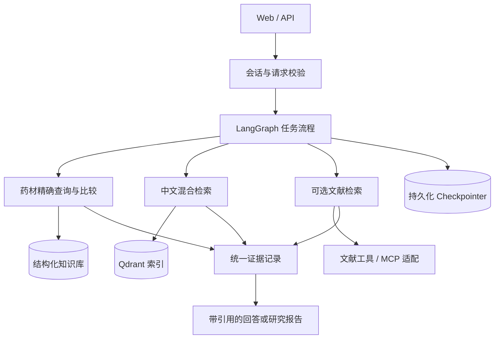

# TCM Research Agent：建设大纲与实施路线

> 文档性质：后续开发工作大纲，不代表所列能力已经实现。
> 更新日期：2026-10-12。依据：本地 ETCM2.0 数据审计、用户提供的《TCM Multi-Agent Assistant：技术栈审查与升级方案》、当前工作区代码、已保存的本地测试报告。
> 定位：中草药知识检索与科研证据分析助手。先交付可靠的查询与证据能力，再按实际收益扩展 Agent 工作流。

## 1. 项目目标与范围

### 1.1 第一版要解决的问题

- 根据药材规范名称或别名，查询有来源的结构化信息。
- 按已存在的字段筛选药材，并对指定药材进行可复核的属性比较。
- 用中文检索原始资料，回答时提供具体记录或文档片段的依据。
- 数据不足、名称歧义、外部工具不可用时，明确说明原因与缺失信息。
- 后续接入文献工具，将本地传统知识与外部科研证据分开呈现。

### 1.2 暂不纳入范围

- 自动诊断、个体化处方、替代专业判断的用药决策。
- 没有数据支撑的药材—成分—靶点关系推断或关系填库。
- 脑肿瘤、胸片、皮肤病图像分析和语音服务作为默认启动依赖。
- 为增加技术数量引入 Kubernetes、微服务、Neo4j、Redis 或 A2A。
- 将三个业务职责强制拆成三个独立服务或每次必经的 LLM Agent。

## 2. 当前基线：哪些已经完成，哪些尚未证明

以下状态来自已完成的代码检查和上一轮测试，不等同于生产验收。

| 项目 | 当前状态 | 后续工作 |
|---|---|---|
| Chat / Embedding | 已改为兼容接口；聊天、嵌入真实调用成功；当前 1024 维 | 配置校验、版本记录、失败分类 |
| Tavily | 密钥验证成功，联网回退能完成 | 变成可选能力；缺密钥、超时、空结果均需降级 |
| 会话隔离 | 已传递 session_id；真实 A/B 会话测试通过 | 所有权校验、过期机制、持续回归 |
| 短期记忆 | 同会话回忆通过；活跃历史默认最近 20 条消息 | 持久化、重启恢复、删除与保留策略 |
| 输出过滤 | 已传入历史；不再在测试用例中误删正确编号 | 验证其他多轮场景，不把 LLM 过滤当作事实校验器 |
| 本地 Qdrant 并发 | 单进程共享 RAG 并排队；两个并发请求成功 | 当前方案不是多进程能力，扩容前迁移服务端 |
| 来源链接 | 本地链接改为相对路径，兼容旧索引 localhost URL | 受控文件接口、片段/页码定位、逐结论引用 |
| 基础评测 | 有 eval_rag.py、compare_rag.py 和 14 项回归测试 | 建立中文人工核对集；补工具、拒答和证据评测 |
| CI | 当前 workflow 只构建 Docker 镜像 | 增加单元、集成、静态检查与发布验证 |
| 发布 | 本地 7860 已加载修复；旧 0.1.0 镜像未包含本轮修复 | 修复快照、重建、独立验证后再发布 |
| 中草药 JSON | 已完成首轮审计；2,076 份药材基础记录已入 SQLite，CLI、独立 API 与页面已提供，筛选/比较保留来源；尚未接入原聊天 | 中文映射暂缓，补黄金集与聊天集成；靶点错配待复核；使用/分发范围待确认 |
| 效果证据 | 已有英文医学小样本；单题简单 RAG 可成功 | 不能据此推断中文或中草药效果 |

验收依据：[框架检验](../audits/framework_review_2026-10-09.md)、[发布镜像测试](../audits/local_release_test/status.md)、[Tavily 复测](../audits/local_release_test/tavily_retest.md)、[记忆修复验收](../audits/memory_fix/report.md)。

**记忆边界：** 当前不是长期记忆。进程重启会清空；不同设备没有账户级同步；MemorySaver 可能保留历史 checkpoint 版本，活跃上下文裁剪不代表总内存占用有上限。持久化 checkpoint 也不自动等于“长期语义记忆”。

## 3. 技术取舍与原则

| 组件 | 处理方式 | 决策依据 |
|---|---|---|
| Python、FastAPI、Pydantic | 保留 | 支撑 API、输入校验和共享契约 |
| LangGraph | 保留状态图思想，先整理状态与流程 | 精确查询不必经过通用 Supervisor；复杂任务才做编排 |
| LangChain / LangGraph 依赖 | 独立兼容性升级任务 | 固定现有基线，按官方迁移指南逐项测试，禁止直接全量升级 |
| Chat / Embedding 工厂 | 保留 | 分离服务配置与业务逻辑；索引绑定嵌入模型及版本 |
| SQLite → PostgreSQL | 单机 MVP 可用 SQLite；有多用户需求再确定 PostgreSQL | 结构化知识、checkpoint、向量数据分别管理，不混为同一职责 |
| Qdrant | 保留；本地模式用于单进程开发 | 服务端部署作为多进程和正式服务的准入条件 |
| Dense + BM25 | 做中文对照后决定默认组合 | 药名、别名、短字段与长描述分别测；核查分词与归一化 |
| 重排 | TinyBERT 为现有基线，多语言模型为候选 | bge-reranker-v2-m3 先评测，再按效果、内存和延迟决定 |
| Docling | 保留为可选 PDF 导入器 | JSON 不经过 PDF 解析链；文本问答不应依赖 OCR/CV 初始化 |
| MCP | 业务查询稳定后增加协议适配层 | 工具逻辑复用 repository/service，不在 MCP 内再写一套业务 |
| Tracing | 先结构化本地日志，再选 Langfuse 或 LangSmith 之一 | 记录证据链与阶段耗时；明确脱敏和日志保留规则 |
| RAGAS 等评测工具 | 可选补充 | 不替代人工核对、结构化精确断言或证据原文检查 |

版本说明：本文不将建议材料中的“最新版本号”作为实施承诺。升级前记录所选版本、Python 兼容性和锁文件，并在独立变更中验收。LangGraph 提供 [v1 迁移指南](https://docs.langchain.com/oss/python/migrate/langgraph-v1)；MCP SDK 官方仓库提供 [版本迁移与服务端/客户端文档](https://github.com/modelcontextprotocol/python-sdk)，实施时固定同一版本线。重排候选以 [官方模型卡](https://huggingface.co/BAAI/bge-reranker-v2-m3) 为准，不预设它一定优于当前基线。

## 4. 目标架构



关键约束：数据库是结构化事实的来源，Qdrant 是可重建的检索索引；对话记忆不能直接成为知识库事实。证据不足不应自动变成无来源的模型回答。

## 5. 数据与证据契约

### 5.1 先审计真实 JSON，再定 Schema

2026-10-10 首轮审计已完成：[数据审计报告](ETCM2_DATA_AUDIT.md)、[字段映射草案](ETCM2_FIELD_MAPPING.md)。原始路径为 `/home/zry/workspace/HDCTI/dataset/ETCM2.0`，共 48,322 个 JSON、169.284 GiB；文件数不等于唯一实体数。药材基础字段没有独立中文名/别名字段，靶点存在重复响应和身份错配，因此首批范围收敛为药材基本信息，不直接导入完整响应或构建可信关系图谱。

第一批数据审计需要输出：记录数、字段清单/类型、缺失率、重复项、别名冲突、来源覆盖率、更新方式、可使用与可分发范围。保留原文件校验和与样本，不修改原始数据。

建议字段是候选集合，不表示原数据已经具有这些信息：

| 类别 | 候选字段 | 约束 |
|---|---|---|
| 标识 | herb_id、source_id、schema_version | ID 稳定；原始 ID 可追溯；同名不同实体不自动合并 |
| 名称 | name、aliases、latin_name | 保留原名、规范名和归一化规则版本；别名可指向多个候选 |
| 本体区分 | species、medicinal_part、processing | 区分基原、药用部位和炮制品；信息不足时保持未解析 |
| 传统属性 | properties、flavors、meridians、effects、indications | 仅导入源数据实际存在的值，并保留原始表述 |
| 科研关系 | ingredients、targets、relations | 后期扩展；没有真实关系数据时不生成关系 |
| 来源 | source_type、source_record_id、source_version、locator | 结构化记录可用字段路径；PDF 可用页码/段落；网页用 URL/标题/访问时间 |

**缺失值规则：** 区分“未知/未提供”“已确认无该项”“字段不适用”。不能不加说明地用 `[]` 同时表达三者。缺失信息不允许由 LLM 自动补齐后当作数据库事实。

### 5.2 双存储与一致性

- 结构化数据库：支持名称/ID 精确查询、属性筛选、比较和统计。
- Qdrant：按实体或语义单元建立检索文本，元数据含 herb_id、source_record_id、source_version、chunk_id、字段路径或文档定位。
- 原始资料单独保存；通过允许列表或鉴权的来源接口访问，不暴露整个 data 目录。
- 导入流程需幂等：同一 source_id + version 重复导入不重复新增；更新、删除可同步到索引。
- 记录结构化数据版本和索引版本；更新失败可重试、回滚或完整重建，避免查询不同版本的数据。
- 更换嵌入模型或维度使用新集合/版本；先验证再切换，不混用旧向量。

### 5.3 统一证据对象

建议核心字段：evidence_id、entity_ids、claim、evidence_type、source_id、locator、quote_or_excerpt、publication_date、retrieved_at、limitations。

证据类型至少区分：传统记载、体外实验、动物实验、临床研究、综述/指南、计算预测、未知。类型不是自动质量评分；传统功效、实验现象和预测关联不能写成同一种已证实治疗效果。

缺少出处的记录仍可保留，但必须标为未核验；无证据回答、无结果、字段缺失、实体歧义和工具失败应返回不同状态。

## 6. 工作流与工具边界

### 6.1 按任务选择最短可验证路径

| 任务 | 首选路径 | 失败或歧义时 |
|---|---|---|
| 查询指定药材属性 | 名称解析 → 结构化查询 | 列出候选或说明字段缺失 |
| 按多条件筛选 | 受控字段过滤 | 返回条件和空结果，不由 LLM 凑名单 |
| 比较多种药材 | 多实体查询 → 字段对齐 → 比较 | 缺失字段单独标注 |
| 语义相近的传统描述 | 属性约束 + RAG | 展示相似依据，不推断可替代用药 |
| 查询现代研究证据 | 已有文献 → 可选外部文献工具 | 区分检索不到和没有研究证据 |
| 综合研究报告 | 汇总结构化事实与文献证据 → 检查引用 | 分列已知、争议和证据不足 |

### 6.2 三个业务职责，按需演进为 Agent

1. **Herb Knowledge**：实体解析、结构化查询、筛选、比较及本地检索。
2. **Literature Research**：检索、去重、保存 PMID/DOI、研究类型和可访问的原文定位。
3. **Evidence Report**：整合前两者结果，区分证据类型，输出结论与对应来源。

前两项只有在输入依赖允许、并发预算充足时才并行；报告必须等待所需证据。普通属性查询不必走全部三个模块。第一版用明确条件路由，多步骤任务稳定后再评估 Supervisor 的价值。

### 6.3 MCP 工具契约

候选工具：get_herb_detail、search_herbs、filter_herbs、compare_herbs；文献端提供检索与文献详情读取。

工具输入输出由共享 Schema 约束：返回 status、data、sources、warnings、error、dataset_version。错误代码至少覆盖 invalid_argument、not_found、ambiguous_entity、missing_field、provider_unavailable、timeout。

- 第一版工具只读；禁止任意 SQL、任意文件路径和未经约束的写库操作。
- 明确超时、结果数量、分页、重试边界和调用预算。
- 本地调试可选 stdio，服务部署再评估 Streamable HTTP；无需同时实现所有传输方式。
- PubMed 优先复用经过验证的服务；不可用时可通过官方 API 适配，不以重复造 Server 为目标。
- MCP 接入需要同时验证服务端、客户端、真实工具调用与异常分支，不以“安装 SDK”为完成标准。

## 7. 实施阶段、交付物和完成条件

优先级：P0 为正确性/数据入口/发布阻塞项；P1 为核心检索与工具能力；P2 为优化与展示；P3 为需求出现后再评估。

### M0：固定可回归的工程基线（P0）

- [x] 修复基本会话隔离、历史过滤和单进程 Qdrant 并发；保留现有测试证据。
- [ ] M0-01：整理当前未提交修改，区分原有改动、本轮修复和审计文件，形成可回退代码快照。
- [ ] M0-02：统一 AgentState 的字段和节点返回结构；修复 next/agent_state 的隐式约定以及无图路由冲突。
- [ ] M0-03：复用编译后的 graph，明确应用启动/关闭、模型预热与资源释放生命周期。
- [ ] M0-04：影像、语音、联网能力配置化；关闭后不导入重型依赖、不加载模型、不进入相应路由。
- [ ] M0-05：移除整个 data/uploads 的公开静态挂载，设计受控来源接口；同步调整已有相对链接。
- [ ] M0-06：将现有回归接入 CI；本地/CI 测试默认不调用付费 API，真实调用单独标记。

**交付物：** 基线提交、依赖锁定记录、最小文本启动配置、API/来源接口回归、CI 结果。
**完成条件：** 不配可选密钥、不提供 CV 权重也能启动文本服务；禁用功能不导致 500；未授权请求不能下载数据库、内部文档存储或他人上传内容。

### M1：中草药 JSON 与结构化查询 MVP（P0）

**前置输入状态：** 已取得本地 JSON 并审计药材/靶点全量及成分/疾病样本；字段语义、来源版本、用途与分发约束仍需进一步确认。

- [ ] M1-01：首轮数据画像、映射草案和药材可执行校验已完成；字段语义、受控词表与官方版本确认待完成。
- [ ] M1-02：药材基础信息 loader 已实现并导入 2,076 份记录；结构校验、HTML 名称提取、异常隔离、批次计数与来源定位通过；传统属性词表归一化、交叉链接配对待完成。
- [ ] M1-03：repository 的来源 ID/拼音/拉丁名/英文名精确查询和重复名称候选已完成；多条件筛选与比较已完成；中文别名仍待完成（暂缓中文名映射）。
- [ ] M1-04：SQLite 全快照幂等更新、缺失文件失效、版本隔离与批次记录已验证；文件更名迁移、完整历史修订和未来索引同步待完成。
- [ ] M1-05：已提供独立轻量查询 API（拼音/拉丁/英文名详情、字段筛选、多药材比较）与结构化展示页（分页筛选、同名候选选择、字段来源展开）；中文查询未支持（暂缓中文名映射），实际支持范围以拼音/拉丁/英文名为准。
- [ ] M1-06：建立首批人工核对的结构化测试集，不依赖模型生成答案充当真值。

**交付物：** 数据审计、Schema、导入命令、结构化数据库、查询工具、固定测试集。
**完成条件：** 固定数据集上的精确查询/筛选/比较结果与人工预期完全一致；缺失字段不补造；重复导入不会增加重复记录；歧义名称能返回候选。

2026-10-10 实施记录：[药材 MVP 使用说明](ETCM2_MVP_USAGE.md)、[验收报告](../audits/etcm2_mvp/report.md)。新增 10 项单元测试、真实数据 26 项检查通过；同版本重复导入新增 0 条。当日完成范围仅 CLI/repository，不代表中文聊天能力已完成。

2026-10-12 实施记录：新增 `filter_herbs`（字段子串筛选，AND 组合）、`compare_herbs`（多药材字段对齐）、`_summarize`（精简视图）于 [`tcm/herbs.py`](../tcm/herbs.py)；新增独立轻量 API [`tcm/api.py`](../tcm/api.py)（`/health`、`/herbs/{name}`、`/herbs`、`/herbs/compare`、极简页），只加载 herbs repository、不依赖 CV 模型。中文名映射暂缓。repository 层 14 项单测通过；API 层测试此前未运行；现已在独立轻量环境补跑，见下方修复验收。

2026-10-12 修复验收：查询按钮全局变量冲突、筛选条件静默忽略、筛选/比较来源丢失已修复；14 项数据层测试、8 项 API 测试及 6 项真实浏览器检查通过。独立 API 无需等待 Docker 恢复。见 [API 与页面验收](../audits/etcm2_mvp/api_review_2026-10-12.md)。

2026-10-12 页面推进：新增来源 ID 查询接口与筛选分页，查询页改为结构化表格、字段比较和可展开出处；同名候选保留独立记录。见 [页面工作流验收](../audits/etcm2_mvp/page_workflow_2026-10-12.md)。中文映射仍暂缓，未接入原医疗聊天。

### M2：中文检索与证据定位（P1，依赖 M1）

- [ ] M2-01：生成字段感知的检索文本；JSON 使用字段路径定位，PDF 使用文档定位。
- [ ] M2-02：为切块与上下文设置真实长度上限；不要仅依赖提示词中的“512 词”。
- [ ] M2-03：核查中文分词、药名/别名归一化；比较 dense-only 与 hybrid。
- [ ] M2-04：比较无重排、现有重排、多语言重排候选，记录内存、耗时与质量。
- [ ] M2-05：返回 evidence_id、chunk_id、定位信息；答案中每项关键结论能映射证据。
- [ ] M2-06：分开记录检索分数、重排分数和证据充分性；不把异构分数平均当正确概率。
- [ ] M2-07：用中文固定集比较简单 RAG 与额外步骤的增益，只有增益明确的步骤进入默认链路。

**交付物：** 索引器、索引版本记录、证据 Schema、中文检索对照报告。
**完成条件：** 对相同数据/问题报告 Recall@k、MRR/nDCG、证据定位正确性与延迟；保留/替换方案由结果决定。阈值在基线完成后冻结，不能事后挑选有利样本。

### M3：会话持久化与依赖迁移（P0/P1，与 M1/M2 可独立推进）

- [ ] M3-01：在独立变更中选择并锁定兼容的 LangGraph/LangChain/checkpointer 版本，记录迁移清单。
- [ ] M3-02：区分 conversation_id、session_id、用户所有权；明确本地匿名与登录部署的差异。
- [ ] M3-03：选择受支持的持久化 checkpointer，验证重启恢复和数据库迁移。
- [ ] M3-04：实现会话过期、删除、历史保留与必要的脱敏；删除范围包括历史 checkpoint。
- [ ] M3-05：暂不建立长期个人画像；如需长期偏好/研究项目记忆，另立显式存取和删除契约。
- [ ] M3-06：只有保留人工审核需求时才实现 interrupt/resume；否则关闭现有伪审批入口。

**交付物：** 依赖锁文件、迁移说明、持久化会话实现、重启/越权/删除/并发回归。
**完成条件：** 重启恢复指定会话；不同用户不能读取对方会话；删除后无法从旧 checkpoint 恢复；升级后 M0–M2 回归不退化。未完成前不宣称长期记忆。

### M4：MCP 与文献证据工作流（P1，依赖 M1；综合报告依赖 M2）

- [ ] M4-01：把已有中草药 service 暴露为 MCP 工具，保证直接调用与 MCP 调用结果一致。
- [ ] M4-02：接入并验证 PubMed 文献工具，保存检索式、日期、PMID/DOI、来源和证据范围。
- [ ] M4-03：文献去重；摘要与全文分别标记，未取得全文时不编造页码或全文结论。
- [ ] M4-04：实现药材比较与证据报告工作流；限定工具次数、时间和成本。
- [ ] M4-05：引用检查、证据类型检查和工具失败回退；文献文本作为数据而非执行指令。

**交付物：** MCP Server/Client、工具契约测试、文献适配器、示例报告和完整调用轨迹。
**完成条件：** Schema 校验、错误分支和调用预算测试通过；报告能追溯到本地记录与真实文献；工具失败时不会包装成“没有相关研究”。

### M5：可重复部署与发布验收（P1/P2，持续建设、最后验收）

- [ ] M5-01：选定 tracing 方案，记录阶段耗时、路由、检索命中、工具错误、token 用量和数据/模型版本。
- [ ] M5-02：服务化 Qdrant 与所选持久存储；提供 Docker Compose、健康与 readiness 检查。
- [ ] M5-03：精简 CV/OCR/语音可选依赖；模型缓存显式管理，避免每个新容器都冷下载。
- [ ] M5-04：开发/生产配置、鉴权、限流、超时、日志脱敏、备份/恢复与数据迁移说明。
- [ ] M5-05：固定代码/模型/数据版本；构建版本化镜像，在不挂载源码的条件下验收。
- [ ] M5-06：整理 README、架构图、演示与实测报告，只描述已验证能力。

**交付物：** 部署配置、CI 流水线、版本化镜像、运行手册、发布记录。
**完成条件：** 干净环境可重现；镜像不含密钥/上传资料/私有数据；关键流程通过；失败率、p50/p95 延迟和调用成本都有原始记录。正式发布前完成来源与会话访问控制。

## 8. 评测贯穿各阶段

| 维度 | 测试内容 | 不接受的替代指标 |
|---|---|---|
| 结构化正确性 | 精确结果集、字段缺失、别名冲突、幂等导入 | 模型自称答案正确 |
| 检索 | 片段级 Recall@k、MRR/nDCG、中文实体与别名 | 只看命中文件名 |
| 回答 | 关键结论是否被证据支持、引用定位、拒答合理性 | 单纯英文关键词重合率 |
| 工具 | 工具选择、参数合法性、失败处理、预算 | 只验证 SDK 能 import |
| 记忆 | 同会话回忆、跨会话隔离、重启恢复、删除 | HTTP 200 或“已记住” |
| 工程 | 冷/热启动、并发、超时、p50/p95、成本 | 单个成功请求的耗时 |

测试集分层：结构化黄金集、中文检索集、多轮/歧义/无答案集、文献引用集、工具故障与并发集。先做小样本工程筛查，再扩充并冻结独立测试集；开发集用于调参数，测试集避免反复调优泄漏。

对照顺序：结构化直接查询 → 简单 RAG → hybrid → 重排 → 查询扩展 → 完整工作流。同一数据快照和题集，控制预热、上下文与模型参数；人工判断和 LLM judge 分开报告。

## 9. 建议目录与改动落点

以下是待新增/调整的建议，不表示目录已存在。第一阶段按功能新增，避免一次性搬迁整个仓库。

```text
agents/
  agent_decision.py          # 逐步整理状态、路由和生命周期
  runtime.py                # 当前会话/RAG 单进程运行管理
  source_links.py            # 当前链接兼容；后续适配受控来源接口
  herb_agent/               # 药材查询与检索编排
  literature_agent/         # 文献任务编排
  report_agent/             # 证据报告编排
  rag_agent/                # 保留并逐步完善检索组件

tcm_data/
  schemas.py                # 数据/来源/证据契约
  json_loader.py            # 导入、校验与审计
  herb_repository.py        # 结构化查询
  service.py                # API 和 MCP 共用的业务层
  rag_indexer.py            # 幂等索引与版本管理

mcp_servers/
  herb_server.py            # 只读业务工具适配
  pubmed_adapter.py         # 复用已有服务或官方 API

evals/                      # 与已有 eval_rag.py/compare_rag.py 逐步整合
  datasets/                 # 可公开的小型测试集；敏感资料不入库
  evaluate.py
  rubrics.md

tests/                      # 延续已有测试；新增数据/工具/集成测试
migrations/                 # 结构化数据和会话存储迁移
docs/                       # 本大纲、契约、ADR、运行手册
compose.yaml                # 待选定服务依赖后新增
pyproject.toml              # 迁移时明确与 requirements/锁文件的唯一来源
```

每个阶段更新一条决策记录：问题、候选、选择、证据、取舍、回滚方法。测试记录仍可保留在 audits/，不要把一次试验结果误当正式基准。

## 10. 待确认输入与第一批可执行任务

### 10.1 必要输入

| 输入 | 用于决定 | 未提供时的处理 |
|---|---|---|
| 实际 JSON 已提供；字段语义和快照版本待补充 | 已有清单、全检/抽样报告与映射草案 | 初期保留源字段语义，未知值不推断 |
| 数据来源与使用/分发范围 | 来源记录、部署和镜像内容 | 原数据不打入公开镜像 |
| 目标问题样例 | 结构化/语义/文献任务优先级 | 先实现查详情、筛选、比较 |
| 部署 CPU/GPU/内存与并发需求 | 重排选型、缓存和服务化 | 以单机开发为基线，不承诺容量 |
| 是否需要登录、重启恢复、跨设备使用 | 会话所有权与持久化 | 清楚标注匿名短期会话限制 |

### 10.2 立即开始的工作顺序

1. **冻结当前修复基线**：整理变更与已有 14 项测试，记录当前镜像/代码差异。
2. **完成 M0 的可选功能与数据访问边界**：形成不依赖影像和语音的文本应用。
3. **依据已完成审计落实 M1-01/02**：完成药材 Schema 和 loader；隔离异常候选，保留文件校验和与字段路径。
4. **实现药材纵向闭环**：先以少量真实记录验证，再导入通过校验的药材基础信息 → 拼音/ID 精确查询 → 展示出处 → 黄金集验证；中文入口另配可核验名称映射。
5. **并行推进独立的依赖兼容性与持久化设计**：不让框架升级阻塞字段审计，也不把持久记忆拖到发布后。
6. **有基线再增加中文 RAG/MCP/报告**：每增加一层都提交与前一层的对照结果。

## 11. 扩展条件与完成定义

已取得的 ETCM2.0 本地快照作为首批数据源；审计数量仅描述本地文件，不代表官方实体总量。本文不假定存在稳定可调用 API。只有取得可使用的数据、明确信息版本及关系证据后，再开启成分、靶点、疾病关联分析。图数据库是否需要由真实关系查询决定。

一个任务只有同时具备以下内容才标为完成：代码/Schema 或文档交付物、可重复测试、真实失败分支、对应来源/版本记录、明确限制。模型调用成功、HTTP 200、截图或演示视频均不能单独替代功能验收。

后续每次开发从本大纲选取任务 ID，报告“完成项、验证、未完成项、下一依赖”。不重复开发已修复功能，也不把未来计划写成当前成果。
