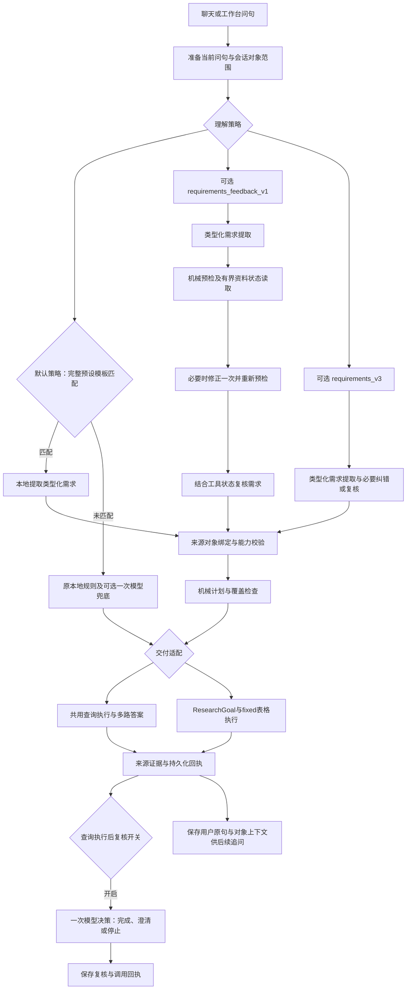

# TCM DataOps Agent：统一大纲与真实状态

**正式产品范围收敛（2026-11-06）：** 对外定位为中草药资料问答系统。首页与默认帮助只介绍问答主线；表格列为候选，收藏/复杂研究/其他实验入口默认隐藏。底层代码、原API、历史产物与评测保留，配置可用不等于产品完成。以[功能状态](FEATURE_STATUS.md)为现行范围；下文五类任务及各轮交付为历史工程范围，不自动升级为现行产品承诺。

**答案展示维护（2026-11-06，工作区未提交）：** 聊天普通标量入口与多路交付使用同一精简展示，同药材字段集中、性味合并、检索细节折叠；缺项、冲突与来源保留，无额外模型调用。见[修改与浏览器验证](../audits/answer_compaction_v1/README.md)。

**字段来源维护（2026-11-06，工作区未提交）：** 常用字段的默认来源集中到共享规则；明确指定来源优先，完整标量模板的模型字段错误在执行前拦截，并使用已有反馈纠正额度。18模块207项离线检查通过，无新增真实模型调用；7896已更新，4个会话、2个工作区及2份XLSX内容核对一致。见[维护与限制](../audits/field_sources_v1/README.md)。

**当前试用更新（2026-11-06）：** 7896本地实例已按用户要求启用已有 `requirements_feedback_v1` 与查询执行后复核，工具执行保持fixed；本轮补齐左侧功能区、按药材合并回答、表格下载状态及短指代对象继承。115项离线测试和14组浏览器检查通过，无新增真实模型评测；7934旧镜像与历史成绩不变。见[本轮修改与验证](../audits/chat_presentation_v1/README.md)。

**当前交付范围（2026-11-05）：** 只完善单药字段、多药同字段、跨来源、分页关系查询和固定模板表格五类预设问题。暂停通用列顺序、更多理解策略及扩大模型评测。见[范围、13条走查与完成标准](PRESET_QUESTION_SCOPE.md)；下方历史功能描述不扩大本轮开发范围。

更新：2026-11-06（Asia/Shanghai）。本文是当前架构、任务顺序与状态入口；下方历史阶段记录保留当时成绩，不作为最新部署状态。恢复约束与原始证据位置见[新会话交接](NEXT_SESSION_HANDOFF_20261103.md)。

**最新维护交付（2026-11-06）：** `2e9d50c`已本地提交并部署至7934，补齐聊天待确认请求保存、同编号重试、刷新恢复和会话变更保护；补充[业务背景与交付流程](PRESET_QUESTION_SCOPE.md#业务背景与一次完整交付)。114项针对性离线检查、7组合成浏览器检查通过；部署复验13条预设、4轮对话及3组真实页面恢复检查通过。保持fixed与模型关闭，未推送GitHub、未产生新远程CI。见[本地交付与回滚](../audits/chat_request_recovery_v1/release.md)。

**上一版交付闭环（2026-11-05）：** 实现`954776b`已提交并推送，GitHub全量1862项及镜像构建通过；当时7934部署验收通过13条预设问题、4轮连续对话及两份XLSX，模型调用0。见[原交付记录](../audits/conversation_scope_v1/release_closure.md)，该远程CI成绩不代替最新维护提交的验证。

## 当前结论与项目范围

面向中草药资料查询、来源查证和表格整理。已有属性/药典/关系查询、跨来源多路答案、表格及父子追加、持久化会话与任务、幂等回执、所有权隔离、来源证据和请求诊断。原始资料只读，名称候选与字面身份比较不等于人工确认的药材身份。

当前采用单Agent应用路线，常规资料任务由宿主fixed执行；多轮native执行仍属于实验。可选 `requirements_v3` 已接完整需求检查；新增 `requirements_feedback_v1`（W）接入有界工具反馈、一次修正和复核，默认仍为 `local_then_one_model_v1`。全量分页导出、开放自主任务、临床推荐、全库身份审核不属于本轮收尾范围。

**最新增量（2026-11-05）：** 五类预设问题13/13通过，123项受影响回归通过。已有固定执行器处理完整字段、双来源和分页，明确模板无需模型；见[证据](../audits/preset_questions_v1/README.md)。7934已更新并通过同一13项部署验收。历史W成绩仍为业务3/6，不能用本地模板走查覆盖原分数。

**上一阶段收尾状态：** 用户已确认恢复，C阶段全仓1804项/208模块通过；7933双来源专项10项通过；live_v2可继续组合已全部执行，119组合有终态、1组合保留中断。新业务30题R/G/V为2/8/6题通过，默认策略不变。完整分组与失败分析见[收尾验收](../audits/requirements_completion_v1/README.md)。删除一行历史HTML注释中的疑似密钥后，新建7934镜像实例验收；本轮以本地提交收尾，不推送。

**连续对话修复（2026-11-05）：** 用户反馈表明固定问法13/13不足以覆盖实际追问。本轮补充未识别请求与澄清的持久化、最近一轮对象范围、无来源限定的性味查询，以及W理解/复核共享会话上下文。仍围绕原五类资料问题，不扩展后台任务或多Agent团队。见[连续对话验收](../audits/conversation_scope_v1/README.md)。

**执行后反馈增量（已随最终镜像部署，默认关闭）：** 查询工具执行后可选择开启一次模型复核，输出完成/澄清/停止；工具结果先保存，复核预占回执且未知不重试。W原理解最多3次＋复核1次，总上限4次。初次实现阶段91项受影响测试通过、真实调用0；随后真实验证见下一段。表格保持现有文件校验。

**真实反馈验证（2026-11-05）：** 15/16次调用、45,953 token、HTTP错误及未知派发0。首测3/4符合预期，C04过度澄清；修复后C04单案及保存药典结果的复核通过，保留原失败与脚本中断。修复回归34项通过。未证明优于本地规则，7934继续关闭模型。详见[真实结果](../audits/conversation_scope_v1/live_feedback_result.json)。

## 当前架构与技术细节

**离线收尾记录（2026-11-05）：** 已补齐CI的NumPy/Qdrant/psycopg依赖。干净Python 3.11.17环境全量覆盖215模块1862项；首轮两个旧测试仍禁止拒绝请求写记忆，更新后14项复测通过，无剩余失败、跳过或网络尝试。这份[本地验证记录](../audits/conversation_scope_v1/ci_verification.json)不代表再次完整回归或远程CI通过；后续提交、部署与远程验证以顶部交付记录为准。

| 层次 | 实现与关键约束 | 主要代码 |
|---|---|---|
| 入口与调度 | 聊天/工作台共用资料需求提交；理解策略可选，查询回到共用执行器，表格进入ResearchGoal与原队列 | `tcm/dataops/service.py`、`tcm/dataops/chat.py`、`tcm/chat.py` |
| 会话上下文 | 未识别请求保存为未执行，澄清保留用户原句；追问仅继承同会话最近一轮对象，显式新对象优先，数量不一致澄清；上下文随请求回执冻结 | `tcm/dataops/conversation_scope.py`、`chat.py`、`answer_delivery.py` |
| 预设模板解析 | 默认策略下完整匹配五类明确问法，提取对象、来源、字段及交付形式；复用绑定、规划和fixed执行，匹配模板无需模型 | `tcm/dataops/preset_requests.py`、`app.py` |
| 类型化需求 | 对象、逐对象字段、关系组、交付形式与追加操作分开表达；answer/table按form判别，兼容旧持久化null | `tcm/dataops/requirements_v2.py` |
| 模型理解 | 输入包含标准字段清单、候选名称与必要父字段；最多两次请求用于提取＋纠错或独立复核；纠错返回错误码、字段路径和具体改法 | `tcm/dataops/requirements_understanding.py` |
| 工具反馈理解（可选W） | 机械预检＋最多2对象×4标量字段的只读状态探测；修正共一次，再进行不看前提案的语义复核；每轮最多3次请求，未知不重试 | `tcm/dataops/requirements_feedback.py` |
| 绑定与规划 | 来源对象绑定→能力校验→机械计划→需求覆盖检查→查询路由/表格Goal适配；规划阶段本身不执行工具 | `tcm/dataops/requirements_pipeline.py`、`requirements_planner.py`、`capability_matrix.py` |
| 字段来源与查询覆盖 | 模板、字段契约及模型提示共用默认来源；未指定来源的性味/归经默认ETCM，剂量等默认药典，显式来源优先。完整标量模板的模型提案执行前校验对象/来源/字段；W在原预算内纠正。不构成任意自然语言的语义证明 | `tcm/dataops/field_sources.py`、`requirements_understanding.py`、`query_coverage.py` |
| 执行后复核（可选） | 查询执行后读取状态摘要；一次finish/clarify/stop，缺失不可升级、成功结果保留、独立派发回执；已部署代码，默认关闭 | `tcm/dataops/result_feedback.py` |
| 答案交付 | 逐路状态与证据、部分成功保留、一轮对话提交、持久化回执和幂等重放；聊天与工作台共享协调器 | `tcm/dataops/answer_delivery.py`、`assets/web/answer_delivery.js` |
| 表格与恢复 | fixed执行、来源/字段检查、XLSX交付、不可变父子版本；SQLite队列/持久状态与所有权检查，追加保留父产物 | `tcm/dataops/research_graph.py`、`jobs.py`、`research_contracts.py` |
| 数据与检索 | ETCM结构化属性和关系、药典字段证据、精确/BM25基线；BGE/Qdrant与受限引用RAG已有阶段实现，未证明向量或多轮模型整体收益 | `tcm/relation_queries.py`、`tcm/mineru_retrieval.py`、`tcm/research_evidence_store.py` |
| 诊断与评测 | 分阶段失败码；真实ASGI/工具/文件观察；派发前扣预算、SQLite回执、源码/依赖/数据/题集冻结，不覆盖已开始组合 | `tcm/dataops/diagnostics.py`、`tcm/evaluation/` |

`requirements_v3` 是策略名，内部类型与提交工具仍使用 `RequirementsDraftV2` / `submit_requirements_v2`，不要将两者误判为版本未接通。answer的 `row_policy/count` 只能省略或null；table必须 `row_policy`，`top_n` 必须带1–5的count，其他策略不带count。纠错耗尽两次额度后，不得绕过必要语义复核执行。

图示为成功路径；需求不明、能力不支持或覆盖不足会在执行前返回澄清/失败，不以部分可执行需求替代全部要求。

## 最新证据与验收边界

| 阶段 | 已有证据 | 当前限制 |
|---|---|---|
| 评测执行器修复 | 真实ASGI/工具/数据/XLSX观察、父文件校验、预算回执与冻结保护；独立AI题集40场景43轮 | AI出题不是真人用户研究，来源参考不等于身份人工审核 |
| B：交付Schema与纠错反馈 | 100项专项、6份保存返回离线回放；全仓1799项/207模块、0跳过/0联网尝试 | 仅代表B阶段源码，不代表后续修改已全仓通过 |
| C：来源选择与替代参考 | 已实现，交接记录56项针对性测试通过；评分逐个完整替代方案比较 | 恢复后1804项/208模块全仓通过、0跳过/0联网尝试；不能拼接不同参考方案凑分 |
| 预设问题源码与7934部署验收 | 五类问题10条业务＋3条边界均通过，123项受影响测试通过，模型调用0次 | 固定开发模板；不代表任意自然语言泛化，未重跑全仓 |
| 上一阶段本地镜像clean验收 | `var/requirements_completion_v1/clean/summary.json` 为 `passed/complete`；含查询、表格、追加、重建恢复 | 7933双来源专项10项已通过；依赖主机只读数据挂载 |

替代参考通过 `Scenario.alternative_expectations` 保存；对象、任务类别和交付形式必须与主参考一致。实际评分同时核对逐对象字段、关系组、来源和值、缺失及真实文件；HTTP 200或排队成功均不等于任务达成。

证据：[执行器修复](../audits/requirements_eval_repair_v2/README.md)、[B阶段验收](../audits/requirements_delivery_feedback_v1/acceptance.json)、[来源策略测试代码](../tests/test_source_choice_policy.py)。本轮已完成C阶段全仓检查，原始中断记录保留；详见[完整报告](../audits/requirements_completion_v1/offline_ci_summary.json)。

## 真实对照：两轮分别保留

R为纯本地，G为本地加至多一次模型理解，V为 `requirements_v3`、每轮至多两次模型请求；三者共用数据与执行基础，不能将这些策略名与历史F/P/A执行策略混用。

| 运行 | 派发与进度 | 解释 |
|---|---|---|
| `live_v1` | 11次派发，10次HTTP200、1次未知，随后停止；前4场景已开始 | 原始R0/4、G3/4、V0/4保留；HV2-02参考来源有歧义，V第四题是传输未知，不是已证实理解失败 |
| `live_v2` | 118次派发均HTTP200；119组合有终态，HV2-02 V保留started且无provider派发；未启动组合0 | 已见4题R/G/V为1/4、4/4、3/4（含1中断）；此前未运行30业务题2/30、8/30、6/30；6边界题全部通过，未证明V优于G |

live_v2原授权上限129次（R0/G43/V86），累计已用118次，剩余额度不用于重跑。模型为 `api.deepseek.com / deepseek-flash`、thinking关闭，每次1200输出token、64KiB、30秒、无自动重试；HTTP错误/未知派发停止。只发送问句、静态工具/标准字段、名称候选、父字段及纠错反馈，不发送原始资料或历史。

`ledger.sqlite3` 是派发事实；`--resume` 跳过所有已开始组合，不补跑HV2-02 V。本次恢复前后冻结校验均通过；结束后删除HTML历史注释，旧manifest会拒绝当前源码，不应再直接resume。补跑中断组合或新增实验必须另存方案，不覆盖现有回执。具体manifest与目录见[交接第5节](NEXT_SESSION_HANDOFF_20261103.md#5-两轮真实模型记录严格分开)。

## 数据与本地部署

当前数据发布版 `var/data_releases/r1_names_20261101`，含2076条ETCM来源记录、616个药典条目、8665个字段块；不是去重药材种数。旧 `r1_20261030` 缺丹参/连翘中文候选，不能代替最新目录验收。

| 端口 | 容器 | 当前状态 |
|---|---|---|
| 7934 | `tcm-requirements-clean-completion-v2` | `recovery-2e9d50c`，健康；13条预设＋4轮连续对话及页面恢复检查通过，原会话保留 |
| 7933 | `tcm-requirements-clean-completion-v1` | 历史冻结版本；当时clean及双来源专项通过，不作为当前入口 |
| 7932 | `tcm-requirements-clean-names-v2` | 历史版本＋最新名称目录，不作为当前入口 |
| 7936 | `tcm-requirements-clean-v2` | 历史版本＋旧发布版，不作为当前入口 |

7934最新镜像 `tcm-research-chat:recovery-2e9d50c`，实现提交`2e9d50c`仅本地提交；`closure-954776b`旧镜像和停止的旧容器保留。入口绑定127.0.0.1、关闭模型、使用主机只读数据，228份运行文件与构建输入一致。原41条会话、38条交付记账已核对保留；私有资料和状态备份留在本地，见[最新部署证据](../audits/chat_request_recovery_v1/deployment.json)。历史`74f2521`、`1532105`及`954776b`各自的旧验收记录保留。

## 当前交付：预设问题已完成

以[预设问题清单](PRESET_QUESTION_SCOPE.md)为准：10条业务例子和3条边界13/13通过，连续对话原例4/4通过，范围内修复及交付记录已完成。W实验保留，暂不扩展、切换默认或启动新的策略对照；任意列顺序和连续追加不作为本轮完成前置条件。7934已更新到维护提交，原会话、配置和数据挂载已核对保留；本次没有推送或新远程CI，见[最新本地交付](../audits/chat_request_recovery_v1/release.md)。

## 上一阶段收尾完成标准与后续方向

本轮完成最新源码离线检查、实际双来源交付和恢复验收、原授权内的真实评测与分组报告，并整理本地提交。没有重跑HV2-02 V，没有覆盖live_v1和原中断记录；默认不push。

以下为上一阶段的探索性建议，已被当前预设范围取代，不是本轮待办：answer/table选择错误、多对象/跨来源理解失败、过度澄清、连续追加未交付。优先用本轮保存返回定位，再另立新协议与未参与修复的题集；不将本轮已见题继续称为保留题，不追加预算刷分，也不扩展临床业务或新框架。

工程验收通过不等于真实泛化达标。最新分组、失败原因、调用量与部署回执以[收尾验收](../audits/requirements_completion_v1/README.md)为准。

## 历史阶段记录（截至2026-11-01）

以下“下一步”“未实现”“当前端口”等均为当时口径；最新状态和执行顺序以上文为准。保留旧失败、旧成绩和方案取舍以便追溯。

更新：2026-11-01。**当前主线为版本化数据与benchmark、检索对照、带引用RAG，再整合Agent任务与部署，服务于大模型应用岗位求职。** 本文是唯一任务顺序与状态入口；[数据/RAG/benchmark方案](DATA_RAG_BENCHMARK_PLAN.md)定义新增契约，[DataOps子方案](DATAOPS_WORKBENCH_PLAN.md)管理已有工作区和交付。**R1/R2已交付研究基线，R3受限摘录RAG及小样本真实调用已验收，模型整体收益仍未证明；R4工程整合与本地镜像已验收，原A0/2保留；新版在新两项限定任务交付通过，但多轮收益未证明。R2首测9/10保留，字段状态缺陷已在R3修复。** D1/D2本地工程保留，V4动态A2/3及G V1规则/模型各8/12不变，开放自主业务及跨任务稳定性仍未验收。

## 目标与边界

面向资料整理人员，支持明确字段查询、按含义查证文档，以及数据库筛选后补充文档证据并持续修改。ETCM承担精确属性/集合查询，药典承担有出处的文本证据；检索、模型回答和任务执行分别评测，通用性来自数据库＋文档协作。R2已新增受限跨条目检索，R3另接原文/引用回答页与API；R4新增限定候选核对页和同图工具，原A未交付，新组合的两项限定任务已交付；有界问句Goal入口已接通，真实8题理解规则4/8、模型6/8，仍有失败，不把入口接通写成自由任务理解已完成。

保留现有20条核对、50条v1/v2规模交付作为可靠基线；新增演示目标是按含义找到药典候选说明并带引用归纳，以及ETCM限定记录后补充药典证据、生成表格与v2。先证明证据能召回、回答受支持，再验证模型何时需要补查或澄清。原始记录只读，Top-k候选不冒充全部相关药材。

不再把方剂推荐、靶点预测、机制研究、全库实体对齐或通路富集作为近期前置任务。文献搜索网络入口和菜单已退役，历史读取继续兼容；多Agent、沙箱、Skills平台、新外部MCP和复杂长期记忆不阻塞首版。

## 当前代码实际能做什么

**2026-11-01验收门禁与查询覆盖修复：** 反例门禁现在核对实际结果、拒绝原因和阶段，不匹配退出1；新增版本17题包括查询和父目标合同，原10题保留。共享字段覆盖检查阻止“功效→全量属性”和“部位＋功效→只查部位”，保持正确查询及原多步计划。开关有效值加入元数据、诊断和幂等签名。能力矩阵仍未接入、Requirements仍是投影；完整契约迁移未完成。原“CI全部通过”记录已更正，不改写旧失败。验收和当前部署见[本轮记录](../audits/understanding_gate_fix_v1/README.md)。

**2026-11-01统一理解链已接入（受限工程改造）。** 7921启用 `unified_v2`，普通自然问句不再被旧规则偶然命中抢占；类型与权限校验、资料任务需求核对分别处理。首轮理解加一次参数纠正或独立复核共用2次请求额度；复核不见首轮提案，不一致不入队。需求合同、阶段与总调用数随回执保存，重放不再调用；7920纯本地。反例、超时、幂等、队列及父版保持验证通过，实际来源回放交付两行/128单元格，外部模型新增0。旧5/6等成绩不改；复杂计划语法合同仍未迁移，真实策略收益待新协议验收。见[本轮记录](../audits/understanding_v2/README.md)。

**2026-11-01真实提案与另一批新表述已完成首测。** 已暴露业务3/3、边界2/2通过；新六业务场景本地0/6、一次理解＋fixed为5/6，业务轮次0/7与6/7，控制1/2与2/2。12次模型理解、69,123 token，无重试；作者改写而非独立保留集。表格及v2通过实际文件和父版内容校验。唯一模型侧业务失败为正确filter_complete提案被齐全性词表误拒，首测后已改为正向约束/明确冲突校验；保存参数真实资料交付两行、128单元格，20模块167项检查通过，新增模型重测0。首测5/6、旧0/8与4/8均保留；7920/7921同源码且无需重启。当前有小样本的一次理解收益证据，多轮收益、独立业务稳定性和新Docker验收仍未完成，见[本轮分项与修复证据](../audits/query_generalization_v2/README.md)。

**2026-11-01宿主误拒修复已交付限定回归。** 普通查询复用宿主目录候选与字面位置，不以请求动词词表拒绝已知对象；仍保留长名称、炮制/否定、漏对象与工具权限约束。展示出处、齐全筛选mode与停止类理由已修，第三人诊疗在模型前拒绝；深层本地诊断及同进程SQLite锁已补齐。60模块529项、6个真实来源回归、两实例10次HTTP检查通过，新增外部模型调用0。G03/G04/G08采用保存参数的SDK替身，G05及两类边界本地执行；原始0/8、4/8不改，不把回归6/6当新模型成绩。复杂计划仍有界，未完全脱离语法合同；分布式诊断、Docker和Langfuse服务端未新增验收。该修复之后的真实回归与另一批新表述结果见上方最新记录。见[本轮证据与范围](../audits/proposal_validation_repairs_v1/README.md)。

**2026-11-01新问法首测已完成，业务泛化仍未通过。** 冻结8业务＋4边界、13轮；业务场景本地0/8，一次理解＋fixed为4/8（业务轮次0/9与5/9，包含一个父任务失败后未运行的追加轮）。13次模型理解返回、74,606 token，不重试，原低分保留。模型补上了属性、药典和表格/增量理解，但正确提案仍被名称/出处/齐全筛选词表误拒；停止类理由与第三人诊疗拒绝也有缺口。本轮改进评测器的跨路径结果/完整证据核对和预算边界，未改业务或Prompt。5模块56项受影响检查通过，另记录一次诊断并发初跑缺记录，重测通过但根因未明。下一大步先将模型提案验证与本地语法解耦，按候选跨度、否定/炮制限制、需求覆盖及工具权限校验；修复以保存返回离线回归，不新增框架，不把已暴露题当保留集。见[首测与分项计划](../audits/query_generalization_v1/README.md)。

**2026-11-01本地属性查询补修：** 单/多属性共享完整字段契约，修复“想知道连翘的药用部位”被药典规则抢占，以及顿号四字段中性味未识别；ETCM性味同时读取药性、药味。普通药材/药典查询补齐公开失败码与诊断事件，区分名称边界、目录未命中和字段缺失。57模块502项受影响回归、7920/7921共16次HTTP检查通过，新增模型调用0，旧评测分数保留。实例源码一致且无需重启；Docker与Langfuse服务端未追加验收。此项已关闭这两个暴露缺口，下一步仍为未参与调优问句的本地/一次理解对照，见[修复原因与范围](../audits/local_query_repairs_v1/README.md)。

2026-10-31体验复核：固定/模拟/模型执行的公开模式已区分，决策步数与实际模型请求分开显示；零合格结果展示字段原因，RAG模型输出与原文相同时明确提示。16模块132项受影响检查通过，7896/7912/7914本地实例已更新；不新增模型实测或改变历史成绩。验收与兼容边界见[本轮记录](../audits/qa_observability_v1/README.md)。

启用research-selection时，聊天与工作台共用 `DataOpsService.submit_research_question`。默认兼容 `local_then_one_model_v1`；显式 `--understanding-policy unified_v2` 使用上述统一理解和2次总额度。查询交回原工具，ResearchGoal进入原队列、ResearchEngine和fixed交付；表单和工作台取消模型仍可本地执行。7921已启用新策略，未默认开启native执行。未将任意任务或全局语义验证标为完成。

| 能力 | 已有实现 | 新主线缺口 |
|---|---|---|
| 工具与执行 | 八个业务工具、原生tool-call图基础、参数/预算/批次/分页/来源校验 | DataOps已有原生工具决策适配器和观察循环；新资料任务已启用fixed；native在新两题交付通过，旧R4 A0/2保留，多轮收益与跨任务稳定性未证 |
| 目标理解 | 聊天/工作台共用版本化理解策略；7921统一模型入口、任务需求合同、一次纠正或独立复核（总计最多2次）；7920本地 | 新策略仅离线/保存参数回放验收；旧单次六业务0/6与5/6保留；独立问句、普通查询语义核对和复杂计划迁移未完成 |
| 检索与关联 | 药材/药典查询、BM25、本地BGE/Qdrant、可选重排；来源身份候选与字面比较 | D1已建20条来源参考及批量差异核对；身份人工签核和全库映射未完成 |
| 数据与benchmark版本 | R1发布已登记2076份JSON，重建616条目/8665片段同hash索引，生成8665候选并冻结30题原始参考 | R2新建8665条/512维缓存及Qdrant代，249条实际截断；4条名称候选阻断已验证；旧缓存仍禁用，网页未切新代 |
| RAG回答 | R3已有有界证据、一次可选生成、引用/完整句摘录检查与原文回退；7912新页可用 | 自由归纳语义支持未验收；小样本无整体收益，默认原文；R4任务工具已接入，新A两题交付但未证明检索增益 |
| 上下文 | 16KB阈值证据外置、受限回读、容量及归属检查 | DataOps已有独立Schema、覆盖/异常摘要和受限证据回读；真实模型上下文效果未评测 |
| 可靠执行 | SQLite队列、SSE、取消、租约、旧A journal；部分报告有PostgreSQL checkpoint | DataOps SQLite持久图和waiting_input已接原队列；单机工程验收通过，分布式部署未做 |
| 工作区与记忆 | 会话、项目、收藏、revision、可选语义候选 | DataOps已有不可变父子版本、字段复用/失效及冲突保护；语义记忆暂不扩建 |
| 交付 | 既有单药/两药报告、证据下载 | DataOps已实现XLSX逐格校验、发布幂等与v1/v2差异表 |
| MCP与观测 | 两个只读工具及客户端；本地Langfuse已接DataOps执行/模型/评测，V3/V4/G轨迹评分回读通过 | 普通查询已有本地分阶段诊断；Langfuse服务端与分布式可靠性未新增验收，无需再包装一套MCP |

D1完整离线回归147模块1243项通过，0跳过、0联网尝试；其后饮片范围修复对受影响模块复测16项通过，详见[验收摘要](../audits/dataops_d1_v1/README.md)。此前145模块1231项保留为历史记录，不与本轮相加。旧24题作者筛查的资料任务首轮8/18、修复后17/18，另1题标签差异单列；均不是新DataOps结果或独立准确率。见[问句契约记录](QUESTION_CONTRACT_MILESTONE.md)。

D2本轮完整离线回归149模块1262项通过，随后最终变更按受影响模块复测；真实20条v1/v2来源对照、两个独立进程的人工续跑和浏览器验收通过。数字不叠加为准确率，详见[D2验收](../audits/dataops_d2_v1/README.md)。

D3完整离线回归150模块1272项通过；此前受影响检查12项、V2诊断后37项及单动作契约改进后45项均通过，计数重叠不与完整回归相加；原30题三策略90次回归通过，0联网。真实50条v2复用200个旧字段，逻辑读取13次；同候选检索6题的重排与简单规则均6/6。三题真实模型V2实际8次请求均HTTP200，F/P各3/3、A为0/3；A中断的精确原因因当时日志不足尚未确认。首轮6次HTTP400原失败保留。D3当时Docker引擎不可用，业务新镜像未构建/发布；后续本地Langfuse部署不等于业务镜像验收。见[D3验收](../audits/dataops_d3_v1/README.md)。

上传前版本完整回归：155模块、1307项通过，0跳过、0联网尝试，见[Git上传前验收](../audits/git_upload_20261030/README.md)。这是上传前版本的一次完整回归，与前述历史及受影响检查计数重叠，不相加；不改变真实模型A和部署的未完成状态。

随后核验实际任务入口，修复“当前能做什么”未识别及菜单写死；菜单、工作台API和动态提交共用执行开关。8模块90项受影响回归通过；真实资料的共同靶点、画像、规范问法相似度、两药表格v1/v2与收藏下载通过本地核验。“近邻”改写仍漏识别、疾病目录未配置、药典部分字段缺失分别记录，未算成功；真实LLM自主整理仍未完成。7912已按原状态目录重启，见[能力核验](../audits/capability_verification_v1/README.md)。

另一Agent走查的是未重启的7896，旧进程缺少新工作台路由；本轮已按原配置重启7896/7912并增加源码版本检查。单药多字段直接查询、普通关系唯一候选自动读取、有界API文本和离线页面资源已修复；构建清单补齐嵌套DataOps与网页资源，关闭的循环演示不再探测未启用接口。最终25模块241项受影响回归通过，两个实际端口及隔离动态表格流程已做浏览器核验，见[新用户走查](NEW_USER_QA_20261030.md)。这不改变真实A、自由问法兜底及镜像尚未验收的状态。

## 已作出的技术选择

2026-10-30质量批次已完成：解析器v5将原页中11处贮藏后试剂/品种/检测注释另存为“条目注释”，新研究视图v3和索引v3保留616个条目的身份、全部原文及既有11条覆盖修订；14个原页/原块开发参考从旧索引3/14到新索引14/14。19模块185项受影响回归通过，问法补修后3模块33项复测通过（重叠、不相加）；真实固定表格、动态追加贮藏、引用、下载和旧版本保护通过。7896/7912已切换v3并保留Langfuse，原v2和历史文件不改写。AI视觉核对不等于人审或全库正确率，见[字段边界验收](../audits/storage_boundary_v1/README.md)。

V3三题真实模型对照与诊断已完成：33次HTTP200，F/P各3/3、A为1/3。A的B04先花预算在可选动作，第8步只生成文件未验证/结束；R01子目标对多scope字段回读后比较、重复核对，触发两步无进展。Langfuse九条轨迹、33个generation、九个分数与本地回执对应，旧V2精确原因仍未知。新增预算/交付/已读缺口反馈、预算续跑绑定和失败诊断，通过10模块77项离线检查，见[V3与V4准备](../audits/dataops_live_v3/README.md)。

最新[V4有界复测](../audits/dataops_live_v4/README.md)已执行一次，33次HTTP200，无重试/格式纠正，F/P各3/3、A为2/3。A的R01父子增量完成；B04字段越界请求和重复询问被宿主拒绝，8步耗尽时已有文件并验证，但未结束，仍算失败。九条评测轨迹、33个generation及九个分数与本地回执对应，V3原文件hash未变。单次开发题变化不证明反馈有可重复收益，A仍未稳定验收。

**G V1已实现并完成对照。** [12道合成开发题](../audits/dataops_goal_v1/README.md)输入原始问句，不再提供标准Goal给模型；R/G各8/12。规范控制R4/4、G1/4，自然表达R0/4、G3/4，四道应澄清/范围外均正确阻止执行。模型会混淆出处与药典来源列、默认与指定列；不能因改问变少而忽略三个错误ready目标。实际12次HTTP200，46项离线检查、24条Langfuse轨迹/24评分通过；原始成绩保留，未接入网页。新接口限128个别名，尚未解决全库目录候选召回。

**R1已完成研究基线验收。** 发布`var/data_releases/r1_20261030`登记2076份原始JSON及侧库/源PDF/原块/修订版本，独立重建的8665片段词法索引与原v3同hash。8665候选保持未审核；30题AI原始证据参考已冻结：20有证据、5缺字段、5对象/炮制形式待澄清，开发20/保留10按来源实体分组无交叉。34项离线检查及完整发布回读通过；34/34 PDF锚点映射只是定位完整性，这是R1当时的未运行状态，后续检索成绩见下方R2。4条旧名称候选不符列入排除清单，旧向量明确禁用；未改写源/侧库或切换服务。见[R1验收](../audits/data_rag_r1/README.md)与[使用说明](DATA_RELEASE_BENCHMARK.md)。

**R2研究对照已完成。** 新8665条/512维向量与匹配Qdrant代已建，249条实际token截断；新增不读取标答的跨条目/限定对象CLI。精确/BM25/dense/RRF共享条件，开发20题各20/20，冻结后保留10题仅首测一次，各9/10；正例原始锚点均覆盖，P17标签别名误计缺失导致状态错误，未改后刷分。58项、7模块离线检查通过，真实候选搜索与4条名称排除通过，外部模型/网络0。向量无增益，保留精确/BM25默认、不加重排。此参考不能证明全库Recall或LLM必要性。见[R2方法与失败](RAG_RETRIEVAL_COMPARISON.md)、[验收](../audits/data_rag_r2/README.md)。

**R3受限摘录RAG已交付。** 字段标签OR覆盖和独立标签查询已修复；新`/rag`与`/api/rag/answers`复用会话/Origin，记录请求后再运行LangGraph条件图，最多6条/每条800字/总4000字证据，一次生成、引用与完整句摘录检查，错误回退原文且不自动重发。真实4次DeepSeek HTTP200、0重试：4/4受限生成契约和4/4零调用控制，2465 token；12模块99项离线及两个端口浏览器通过，Langfuse八轨迹/四generation回读通过。原文基线已含必要信息，模型更长且有重复和不自然共有词串，不能证明整体收益；确定性展示去重另存回放，原记录保留。7912仅点击新页整理按钮会外发节选，7896新页仅原文，普通聊天与DataOps模式不变。见[R3使用与限制](RAG_CITED_ANSWER.md)、[验收](../audits/data_rag_r3/README.md)。

**原R4工程验收时，真实A未通过。** 新 `/dataops/research` 复用D2队列/持久图，接入限定ETCM筛选、字段核对、BM25、证据回读、来源澄清、宿主XLSX交付和v2。最终14模块118项、7912/7914浏览器、持久化JSON逐格回读通过；本地镜像 `tcm-research-chat:r4-final` 已验收且未上传远程。真实两题F按契约2/2交付，A0/2，P一次基础设施中断、一次非法JSON；合计10次请求/19,951 token，原始失败及六条Langfuse轨迹保留，不能证明模型收益。现有任务明确字段表单，非开放问句Goal理解；该轮运行入口为本地模拟策略。见[R4说明](RESEARCH_SELECTION_AGENT.md)、[验收](../audits/data_rag_r4/README.md)。

**执行上下文最初完成离线修复。** Harness V2按状态暴露工具/参数，持久保存最近3组工具动作与返回，补无进展反馈及宿主前置拒绝。原8动作中4个有用动作允许、4个重复动作拦截；15模块127项受影响检查通过，未新增真实模型调用，A原始0/2不变。该轮本地镜像 `tcm-research-chat:r4-harness-v2`，原状态、会话与文件保留。见[离线验收](../audits/research_harness_v2/README.md)。

**有界语义输入已接通并完成新对照。** 新问句接口与页面、聊天复用原队列/图；区分指定对象核对（缺失保留）和按字段完整性筛选，支持原对象续加字段v2。22模块174项、7912/7914浏览器及表格逐格回读通过，该轮镜像为 `tcm-research-chat:r4-question-v1`，复用原状态及会话，未远程发布。8道作者开发题规则4/8、模型方案6/8（其中3题宿主零调用控制）；实际5次HTTP200/7,754 token，模型一次多余澄清、一次擅加属性，生成目标未执行。事后字段拒绝守卫及父对象提示只做离线验证，原成绩不变；该轮默认关闭模型理解与native执行。见[该轮验收](../audits/research_question_v1/README.md)。

**输入理解与执行组合已完成限定验收。** 新冻结的两项业务分别验证候选不足和父表续改，R规则理解0/2、G一次理解＋fixed交付2/2、A同目标＋多轮交付2/2；另两项控制均零调用拦截。G/A共享两次Goal请求，A额外10次，总计12次HTTP200/30,768 token，无重试。A回读9段原文、没有搜索，交付相同；没有证明多轮优于确定性执行。遗漏字段、否定列、模式/数量和父对象变更校验已增强；23模块183项及网页/镜像验收通过。最新镜像 `tcm-research-chat:r4-combined-v1`；7912提供默认未勾选的一次理解选项，任务执行默认fixed，native只作实验。原A0/2及原8题6/8均不改写。见[组合验收与取舍](../audits/research_combined_v1/README.md)。

**求职演示与复现交付已整理并完成本地排练。** 更新现有三分钟演示、90秒讲解、简历贡献、调用链与技术追问，不新建并行方案。现有排练脚本新增`--dataops`模式：检查部署源码状态和fixed开关，以隔离会话生成v1/v2/筛选表，下载逐格回读并验证旧文件/单元格不变，两个澄清问题不创建任务，全程不调用模型。新增4项离线检查；7912/7914实源排练通过。最新本地镜像 `tcm-research-chat:recruitment-v1` 包含提交2cac0d4的运行源码和回答兼容修复，复用原会话/文件，未远程发布。见[三分钟演示](PROJECT_DEMO.md)、[面试证据](INTERVIEW_EVIDENCE.md)及[交付验收](../audits/recruitment_delivery_v2/README.md)。

**新增12题首测已完成。** 作者新编8道业务＋4道宿主控制，非独立用户：R业务1/8、G一次理解＋fixed业务7/8，控制各4/4且零请求；预选A两题端到端0/2，其中一题Goal漏药名未执行，另一题错误交付参数被拒绝。真实13次HTTP200、26,135 token，无重试，旧成绩保留。见[新问句验收与失败处置](../audits/research_acceptance_v1/README.md)。

**统一入口与宿主约束已落地。** 聊天/工作台本地优先、一次兜底，新建/续改Schema和状态约束交付已实现；28模块166项受影响离线检查通过。真实模型三项合成烟测通过，5请求、20,526 token，普通查询不重复分类，零合格原生循环三步交付空表；旧真实资料题未重测。见[本轮验收](../audits/unified_harness_v1/README.md)。

**Schema去重与忙碌重试已完成。** API字段层级文档已修正；已知429保留queue_busy工作区，同key仅重试入队，保留原Goal与usage；未知派发仍不自动重试。服务源码摘要和启动脚本分开追踪。32模块206项受影响检查通过；四道作者合成题中激进精简3/4被否决，保守compact_v2为4/4，总token较同题完整基线少29.86%。两批共12请求64,695 token，不改写旧真实分数。见[本轮取舍及验收](../audits/understanding_compact_v1/README.md)。

**用户原话HTTP回放及外部导入入口已完成。** 11场景12轮，按轮次首测业务R8/10、G10/10，边界R1/2、G0/2，3次API报告理解请求。保留首测；修复无表格关键词的齐全筛选、无对象整理和个人治疗前置拒绝后，三原句双实例6/6回归通过。本轮9模块70项离线检查通过，104份旧文件及三端口版本保护通过，最新本地镜像`user-chat-replay-v1`。新增冻结原句/判据/版本、JSON出处回查、文件/父版检查及外部问句声明导入；这批已暴露用户原话不是新独立保留集。见[验收](../audits/user_chat_replay_v1/README.md)与[外部出题审核](EXTERNAL_QUESTION_ACCEPTANCE.md)。

**外部上下文新题和干净复现已完成首测，业务泛化未通过。** 12个AI模拟场景14轮，作者只见能力说明和候选名；原题、原始返回与合同先冻结，未按这些题调优。10个业务场景本地1/10、一次理解兜底2/10，两个边界各2/2；两个续改场景首轮未满足合同，子轮未执行。不是独立真人验收，来源事实仍待人审。新镜像`external-clean-v1`通过无构建缓存安装、空状态启动、查询/三表交付、重建恢复和v3，21项受影响离线检查通过。见[原始成绩与缺口](../audits/external_clean_v1/README.md)和[复现](CLEAN_REPRODUCTION.md)。

**先行诊断阶段已完成（当时未修业务）。** 请求编号贯穿模型返回、参数校验、队列和后台交付，支持本地owner隔离记录、Langfuse同trace关联和无模型CLI回查；原始Prompt/工具输入及旧14轮本地解析保持一致。三条新诊断重放定位到中文边界守卫、复合报告覆盖校验和不支持的药典字段过滤；原低分不改写。见[诊断验收](../audits/diagnostic_chain_v1/README.md)。

**2026-11-01第一版业务修复已交付本地尝试。** 名称分配词边界、多药成分/靶点完整动作、共同靶点专用路由和`filter_complete`全部齐全项筛选已实现。44模块345项回归及真实资料HTTP交付/重放/v2/零命中通过，外部模型0调用。独立试用7920，旧镜像未更新；丹参/连翘中文名关联仍缺失，旧首测分数不改写，尚未证明模型收益。下一项为冻结新的改写问句并验证一次模型理解和实际交付，规则与模型分开统计；Docker WSL恢复后再做镜像验收。见[本轮结果与限制](../audits/repair_attempt_v1/README.md)。

**名称—理解—交付大步已完成限定验收（2026-11-01）。** OCR粘连标题拼音解析、新的不可变名称目录/R1发布、聊天与工作台资料绑定、多属性原生参数及分阶段失败提示已实现。首批4业务本地0/4、兜底2/4，控制各2/2；两个正确模型返回被宿主误拒的问题已保存参数回归。追加定向问句本地0/2、兜底1/2，另一个零模型调用的规则抢占问题也已修复。合计5请求28,547 token，无重试，不改写首测。当前7920本地/7921一次理解，Docker和Langfuse服务端验收仍待环境恢复。下一项扩展新问法，重点检查错误规则抢占、名称缺口和完整交付，不继续按旧题刷分。见[本轮实现、证据与边界](../audits/name_resolution_v1/README.md)。

**下一大步接通需求契约与能力矩阵，再冻结真实收益对照。** 本轮已修验收假通过及两条查询覆盖漏洞，但Requirements仍是提案投影、能力矩阵未入执行链。先明确契约版本和旧记录兼容，将字段/来源/交付形式校验逐类接入实际调用链，保留查询、表格和父版本正反例；不要把关闭SEMANTIC_REGEX_GUARDS当成消除全部原句解析。之后另冻与旧策略的真实对照，分别统计误拒、误放行、最终交付、澄清比例、请求/token/耗时。开发反例及保存参数不得当未见样本；复杂计划旧语法合同单列迁移。继续fixed常规执行、native实验，未知派发停止；不更换框架、不刷旧题。

原G2不再单列为下一项或R1–R3前置任务；出处/来源、默认/指定列及名称候选问题随R4真实任务接入处理。事后R/G选择11/12仍只是回执回放。常规业务继续F，HTTP不自动开启真实A；不追加预算重跑旧题刷分，自动字段归属修订和观察异常新工具继续暂缓。

- 保留Python、FastAPI、LangGraph 1.x、DeepSeek兼容接口、SQLite和Qdrant；继续A单Agent路线，不重开B/C框架竞赛。
- 新业务用StateGraph表达目标、动态行动、观察、验证与必要人工输入；模型负责策略，程序负责筛选统计、机械分页、字段比较和文件生成。
- 新DataOps图采用原生持久Checkpointer，首版单机SQLite；复用现有队列/SSE。旧journal只恢复旧A路径，不让同一新运行被两套机制恢复。原生checkpoint不自动解决外部请求未知派发，仍需保留派发状态和幂等约束。
- D1锁定openpyxl；D2安装并锁定`langgraph-checkpoint-sqlite==3.1.2`、aiosqlite 0.22.1、sqlite-vec 0.1.9，兼容checkpoint 4.3.1，核心框架未升级。
- 结构化查询使用受限参数契约与参数化SQL；现有检索和身份比较按需适配。MCP默认不是批量工具的必经传输。
- 数据构建同步产生benchmark候选，但原始JSON/PDF锚点核验后才冻结参考；不能从被测索引复制答案自证正确。新向量绑定模型/索引/切分版本，知识库可以收录保留题文档，保留题问句/标签不参与调优或索引正文。
- 精确字段直接查表，语义资料查证才比较BM25/向量/混合/重排；模型需证据才调用检索工具。R4机械构建/验证/发布已由宿主承担，新F/P/A协议独立于旧V4，不改写原始失败。
- 从零组装教程和LCA课程只借鉴机制，不复制云沙箱、内存持久化、完整SDK依赖或销售助手。固定源码与取舍见[方案第2节](DATAOPS_WORKBENCH_PLAN.md#2-两个参考项目的核验与取舍)和[架构决策](ARCHITECTURE_DECISION_REVIEW.md)。

## 现在按什么顺序推进

每阶段交付完整实现、失败路径和报告。R1/R2研究基线与检索对照已交付，R2状态缺陷已在R3修复；受限生成已实测但整体收益未证，自主任务和部署按R4协议执行。

| 顺序 | 状态 | 一次性交付 | 验收门槛 |
|---|---|---|---|
| R1 数据与benchmark基线 | **已完成研究基线验收** | 发布与回读命令；2076份JSON；新建8665片段词法索引；8665未审核候选；冻结30题、20/10分组；旧向量与4条候选问题登记 | 34项离线及真实回读通过；原始锚点可复查；human_signoff=false；检索/模型成绩未运行 |
| R2 同版本检索对照 | **研究对照完成；状态缺陷已在R3修复，首测不变** | 8665条新BGE/Qdrant代；跨条目CLI；四方法冻结对照；逐题失败 | 开发20/20、保留首测9/10；58项离线检查通过；向量无增益，不加重排，不报全库Recall |
| R3 带引用RAG | **受限摘录模式已交付；整体模型收益未证** | 标签修复；有界证据→一次可选生成→引用/完整句摘录校验→原文回退；网页/API与观测 | 4/4受限生成＋4/4零调用控制；99项离线；原始负结果保留，不声称自由语义验证或独立准确率 |
| **R4 Agent整合与部署** | **固定交付/本地部署已验收；native跨任务不稳定** | 限定候选页/原队列图/六工具/宿主交付/v2；真实F/P/A负结果；统一理解与参数约束；本地镜像 | 此前组合G/A各2/2保留；8道作者业务R1/8、G7/8，预选A端到端0/2，4道宿主控制零调用；参数约束已实现、三项合成烟测通过，真实旧题未重测；保守Schema去重与忙碌重试已验收；下一项独立问句与收益验收，人审及远程发布未完成 |

## 已完成阶段及未关闭项

| 顺序 | 状态 | 完整交付范围 | 验收门槛 |
|---|---|---|---|
| D0 需求与选型 | 本轮完成 | 两个上游项目源码核验、业务收敛、模块清单、评测协议和旧文档整理 | 不虚报功能；源文件/提交可追溯；大纲与方案一致 |
| D1 数据工作区与可验收交付 | 已完成验收 | 20条参考范围、目标契约、批量查询/字段核对、结果集版本、XLSX/问题表/来源表、网页预览下载、固定流程F、文献退役 | 从明确输入到v1文件完整跑通；缺失诚实、来源可核、原始数据不变；开发题与参考保存 |
| **D2 动态执行与持续修订** | **本地工程验收完成；真实模型未验收** | 模型工具选择、观察驱动计划、覆盖校验、原生持久图、人工消歧、上下文/预算、增量v2和恢复 | 不同观察下合理决策；重启后可作答继续；新增列不重查旧列；未知派发/重复文件正确处理 |
| D3 对照验收与求职交付 | **本地评测/G V1已交付；真实A及业务镜像未验收，转入R阶段** | 30题冻结集、固定F/一次计划P/动态A对照、50条规模演示、检索小对照、Docker及3–5分钟演示 | 原未完成项不改标完成，后续按R1–R4取舍和验收 |

[D1交付说明](DATAOPS_D1_DELIVERY.md)记录实际运行、源码和验收；[D2交付说明](DATAOPS_D2_DELIVERY.md)记录本地观察循环、HITL和增量修订。工程闭环和50条本地规模已验证；D3真实模型V2已执行，P通过三题，A未完成交付；已补单动作参数校验、显式启用的一次格式纠正、持久恢复和父任务失败报告，并通过SDK模拟接口的本地验收；随后已执行上述V3/V4，V2自身根因仍未确认，V4仍有一题失败。有界问句入口已接入原队列与图，支持字段续改和未识别要求保留；72项受影响检查、浏览器完整流程及本地名称/筛选解析已验收，见[问句入口记录](../audits/dataops_question_v1/README.md)。随后修复聊天首页入口分叉，共享同一DataOpsService和结果组件；102项受影响检查及真实本地两药的聊天下载/刷新/v2流程通过，见[聊天接入](../audits/dataops_chat_v1/README.md)。这是旧D阶段当时的未完成项；后续R4及组合实测已补限定交付、本地镜像与一次理解入口，开放Goal和跨任务稳定性仍未完成。详见[D3报告](DATAOPS_D3_EVALUATION.md)和[3–5分钟演示](DATAOPS_DEMO.md)。每个阶段一次性交付代码、前后端、故障路径和验收，不把每个适配器拆成一轮“下一步”。不需要等待独立用户提供40条问题才开始实现。

## 评测口径

新R阶段采用[分层benchmark契约](DATA_RAG_BENCHMARK_PLAN.md#4-随数据构建benchmark但不自动制造标准答案)：[30题原始参考](../eval/rag_v1/README.md)已冻结并通过源锚点/分组检查，R2检索已首测（保留9/10），生成未验收；作者AI核对而非独立用户或人工签核。先测字段质量、Hit/MRR及范围约束，再测生成支持和任务完成；已有30题DataOps、G十二题及贮藏边界参考继续回归，不与新RAG题相加成准确率。以下为已有任务评测的历史口径。

30题协议已冻结并运行：开发18、作者前瞻保留12，覆盖查询统计、批量核对、连续修改、必要澄清/恢复及范围外。**测的是结构化Goal业务契约，三策略使用替身；不是30题自由问法/真实模型准确率。** 修复评测器后各策略开发18/18；保留题首测各12/12，执行后已转为回归题。 来源参考从固定JSON和文档建立，不从被测输出反推；审核状态如实记录。无人独立出题时不称独立真实用户集。

固定流程也保留正常分页和异常处理；三策略共享工具、数据、预算、验证器。反事实观察只证明行为对观察敏感，不单独证明LLM有收益。完整交付、正确部分结果、等待、失败、not_run分别报告；数据缺失是否允许任务完成由事前契约规定。

主要指标：任务达成、记录集合/字段准确、引用支持、增量修改正确、工具与底层读取次数、token与活跃耗时。原保留集目标10/12在此次离线契约检查达到12/12；这不替代真实模型业务评测。严重错对象/虚构来源/越权仍为0容忍。全部细节见[方案第8节](DATAOPS_WORKBENCH_PLAN.md#8-评测协议小规模但能解释结果)。

## 已有工程与历史计划怎么处理

| 原任务/资料 | 当前处置 |
|---|---|
| G2独立调优/网页提案 | 暂缓，字段语义及候选问题并入R4，不阻塞数据/检索/RAG |
| 数据/RAG新主线 | 新方案定义R1–R4契约；现有DataOps方案降为工作区/交付子方案，已有验收不重做 |
| P0-1证据外置、P0-2报告工具、P0-3聊天生命周期 | 已交付能力保留并复用；不重新建设 |
| P0-4a作者筛查、P0-4b问句修复 | 原始成绩与失败保留，继续作旧功能回归 |
| P0-4c独立业务与模型对照 | 尚未完成，不再单独排为下一项；相关原则纳入D3，不将它改标完成 |
| P1镜像/求职材料 | 合并至后续交付；本地r4-combined-v1已构建验收，远程发布未完成 |
| 方剂研究与机制候选方案 | 历史候选，数据审计保留；不再是研发主线 |
| 旧结构化分析、证据建设和评测计划 | 顶部标历史，仅供追溯，不另设排期 |
| 原始数据、运行记录、失败证据 | 保留；本轮不删除数据或实验，不改旧分数 |

## 外发与发布约束

2026-10-30用户已明确修改此前限制：允许任务所需的真实资料片段发送至配置的模型服务及Langfuse，允许简便的本地自托管部署。此前“仅合成资料/逐次另行确认”不再作为同一授权范围内的阻碍；历史实验的原预算、请求记录与成绩仍按原样保留。后续实验先冻结题目、资料范围、请求/上下文预算并记录实际调用，不自动上传整份PDF/数据库，不发送密钥、无关用户历史或隐藏推理内容。默认预览仍关闭模型和追踪，显式开启后才执行；授权范围不等于模型功能已验收。

本地Langfuse 4.72.0与Python SDK 5.0.4已部署和接入DataOps固定流程、动态图节点、原生模型动作和一次规划；`--with-langfuse`显式开启，任务内容另有采集开关。Langfuse承担观测，SQLite派发回执、checkpoint和产物验证继续承担执行事实；追踪失败不重发模型/工具。部署与验收见[Langfuse接入](LANGFUSE_OBSERVABILITY.md)。贮藏边界修复已另行验收；本地业务镜像和新A两项限定任务已验收，开放自主能力仍待验收。此前“Docker引擎不可用”是D3当时的情况；后续本地镜像已有独立构建及验收回执，没有推送远程。

D1已实现独立工作区、固定本地核对和XLSX交付，预览可直接使用；文献网络传输与菜单已退役，历史只读回看保留。D1当时已安装表格依赖并将Compose的文献开关固定为0；后续本地镜像状态见上方新验收，Git另按用户请求处理。新模式默认关闭，显式`--dataops-synthetic`仅开启本地模型替身，状态/产物使用独立目录；回滚关闭入口即可，旧流程与历史checkpoint保留。
