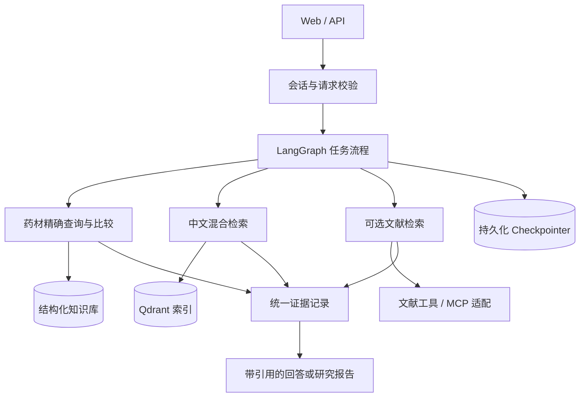

# TCM Research Agent：建设大纲与实施路线

> 文档性质：后续开发工作大纲，不代表所列能力已经实现。
> 更新日期：2026-10-18。依据：本地 ETCM2.0 数据审计、用户提供的《TCM Multi-Agent Assistant：技术栈审查与升级方案》、当前工作区代码、已保存的本地测试报告。已推送基线 `1e299cc` 包含研究工具、证据导出及 CI 修复，远程离线回归 319/319 通过；本轮查询改述已完成本地 331 项回归，远程验收按对应提交另记，Docker 运行验收与镜像发布另行完成。
> 定位：中草药知识检索与科研证据分析助手。先交付可靠的查询与证据能力，再按实际收益扩展 Agent 工作流。

## 1. 项目目标与范围

### 1.1 第一版要解决的问题

- 根据药材规范名称或别名，查询有来源的结构化信息。
- 按已存在的字段筛选药材，并对指定药材进行可复核的属性比较。
- 用中文检索原始资料，回答时提供具体记录或文档片段的依据。
- 数据不足、名称歧义、外部工具不可用时，明确说明原因与缺失信息。
- 后续接入文献工具，将本地传统知识与外部科研证据分开呈现。

### 1.2 暂不纳入范围

- 自动诊断、个体化处方、替代专业判断的用药决策。
- 没有数据支撑的药材—成分—靶点关系推断或关系填库。
- 脑肿瘤、胸片、皮肤病图像分析和语音服务作为默认启动依赖。
- 为增加技术数量引入 Kubernetes、微服务、Neo4j、Redis 或 A2A。
- 将三个业务职责强制拆成三个独立服务或每次必经的 LLM Agent。

### 1.3 业务背景与用户需求

**业务背景。** 当前本地 ETCM2.0 数据以 JSON 及结构化记录为主，药材信息包含多种名称和属性字段，但原始数据不等于面向研究者的中文知识库：专业名称不统一、中文别名映射尚待核验，字段解释与来源定位也需要保留。单纯让大模型回答容易出现实体混淆、缺失字段补造与“传统功效—现代研究结论”混用。另一方面，研究者需要把本地药材资料和公开文献证据结合，手工搜索、比对和整理耗时。因此系统需要将**精确结构化查询、可溯源的语义检索、外部证据获取和按需 Agent 编排**结合起来，而不是把 JSON 原样向量化后用聊天框包装。

**服务对象。** 面向中医药科研人员、药学相关学生和需要查阅中草药信息的研究辅助场景；不提供患者个体化诊断、治疗建议或自动处方。业务价值以**查得准、知道出处、能明确缺失、可复核**为主要目标，不以生成文字长度或 Agent 数量衡量。

**目前的数据与产品事实。** 已验证 2,076 份药材基础记录导入 SQLite，并有独立查询 API/页面支持来源 ID、拼音/拉丁/英文名查询、筛选与比较；**中文名/别名可靠映射尚未完成；原医疗聊天已接入 `/herb` 明确指令查询，已支持受限字段追问，自然语言工具规划尚未实现**。以下需求及验收必须以此为界，不能将规划能力写为已交付。

### 1.4 用户故事、优先级与需求追踪

| 需求 ID | 用户场景与期望 | 预期业务结果 | 关联阶段 | 当前状态 |
|---|---|---|---|---|
| BR-01 药材详情 | 研究者按来源 ID 或已支持名称定位药材 | 返回稳定实体 ID、字段值、缺失信息和来源定位 | M1 | 已有独立 API/页面、聊天指令查询及受限字段追问 |
| BR-02 属性筛选与比较 | 按现有字段组合筛选，或比较 2–N 种药材 | 返回满足条件的记录及逐字段差异；每项保持原始来源 | M1 | 已有实现与测试，仍需人工黄金集 |
| BR-03 中文名称与歧义解析 | 用规范中文名、别名查询，同名时识别不同基原/药用部位 | 名称映射有出处；冲突时列出候选而非静默选择 | M1 / M2 | 药典研究入口已有四组有限字形归一化与冲突拒绝；ETCM 中文名、来源别名/拼音映射仍待核验 |
| BR-04 中文自然语言知识检索 | 使用自然语言查传统属性、同类药材及资料片段 | 结构化字段优先精确查询；语义问题返回相关片段和定位 | M2 | 已有独立药典研究检索及显式 `/research`；名称/字段改述较弱，语义与混合检索对照待做 |
| BR-05 外部科研证据 | 查询某药材现代研究、PubMed 文献及不同证据类型 | 返回真实 PMID/DOI、摘要/全文可用范围、检索时间及局限 | M4 | 规划中，外部 API 不等于已有本地事实 |
| BR-06 综合报告 | 同时比较本地药材属性和现代研究材料 | 生成逐结论可追溯报告，区分传统记载、实验、临床与预测 | M2 / M4 | 已有本地本轮单药证据清单 Markdown 导出；跨药材和现代文献综合报告待实现 |
| BR-07 连续任务 | 多轮补充限定条件、追问来源或修改比较对象 | 状态隔离、上下文明确，重启后可按授权恢复 | M3 | SQLite 成功轮次快照与受限追问已实现并验证重启恢复；账户管理、跨设备与长期记忆待做 |

**优先级规则：** BR-01/02 和来源可靠性是当前 MVP 核心；BR-03/04 完成后才对外强调“中文中草药知识问答”；BR-05/06 在获得可验证文献工具和证据契约后实现；BR-07 的持久化与权限管理属于正式部署准入项。普通精确查询不应被强制升级为多 Agent 工作流。

### 1.5 可演示的端到端业务场景与验收

**场景 A：药材信息查询（现有 MVP 路径）。** 用户输入实际存在的来源 ID、拼音或拉丁/英文名 → 解析具体药材 → 读取 SQLite → 展示属性、原始字段定位和缺失项。验收时同一数据快照结果应与数据库预期一致；名称冲突不得任选一个。中文名输入需等待 BR-03 映射完成，不能提前作为已支持能力演示。

**场景 B：多条件筛选与药材比较（现有 MVP 路径）。** 用户选定已提供的筛选字段和两条或多条药材记录 → 返回符合条件的集合及并列表格 → 展开每个字段的来源。验收要求筛选条件完整生效、字段缺失和空结果单独说明、记录数和字段值可人工复核；当前筛选为字段子串与 AND 组合，不能描述为完整语义筛选。

**场景 C：中文综合问答（目标路径）。** 用户提出“比较两种药材的传统属性，并说明依据” → 规范名称解析/消歧 → 结构化对比 → 需要语义补充时才调用 Qdrant → 证据核对 → 带出处的回答。只有完成中文映射、RAG 索引及相应评测后才验收。

**场景 D：科研证据报告（目标路径）。** 用户提出“整理某药材的已发表药理研究及证据类型” → LangGraph 按需路由本地知识和文献工具 → MCP/官方文献 API 获取可查记录 → 去重与证据分类 → 报告生成与引用检查。验收要求引用可解析、外部工具失败不伪装成“没有研究”、没有全文时不虚构实验细节或页码。

**跨场景要求：** 每一次答案都应标注使用的数据快照与来源，区分结构化记录、语义相似内容与外部研究结论；允许返回“数据不足/字段缺失/名称不明确/工具不可用”。医疗与药理研究信息不得被表述为面向具体患者的诊疗决策。

## 2. 当前基线：哪些已经完成，哪些尚未证明

以下状态来自已完成的代码检查和上一轮测试，不等同于生产验收。

| 项目 | 当前状态 | 后续工作 |
|---|---|---|
| Chat / Embedding | 已改为兼容接口；聊天、嵌入真实调用成功；当前 1024 维 | 配置校验、版本记录、失败分类 |
| Tavily | 密钥验证成功，联网回退能完成 | 变成可选能力；缺密钥、超时、空结果均需降级 |
| 会话隔离 | 已传递 session_id；真实 A/B 会话测试通过 | 所有权校验、过期机制、持续回归 |
| 会话记忆 | 已以SQLite保存末轮成功快照，最近20条消息与药材槽位可重启恢复；签名Cookie默认30天，已提供删除和过期 | 账号所有权、数据库升级迁移、长期语义记忆另立范围 |
| 输出过滤 | 已传入历史；不再在测试用例中误删正确编号 | 验证其他多轮场景，不把 LLM 过滤当作事实校验器 |
| 本地 Qdrant 并发 | 单进程共享 RAG 并排队；两个并发请求成功 | 当前方案不是多进程能力，扩容前迁移服务端 |
| 来源链接 | 本地链接改为相对路径，兼容旧索引 localhost URL | 受控文件接口、片段/页码定位、逐结论引用 |
| 基础评测 | 当前含查询改述的工作区离线回归 331/331，无跳过/网络尝试；另有 ETCM 冻结集和药典检索挑战记录 | 工程回归不等于业务准确率；人工签核和全文质量验收仍待完成 |
| CI | 已有严格离线回归及 Docker 构建工作流；已补齐 PDF 预览依赖；`1e299cc` 的远程 Python 3.11.17 回归为 34 模块、319 项全部通过 | 保留跳过即失败和禁网规则；工程回归不替代私有全快照与容器运行验收 |
| 发布 | `91d1955` 的 Docker 构建成功；本机主聊天研究工具使用 7871 预览，独立研究台使用 7869 | 本机预览端口不等于 Docker 映射；最新功能未重建/验收容器，尚未发布新 Docker Hub 镜像 |
| 中草药 JSON | 已完成首轮审计；2,076 份药材基础记录已入 SQLite，CLI、独立 API 与页面已提供，筛选/比较保留来源；聊天已接入明确名称/ID查询 | 中文映射暂缓，黄金集待人工签核，药材槽位已随会话持久化，账号与长期语义记忆待完成；靶点错配待复核；使用/分发范围待确认 |
| 药典研究检索 | 413 页药材资料形成 616 个未人审候选、8,654 个字段块；提供字段出处、原页预览、可撤销 AI 修订与主聊天显式工具 | 独立研究索引与 ETCM 分开；不代表全书完成或正式知识库验收，中文名称跨库映射未建立 |
| 效果证据 | 同一已知案例回归中，药典标准问法保持 20/20；字段改述 2/8→8/8、药名变体 2/8→5/8，保留三条拼音失败和原炮制/引用保护 | 已用于规则开发，只是回归记录；不代表独立准确率、全文正确率或医疗效果 |

验收依据：[框架检验](../audits/framework_review_2026-10-09.md)、[发布镜像测试](../audits/local_release_test/status.md)、[Tavily 复测](../audits/local_release_test/tavily_retest.md)、[记忆修复验收](../audits/memory_fix/report.md)。

**记忆边界：** 已实现本地会话持久化，保留有效Cookie和同一SQLite存储即可在重启后恢复最近20条消息及药材槽位；默认闲置30天过期，可清除。不是长期语义记忆、无限历史档案、图节点级续跑或账户级同步。见 [持久化说明](PERSISTENT_MEMORY.md)。

## 3. 技术取舍与原则

| 组件 | 处理方式 | 决策依据 |
|---|---|---|
| Python、FastAPI、Pydantic | 保留 | 支撑 API、输入校验和共享契约 |
| LangGraph | 保留状态图思想，先整理状态与流程 | 精确查询不必经过通用 Supervisor；复杂任务才做编排 |
| LangChain / LangGraph 依赖 | 独立兼容性升级任务 | 固定现有基线，按官方迁移指南逐项测试，禁止直接全量升级 |
| Chat / Embedding 工厂 | 保留 | 分离服务配置与业务逻辑；索引绑定嵌入模型及版本 |
| SQLite → PostgreSQL | 单机 MVP 可用 SQLite；有多用户需求再确定 PostgreSQL | 结构化知识、checkpoint、向量数据分别管理，不混为同一职责 |
| Qdrant | 保留；本地模式用于单进程开发 | 服务端部署作为多进程和正式服务的准入条件 |
| Dense + BM25 | 做中文对照后决定默认组合 | 药名、别名、短字段与长描述分别测；核查分词与归一化 |
| 重排 | TinyBERT 为现有基线，多语言模型为候选 | bge-reranker-v2-m3 先评测，再按效果、内存和延迟决定 |
| Docling | 保留为可选 PDF 导入器 | JSON 不经过 PDF 解析链；文本问答不应依赖 OCR/CV 初始化 |
| MCP | 业务查询稳定后增加协议适配层 | 工具逻辑复用 repository/service，不在 MCP 内再写一套业务 |
| Tracing | 先结构化本地日志，再选 Langfuse 或 LangSmith 之一 | 记录证据链与阶段耗时；明确脱敏和日志保留规则 |
| RAGAS 等评测工具 | 可选补充 | 不替代人工核对、结构化精确断言或证据原文检查 |

版本说明：本文不将建议材料中的“最新版本号”作为实施承诺。升级前记录所选版本、Python 兼容性和锁文件，并在独立变更中验收。LangGraph 提供 [v1 迁移指南](https://docs.langchain.com/oss/python/migrate/langgraph-v1)；MCP SDK 官方仓库提供 [版本迁移与服务端/客户端文档](https://github.com/modelcontextprotocol/python-sdk)，实施时固定同一版本线。重排候选以 [官方模型卡](https://huggingface.co/BAAI/bge-reranker-v2-m3) 为准，不预设它一定优于当前基线。

## 4. 目标架构



关键约束：数据库是结构化事实的来源，Qdrant 是可重建的检索索引；对话记忆不能直接成为知识库事实。证据不足不应自动变成无来源的模型回答。

## 5. 数据与证据契约

### 5.1 先审计真实 JSON，再定 Schema

2026-10-10 首轮审计已完成：[数据审计报告](ETCM2_DATA_AUDIT.md)、[字段映射草案](ETCM2_FIELD_MAPPING.md)。原始路径为 `/home/zry/workspace/HDCTI/dataset/ETCM2.0`，共 48,322 个 JSON、169.284 GiB；文件数不等于唯一实体数。药材基础字段没有独立中文名/别名字段，靶点存在重复响应和身份错配，因此首批范围收敛为药材基本信息，不直接导入完整响应或构建可信关系图谱。

第一批数据审计需要输出：记录数、字段清单/类型、缺失率、重复项、别名冲突、来源覆盖率、更新方式、可使用与可分发范围。保留原文件校验和与样本，不修改原始数据。

建议字段是候选集合，不表示原数据已经具有这些信息：

| 类别 | 候选字段 | 约束 |
|---|---|---|
| 标识 | herb_id、source_id、schema_version | ID 稳定；原始 ID 可追溯；同名不同实体不自动合并 |
| 名称 | name、aliases、latin_name | 保留原名、规范名和归一化规则版本；别名可指向多个候选 |
| 本体区分 | species、medicinal_part、processing | 区分基原、药用部位和炮制品；信息不足时保持未解析 |
| 传统属性 | properties、flavors、meridians、effects、indications | 仅导入源数据实际存在的值，并保留原始表述 |
| 科研关系 | ingredients、targets、relations | 后期扩展；没有真实关系数据时不生成关系 |
| 来源 | source_type、source_record_id、source_version、locator | 结构化记录可用字段路径；PDF 可用页码/段落；网页用 URL/标题/访问时间 |

**缺失值规则：** 区分“未知/未提供”“已确认无该项”“字段不适用”。不能不加说明地用 `[]` 同时表达三者。缺失信息不允许由 LLM 自动补齐后当作数据库事实。

### 5.2 双存储与一致性

- 结构化数据库：支持名称/ID 精确查询、属性筛选、比较和统计。
- Qdrant：按实体或语义单元建立检索文本，元数据含 herb_id、source_record_id、source_version、chunk_id、字段路径或文档定位。
- 原始资料单独保存；通过允许列表或鉴权的来源接口访问，不暴露整个 data 目录。
- 导入流程需幂等：同一 source_id + version 重复导入不重复新增；更新、删除可同步到索引。
- 记录结构化数据版本和索引版本；更新失败可重试、回滚或完整重建，避免查询不同版本的数据。
- 更换嵌入模型或维度使用新集合/版本；先验证再切换，不混用旧向量。

### 5.3 统一证据对象

建议核心字段：evidence_id、entity_ids、claim、evidence_type、source_id、locator、quote_or_excerpt、publication_date、retrieved_at、limitations。

证据类型至少区分：传统记载、体外实验、动物实验、临床研究、综述/指南、计算预测、未知。类型不是自动质量评分；传统功效、实验现象和预测关联不能写成同一种已证实治疗效果。

缺少出处的记录仍可保留，但必须标为未核验；无证据回答、无结果、字段缺失、实体歧义和工具失败应返回不同状态。

## 6. 工作流与工具边界

### 6.1 按任务选择最短可验证路径

| 任务 | 首选路径 | 失败或歧义时 |
|---|---|---|
| 查询指定药材属性 | 名称解析 → 结构化查询 | 列出候选或说明字段缺失 |
| 按多条件筛选 | 受控字段过滤 | 返回条件和空结果，不由 LLM 凑名单 |
| 比较多种药材 | 多实体查询 → 字段对齐 → 比较 | 缺失字段单独标注 |
| 语义相近的传统描述 | 属性约束 + RAG | 展示相似依据，不推断可替代用药 |
| 查询现代研究证据 | 已有文献 → 可选外部文献工具 | 区分检索不到和没有研究证据 |
| 综合研究报告 | 汇总结构化事实与文献证据 → 检查引用 | 分列已知、争议和证据不足 |

### 6.2 三个业务职责，按需演进为 Agent

1. **Herb Knowledge**：实体解析、结构化查询、筛选、比较及本地检索。
2. **Literature Research**：检索、去重、保存 PMID/DOI、研究类型和可访问的原文定位。
3. **Evidence Report**：整合前两者结果，区分证据类型，输出结论与对应来源。

前两项只有在输入依赖允许、并发预算充足时才并行；报告必须等待所需证据。普通属性查询不必走全部三个模块。第一版用明确条件路由，多步骤任务稳定后再评估 Supervisor 的价值。

### 6.3 MCP 工具契约

候选工具：get_herb_detail、search_herbs、filter_herbs、compare_herbs；文献端提供检索与文献详情读取。

工具输入输出由共享 Schema 约束：返回 status、data、sources、warnings、error、dataset_version。错误代码至少覆盖 invalid_argument、not_found、ambiguous_entity、missing_field、provider_unavailable、timeout。

- 第一版工具只读；禁止任意 SQL、任意文件路径和未经约束的写库操作。
- 明确超时、结果数量、分页、重试边界和调用预算。
- 本地调试可选 stdio，服务部署再评估 Streamable HTTP；无需同时实现所有传输方式。
- PubMed 优先复用经过验证的服务；不可用时可通过官方 API 适配，不以重复造 Server 为目标。
- MCP 接入需要同时验证服务端、客户端、真实工具调用与异常分支，不以“安装 SDK”为完成标准。

## 7. 实施阶段、交付物和完成条件

优先级：P0 为正确性/数据入口/发布阻塞项；P1 为核心检索与工具能力；P2 为优化与展示；P3 为需求出现后再评估。

### M0：固定可回归的工程基线（P0）

- [x] 修复基本会话隔离、历史过滤和单进程 Qdrant 并发；保留现有测试证据。
- [x] M0-01：药典处理及持久化研究对话基线为 `91d1955`；主图 `/research` 集成、CI 依赖修复及更新后的大纲已随 `bc27ce8` 提交并 push，远程离线回归通过。私有 PDF、数据库、会话凭证未进入提交，Docker 运行与发布单列验收。
- [ ] M0-02：本轮已显式声明 next、disabled_feature，并移除路由/验证节点的嵌套 agent_state 返回及无图必经闲聊的提示冲突；完整 State/返回结构统一仍待完成。
- [ ] M0-03：复用编译后的 graph，明确应用启动/关闭、模型预热与资源释放生命周期。
- [x] M0-04：影像、语音、联网已独立配置化，默认关闭；关闭时不导入相应 SDK/CV/联网模块，不加载 CV 权重，不进入禁用路由。启用但缺密钥明确降级；13 项开关测试及实际页面/API 验证通过，见 [用法](OPTIONAL_FEATURES.md)。
- [x] M0-05：已移除 data/uploads 整目录静态挂载；公共资料逐文件白名单与哈希校验，旧引用只兼容已登记项；上传结果按匿名会话 Cookie/随机 token 隔离、限时快照。账户级鉴权仍属 M3。见 [访问策略](SOURCE_ACCESS.md)。
- [x] M0-06：离线 CI 工作流及严格测试入口已交付。保留 `91d1955` 缺 PyMuPDF/Pillow 导致 8 项跳过而失败的记录；补齐依赖后，本地隔离快照 298/298、当前代码 309/309 通过，均零跳过/零网络尝试。修复已随 `bc27ce8` push，远程 Python 3.11.17 的 33 模块、309 项全部通过，依赖一致性检查及报告上传成功。见 [运行说明](OFFLINE_CI.md)、[修复记录](../audits/ci_dependency_fix_20261018/report.json) 与 [远程验收](https://github.com/konoluluxiuda/tcm-multi-agent-assistant/actions/runs/39097002274)。

**交付物：** 基线提交、依赖锁定记录、最小文本启动配置、API/来源接口回归、CI 结果。
**完成条件：** 不配可选密钥、不提供 CV 权重也能启动文本服务；禁用功能不导致 500；未授权请求不能下载数据库、内部文档存储或他人上传内容。

2026-10-12 M0-04 验收：原应用以默认关闭影像/语音/联网的文本模式重启，禁用端点返回 403，缺密钥返回 503；启动导入阻断、启用替身和会话回归通过。详情见 [验收报告](../audits/optional_features/report.md)。M0-05 的完成情况见下方记录。

2026-10-12 M0-05 验收：38 项策略/API/上传/现有回归通过，实际主服务 87 项 HTTP 检查通过；资料清单包含 4 PDF 与 71 图像，未知或私有目录拒绝下载。匿名结果快照有效期 10 分钟，账户所有权仍待 M3。见 [验收报告](../audits/source_access/report.md)。下一项 M0-06 接入 CI。

2026-10-13 M0-06 推进：离线范围 10 个测试模块、75 项全部通过，55 个 Python 文件语法检查通过；新增入口故障测试证明跳过、断言失败及被吞掉的网络尝试均不能判为成功。保留首次精简依赖缺 Werkzeug 的失败记录与补齐后的结果，见 [验收报告](../audits/offline_ci/report.md)。2026-10-14 补充：提交 5f251ed 的 GitHub Python 3.11.17 离线回归成功，75/75，artifact 已上传；M0-06 完成。随后推进 M1-06 人工签核与 EV-02 任务候选。

### M1：中草药 JSON 与结构化查询 MVP（P0）

**前置输入状态：** 已取得本地 JSON 并审计药材/靶点全量及成分/疾病样本；字段语义、来源版本、用途与分发约束仍需进一步确认。

- [ ] M1-01：首轮数据画像、映射草案和药材可执行校验已完成；字段语义、受控词表与官方版本确认待完成。
- [ ] M1-02：药材基础信息 loader 已实现并导入 2,076 份记录；结构校验、HTML 名称提取、异常隔离、批次计数与来源定位通过；传统属性词表归一化、交叉链接配对待完成。
- [ ] M1-03：repository 的来源 ID/拼音/拉丁名/英文名精确查询和重复名称候选已完成；多条件筛选与比较已完成；中文别名仍待完成（暂缓中文名映射）。
- [ ] M1-04：SQLite 全快照幂等更新、缺失文件失效、版本隔离与批次记录已验证；文件更名迁移、完整历史修订和未来索引同步待完成。
- [ ] M1-05：已提供独立轻量查询 API（拼音/拉丁/英文名详情、字段筛选、多药材比较）与结构化展示页（分页筛选、同名候选选择、字段来源展开）；中文查询未支持（暂缓中文名映射），实际支持范围以拼音/拉丁/英文名为准。 已接入原医疗聊天的 `/herb` 名称/来源 ID 指令与资料卡；已补充受限字段追问与同名/跨会话澄清，不含模型工具规划；会话持久化已于2026-10-16补充，见 [使用与验证](TCM_CHAT_CONTEXT.md)。
- [ ] M1-06：已建立 30 项来源对照的冻结验收候选集，66 份返回记录字段/来源预期、快照指纹与评测器已交付；数据层和 Docker API 均 30/30，评测器 7 项故障回归通过。人类审核签核待完成，不以代理核对替代人工审定。

**交付物：** 数据审计、Schema、导入命令、结构化数据库、查询工具、固定测试集。
**完成条件：** 固定数据集上的精确查询/筛选/比较结果与人工预期完全一致；缺失字段不补造；重复导入不会增加重复记录；歧义名称能返回候选。

2026-10-10 实施记录：[药材 MVP 使用说明](ETCM2_MVP_USAGE.md)、[验收报告](../audits/etcm2_mvp/report.md)。新增 10 项单元测试、真实数据 26 项检查通过；同版本重复导入新增 0 条。当日完成范围仅 CLI/repository，不代表中文聊天能力已完成。

2026-10-12 实施记录：新增 `filter_herbs`（字段子串筛选，AND 组合）、`compare_herbs`（多药材字段对齐）、`_summarize`（精简视图）于 [`tcm/herbs.py`](../tcm/herbs.py)；新增独立轻量 API [`tcm/api.py`](../tcm/api.py)（`/health`、`/herbs/{name}`、`/herbs`、`/herbs/compare`、极简页），只加载 herbs repository、不依赖 CV 模型。中文名映射暂缓。repository 层 14 项单测通过；API 层测试此前未运行；现已在独立轻量环境补跑，见下方修复验收。

2026-10-12 修复验收：查询按钮全局变量冲突、筛选条件静默忽略、筛选/比较来源丢失已修复；14 项数据层测试、8 项 API 测试及 6 项真实浏览器检查通过。独立 API 无需等待 Docker 恢复。见 [API 与页面验收](../audits/etcm2_mvp/api_review_2026-10-12.md)。

2026-10-12 页面推进：新增来源 ID 查询接口与筛选分页，查询页改为结构化表格、字段比较和可展开出处；同名候选保留独立记录。见 [页面工作流验收](../audits/etcm2_mvp/page_workflow_2026-10-12.md)。中文映射仍暂缓，未接入原医疗聊天。

2026-10-12 Docker 推进：原主应用恢复为 healthy；独立药材镜像约 211 MB、运行于本机 7863，只读挂载数据库并通过 `/ready` 检查。26 项镜像内回归和 10 项本机 HTTP 检查通过。两服务均使用 unless-stopped，测试容器保持停止。见 [部署报告](../audits/docker_recovery_2026-10-12.md)。

2026-10-12 M1-06 推进：已交付 [固定验收集](../eval/tcm_golden_v1.json)、[评测运行说明](../eval/README.md)、[人工复核说明](TCM_GOLDEN_REVIEW.md) 和 [结果报告](../audits/tcm_golden/report.md)。预期不从生产查询函数生成，套件不会在评测时自动更新；快照变更时停止评测。人工签核待完成。

2026-10-14 M1-06 补充：另一独立 AI 子代理完成来源与契约复核，30 操作预期一致；保留 8 项 NBSP 展示分歧、5 项空白规范差异，5 条异常文案未独立验证。审计器新增 9 项故障/边界测试；冻结集与人工待签核状态不变。见 [AI 复核说明](TCM_AI_REVIEW.md)。后续先人工确认展示与字段语义，再推进 EV-02 真实任务候选。

2026-10-15 EV-02 推进：已按现有实现记录 [空白规范 ADR](decisions/0001-text-normalization.md)，八项查询/展示检查通过，原始分歧保留。独立 AI 已设计 [60 条任务候选](../eval/tcm_task_candidates_v1.json)，dev20/test40，全部 designed、observed=0；声明入口支持55、未支持5，不是成功数。650 个来源锚点及快照校验通过，本地工程回归90/90。见 [候选说明](TCM_TASK_CANDIDATES.md)。人工审定、真实使用题收集与逐题执行均待完成，M1-06/EV-02 不提前标为完成。

2026-10-15 EV-03 推进：基线 `7db320e` 已上传，远程90项回归通过；新增 [逐题API执行器](TCM_TASK_EXECUTION.md)，55条API题运行后46条机器检查通过、9条partial、0条失败；3条人工UI与2条聊天题未执行，任务完成率null。修复执行器的整段证据适配并保留首轮5个失败；新增10项故障测试，本地工程回归100/100。未修改原冻结集/候选预期，人工签核及真实任务效果仍待完成。

2026-10-15 浏览器补充：3条UI工作流已用真实Chromium执行通过，5条PMID显示、3条中文降级及422约束补证通过。9条partial分为能力缺口3、说明文字1、科研解释5，不自动改判业务成功。累计58题执行过API或浏览器检查，聊天2题未执行，人类签核与任务完成率仍未取得；见 [验收说明](TCM_TASK_UI.md)。下一步可接入已有名称/ID的聊天查询工具，中文映射仍暂缓。

2026-10-15 聊天集成：M1-05 新增明确 `/herb` 指令分支，直接读 SQLite，显示字段出处和同名候选，不经模型改写；数据库不可用返回结构化503。109项离线回归、6项合成浏览器及5项真实快照检查通过，原冻结集30/30且快照未改。该检查不替代原2条聊天上下文候选，人类签核与任务完成率仍待取得。下一步建立结构化会话实体状态并验证追问与跨会话隔离。见 [交付范围](TCM_CHAT_LOOKUP.md)。

2026-10-15 会话上下文：新增明确的来源ID/版本/SHA槽位及字段追问，普通话题、失败和清除指令会结束焦点，来源变更要求重选。按原问句通过主应用执行原2条聊天候选的future_target，冻结候选不改；累计60题有执行记录，不等于60题业务成功，原9条partial及人工签核仍待处理。119项工程回归、11项合成与10项真实快照浏览器检查通过，原冻结集30/30。下一步整理人工复核与真实问题采集，确认后再决定模型规划/检索实验。见 [交付说明](TCM_CHAT_CONTEXT.md)。

### M2：中文检索与证据定位（P1，依赖 M1）

- [ ] M2-01：生成字段感知的检索文本；JSON 使用字段路径定位，PDF 使用文档定位。已从 MinerU 的 413 页药材资料解析 616 个未人审候选，并建立 8,654 个字段块的独立研究索引，保留来源 SHA、页码、坐标和原始 OCR。另有 11 条可撤销 AI 修订，均未获人工批准；全书处理、全文质量验收及正式知识库导入仍未完成。见 [MinerU 接入记录](MINERU_RESULTS_IMPORT.md)、[标题修复](MINERU_HEADING_RECOVERY.md) 和 [研究页面](MINERU_RESEARCH_UI.md)。
- [ ] M2-02：为切块与上下文设置真实长度上限；不要仅依赖提示词中的“512 词”。
- [ ] M2-03：核查中文分词、药名/别名归一化；比较 dense-only 与 hybrid。已在药名/字段路由增加有限字段改述、四组字形对应、碰撞拒绝及解析轨迹，已知回归字段改述 8/8、药名变体 5/8；不猜拼音/别名，不以母药替代炮制品。来源映射、全面消歧和混合检索实验仍待完成，见 [查询说明](MINERU_QUERY_FORMS.md)。
- [ ] M2-04：比较无重排、现有重排、多语言重排候选，记录内存、耗时与质量。
- [ ] M2-05：返回 evidence_id、chunk_id、定位信息；答案中每项关键结论能映射证据。研究卡片已有字段、来源和原页定位；现已提供本轮单药证据清单 Markdown 导出，保留双版本文本、修订/未人审状态、缺失项、截断和未展开引用。生成式报告的逐结论核对仍待实现，见 [导出说明](RESEARCH_EVIDENCE_EXPORT.md)。
- [ ] M2-06：分开记录检索分数、重排分数和证据充分性；不把异构分数平均当正确概率。
- [ ] M2-07：用中文固定集比较简单 RAG 与额外步骤的增益，只有增益明确的步骤进入默认链路。

**交付物：** 索引器、索引版本记录、证据 Schema、中文检索对照报告。
**完成条件：** 对相同数据/问题报告 Recall@k、MRR/nDCG、证据定位正确性与延迟；保留/替换方案由结果决定。阈值在基线完成后冻结，不能事后挑选有利样本。

2026-10-16 OCR前置：用户提供两份2025一部扫描件。已确认434页文件相较2058页文件范围较窄并有印刷27→30的跳页；以四味已有ETCM药材做跨栏、跨页和补页试验，21/21预录片段命中，整页基线79次串栏交替。后验查到拼音、学名与中文植物名错字，保留原始OCR，不将片段命中率当全文准确率。未导入生产知识库、未更新中文映射，下一步先做带坐标的字段候选和异常隔离。见 [试验报告](PHARMACOPOEIA_OCR_PILOT.md)。

2026-10-17 字段候选：从既有四药手工区域提取36字段位置，33有候选、3未观察到注意项；保留跨栏/跨页坐标并生成33张原图裁剪。新确认两处功能主治错字，加上既有标记，三条隔离、一条待人审、零条批准。提供只读字段查询/本地复核页，未导入生产；25项实际查询、7项浏览器、140项工程回归及原30条冻结验收通过。修复漏句号吞入采收描述，保留原始OCR。见 [交付说明](PHARMACOPOEIA_FIELD_CANDIDATES.md)。

2026-10-17 MinerU适配：五卷413页生成612个未人审药材/饮片候选，按坐标修复部分JSON块的阅读顺序，保留来源SHA、原页码、块坐标和字段字符区间。357条跨页、4条跨卷，111张裁图均关联；26条触发复核标记，候选数与未标记状态不代表全文正确性。新增11项回归，与原切分测试合计37项通过，重建SHA稳定、输入篡改被拒绝。未修改ETCM或接入正式检索。下一步核对异常并独立抽查未标记条目，形成带页码的研究检索验收样本。见 [MinerU接入记录](MINERU_RESULTS_IMPORT.md)。

2026-10-17 MinerU复核与v2：对26条标记和固定规则抽取的14条未标记候选进行局部AI原图对照，发现药名错字、标题漏行、来源/用法字词差异和caption混正文；未标记的秦艽也被识别为秦芫，保留漏报记录。已修复蜂蜜页跨栏表格排序及字段归属，原始块不变、其他611候选不变；42项相关测试通过，v2重建SHA稳定。11条修订提案尚未应用，零人审批准、未导入正式库。下一步建立来源修订覆盖层、修复caption字段边界，再用新样本验证。见 [复核说明](MINERU_REVIEW.md)。

2026-10-17 MinerU v3与研究修订：按layout子段坐标恢复18个caption/脚注元素（780字符），其中金银花6段正文恢复到检查/含量测定；612条标题及原始块归属不变。11条AI提案已作为可撤销覆盖应用于独立研究视图，保留原值、证据SHA和未人审状态，不更改原始OCR、ETCM或正式索引。56项相关回归通过，单条/全部回滚、重复构建及证据篡改拒绝已验证。下一步以新问题建立本地检索/引用基线，已知失败作为回归，避免把规则调优样本当独立验收。见 [修订层交付](MINERU_REVISIONS.md)。

2026-10-17 研究检索基线：独立SQLite FTS5索引含612候选/8650字段块；固定20个新编问题、4个范围/缺项问题及4个回归，AI来源辅助参考未人审。新问题前5证据命中为BM25 18/20、药名字段20/20，但无歧义首位仅13/20、18/20；范围状态0/4、4/4。65项工程回归通过、索引SHA重建一致。原图确认白头翁两标题块缺text_level，正文被并入白术，此为P0阻断入库问题，不将命中率当验收。下一步修复无级别标题边界、扫描同类漏切，处理稳定来源身份及修订重基，再重建索引。见 [基线及失败清单](MINERU_RETRIEVAL_BASELINE.md)。

2026-10-17 缺级别标题修复：v4用标题组合、版面和来源句佐证恢复木棉花、白头翁、半边莲、满山红，候选612→616，四条原图首尾已AI核对，未做人审。改用绑定原标题来源的稳定ID，612旧标题唯一迁移、11条修订按原始目标跨度重基，原blocks SHA不变。新版索引8654字段块；原20题字段路由无歧义首位18→20，BM25仍前5命中18题，不调整排名参数。78项工程回归及解析/修订/索引重建SHA检查通过，原基线保留。下一步接入只读研究页面及原页证据预览，使用新问题继续验证。见 [修复与来源迁移](MINERU_HEADING_RECOVERY.md)。

2026-10-17 研究页面：新版616候选、8654字段接入独立7869只读页面，可对照OCR原文/AI修订并查看字段/标题的原PDF物理页红框证据。分册/全本来源SHA验证、文件变化拒绝和并发只读通过；86项工程回归、9组真实浏览器检查通过。旧页面保留，全部仍未人审，未接入正式聊天或发布Docker镜像。下一步冻结新增问题及证据参考，验证别名、炮制范围与失败分支，M2全文质量验收仍未完成。见[研究页面](MINERU_RESEARCH_UI.md)。

2026-10-18 新问题挑战：冻结50个AI问题并核对43处原图锚点；药名字段标准问法前5命中20/20，字段改述2/8、药名变体2/8。4个无独立炮制条目全部直接返回母药，未知复合名误匹配灵芝；炙甘草命中字段但跨条目引用未解析。新增8项测试后相关工程回归94项通过，未改检索器/索引/正式库。下一任务为P0炮制范围保护、未知名称误匹配和引用未展开状态；本批只可用于后续回归，M2仍未完成。见[50题挑战报告](MINERU_CHALLENGE_V1.md)。

2026-10-18 查询保护：增加炮制范围未解析、名称上下文和引用未展开保护，空标题/引用移出有效命中并在页面单列来源。104项工程回归、12组浏览器检查通过；已知4个炮制品误替代被阻止，药名字段范围检查6/6，旧20题保持20/20。繁体拼音/改述能力未扩展，同字段多范围、引用自动展开仍未实现。下一步转向独立研究聊天工具调用与追问/重启恢复，按状态拒绝补缺或代换；M2仍未完成。见[检索保护](MINERU_RETRIEVAL_GUARDS.md)。

2026-10-18 独立研究对话：新增7869/chat，确定性工具路由支持药材焦点、追问和出处回查；独立SQLite会话复用原完成轮次存储，保留20消息/30天，绑定来源与策略版本。120项研究侧及30项主存储/图会话/ETCM兼容测试通过，8组聊天浏览器检查实际关闭重启服务与浏览器后追问成功，原研究台12组通过。未使用LLM、未新增LangGraph图或接入主聊天。下一步可封装现有Agent显式研究工具，先维持状态契约，避免模型补缺；M2人工/全文质量验收与主应用融合仍未完成。见[研究对话](MINERU_RESEARCH_CHAT.md)。

2026-10-18 主图研究工具：现有LangGraph新增显式/research分支，复用确定性ResearchTool并提供主聊天证据卡/原页接口；默认关闭，不让模型自主调用或补缺。ETCM与研究焦点分离，旧快照可读，切换任务清焦点；真实主服务重启可恢复追问。161项相关工程回归，新主页面6组、ETCM13组、独立研究8组浏览器检查通过。本机7871可体验，未改Docker。下一步按研究需求补字段/名称改述或证据清单输出，不扩框架；M2全文/人工质量验收仍未完成。见[主Agent研究工具](AGENT_RESEARCH_TOOL.md)。

2026-10-18 证据清单：主聊天、独立聊天和研究台已提供本轮单药字段 Markdown 导出，服务端按索引 SHA 重新检索并校验来源，不接收客户端证据、不写会话、不调用模型。原文/修订、出处物理页与坐标、缺失/截断/引用未展开分别保留；炮制范围不明仅列母条目标题。新增10项测试，完整离线319/319、主页面8组与独立入口10组浏览器检查通过。此轮代码、文档与验收摘要纳入本次提交，尚未推送，Docker未更新，M2全文/人审验收仍待完成；下一开发项为M2-03字段改述与药名变体。见 [导出说明](RESEARCH_EVIDENCE_EXPORT.md)。

2026-10-18 查询改述：新增“多少克、剂量、药效、储藏、使用警示、取自哪一部分”等字段定位，以及黃/黄、黨/党、參/参、烏/乌四组查询字形归一化。保留真实索引名称、原始问题和映射轨迹，字形碰撞要求消歧；不改分词配方/索引，拼音与错字不猜测。冻结50题已知回归字段改述2/8→8/8、药名变体2/8→5/8，标准20/20、范围外6/6、炮制保护4/4保持；三条拼音失败与炙甘草未展开引用保留。331项离线及主页面10组、独立入口11组浏览器检查通过。本次交付包含代码、文档及本地验收摘要，远程状态以对应提交CI为准；Docker未更新，M2-03整体仍未完成。见 [查询说明](MINERU_QUERY_FORMS.md)。

### M3：会话持久化与依赖迁移（P0/P1，与 M1/M2 可独立推进）

- [ ] M3-01：在独立变更中选择并锁定兼容的 LangGraph/LangChain/checkpointer 版本，记录迁移清单。
- [ ] M3-02：已实现本地匿名签名Cookie、凭证散列会话键及持久密钥；账号所有权、conversation_id与用户级会话管理仍待设计。
- [ ] M3-03：已实现独立SQLite末轮快照并通过实际服务/浏览器重启恢复；未采用原生checkpointer，选择与框架迁移仍待独立评审，已有Schema v1保护但未实现升级迁移。
- [ ] M3-04：已实现默认30天闲置过期、近期20消息保留、服务器删除及防旧请求复活；不保存历史checkpoint。已隔离会话凭证，进一步敏感字段脱敏及备份保留策略待完成。
- [ ] M3-05：暂不建立长期个人画像；如需长期偏好/研究项目记忆，另立显式存取和删除契约。
- [ ] M3-06：只有保留人工审核需求时才实现 interrupt/resume；否则关闭现有伪审批入口。

2026-10-16 实施：采用SQLite成功轮次JSON快照，保存近期消息和明确药材槽位；签名Cookie随数据库持久化，页面自动恢复，清除接口实际删除服务端内容。129项离线回归、13项合成与12项真实快照浏览器检查通过，包含真正结束/重启服务和浏览器及删除后重启检查；原2条聊天候选通过，冻结集30/30。Docker因当前WSL未启用集成，仅提供持久卷Compose及静态检查，未完成容器验收或镜像发布。见 [交付说明](PERSISTENT_MEMORY.md) 与 [ADR](decisions/0002-completed-turn-memory.md)。

**交付物：** 依赖锁文件、迁移说明、持久化会话实现、重启/越权/删除/并发回归。
**完成条件：** 重启恢复指定会话；不同用户不能读取对方会话；删除后无法从旧 checkpoint 恢复；升级后 M0–M2 回归不退化。未完成前不宣称长期记忆。

### M4：MCP 与文献证据工作流（P1，依赖 M1；综合报告依赖 M2）

- [ ] M4-01：把已有中草药 service 暴露为 MCP 工具，保证直接调用与 MCP 调用结果一致。
- [ ] M4-02：接入并验证 PubMed 文献工具，保存检索式、日期、PMID/DOI、来源和证据范围。
- [ ] M4-03：文献去重；摘要与全文分别标记，未取得全文时不编造页码或全文结论。
- [ ] M4-04：实现药材比较与证据报告工作流；限定工具次数、时间和成本。已有 M2-05 本地本轮单药证据清单，不依赖新增文献工具；跨药材工作流及本地与现代文献综合报告须等待后续契约与 M4-02/03 的真实文献证据完成。
- [ ] M4-05：引用检查、证据类型检查和工具失败回退；文献文本作为数据而非执行指令。

**交付物：** MCP Server/Client、工具契约测试、文献适配器、示例报告和完整调用轨迹。
**完成条件：** Schema 校验、错误分支和调用预算测试通过；报告能追溯到本地记录与真实文献；工具失败时不会包装成“没有相关研究”。

### M5：可重复部署与发布验收（P1/P2，持续建设、最后验收）

- [ ] M5-01：选定 tracing 方案，记录阶段耗时、路由、检索命中、工具错误、token 用量和数据/模型版本。
- [ ] M5-02：服务化 Qdrant 与所选持久存储；提供 Docker Compose、健康与 readiness 检查。
- [ ] M5-03：精简 CV/OCR/语音可选依赖；模型缓存显式管理，避免每个新容器都冷下载。
- [ ] M5-04：开发/生产配置、鉴权、限流、超时、日志脱敏、备份/恢复与数据迁移说明。
- [ ] M5-05：固定代码/模型/数据版本；构建版本化镜像，在不挂载源码的条件下验收。
- [ ] M5-06：整理 README、架构图、演示与实测报告，只描述已验证能力。

**交付物：** 部署配置、CI 流水线、版本化镜像、运行手册、发布记录。
**完成条件：** 干净环境可重现；镜像不含密钥/上传资料/私有数据；关键流程通过；失败率、p50/p95 延迟和调用成本都有原始记录。正式发布前完成来源与会话访问控制。

## 8. 评测贯穿各阶段

| 维度 | 测试内容 | 不接受的替代指标 |
|---|---|---|
| 结构化正确性 | 精确结果集、字段缺失、别名冲突、幂等导入 | 模型自称答案正确 |
| 检索 | 片段级 Recall@k、MRR/nDCG、中文实体与别名 | 只看命中文件名 |
| 回答 | 关键结论是否被证据支持、引用定位、拒答合理性 | 单纯英文关键词重合率 |
| 工具 | 工具选择、参数合法性、失败处理、预算 | 只验证 SDK 能 import |
| 记忆 | 同会话回忆、跨会话隔离、重启恢复、删除 | HTTP 200 或“已记住” |
| 工程 | 冷/热启动、并发、超时、p50/p95、成本 | 单个成功请求的耗时 |

测试集分层：结构化黄金集、中文检索集、多轮/歧义/无答案集、文献引用集、工具故障与并发集。先做小样本工程筛查，再扩充并冻结独立测试集；开发集用于调参数，测试集避免反复调优泄漏。

对照顺序：结构化直接查询 → 简单 RAG → hybrid → 重排 → 查询扩展 → 完整工作流。同一数据快照和题集，控制预热、上下文与模型参数；人工判断和 LLM judge 分开报告。

### 8.1 从工程通过走向业务效果证据

实施细则见 [项目证据与实验计划](PROJECT_EVIDENCE_PLAN.md)：先收集并审核 60 条任务候选，区分真实使用题与设计题、开发集与保留测试集；现有 30 项冻结候选继续作为工程契约验收，不替代真实任务评测。分别报告能力覆盖率、任务完成率、引用定位与结论支持、延迟、调用成本和失败分类。未支持任务、未运行项和未知成本必须单列。

后续遵循 EV-01–05：M0-06 离线 CI → M1-06 人工签核与任务候选 → 轻量 API 实测记录 → M2 检索/重排对照 → 聊天集成后的工作流收益验证。中文映射仍暂缓，中文 RAG 与文献任务未完成前不宣称效果；只按实际方案和原始记录撰写成果。

2026-10-17 PDF解析对照前置：固定20个扫描输入页，RapidOCR与PP-StructureV3均完成20/20；既有21片段分别命中21/21和20/21（后者少一处句末句号），单次页面处理154.171秒与1025.665秒。保留内存分配及MKL-DNN两次失败记录；限制检测尺寸、识别批量并关闭加速路径后完成CPU运行。发现专业词仍有旧错字和新错字，保留RapidOCR基线，Paddle仅作为离线复核候选。全文准确率/阅读顺序准确率仍为空，人工签核与M2-01正式索引未完成。见 [对照报告](PHARMACOPOEIA_PDF_BENCHMARK.md)。

2026-10-17 双引擎字段复核：复用20页实验结果生成四味药36字段位置，20原值一致、7归一化一致、6文字差异、3双方未观察到注意项；输出33张字段证据图与8张完整区域图，提供并排高亮页面和与结果SHA绑定的36项空白人工转录模板。154项离线回归、8项真实浏览器检查通过。人工参考和批准字段仍为0，未导入生产；下一步核对完整字段并回收人工转录，M2-01仍未完成。见 [复核说明](PHARMACOPOEIA_DUAL_REVIEW.md)。

2026-10-17 原图诊断：逐处核对六个文字差异字段，生成六份明确标记为AI的转录草案；修复大腹皮页脚·28·混入来源，保留双方原始行与排除原因。独立新版保留OCR/AI/人工参考三者的状态边界，人工参考和批准字段仍为0；159项离线回归、10项浏览器检查通过。后续补齐其他字段参考并回收人工核对，未导入正式索引。见 [视觉诊断](PHARMACOPOEIA_VISUAL_TRIAGE.md)。

2026-10-17 目标字段转录覆盖：读图补齐四味药9类目标字段，33份AI草案与3条有限区域缺失观察，来源/图片SHA和目标覆盖校验；缺失注意项不变成无禁忌或空白参考。原始OCR、人工参考状态及历史草案保留；162项离线回归、11项浏览器检查通过。人工参考与批准均0，M2-01正式索引未完成。见 [覆盖报告](PHARMACOPOEIA_FULL_REVIEW.md)。

2026-10-17 可扩展审核流程：按用户反馈移除研究功能的全量人工签核门槛，实现独立机器质检、人审状态和使用范围；36字段中28可进入词法研究索引、5异常复核、3未知，另分层抽6项。SQLite只读检索和本地API/页面可用；策略变化拒绝旧索引，不使用AI草案作为放行依据。170项离线回归、10项浏览器/API检查通过。仅四药手工区域验证，人工批准仍0，实际工作量降低比例未估算；正式聊天RAG及全书自动边界未完成。见 [自动质检](PHARMACOPOEIA_AUTOMATED_QC.md)。

2026-10-17 自动切分与续跑：固定9页，复用5页并新增OCR 4页，自动得到10个未审核条目；8个止于下一标题、人工牛黄和山茱萸仍未闭合。保留饮片及附属标准范围、原始行证据与页级缓存；实际分两批处理，最终重跑9页缓存命中、0页新增OCR，结果SHA稳定，182项离线回归通过。发现并修复“本品由”开头漏切，新增页面已用于调规则，不报告独立准确率。下一步冻结规则并以未参与开发的30–50页验证边界、异常与缺页，再批量处理完整章节；M2-01仍未完成。见 [批处理说明](PHARMACOPOEIA_BATCH_EXTRACTION.md)。

2026-10-17 章节版式检查：抽查11页，确认两个扫描件的药材正文对应样页均为双栏、凡例样页存在单栏；按章节复用配置，不能整份文件统一切栏。重叠药材章节优先清晰扫描件，已核实缺页再由全本补充；制剂、提取物、索引需独立适配。批处理新增章节声明及混版拒绝，旧九页仅允许原样历史重放，见 [章节版式说明](PHARMACOPOEIA_CHAPTER_LAYOUT.md)。

2026-10-17 三十页冻结验证：新取药材章节前/中/后三组30页，原生OCR完成；相对44处未人审AI参考检出36处、漏8处，另2处名称差异。主评估退出2，边界验证未通过；事后定位7个已有候选被跨药串接，另2个身份差异，形成9候选复核清单。来源句式不足、OCR漏整行、中文标题漏字均需处理；不启动全章抽取。192项离线回归、缓存稳定性与篡改拒绝通过，原PDF/ETCM未改。下一步以这30页作失败回归，修复边界后另取新页面验证；M2-01仍未完成。见 [冻结验证说明](PHARMACOPOEIA_BOUNDARY_VALIDATION.md)。

2026-10-17 边界恢复：最终v5解耦条目与来源识别，残缺标题/括号别名/乱码拼音及中文标题整行缺失分别保留未知身份，不自动补药名。已知30+8+4页回归对应44+14+7处标题，原名称错误仍保留；新8页与4页暴露的2+1处失败也保留历史。最终另取4页、6处AI参考标题全部对应，未见边界失败；203项离线回归与缓存稳定性检查通过。原PDF、ETCM和三组失败基线未改。下一步对异常区域局部重识别并验证未知身份隔离，再逐批扩展章节；M2-01仍未完成，见 [边界修复说明](PHARMACOPOEIA_BOUNDARY_REPAIR.md)。

2026-10-17 药材章节PDF准备：单独导出413页高清补页版和413页全本原扫描参考版，补入已知缺失的印刷28、29页，排除其他章节。高清版另分5卷，均低于180,000,000字节，逐页来源JSON/CSV可追溯；原图未重采样、未进行OCR、未外部上传，7个PDF的1239个页面实例均与选定来源一致。下一步以该章节准备成熟解析器的难例对照；完整性/真实性未宣称官方认证。见 [药材PDF导出](PHARMACOPOEIA_HERB_PDF_EXPORT.md)。


## 9. 建议目录与改动落点

以下是待新增/调整的建议，不表示目录已存在。第一阶段按功能新增，避免一次性搬迁整个仓库。

```text
agents/
  agent_decision.py          # 逐步整理状态、路由和生命周期
  runtime.py                # 当前会话/RAG 单进程运行管理
  source_links.py            # 当前链接兼容；后续适配受控来源接口
  herb_agent/               # 药材查询与检索编排
  literature_agent/         # 文献任务编排
  report_agent/             # 证据报告编排
  rag_agent/                # 保留并逐步完善检索组件

tcm_data/
  schemas.py                # 数据/来源/证据契约
  json_loader.py            # 导入、校验与审计
  herb_repository.py        # 结构化查询
  service.py                # API 和 MCP 共用的业务层
  rag_indexer.py            # 幂等索引与版本管理

mcp_servers/
  herb_server.py            # 只读业务工具适配
  pubmed_adapter.py         # 复用已有服务或官方 API

evals/                      # 与已有 eval_rag.py/compare_rag.py 逐步整合
  datasets/                 # 可公开的小型测试集；敏感资料不入库
  evaluate.py
  rubrics.md

tests/                      # 延续已有测试；新增数据/工具/集成测试
migrations/                 # 结构化数据和会话存储迁移
docs/                       # 本大纲、契约、ADR、运行手册
compose.yaml                # 待选定服务依赖后新增
pyproject.toml              # 迁移时明确与 requirements/锁文件的唯一来源
```

每个阶段更新一条决策记录：问题、候选、选择、证据、取舍、回滚方法。测试记录仍可保留在 audits/，不要把一次试验结果误当正式基准。

## 10. 待确认输入与第一批可执行任务

### 10.1 必要输入

| 输入 | 用于决定 | 未提供时的处理 |
|---|---|---|
| 实际 JSON 已提供；字段语义和快照版本待补充 | 已有清单、全检/抽样报告与映射草案 | 初期保留源字段语义，未知值不推断 |
| 数据来源与使用/分发范围 | 来源记录、部署和镜像内容 | 原数据不打入公开镜像 |
| 目标问题样例 | 结构化/语义/文献任务优先级 | 先实现查详情、筛选、比较 |
| 部署 CPU/GPU/内存与并发需求 | 重排选型、缓存和服务化 | 以单机开发为基线，不承诺容量 |
| 是否需要登录、重启恢复、跨设备使用 | 会话所有权与持久化 | 清楚标注匿名短期会话限制 |

### 10.2 当前下一步顺序（2026-10-18）

1. **M0-01/06：当前版本收尾已完成。** `bc27ce8` 已提交并 push，主图研究工具与 CI 依赖修复在远程 Python 3.11.17 上 309/309 通过。下一项开发为下述 M2-05；Docker 构建与运行验收、镜像发布仍须分别记录。
2. **M2-05：本轮单药证据清单已提交推送。** 可导出 Markdown，包含药材名称、字段、来源版本/页码、原文与修订区分、未人审状态及缺失/未展开引用；无证据不补写。已随 `1e299cc` 推送并通过远程 319 项回归；不代表综合报告或 Docker 已交付。
3. **M2-03：有限查询改述已本地实现。** 已改善字段表达及四组药名字形，并记录既有失败的回归变化；保留拼音未解析、字形冲突与炮制保护。本次交付包含受控规则和本地验收；后续名称映射需有来源，不能以猜测或扩大测试题数量代替功能。中文分词/混合检索对照另立实验，不宣称本阶段整体完成。
4. **M5-03/05：验证容器中的完整使用路径。** 明确研究预览依赖、只读资料挂载、会话持久卷与开关；在不挂载源码的镜像中验证查询、出处预览和重启恢复，再进行版本化发布。
5. **按实际需求推进 M4-02/03 与 M3 剩余项。** 需要现代研究证据时再接 PubMed；正式多用户部署前补所有权、迁移及备份策略。MCP、框架依赖升级和原生 checkpointer 单独评估，不阻塞现有工具交付。

当前测试与失败记录足以支撑上述功能开发，不再以扩充测试题数量作为默认下一步。人工签核、全文质量验收和未来独立效果验证仍保留为未完成项，不以工程回归替代。

## 11. 扩展条件与完成定义

已取得的 ETCM2.0 本地快照作为首批数据源；审计数量仅描述本地文件，不代表官方实体总量。本文不假定存在稳定可调用 API。只有取得可使用的数据、明确信息版本及关系证据后，再开启成分、靶点、疾病关联分析。图数据库是否需要由真实关系查询决定。

一个任务只有同时具备以下内容才标为完成：代码/Schema 或文档交付物、可重复测试、真实失败分支、对应来源/版本记录、明确限制。模型调用成功、HTTP 200、截图或演示视频均不能单独替代功能验收。

后续每次开发从本大纲选取任务 ID，报告“完成项、验证、未完成项、下一依赖”。不重复开发已修复功能，也不把未来计划写成当前成果。
